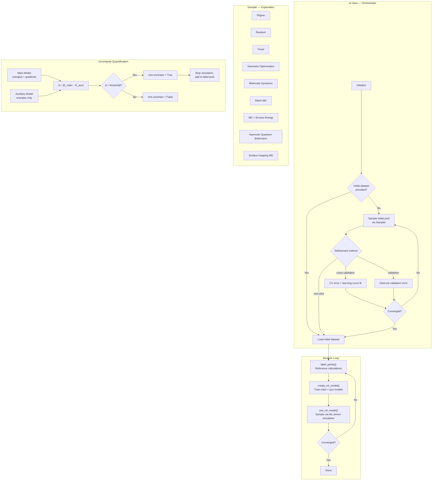

The Active Learning (AL) pipeline in MLatom automates the construction of machine learning potential energy surfaces by iteratively expanding a training set with configurations sampled from molecular dynamics, geometry optimizations, or other simulations. At its core, the system uses a **dual-model uncertainty quantification (UQ) strategy**: a main model trained on energies and gradients, paired with an auxiliary model trained on energies only. Disagreement between the two models identifies high-uncertainty geometries that require labeling with a reference quantum chemistry method, closing the feedback loop that drives efficient data acquisition.

Sources: [al.py](mlatom/al.py#L16-L17), [al_utils.py](mlatom/al_utils.py#L9-L10)

## Pipeline Architecture

The AL pipeline is orchestrated by the `al` class and decomposed into clearly separated concerns across three modules. The `al` class manages the overall iteration lifecycle and state persistence, the `Sampler` class encapsulates exploration strategies for discovering new configurations, and the `ml_model` / `ml_model_msani` classes handle model training, prediction, and uncertainty quantification. A lightweight stop-function mechanism bridges prediction and sampling by terminating simulations when a molecule is flagged as uncertain.



Sources: [al.py](mlatom/al.py#L378-L426), [al_utils.py](mlatom/al_utils.py#L1254-L1260), [al_utils.py](mlatom/al_utils.py#L2492-L2494)

## The `al` Class — Orchestrating the Loop

The `al` class is the central coordinator. Its constructor accepts a wide range of keyword arguments covering every aspect of the pipeline — from the reference method to the sampling strategy to convergence criteria — then immediately launches the main loop unless debug mode is enabled. State is persisted across restarts through an `al_info.json` file and per-iteration subdirectories under `iterations/`.

### Constructor and Configuration

All configuration flows through keyword arguments. The constructor establishes sensible defaults for common parameters while requiring an explicit `reference_method` (a quantum chemistry method for labeling). The `molecule` argument, if provided, triggers automatic geometry optimization and frequency calculation via `optfreq()` to produce the equilibrium structure used as the origin for initial condition sampling.

| Parameter | Type | Default | Description |
|-----------|------|---------|-------------|
| `job_name` | `str` | `'AL'` | Prefix for output files |
| `reference_method` | model instance | *(required)* | Quantum chemistry method for labeling |
| `baseline_method` | model instance | `None` | Baseline for delta learning |
| `molecule` | molecule | `None` | Equilibrium geometry (triggers opt+freq) |
| `initial_dataset` | molecular_database | `None` | Pre-built dataset (skips initial sampling) |
| `initial_points_refinement` | `str` | `'cross-validation'` | Strategy: `'cross-validation'`, `'validation'`, or `'one-shot'` |
| `init_ncvsplits` | `int` | `5` | CV splits for cross-validation refinement |
| `init_RMSE_threshold` | `float` | `None` | RMSE target to stop initial sampling |
| `init_train_energies_only` | `bool` | `True` | Energy-only training during initial sampling |
| `ml_model` | `str` or class | `'ml_model'` | ML model class (`'ANI'`, `'KREG'`, `'MACE'`, `'msani'`, `'delta_msani'`) |
| `device` | `str` | auto-detect | `'cuda'` or `'cpu'` |
| `validation_set_fraction` | `float` | `0.1` | Fraction held out for validation during training |
| `reuse_previous_model` | `bool` | `False` | Skip retraining if model file exists |
| `train_model_from_scratch_interval` | `int` | `5` | Retrain from scratch every N iterations |
| `sampler` | `Sampler` or `str` | `Sampler('batch_md')` | Exploration sampler |
| `new_points` | `int` | `None` | Max sampled points per iteration |
| `min_new_points` | `int` | `5` | Convergence threshold for new points |
| `max_iterations` | `float` | `inf` | Hard cap on iterations |
| `init_sampling_only` | `bool` | `False` | Exit after initial point sampling |

Sources: [al.py](mlatom/al.py#L50-L376)

### The Main Iteration Loop

The `main()` method implements a straightforward while-loop that continues until convergence or the maximum iteration count is reached. Each iteration executes four sequential phases, and timing is reported for each:

1. **Label** — `label_points()` sends the molecular pool to the reference method for energy and gradient calculations, using parallel execution when `label_nthreads > 1`.
2. **Train** — `create_ml_model()` splits the accumulated labeled database into training/validation sets, trains both the main and auxiliary models, and computes the UQ threshold on the validation set.
3. **Sample** — `use_ml_model()` runs ML-driven simulations (MD, geometry optimization, etc.) using the newly trained model. Simulations are stopped early via the stop function when a molecule is flagged as uncertain, and those molecules are collected into the next pool to label.
4. **Convergence check** — If the number of newly sampled points falls below `min_new_points`, the pipeline declares convergence and exits.

> [!TIP]
> The pipeline supports **restart from any iteration**. On startup, if `al_info.json` exists with a non-zero `iteration` count, `main()` reconstructs the labeled database by loading all `labeled_db.json` files from prior iteration directories, then resumes the loop from the recorded iteration number. This makes long-running active learning jobs resilient to interruptions.

Sources: [al.py](mlatom/al.py#L378-L426)

## Initial Data Pool Sampling

Before the iterative loop begins, the pipeline must establish a seed set of labeled configurations. Three strategies control how this initial pool is built, selectable via the `initial_points_refinement` parameter.

### Cross-Validation Refinement (Default)

This is the most rigorous approach. It alternates between sampling a batch of new initial conditions (via the `initdata_sampler`) and evaluating model quality through k-fold cross-validation. A learning curve is fitted to the sequence of `(Ntrain, RMSE)` pairs using a power-law model `eRMSE = a · N^b`. Sampling stops when the predicted improvement from adding `init_ntrain_next` more points drops below 10% of the current error — that is, when `[e(N) − e(N+ΔN)] / e(N) < 0.1`. This ensures the initial pool is large enough for meaningful model training but avoids wasteful over-sampling.

Sources: [al.py](mlatom/al.py#L462-L543)

### Validation Refinement

Analogous to cross-validation, but uses a single random hold-out split (controlled by `init_validation_set_fraction`, default 0.2) instead of k-fold. The same learning curve convergence criterion applies. This is faster per iteration since only one model is trained instead of `init_ncvsplits` models.

Sources: [al.py](mlatom/al.py#L575-L597)

### One-Shot Sampling

The simplest strategy: sample initial conditions once via the `initdata_sampler`, label them all with the reference method, and proceed directly to the iterative loop. No quality assessment or adaptive expansion occurs. This is useful when the user has domain knowledge about an appropriate initial set size.

Sources: [al.py](mlatom/al.py#L600-L617)

### Alternative: Pre-built Initial Dataset

If an `initial_dataset` (a `molecular_database` instance) is provided, all sampling is bypassed entirely. The pre-built dataset is saved as `init_cond_db.json` and used directly as the molecular pool to label. This supports workflows where training data has been curated externally.

Sources: [al.py](mlatom/al.py#L437-L445)

## Sampling Strategies — The `Sampler` Class

The `Sampler` class in `al_utils.py` acts as a strategy dispatcher. It accepts either a string identifier or a callable, mapping string names to built-in sampling methods. Each method generates a molecular database of configurations, annotates each molecule with a `sampling` attribute indicating its source, and returns the database to the AL pipeline.

| Sampler Name | Constructor String | Description |
|---|---|---|
| **Wigner** | `'wigner'` | Samples nuclear displacements from the Wigner distribution at a given temperature |
| **Random** | `'random'` | Adds uniform random perturbations to equilibrium coordinates |
| **Fixed** | `'fixed'` | Returns a user-provided molecule or database unchanged |
| **Geometry Optimization** | `'geomopt'` | Runs geometry optimizations from sampled initial conditions; collects steps where UQ triggers |
| **Molecular Dynamics** | `'md'` | Runs individual MD trajectories in parallel; collects final uncertain configurations |
| **Batch Molecular Dynamics** | `'batch_md'` | Uses the `md_parallel` engine for vectorized multi-trajectory propagation |
| **MD with Excess Energy** | `'md_excess_energy'` | MD trajectories initialized with Poisson-distributed excess vibrational energies |
| **Harmonic Quantum Boltzmann** | `'harmonic-quantum-boltzmann'` | Samples from the harmonic quantum Boltzmann distribution |
| **Surface Hopping MD** | `'lzsh'` | Nonadiabatic surface-hopping dynamics for excited-state PES construction |

### How Samplers Interact with UQ

Every simulation-type sampler (MD, geometry optimization, surface hopping) integrates with the stop-function mechanism. The `internal_stop_function` inspects the `mol.uncertain` flag — set during prediction by comparing the main and auxiliary model energies — and returns `stop=True` when uncertainty exceeds the threshold. In MD, this terminates the trajectory immediately, and the terminal configuration is added to the pool to label. In geometry optimization, steps where uncertainty is detected mid-optimization are collected. An optional `uq_threshold` parameter on the sampler allows overriding the threshold from a previous iteration without retraining.

> [!TIP]
> The `batch_molecular_dynamics` sampler is the default for the iterative loop and is recommended for most use cases. It leverages the `md_parallel` module for efficient vectorized propagation of many trajectories simultaneously, making it significantly faster than the per-trajectory parallelization used by the standard `molecular_dynamics` sampler.

Sources: [al_utils.py](mlatom/al_utils.py#L9-L518), [al_utils.py](mlatom/al_utils.py#L2492-L2497)

## Dual-Model Uncertainty Quantification

The UQ mechanism is the intelligence layer that determines *which* configurations warrant expensive reference labeling. Rather than relying on ensemble disagreement or gradient-based heuristics, MLatom employs a principled approach based on model disagreement between two models trained with different information content.

### Architecture: Main Model vs. Auxiliary Model

| Aspect | Main Model | Auxiliary Model |
|--------|-----------|----------------|
| **Training data** | Full (energies + gradients) | Energy values only |
| **Purpose** | Primary prediction engine | UQ calibration signal |
| **File suffix** | `mlmodel.pt` (or `.npz` for KREG) | `aux_mlmodel.pt` (or `.npz`) |
| **Prediction output** | `mol.energy`, `mol.energy_gradients` | `mol.aux_energy`, `mol.aux_energy_gradients` |

During prediction, both models evaluate every molecule. The uncertainty for a molecule is computed as the absolute energy difference:

```
uq = |E_main − E_aux|
```

A molecule is flagged as uncertain (`mol.uncertain = True`) when `uq` exceeds the dynamically computed threshold. The threshold defaults to the **M+3·MAD** statistic (median + 3 × median absolute deviation) of the UQ values on the validation set, making it robust to outliers. Alternative metrics include `'max'` (use the maximum UQ value) or custom `'m+n*MAD'` patterns like `'m+2.5mad'`.

Sources: [al_utils.py](mlatom/al_utils.py#L1409-L1426), [al_utils.py](mlatom/al_utils.py#L1436-L1456)

### Threshold Persistence and Adaptation

The UQ threshold is computed once — on the first iteration's validation set — and stored in `al_info['uq_threshold']`. On subsequent iterations, the saved threshold is reused, providing consistent stopping behavior across the pipeline's lifetime. However, samplers can override this threshold via the `uq_threshold` keyword argument, enabling looser or tighter exploration without retraining.

Sources: [al_utils.py](mlatom/al_utils.py#L1396-L1405)

## ML Model Training Within the Pipeline

The `ml_model` class (for standard models like ANI, KREG, MACE) and `ml_model_msani` class (for the Msani/VecMsani architectures) manage the training lifecycle within each AL iteration. Both follow the same pattern.

### Training Workflow

1. **Data splitting** — The accumulated labeled database is randomly split into 90% subtraining and 10% validation sets. If a `training_db.json` already exists in the working directory (from a prior failed or restarted iteration), it is reloaded instead of re-splitting.
2. **Main model training** — If no saved model file exists, a fresh main model is initialized and trained on both energies and gradients (unless `use_gradients_in_training=False`). If a model file is found, training is skipped.
3. **Auxiliary model training** — A separate model is trained on energies only, using the same subtraining/validation split.
4. **UQ threshold calibration** — Both models predict on the validation set, UQ values are extracted, and the threshold is set via the `threshold_metric` method.
5. **Summary generation** — Training and validation metrics are written to a summary file in the iteration working directory.

The `ml_model_trainer` class acts as a factory, dispatching to model-specific training routines (`main_model_trainer_kreg`, `main_model_trainer_ani`, `main_model_trainer_mace`, `main_model_trainer_msani`) based on the `ml_model_type` configuration.

Sources: [al_utils.py](mlatom/al_utils.py#L1046-L1228), [al_utils.py](mlatom/al_utils.py#L1313-L1410)

## Delta Learning Support

The pipeline natively supports delta learning workflows where the ML model learns the *difference* between a high-level reference method and a lower-level baseline (e.g., learning the correction from DFT to CCSD(T)). The `delta_ml_model_trainer` extends `ml_model_trainer` and overrides the training methods to compute delta properties on-the-fly before model fitting.

At the configuration level, providing `baseline_method` to the `al` constructor activates delta labeling. During `label_points_moldb()`, both the reference and baseline methods are called for each molecule, and the delta energy and delta gradients are stored on the molecule object. The `ml_model_delta_msani` class further extends `ml_model_msani` with delta-aware training and prediction, automatically adding baseline predictions back during inference.

Sources: [al_utils.py](mlatom/al_utils.py#L1230-L1252), [al.py](mlatom/al.py#L742-L764)

## Filesystem Layout

Each active learning job produces a structured output directory. Understanding this layout is essential for monitoring progress and restarting interrupted jobs.

```
<job_directory>/
├── al_info.json                          # Pipeline state (iteration, UQ threshold, model paths)
├── init_cond_db.json                     # Initial conditions database
├── labeled_db.json                       # Cumulative labeled database
├── valdb.json                            # Latest validation split
├── iterations/
│   ├── 0/
│   │   ├── labeled_db.json              # Points labeled in iteration 0
│   │   ├── db_to_label.json             # Full-sampling-info pool for next iteration
│   │   ├── training_db.json             # Full training set snapshot
│   │   ├── mlmodel.pt                   # Main model (iteration 0)
│   │   ├── aux_mlmodel.pt               # Auxiliary model (iteration 0)
│   │   └── trajs/                       # Optional trajectory dumps
│   ├── 1/
│   │   ├── labeled_db.json
│   │   ├── db_to_label.json
│   │   ├── training_db.json
│   │   ├── mlmodel.pt
│   │   ├── aux_mlmodel.pt
│   │   └── trajs/
│   └── ...
```

Sources: [al.py](mlatom/al.py#L340-L360), [al.py](mlatom/al.py#L388-L426)

## Labeling with Reference Methods

The `label_points_moldb()` method handles the computationally expensive step of calculating reference energies and gradients for unlabeled molecules. It supports both single-threaded and multi-threaded execution. In parallel mode (`nthreads > 1`), it uses `run_in_parallel` with temporary working directories to avoid file conflicts between concurrent quantum chemistry calculations. The method gracefully handles failed calculations — molecules where the reference method raises an exception are counted and excluded from the labeled database rather than crashing the pipeline.

Sources: [al.py](mlatom/al.py#L620-L672), [al.py](mlatom/al.py#L723-L806)

## Convergence and Stopping Criteria

The pipeline converges when the exploration sampler produces fewer than `min_new_points` (default 5) uncertain configurations in an iteration. This indicates the ML model has become sufficiently accurate across the configuration space explored by the sampler. A hard cap on iterations is enforced by `max_iterations` (default infinity). The combination of these two criteria — a soft data-driven convergence check and a hard computational budget — provides both efficiency and safety guarantees.

Sources: [al.py](mlatom/al.py#L698-L718)

---

For deeper understanding of the underlying model architectures that power the AL pipeline, see [Model Class Hierarchy](9-model-class-hierarchy) and [Kernel Ridge Regression Models](10-kernel-ridge-regression-models). To learn how the sampling strategies connect to the broader simulation engine, consult [Molecular Dynamics Engine](19-molecular-dynamics-engine). For strategies on initial data selection and validation, proceed to [Data Sampling and Cross-Validation Strategies](25-data-sampling-and-cross-validation-strategies).