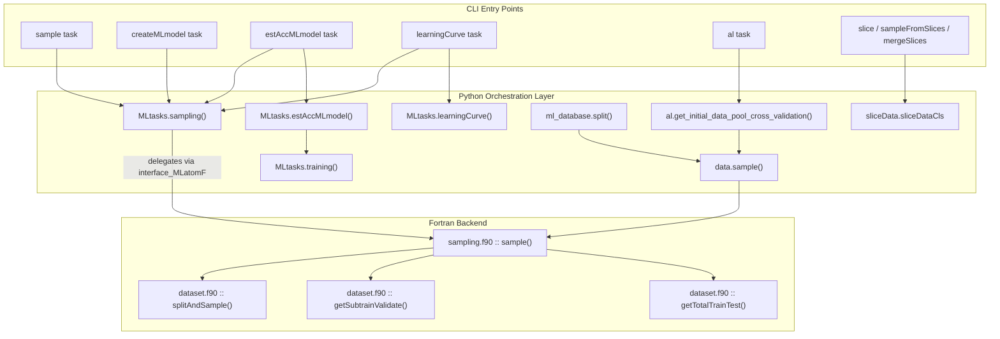
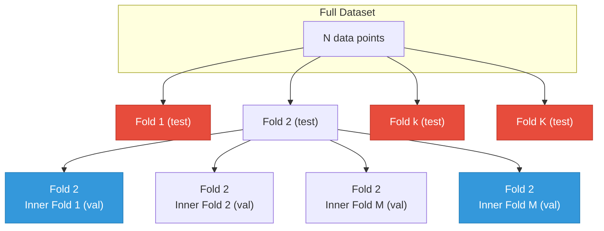
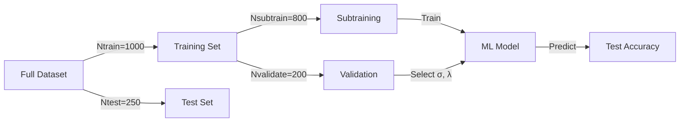

The fidelity of any machine learning potential rests on two pillars: **how training data is partitioned** and **how model generalization is measured**. MLatom implements a layered sampling architecture where the Fortran backend (`MLatomF`) handles high-performance index generation and the Python frontend orchestrates active-learning loops, slice-based structured sampling, and nested cross-validation pipelines. This page dissects every sampling primitive, the data-flow contracts between layers, and the cross-validation topologies available for both static model evaluation and adaptive data acquisition.

## Architectural Overview

MLatom's sampling subsystem spans three tiers. The **Fortran tier** performs the low-level combinatorics of fold generation and index shuffling. The **Python task tier** (`MLtasks`) bridges CLI arguments to both backends, managing temporary index files and converting between 1-based Fortran indices and 0-based NumPy arrays. The **active learning tier** (`al.py`, `al_utils.py`) uses sampling primitives as building blocks within iterative uncertainty-driven loops. A separate **slice-based subsystem** (`sliceData.py`) provides distance-ordered partitioning for equilibrium-structure-centric datasets.

Sources: [sampling.f90](mlatom/MLatomF_src/sampling.f90#L1-L127), [MLtasks.py](mlatom/MLtasks.py#L363-L374), [data.py](mlatom/data.py#L3331-L3383)

## Core Sampling Primitives

### The `data.sample()` Function

The foundational sampling entry point in the Python layer is `data.sample()`, a standalone function that operates on any molecular database instance. It accepts a `sampling` mode string, a `number_of_splits` integer, and either `fraction_of_points_in_splits` or `split_equally` flags. The function validates that the sum of fractions does not exceed 1.0, distributes rounding residuals to the first slices, then either shuffles indices randomly or uses user-defined index lists. The return value is a list of molecular database objects, one per split, constructed by iterating over the computed index ranges and appending the corresponding molecules.

Sources: [data.py](mlatom/data.py#L3331-L3383)

### The `ml_database.split()` Method

The `ml_database` class exposes sampling through its `split()` method, which is a thin delegation to `data.sample()`, passing `self` as the database to split. This design means every molecular database instance — whether holding small molecules, trajectory frames, or reaction steps — inherits a uniform splitting interface. The method returns a list of new `ml_database` instances, preserving the original database type via `type(molDB)()`.

Sources: [data.py](mlatom/data.py#L131-L133)

### The Fortran `sampling` Module

The Fortran backend's `sampling.f90` contains a single `sample()` subroutine that orchestrates all index generation for the compiled MLatomF workflow. It first calls `dataset.getTotalTrainTest()` to determine how many points belong in training versus test sets, handling both absolute counts and fractional specifications (values < 1.0 are interpreted as proportions of `NitemsTot`). When cross-validation testing is enabled (`CVtest`), the subroutine allocates fold arrays (`indicesCVtestSplits` and `CVtestFolds`) and calls `splitAndSample()` to distribute indices across folds. For each fold, it constructs complementary train/test partitions by concatenating all non-holdout folds into the training index array. If nested cross-validation for hyperparameter optimization (`CVopt`) is also requested, the subroutine recursively calls `splitAndSample()` within each training fold to create inner CV splits.

Sources: [sampling.f90](mlatom/MLatomF_src/sampling.f90#L20-L127), [dataset.f90](mlatom/MLatomF_src/dataset.f90#L91-L200)

## Sampling Modes and Data Partitioning

MLatom supports four distinct sampling modes that determine how data points are assigned to subsets. The choice of mode propagates through the entire pipeline, from index generation to model training and accuracy estimation.

| Mode | Description | Typical Use Case |
|------|-------------|------------------|
| `random` | Fisher-Yates shuffle of all indices, then sequential assignment by split size | Default for most training/test splits |
| `user-defined` | External index files (1-based) specify exact membership of each subset | Reproducible benchmarks, predefined chemical space partitions |
| `none` | No shuffling; indices are assigned in their original file order | Ordered datasets where randomization is undesirable |
| Distance-based slicing | Euclidean distance sorting from equilibrium geometry, then equal-range slicing | PES datasets centered on a minimum-energy structure |

### Random Sampling

The default and most widely used mode. In the Python layer, `data.sample()` delegates to `random.shuffle(all_indices)` before sequential slicing. In the Fortran layer, `splitAndSample()` performs an analogous permutation. The `MLtasks.sampling()` function, when invoked for `createMLmodel` or `estAccMLmodel` tasks, suppresses all user-defined index inputs (`iTrainIn`, `iSubtrainIn`, `iValidateIn`, `iTestIn` are set to empty strings) and generates fresh random splits into a temporary directory. After generation, indices are read back with `np.loadtxt(...).astype(int) - 1` to convert from Fortran's 1-based indexing to Python's 0-based convention.

Sources: [MLtasks.py](mlatom/MLtasks.py#L791-L833), [data.py](mlatom/data.py#L3357-L3359)

### User-Defined Sampling

When `sampling=user-defined`, the pipeline reads pre-existing index files rather than generating new ones. The `MLtasks.sampling()` function skips the Fortran delegation entirely when the sampling mode matches, and instead directly loads the user-supplied index files specified via `iTrainIn`, `iSubtrainIn`, `iValidateIn`, `iTestIn`, `iCVtestPrefIn`, and `iCVoptPrefIn`. This mode is essential for reproducible studies where the exact train/test partition must be consistent across multiple experiments or publications.

Sources: [MLtasks.py](mlatom/MLtasks.py#L785-L790)

### Distance-Based Slice Sampling

The `sliceData` module implements a fundamentally different sampling paradigm optimized for potential energy surface datasets. The workflow proceeds in three stages:

1. **Sort by distance**: An equilibrium descriptor vector (`eqX`) is loaded, and all data point descriptors (`xx`) are sorted by their Euclidean distance to this reference. The `sortByDistance()` method computes distances using the L2 norm across all descriptor dimensions and stores a sorted index mapping.

2. **Slice**: The sorted dataset is divided into `nslices` equal-sized spatial shells. Each slice corresponds to a contiguous range in the distance-ordered list, with the final slice absorbing any rounding remainder. Index files, descriptor files, and distance files are written to per-slice subdirectories.

3. **Sample from slices**: When `sampleFromSlices` is invoked, each slice independently samples `Ntrain / nslices` points using the standard MLatom sampling engine. This ensures **spatial uniformity** across the training set — a critical requirement for PES models that must generalize across both near-equilibrium and far-from-equilibrium geometries.

4. **Merge**: The `mergeSlices` operation interleaves sampled points across slices in a round-robin fashion to construct the final `itrain.dat`, `isubtrain.dat`, `ivalidate.dat`, and `itest.dat` files. The subtraining set uses 80% of the training pool, and unsampled points from all slices are pooled into the test set.

Sources: [sliceData.py](mlatom/sliceData.py#L13-L212)

## Cross-Validation Topologies

Cross-validation in MLatom is not a monolithic concept — the framework implements **three distinct CV roles**, each serving a different purpose in the model development lifecycle. Understanding the distinction between CVtest, CVopt, and the subtraining/validation split is essential for correctly configuring MLatom workflows.

### Role 1: CVtest — Estimating Predictive Accuracy

CVtest is the outermost cross-validation layer, used to produce an unbiased estimate of model generalization error. When `CVtest=True`, the dataset is split into `NcvTestFolds` folds. For each fold `j`, the model is trained on all folds except `j`, and predictions are made on fold `j`. After iterating through all folds, predictions from every held-out set are concatenated into a single combined test set, and statistics (MAE, RMSE, correlation) are computed across the full dataset.

A special case is **leave-one-out (LOO)** cross-validation, activated by setting `LOOtest=True` (which internally forces `NcvTestFolds = NitemsTot`). LOO is computationally expensive but provides the most thorough utilization of limited data.

The `estAccMLmodel` task in `MLtasks.py` orchestrates this loop: for each test fold, it concatenates the remaining folds into a combined training index array (`i_cv_train`), trains a model, predicts on the held-out test fold, and accumulates results. After all folds complete, it calls `analyzing()` on the combined predictions.

Sources: [MLtasks.py](mlatom/MLtasks.py#L97-L151), [sampling.f90](mlatom/MLatomF_src/sampling.f90#L52-L72)

### Role 2: CVopt — Hyperparameter Optimization

CVopt is an inner cross-validation layer, nested either within each CVtest fold or within the single training set (when CVtest is disabled). It is used exclusively for **selecting optimal hyperparameters** (e.g., kernel widths for KRR, network architectures for neural networks). When `CVopt=True`, the training data is further split into `NcvOptFolds` inner folds. Each hyperparameter candidate is evaluated by training on `NcvOptFolds - 1` inner folds and validating on the held-out inner fold. The hyperparameter with the lowest aggregate validation error is selected for the final model.

In the Fortran backend, this nesting is explicit: the `sample()` subroutine iterates over CVtest folds, and within each fold, conditionally calls `splitAndSample()` on the training indices to create CVopt splits. The nested index files use a composite naming scheme: `{CVtestPref}{j}{CVoptPref}{i}.dat`, where `j` is the outer fold and `i` is the inner fold.

The Python `training()` function passes CVopt splits to `model.optimize_hyperparameters()` as `cv_splits_molecular_databases`, enabling the model to evaluate each hyperparameter candidate across all inner folds.

Sources: [sampling.f90](mlatom/MLatomF_src/sampling.f90#L85-L95), [MLtasks.py](mlatom/MLtasks.py#L886-L918)

### Role 3: Subtraining/Validation — Simple Hold-Out for Hyperparameters

When full CVopt is too expensive, MLatom falls back to a single hold-out split of the training set into **subtraining** (80% by default) and **validation** (20%) sets. This is handled by `getSubtrainValidate()` in the Fortran backend or by a simple `split(number_of_splits=2, fraction_of_points_in_splits=[0.8, 0.2])` call in Python. The validation set is used for early stopping and hyperparameter selection, while the subtraining set is used for actual model fitting.

Sources: [dataset.f90](mlatom/MLatomF_src/dataset.f90#L91-L200), [al.py](mlatom/al.py#L575-L597)

### Nested Cross-Validation Topology

When both CVtest and CVopt are enabled simultaneously, MLatom constructs a **nested cross-validation** topology. The outer loop partitions data into test folds for accuracy estimation, while the inner loop partitions each outer training set into optimization folds for hyperparameter selection. This prevents information leakage from the test set into hyperparameter choices.

Sources: [MLtasks.py](mlatom/MLtasks.py#L812-L830), [sampling.f90](mlatom/MLatomF_src/sampling.f90#L75-L100)

## The `MLtasks.sampling()` Bridge Function

The `sampling()` function in `MLtasks.py` is the critical bridge between the high-level task interface and the low-level sampling engines. Its signature exposes the full parameter space: dataset files (`XYZfile`, `XfileIn`), sampling mode (`sampling`), set sizes (`Ntrain`, `Nsubtrain`, `Nvalidate`, `Ntest`), index file paths for both input and output, and CV configuration flags (`CVtest`, `CVopt`, `NcvTestFolds`, `NcvOptFolds`). The function operates through the following sequence:

1. **Argument normalization**: Copies relevant keys from the parent `args` object (or constructs a fresh `mlatom_args` if called programmatically), then overlays any explicitly passed keyword arguments.
2. **Conditional Fortran delegation**: If the sampling mode is not `user-defined`, the function delegates to the Fortran backend via `interface_MLatomF.ifMLatomCls.run()`, writing indices to temporary files. After the Fortran call completes, it reads the generated index files back into NumPy arrays.
3. **CV fold loading**: When CVtest or CVopt is enabled, the function loads multi-fold index files by iterating over fold numbers and appending each fold's indices to a list of arrays. For the doubly-nested case (CVtest + CVopt), it constructs a nested list structure: `i_cvopt[j][i]` represents inner fold `i` within outer fold `j`.
4. **Index conversion**: All loaded indices are converted from Fortran's 1-based convention to Python's 0-based convention via `.astype(int) - 1`.

Sources: [MLtasks.py](mlatom/MLtasks.py#L751-L858)

## Active Learning Sampling Strategies

Within the active learning pipeline ([Active Learning Pipeline](24-active-learning-pipeline)), sampling strategies determine how candidate data points are generated for labeling. The `Sampler` class in `al_utils.py` provides multiple generation methods, each producing a molecular database of candidate geometries that are subsequently evaluated by a reference quantum chemistry method.

| Sampler Method | Description | Key Parameters |
|---|---|---|
| `fixed` | Uses pre-existing molecular geometries from a database | `molecular_database` |
| `random` | Generates random displacements from an equilibrium structure | `scale` (Å), `number_of_initial_conditions` |
| `wigner` | Wigner distribution sampling from harmonic frequencies | `initial_temperature`, `use_hessian` |
| `geometry_optimization` | Samples low-energy geometries via ML-predicted optimization | `uq_threshold`, `program` |
| `molecular_dynamics` | Samples configurations from MD trajectories | `maximum_propagation_time`, `time_step`, `ensemble` |
| `batch_molecular_dynamics` | Parallelized batch MD with round-robin trajectory allocation | Same as MD + `batch_parallelization` |
| `surface_hopping_molecular_dynamics` | Nonadiabatic dynamics sampling across electronic states | Inherited MD parameters |

Sources: [al_utils.py](mlatom/al_utils.py#L9-L519)

## Adaptive Initial Pool Sampling with Cross-Validation

The `al.py` module implements a sophisticated adaptive sampling loop for determining the minimum viable initial training set in active learning. The `get_initial_data_pool_cross_validation()` method iteratively adds batches of sampled points to the training pool, and after each batch, evaluates the model's expected accuracy using either cross-validation or hold-out validation. The loop terminates when one of two stopping criteria is met:

1. **Threshold-based**: If `init_RMSE_threshold` is set, the loop stops when the cross-validation RMSE drops below this value. This provides a hard quality guarantee.

2. **Learning curve extrapolation**: When no threshold is set, the method fits a power law of the form `e(N) = a · N^b` to the log-log relationship between training set size and RMSE. It then extrapolates to predict the RMSE at `N + init_ntrain_next` points. If the predicted relative improvement `(e(N) - e(N+ΔN)) / e(N)` falls below 10%, the loop terminates — the marginal return of additional data has become negligible. The linear regression is performed using `scipy.stats.linregress` on the log-transformed data, and a positive slope (which would indicate the RMSE is increasing with more data, a sign of overfitting or numerical noise) is explicitly handled by skipping that iteration.

Within each iteration, the method delegates to either `init_cross_validation()` (which calls `data.sample()` with `split_equally=True` to create equal-sized CV folds) or `init_validation()` (which uses `molecular_database.split()` with an 80/20 fraction). The cross-validation path trains a full model per fold, while the validation path trains a single model on the subtraining set. Both paths compute RMSE using `stats.rmse()`.

> [!TIP]
> The learning curve extrapolation in `get_initial_data_pool_cross_validation()` requires at least `minimum_number_of_fitting_points` data points before attempting regression. Positive regression slopes are silently skipped rather than treated as errors, since they often reflect transient noise in early sampling iterations when the model capacity is poorly matched to the data.

Sources: [al.py](mlatom/al.py#L462-L597)

## Learning Curve Generation

The `learningCurve()` task in `MLtasks.py` automates the systematic evaluation of model accuracy as a function of training set size. It accepts a comma-separated list of training set sizes (`lcNtrains`) and a corresponding list of repeat counts (`lcNrepeats`). For each training size, the function:

1. Creates a dedicated directory structure: `lcDir/Ntrain_{n}/repeat_{j}/{modeldirname}/`
2. Invokes `sampling()` to generate random train/subtrain/validate/test splits (or reuses existing index files if present)
3. Delegates to `CLItasks(args).run()` which executes the full `estAccMLmodel` pipeline
4. Aggregates results across repeats, computing mean and standard deviation of RMSE
5. Writes CSV files (`lcy.csv`, `lcygradxyz.csv`, `lctimetrain.csv`, `lctimepredict.csv`) with per-size statistics

A `.running` sentinel file prevents concurrent execution of the same repeat, and completed repeats are detected via the presence of `result.json`, enabling resumption of interrupted learning curve studies.

Sources: [MLtasks.py](mlatom/MLtasks.py#L216-L350)

## Model Training with Subtraining/Validation Splits

The `training()` function in `MLtasks.py` demonstrates how sampling indices flow into the model fitting pipeline. When hyperparameter optimization is enabled, the function passes `molecular_database[i_subtrain]` as the subtraining set, `molecular_database[i_validate]` as the validation set, and a list of `molecular_database[i_split]` for each CVopt fold. The molecular database class supports integer array indexing via its `__getitem__` method, which constructs a new database containing only the referenced entries. After hyperparameter optimization (if applicable), the model is trained on the full `molecular_database[i_train]` set — note this is the **outer** training set, not the subtraining set, ensuring the final model benefits from all available labeled data.

Sources: [MLtasks.py](mlatom/MLtasks.py#L886-L918), [data.py](mlatom/data.py#L163-L170)

## Error Metrics for Validation

Once cross-validation or test-set predictions are generated, MLatom's `stats.py` module provides the statistical primitives for quantifying accuracy:

| Metric | Function | Formula |
|--------|----------|---------|
| Mean Absolute Error | `mae()` | `Σ|y_est - y_ref| / N` |
| Mean Signed Error | `mse()` | `Σ(y_est - y_ref) / N` |
| Root-Mean-Square Error | `rmse()` | `√(Σ(y_est - y_ref)² / N)` |
| Pearson Correlation | `correlation_coefficient()` | Standard Pearson r |
| Largest Positive Outlier | `largest_positive_outlier()` | `max(y_est - y_ref)` |
| Largest Negative Outlier | `largest_negative_outlier()` | `min(y_est - y_ref)` |
| Linear Regression | `linear_regression()` | `y_est = a + b·x` with R² and standard errors |

The `analyzing()` function in `MLtasks.py` wraps these metrics, computing them for scalar values (energies) and gradient vectors separately, and returning a structured result dictionary with both per-split and aggregate statistics.

Sources: [stats.py](mlatom/stats.py#L9-L122), [MLtasks.py](mlatom/MLtasks.py#L919-L1046)

## Configuration Reference

The following table summarizes all sampling-related arguments accepted by the `mlatom_args` class, as used across the sampling pipeline:

| Argument | Type | Default | Description |
|----------|------|---------|-------------|
| `sampling` | str | `'random'` | Sampling mode: `random`, `user-defined`, `none` |
| `Nuse` | int/str | `'ALL'` | Total number of data points to use (or `'ALL'`) |
| `Ntrain` | int/float | `0.8 × Ntot` | Training set size (float < 1.0 = fraction) |
| `Nsubtrain` | int/float | — | Subtraining set size for hyperparameter optimization |
| `Nvalidate` | int/float | — | Validation set size |
| `Ntest` | int/float | `Ntot - Ntrain` | Test set size |
| `CVtest` | bool | `False` | Enable cross-validation for accuracy estimation |
| `CVopt` | bool | `False` | Enable cross-validation for hyperparameter optimization |
| `LOOtest` | bool | `False` | Leave-one-out test CV |
| `LOOopt` | bool | `False` | Leave-one-out optimization CV |
| `NcvTestFolds` | int | 5 | Number of CV test folds |
| `NcvOptFolds` | int | 5 | Number of CV optimization folds |
| `iTrainIn` / `iTrainOut` | str | — | Train index file (input/output) |
| `iSubtrainIn` / `iSubtrainOut` | str | — | Subtrain index file |
| `iValidateIn` / `iValidateOut` | str | — | Validate index file |
| `iTestIn` / `iTestOut` | str | — | Test index file |
| `iCVtestPrefIn` / `iCVtestPrefOut` | str | — | CV test fold index file prefix |
| `iCVoptPrefIn` / `iCVoptPrefOut` | str | — | CV opt fold index file prefix |
| `nslices` | int | 3 | Number of distance-based slices |
| `eqXfileIn` | str | — | Equilibrium descriptor file for slice sampling |

Sources: [MLtasks.py](mlatom/MLtasks.py#L751-L757), [sliceData.py](mlatom/sliceData.py#L216-L231)

## Practical Workflow Patterns

### Standard Train/Test Split with Hyperparameter Optimization

The most common workflow for model creation and evaluation combines a random train/test split with an internal subtrain/validate partition:

### Nested CV for Unbiased Hyperparameter Selection

For rigorous model comparison where hyperparameter choices must not contaminate the test estimate:

1. Enable `CVtest=True` with `NcvTestFolds=5`
2. Enable `CVopt=True` with `NcvOptFolds=4`
3. For each outer fold, the inner 4-fold CV selects optimal hyperparameters
4. The outer fold test predictions are aggregated for the final accuracy estimate

### Active Learning Initial Pool Determination

When configuring active learning, set `option='cross-validation'` in `get_initial_data_pool_cross_validation()` to automatically determine the minimum initial training set size. The method iteratively samples, labels, and evaluates until the learning curve flattens, at which point the active learning loop can begin with a well-conditioned model.

> [!TIP]
> When using nested cross-validation (CVtest + CVopt), the index file naming follows the pattern `{CVtestPref}{j}{CVoptPref}{i}.dat`. If you provide custom `iCVoptPrefOut` values, ensure they do not collide with the `iCVtestPrefOut` prefix to avoid file overwrites. The `MLtasks.sampling()` function handles this by checking for the compound file pattern `*icvtest1icvopt1.dat`.

Sources: [MLtasks.py](mlatom/MLtasks.py#L812-L830), [al.py](mlatom/al.py#L462-L543)

## Next Steps

- **[Active Learning Pipeline](24-active-learning-pipeline)** — How sampling strategies integrate into the full uncertainty-driven active learning loop
- **[Hyperparameter Optimization](12-hyperparameter-optimization)** — How CVopt folds drive the selection of kernel widths, regularization, and network architecture
- **[Kernel Ridge Regression Models](10-kernel-ridge-regression-models)** — KRR's dependence on proper sampling for kernel matrix conditioning
- **[Model Class Hierarchy](9-model-class-hierarchy)** — The model training interface that consumes sampling indices
- **[Fortran Backend MLatomF](28-fortran-backend-mlatomf)** — Deeper internals of the Fortran sampling and dataset modules