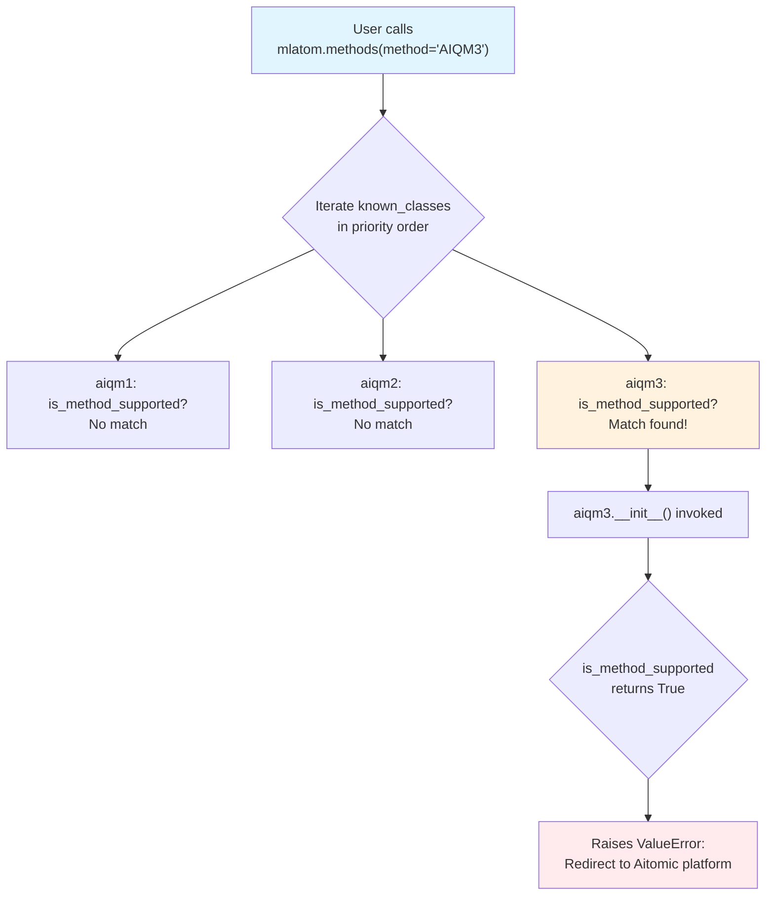
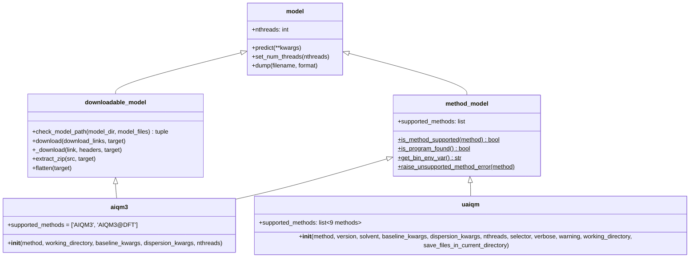

MLatom's AIQM family and its successor, the Universal AI-Enhanced Quantum Mechanical (UAIQM) framework, represent the frontier of hybrid quantum-mechanical/machine-learning methods. Within the open-source MLatom repository, AIQM3 and UAIQM exist as **add-on stub classes** — architectural placeholders that register the method names in MLatom's dispatch system while deferring the full implementation to the **Aitomic** commercial platform. This design lets the open-source `mlatom.methods()` router recognize and validate these method strings without requiring proprietary model files in the public repository.

Sources: [models.py](mlatom/models.py#L598-L625), [aiqm3.py](mlatom/addons/aiqm3/aiqm3.py#L1-L48), [uaiqm.py](mlatom/addons/uaiqm/uaiqm.py#L1-L72)

## Architectural Role in MLatom's Model Dispatch

The add-on models sit within MLatom's method resolution pipeline, which iterates through a prioritized list of `known_classes` to find the first class that claims support for a requested method string. AIQM3 and UAIQM are imported directly from the `mlatom/addons/` subpackage and registered alongside the built-in model classes (AIQM1, AIQM2, ANI, MACE, etc.) in the `known_classes` list. This ordering matters: the list defines default resolution precedence, and add-on classes appear early in the sequence.



When `mlatom.methods(method='AIQM3')` is called, the dispatcher in [models.py](mlatom/models.py#L675-L682) loops through `known_classes` and invokes `method_class.is_method_supported(method)` on each. The add-on classes **do** report support for their respective methods, so instantiation proceeds to `__init__()`, where the redirect to Aitomic occurs.

Sources: [models.py](mlatom/models.py#L624-L691), [model_cls.py](mlatom/model_cls.py#L175-L206)

## Inheritance Hierarchy and Mixin Composition

The two add-on classes adopt distinct inheritance strategies that reflect their differing design intentions:

- **AIQM3** inherits from both `method_model` and `downloadable_model`, signaling that the full implementation would need to download pre-trained neural network weight files from a remote source — consistent with how AIQM1 and AIQM2 handle their TorchANI and OmniNet model assets.
- **UAIQM** inherits only from `method_model`, indicating a broader framework that may compose its models from baseline QM methods, ML corrections, and dispersion corrections rather than relying on a single downloadable artifact.

Both share `method_model` as their core mixin, which provides the classmethod `is_method_supported()` for case-insensitive method name matching against the class-level `supported_methods` list, and `raise_unsupported_method_error()` for clear diagnostic messages when a method string is unrecognized.



Sources: [model_cls.py](mlatom/model_cls.py#L175-L340), [aiqm3.py](mlatom/addons/aiqm3/aiqm3.py#L5-L5), [uaiqm.py](mlatom/addons/uaiqm/uaiqm.py#L16-L16)

## AIQM3 — GFN2-xTB Based AI-Enhanced Quantum Mechanical Method 3

AIQM3 extends the AIQM lineage (AIQM1 → AIQM2 → AIQM3) with a GFN2-xTB baseline augmented by machine-learning corrections for energy, energy gradients, and Hessian predictions. The stub in the open-source repository supports two method variants:

| Method String | Description |
|---|---|
| `AIQM3` | Standard AIQM3 with GFN2-xTB baseline |
| `AIQM3@DFT` | AIQM3 variant targeting DFT-level accuracy |

The constructor accepts parameters for fine-grained control over the baseline semiempirical method and dispersion correction, mirroring the parameter signature of AIQM2 — a deliberate API consistency decision that lets users migrate from AIQM2 to AIQM3 by changing only the method string.

| Parameter | Type | Default | Purpose |
|---|---|---|---|
| `method` | `str` | `'AIQM3'` | Selects the AIQM3 variant |
| `working_directory` | `str` | `None` (current directory) | Path for temporary calculation files |
| `baseline_kwargs` | `dict` | `None` | Keyword arguments forwarded to the GFN2-xTB baseline |
| `dispersion_kwargs` | `dict` | `None` | Keyword arguments for the D4 dispersion correction |
| `nthreads` | `int` | `1` | Number of parallel threads |

Sources: [aiqm3.py](mlatom/addons/aiqm3/aiqm3.py#L32-L48), [aiqm2.py](mlatom/aiqm2.py#L32-L50)

## UAIQM — Universal and Updatable AI-Enhanced QM Methods

UAIQM represents a significantly broader design philosophy than the AIQM series. Rather than a single fixed method, UAIQM defines a **composable framework** where users select a baseline semiempirical method, a correction level (DFT or coupled-cluster), and optionally a solvent model. The stub registers nine distinct method strings covering this combinatorial space:

| Method String | Baseline | Correction Target |
|---|---|---|
| `uaiqm_optimal` | Auto-selected | Auto-selected |
| `uaiqm_nobaseline@dft` | None (ML only) | DFT |
| `uaiqm_nobaseline@cc` | None (ML only) | Coupled cluster |
| `uaiqm_odm2star@dft` | ODM2* | DFT |
| `uaiqm_odm2star@cc` | ODM2* | Coupled cluster |
| `uaiqm_gfn2xtbstar@dft` | GFN2-xTB* | DFT |
| `uaiqm_gfn2xtbstar@cc` | GFN2-xTB* | Coupled cluster |
| `uaiqm_wb97x631gp@cc` | ωB97X/6-31G* | Coupled cluster |
| `uaiqm_wb97xdef2tzvpp@cc` | ωB97X/def2-TZVPP | Coupled cluster |

The `@dft` and `@cc` suffixes indicate the **target accuracy level** of the ML correction — whether the delta-learning model was trained to reproduce DFT or CCSD(T)-level reference data. This naming convention follows the same pattern established by AIQM1@DFT and AIQM2@DFT.

The constructor exposes a richer parameter surface than AIQM3, reflecting UAIQM's configurability:

| Parameter | Type | Default | Purpose |
|---|---|---|---|
| `method` | `str` | `'uaiqm_gfn2xtbstar@cc'` | Selects the UAIQM composition |
| `version` | `str` | `'newest'` | Model version selector |
| `solvent` | `str` | `None` | Solvent for xtb-based methods (ALPB/GBSA) |
| `baseline_kwargs` | `dict` | `{}` | Arguments for the baseline QM method |
| `dispersion_kwargs` | `dict` | `{}` | Arguments for D4 dispersion |
| `nthreads` | `int` | `1` | Thread count for parallel execution |
| `selector` | object | `None` | Custom method selector (default auto-selects) |
| `verbose` | `bool` | `False` | Print selection diagnostics |
| `warning` | `bool` | `True` | Enable warning messages |
| `working_directory` | `str` | `None` | Temporary file location |
| `save_files_in_current_directory` | `bool` | `True` | Whether to retain intermediate files |

Sources: [uaiqm.py](mlatom/addons/uaiqm/uaiqm.py#L41-L68)

## The Gatekeeper Pattern: Method Support and Aitomic Redirection

Both add-on classes implement the same two-phase gatekeeper logic inside their `__init__()` methods. This is the critical behavioral pattern that distinguishes add-on stubs from fully functional model classes:

**Phase 1** — `is_method_supported(method)` performs a case-insensitive lookup of the requested method string against the class's `supported_methods` list. This method is inherited from `method_model` and returns `True` if a match is found.

**Phase 2** — If the method *is* supported, the constructor raises a `ValueError` with a message directing the user to the Aitomic platform at `http://MLatom.com/aitomic`. If the method is *not* supported (e.g., a typo), `raise_unsupported_method_error()` provides a different diagnostic suggesting the user may have misspelled the method name.

This inverted logic — raising an error *when* the method is found — is intentional. It ensures that only valid add-on method names trigger the Aitomic redirect, while invalid names produce the standard "method not recognized" error from the dispatch loop in `mlatom.methods()`.

> [!TIP]
> The `is_method_supported()` check uses Python's `cls.__dict__` (not `dir()` or `getattr()`) to inspect `supported_methods`, which means it only finds methods defined directly on the class — not inherited ones. This prevents false positive matches in subclass hierarchies.

Sources: [aiqm3.py](mlatom/addons/aiqm3/aiqm3.py#L43-L47), [uaiqm.py](mlatom/addons/uaiqm/uaiqm.py#L65-L68), [model_cls.py](mlatom/model_cls.py#L175-L206)

## Relationship to Built-in AIQM Models

AIQM3's stub mirrors the API surface of AIQM2 (its direct predecessor), which is fully implemented in the open-source codebase. Understanding the AIQM2 implementation provides the clearest picture of what AIQM3's full version would deliver. AIQM2 combines a GFN2-xTB baseline with an OmniNet neural network correction and D4 dispersion, exposing properties including energy, gradients, Hessian, dipole derivatives, and prediction uncertainty.

| Feature | AIQM2 (built-in) | AIQM3 (add-on) | UAIQM (add-on) |
|---|---|---|---|
| **Baseline** | GFN2-xTB | GFN2-xTB | Configurable (ODM2*, GFN2-xTB*, ωB97X, or none) |
| **ML Architecture** | OmniNet | Withheld (Aitomic) | Withheld (Aitomic) |
| **Correction Target** | DFT-level | DFT-level | DFT or CCSD(T) level |
| **Energy** | ✅ | ✅ (documented) | ✅ (documented) |
| **Gradients** | ✅ | ✅ (documented) | ✅ (documented) |
| **Hessian** | ✅ | ✅ (documented) | ✅ (documented) |
| **Uncertainty** | ✅ | ✅ (documented) | — (not documented) |
| **Solvent Support** | — | — | ✅ (xtb-based only) |
| **Open Source** | ✅ | ❌ (Aitomic) | ❌ (Aitomic) |

Sources: [aiqm2.py](mlatom/aiqm2.py#L5-L32), [aiqm3.py](mlatom/addons/aiqm3/aiqm3.py#L7-L30), [uaiqm.py](mlatom/addons/uaiqm/uaiqm.py#L17-L39)

## Model File Resolution and Download Infrastructure

Although AIQM3 and UAIQM stubs do not currently exercise the download machinery, AIQM3 inherits `downloadable_model`, which implements a three-tier model file resolution strategy. When a full implementation is active, this system checks for pre-trained model files in the following order:

1. **`$MODELSPATH`** environment variable — supports multiple colon-separated paths
2. **`mlatom/mlatom_models/`** — bundled model files shipped with the package
3. **`~/.mlatom/models/`** — user-local model cache (also the download target)

If no existing files are found, the `download()` method fetches model archives from remote URLs, extracts ZIP files, and optionally flattens nested directory structures. This infrastructure is already battle-tested by the built-in AIQM1 and AIQM2 implementations.

Sources: [model_cls.py](mlatom/model_cls.py#L208-L340)

## Intended Usage Pattern

The docstrings in both stub files document the expected public API for the full implementations. The usage pattern is consistent with all MLatom method classes — instantiate via `mlatom.methods()`, call `.predict()` with property flags, then read results from the molecule object:

```python
import mlatom as ml

# AIQM3 usage (requires Aitomic license)
mol = ml.molecule.from_xyz_file(filename='ethanol.xyz')
aiqm3 = ml.methods(method='AIQM3')
aiqm3.predict(molecule=mol, calculate_energy=True,
              calculate_energy_gradients=True, calculate_hessian=True)
energy = mol.energy
gradient = mol.get_energy_gradients()
hess = mol.hessian
std = mol.aiqm3_model_nn.energy_standard_deviation

# UAIQM usage (requires Aitomic license)
mol2 = ml.data.molecule()
mol2.read_from_xyz_file(filename='ethanol.xyz')
uaiqm = ml.models.methods(method='uaiqm_odm2star@cc', version='newest')
uaiqm.predict(molecule=mol2, calculate_energy=True,
              calculate_energy_gradients=True, calculate_hessian=True)
energy = mol2.energy
gradient = mol2.gradient
```

Sources: [aiqm3.py](mlatom/addons/aiqm3/aiqm3.py#L17-L29), [uaiqm.py](mlatom/addons/uaiqm/uaiqm.py#L27-L38)

## Summary

AIQM3 and UAIQM occupy a deliberately designed architectural niche in MLatom: they are **stub classes** that register proprietary method names in the open-source dispatch system while redirecting users to the Aitomic platform for the full implementation. AIQM3 inherits both `method_model` and `downloadable_model` for a download-capable single-model design, while UAIQM extends only `method_model` to accommodate its broader composable framework. Both share the gatekeeper pattern where supported method names trigger an informative redirect rather than silent failure, maintaining a clean separation between the open-source MLatom core and its commercial extensions.

For the fully functional built-in AIQM methods, see [AIQM Methods and Delta Learning](11-aiqm-methods-and-delta-learning). To understand how `mlatom.methods()` resolves method strings across the full class hierarchy, see [Model Class Hierarchy](9-model-class-hierarchy). For other add-on extensions in the same subpackage, see [OmniP2x Multi-State Potentials](27-omnip2x-multi-state-potentials).