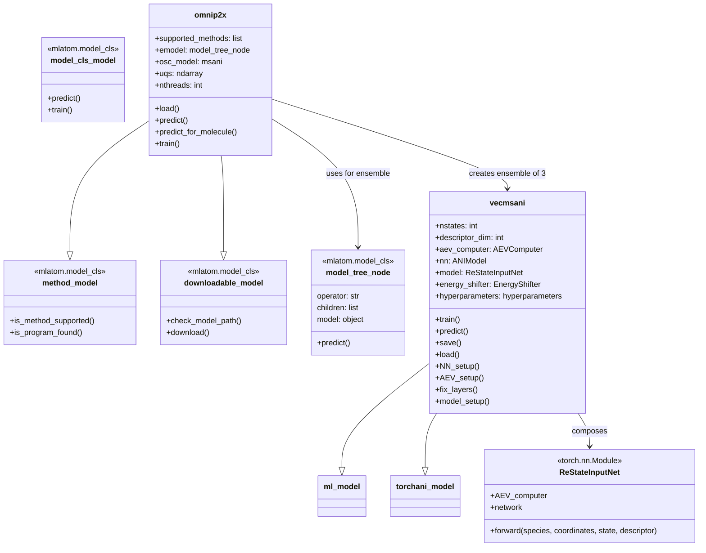
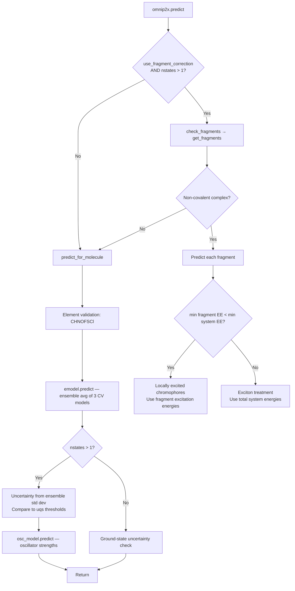
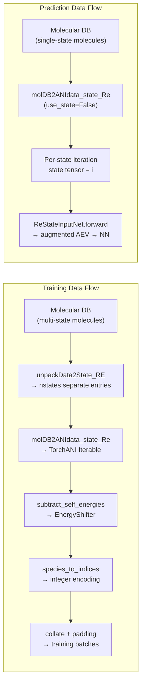

OmniP2x is a universal neural network potential designed specifically for excited-state simulations, enabling prediction of energies, energy gradients, excitation energies, and oscillator strengths across multiple electronic states. Implemented as an add-on within MLatom, it extends the TorchANI architecture with a custom state-aware input augmentation strategy and supports both inference from pre-trained weights and fine-tuning on user-provided datasets.

## Architectural Overview

The OmniP2x subsystem resides under `mlatom/addons/omnip2x/` and is composed of four files, each with a distinct responsibility in the model lifecycle. The architecture separates user-facing orchestration from the core neural network machinery, following a delegation pattern where the high-level `omnip2x` class manages model loading, ensemble composition, fragment correction, and uncertainty quantification, while the `vecmsani` class handles training, prediction, and the TorchANI/PyTorch integration.



The module file structure is compact and purpose-driven:

| File | Role | Key Export |
|---|---|---|
| `omnip2x.py` | User-facing facade, model orchestration, fragment correction | `omnip2x` class |
| `vecmsani.py` | Core MS-ANI neural network with multi-state training | `vecmsani` class |
| `re_state_input_net.py` | Custom PyTorch module augmenting AEV with state/descriptor inputs | `ReStateInputNet` |
| `__init__.py` | Package marker (binary/deployed artifact) | — |

Sources: [omnip2x.py](mlatom/addons/omnip2x/omnip2x.py#L1-L18), [vecmsani.py](mlatom/addons/omnip2x/vecmsani.py#L1-L20), [re_state_input_net.py](mlatom/addons/omnip2x/re_state_input_net.py#L1-L13)

## Prediction Pipeline and Model Composition

OmniP2x's prediction flow is a carefully staged process that begins with automatic model downloading and culminates in optional fragment-based corrections. The `omnip2x.__init__` constructor triggers `load()`, which attempts to locate pre-trained weights under the `omnip2x_model/` directory. If absent, it downloads from GitHub via a primary zip URL, with individual file downloads as fallback. The energy model is an ensemble of three cross-validated networks (`OMNIP2x_CV_1.pt` through `OMNIP2x_CV_3.pt`) wrapped in a `model_tree_node` tree that averages their outputs. A separate oscillator strength model (`OMNIP2x_oscillator.pt`) uses the standard `msani` architecture.
Sources: [omnip2x.py](mlatom/addons/omnip2x/omnip2x.py#L42-L99)

The `predict()` method serves as the entry point and delegates per-molecule to `predict_for_molecule()`, which enforces element constraints (only H, C, N, O, F, S, Cl are supported) and invokes the ensemble energy model followed by the oscillator strength model when `nstates > 1`.
Sources: [omnip2x.py](mlatom/addons/omnip2x/omnip2x.py#L99-L210)



### Fragment Correction for Non-Covalent Complexes

A distinctive feature of OmniP2x is its built-in fragment correction mechanism for non-covalent molecular complexes. When `use_fragment_correction=True` and `nstates > 1`, the system detects disconnected fragments using a graph-based approach with covalent radii (tolerance of 0.7 Å). It builds a `networkx` graph where edges connect bonded atoms, then extracts connected components as fragments. If the lowest fragment excitation energy is lower than the total system's, the complex is treated as locally excited chromophores with fragment-based excitation energies and oscillator strengths; otherwise, it is treated as an exciton and the total system results are used directly.
Sources: [omnip2x.py](mlatom/addons/omnip2x/omnip2x.py#L272-L309)

### Uncertainty Quantification

OmniP2x provides built-in uncertainty quantification derived from the ensemble spread across the three cross-validated models. After prediction, the standard deviation of energies across ensemble members is computed via `model_tree_node.standard_deviation()`. These values are compared against pre-defined uncertainty thresholds (`self.uqs`, an 11-element array) that were calibrated during model development. When the predicted uncertainty exceeds the threshold for a given state, a warning is printed to alert the user. This mechanism is active by default and controlled via the `warnings` parameter.
Sources: [omnip2x.py](mlatom/addons/omnip2x/omnip2x.py#L83-L100), [omnip2x.py](mlatom/addons/omnip2x/omnip2x.py#L199-L210)

## Core Neural Network: The vecmsani Architecture

The `vecmsani` class (vector multi-state ANI) is the computational heart of OmniP2x. It extends the standard ANI architecture by augmenting the Atomic Environment Vector (AEV) with two additional input channels: an electronic **state indicator** and an **Rₑ descriptor** vector. This augmentation is implemented through the custom `ReStateInputNet` PyTorch module.
Sources: [vecmsani.py](mlatom/addons/omnip2x/vecmsani.py#L118-L175)

### Input Augmentation via ReStateInputNet

The `ReStateInputNet` module intercepts the standard TorchANI forward pass and concatenates three tensors along the per-atom feature dimension before feeding them into the neural network. The `forward()` method computes the standard AEV from species and coordinates, then concatenates the RE descriptor vector (expanded per-atom) and the state tensor (also expanded per-atom) to produce an augmented AEV of shape `[batch, natoms, aev_length + descriptor_dim + 1]`. This means the first linear layer of each species-specific network receives `aev_length + 1 + descriptor_dim` inputs rather than the standard `aev_length`.
Sources: [re_state_input_net.py](mlatom/addons/omnip2x/re_state_input_net.py#L14-L30)

The RE descriptor encodes structural deformation relative to an equilibrium geometry. Computed by `calculate_re_descriptor()`, it stores the ratio `Rₑᵢⱼ / Rᵢⱼ` for each unique pair of atoms, where `Rₑᵢⱼ` is the equilibrium inter-nuclear distance and `Rᵢⱼ` is the current distance. This geometric encoding allows the network to distinguish between different conformations of the same molecule. The default `descriptor_dim` is 2, and when no equilibrium geometry is available, a fallback descriptor `[0, ..., 0, 1]` is used (the last element set to 1 acts as a default flag).
Sources: [vecmsani.py](mlatom/addons/omnip2x/vecmsani.py#L21-L34)

### Multi-State Prediction Strategy

Rather than predicting all states simultaneously in a single forward pass, `vecmsani.predict()` iterates over states sequentially. For each state index `i` from `0` to `nstates-1`, it creates a batch with a uniform state tensor `torch.full((len(batch),), i)`, runs the forward pass through `ReStateInputNet`, and collects the resulting energies and gradients. This per-state iteration ensures that each forward pass receives an unambiguous state label, which the network uses to condition its output. After all states are predicted, the results are assigned to `molecule.electronic_states[i]` for each state, and the `current_state` energy and gradients are also copied to the top-level molecule for compatibility with downstream workflows.
Sources: [vecmsani.py](mlatom/addons/omnip2x/vecmsani.py#L577-L669)

> [!TIP]
> The per-state prediction loop in `vecmsani.predict()` creates a new state tensor per iteration rather than batching all states together. This design choice trades throughput for architectural simplicity—each forward pass is state-unambiguous. For production inference with many states, consider batching states if the model is modified to support multi-state output heads.

## Training and Fine-Tuning

OmniP2x supports fine-tuning of pre-trained models on user-provided datasets through the `train()` method on the `omnip2x` class, which orchestrates training across the three ensemble members. The training architecture uses a compound loss function combining energy MSE, force MSE, and a gap regularization term.

### Loss Function Composition

The total loss is defined as:

```
L = L_energy + λ_force · L_force + λ_gap · L_gap
```

Where `L_energy` is the mean squared error of shifted energies (per √Nₐₜₒₘₛ normalization), `L_force` is the MSE of atomic forces, and `L_gap` is the MSE of absolute energy gaps between consecutive states (`|E_{i+1} - E_i|`). The gap coefficient (`gap_coefficient`, default 1.0) acts as a regularizer that penalizes incorrect state ordering and crossing behavior. An optional `median_loss` mode replaces MSE with median absolute error for improved robustness against outliers.
Sources: [vecmsani.py](mlatom/addons/omnip2x/vecmsani.py#L380-L420)

### Layer Freezing for Transfer Learning

The fine-tuning workflow uses layer freezing to prevent catastrophic forgetting of the pre-trained representations. By default, layers 0–4 (the first five layers) are frozen via the `fixed_layers` hyperparameter, which maps to `vecmsani.fix_layers()`. This method iterates over named parameters of the model, identifies linear layers by their index within each species-specific Sequential network, and sets `requires_grad=False` for frozen layers. The `omnip2x.train()` method also resets the optimizer state to ensure fresh AdamW/SGD trajectories for the unfrozen layers.
Sources: [vecmsani.py](mlatom/addons/omnip2x/vecmsani.py#L771-L789), [omnip2x.py](mlatom/addons/omnip2x/omnip2x.py#L211-L260)

### Data Preparation Pipeline

Training data undergoes a multi-stage preparation pipeline implemented in `data_setup()` and `unpackData2State_RE()`:

1. **State unpacking**: Each molecule with `nstates` electronic states is expanded into `nstates` individual data points, each tagged with its state index via `mol.current_state`. The RE descriptor is attached to each expanded molecule.
Sources: [vecmsani.py](mlatom/addons/omnip2x/vecmsani.py#L78-L102)
2. **Self-energy subtraction**: TorchANI's `EnergyShifter` removes per-element self-energies to improve learning efficiency. The shifter handles element coverage expansion when the fine-tuning dataset contains elements not in the original species order.
Sources: [vecmsani.py](mlatom/addons/omnip2x/vecmsani.py#L839-L848)
3. **Collation and batching**: Data is converted to TorchANI `TransformableIterable` via `molDB2ANIdata_state_Re()`, which yields dictionaries with `species`, `coordinates`, `energies`, `forces`, `state`, and `descriptor` keys, then collated with padding for variable-size molecules.
Sources: [vecmsani.py](mlatom/addons/omnip2x/vecmsani.py#L58-L77)



### Optimizer Configuration

The `vecmsani` class uses a dual-optimizer strategy: **AdamW** for weight parameters and **SGD** for bias parameters. Both optimizers use `ReduceLROnPlateau` schedulers keyed to the validation RMSE. The weight decay for hidden layers follows an exponentially decaying schedule (`0.0001 / 10^j` where `j` is the layer depth), while the first and last linear layers have zero weight decay. Training terminates when the learning rate drops below `early_stopping_learning_rate` (default 1e-5) or `max_epochs` is reached.
Sources: [vecmsani.py](mlatom/addons/omnip2x/vecmsani.py#L729-L770)

## Hyperparameter Reference

The `vecmsani` class defines a comprehensive set of hyperparameters with search-space metadata for optimization. The table below summarizes the key tunable parameters relevant to fine-tuning OmniP2x:

| Hyperparameter | Default | Range | Space | Description |
|---|---|---|---|---|
| `batch_size` | 16 | 1–1024 | linear | Effective batch size (multiplied by `nstates`) |
| `max_epochs` | 100 | 100–1M | log | Maximum training epochs |
| `learning_rate` | 0.001 | 0.0001–0.01 | log | AdamW/SGD initial learning rate |
| `early_stopping_learning_rate` | 1e-5 | 1e-6–1e-4 | log | LR threshold for early stopping |
| `force_coefficient` | 0.1 | 0.05–5 | linear | Weight of force loss term |
| `gap_coefficient` | 1.0 | 0.05–5 | linear | Weight of inter-state gap loss |
| `median_loss` | False | — | — | Use median absolute error instead of MSE |
| `neurons` | [[160, 128, 96]] | — | — | Hidden layer widths per species |
| `activation_function` | CELU(0.1) | CELU/ReLU/GELU | choice | Activation function |
| `fixed_layers` | False | — | — | Layers to freeze (e.g., `[[0,4]]`) |
| `lr_reduce_patience` | 64 | 16–256 | linear | Epochs before LR reduction |
| `lr_reduce_factor` | 0.5 | 0.1–0.9 | linear | LR reduction factor |

Sources: [vecmsani.py](mlatom/addons/omnip2x/vecmsani.py#L131-L170)

> [!TIP]
> When fine-tuning OmniP2x via `omnip2x.train()`, the default hyperparameters differ from the raw `vecmsani` defaults: `max_epochs` is set to 100, `gap_coefficient` to 1, and `fixed_layers` to `[[0,4]]`. These defaults are explicitly set in the `omnip2x.train()` method body and override the `vecmsani` class defaults, ensuring a stable fine-tuning experience without requiring manual configuration.

## Usage Patterns

### Basic Prediction (Pre-trained Model)

The simplest invocation relies on automatic model downloading and default settings. The `omnip2x` constructor handles all setup, and `predict()` populates molecular properties in-place:

```python
from mlatom import data, models

mol = data.molecule.from_xyz_file('molecule.xyz')
omni_model = models.omnip2x(method='omnip2x')
omni_model.predict(molecule=mol, nstates=5, current_state=0)

# Access results
print(f"S₀ energy: {mol.energy} Ha")
for i, state in enumerate(mol.electronic_states):
    print(f"S{i} excitation energy: {state.energy - mol.electronic_states[0].energy} Ha")
    print(f"S{i} uncertainty: {mol.electronic_states[i].energy_standard_deviation} Ha")
if len(mol.oscillator_strengths) > 0:
    print(f"Oscillator strengths: {mol.oscillator_strengths}")
```

The supported method strings are `'omni-p2x'` and `'omnip2x'` (case-insensitive). The `nthreads` parameter propagates to both the energy ensemble and the oscillator strength model.

Sources: [omnip2x.py](mlatom/addons/omnip2x/omnip2x.py#L16-L40)

### Fine-Tuning on a Custom Dataset

Fine-tuning trains all three cross-validated ensemble members independently, then reassembles the ensemble. The oscillator strength model can optionally be retrained by setting `train_osc=True`:

```python
from mlatom import data, models

# Load multi-state training data (molecules with electronic_states populated)
train_db = data.molecular_database.from_file('training_data.json')

omni_model = models.omnip2x(method='omnip2x')
omni_model.train(
    molecular_database=train_db,
    nstates=3,
    xyz_derivative_property_to_learn='energy_gradients',
    spliting_ratio=0.8,
    train_osc=True,
    hyperparameters={
        'max_epochs': 200,
        'gap_coefficient': 1.0,
        'fixed_layers': [[0, 4]],
        'learning_rate': 0.001,
    }
)
# omni_model.emodel is now the fine-tuned ensemble
omni_model.predict(molecule=mol, nstates=3, current_state=1)
```

Each fine-tuned energy model is saved with a filename pattern `OMNI-P2x_ft_emodelft_{i}.pt`, and the oscillator model as `OMNI-P2x_ft_osc_model.pt`. After fine-tuning, the `warnings` flag is automatically set to `False` since the uncertainty thresholds no longer apply to the fine-tuned model.

Sources: [omnip2x.py](mlatom/addons/omnip2x/omnip2x.py#L211-L260)

### Prediction with Fragment Correction

For non-covalent complexes, the fragment correction mode decomposes the system and selectively applies fragment-level excitation energies:

```python
omni_model.predict(
    molecule=complex_mol,
    nstates=6,
    current_state=0,
    use_fragment_correction=True,
    calculate_energy_gradients=True
)
```

When activated, the system uses `networkx` to detect disconnected fragments (requiring `networkx` to be installed). The covalent radii table includes H, C, N, O, F, Cl, Br, I, and S with a default bond tolerance of 0.7 Å. The `bonded()` utility function can be used standalone for custom fragmentation logic.

Sources: [omnip2x.py](mlatom/addons/omnip2x/omnip2x.py#L272-L309)

## Model Persistence and File Formats

OmniP2x uses PyTorch's native serialization (`.pt` files) for model persistence. The `vecmsani.save()` method stores a dictionary containing the network architecture definition (`network`), construction arguments (`args`), the neural network state dict (`nn`), the AEV computer object (`AEV_computer`), and the energy shifter (`energy_shifter`). The `load()` method reconstructs the full pipeline from this dictionary, including wrapping the loaded ANI model inside a `ReStateInputNet`.
Sources: [vecmsani.py](mlatom/addons/omnip2x/vecmsani.py#L206-L230), [vecmsani.py](mlatom/addons/omnip2x/vecmsani.py#L229-L310)

Pre-trained model files follow a naming convention that encodes their role and cross-validation fold:

| File | Purpose | Architecture |
|---|---|---|
| `OMNIP2x_CV_{1,2,3}.pt` | Energy model, cross-validation fold | vecmsani (ReStateInputNet) |
| `OMNIP2x_oscillator.pt` | Oscillator strength model | msani (standard TorchANI) |

## Relationship to the MLatom Model Ecosystem

OmniP2x integrates with MLatom's broader model infrastructure through multiple inheritance and composition patterns. The `omnip2x` class inherits from `method_model` (enabling method name resolution via `supported_methods`) and `downloadable_model` (providing automatic model downloading with zip extraction and fallback). The energy ensemble uses `model_tree_node` for composable model averaging. The core `vecmsani` inherits from `ml_model` and `torchani_model`, gaining access to MLatom's training infrastructure, hyperparameter optimization, cross-validation, and PyTorch thread management.

For developers extending or modifying OmniP2x, the key integration points are: the `model_cls.model_tree_node` for ensemble strategies ([Model Class Hierarchy](9-model-class-hierarchy)), the `model_cls.downloadable_model` for model distribution ([Model Class Hierarchy](9-model-class-hierarchy)), and the TorchANI interface for AEV computation ([Universal ML Potential Interfaces](15-universal-ml-potential-interfaces)). The fragment correction mechanism and multi-state prediction also connect to the molecular dynamics and nonadiabatic dynamics workflows ([Nonadiabatic and Surface-Hopping Dynamics](20-nonadiabatic-and-surface-hopping-dynamics)), where OmniP2x can serve as the potential energy surface provider for excited-state dynamics simulations.
