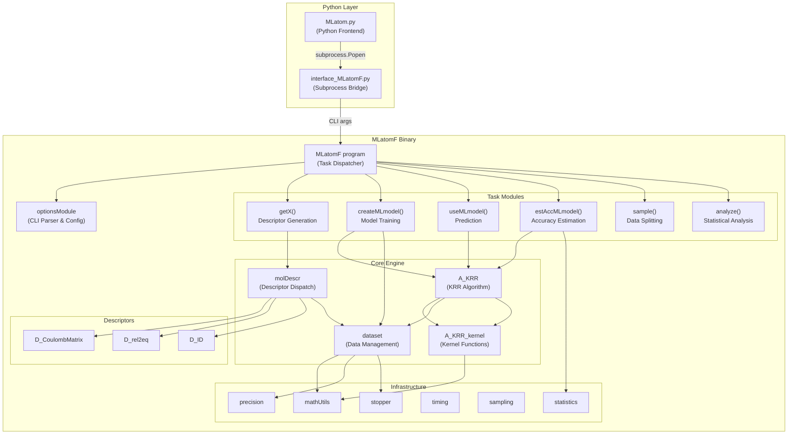

MLatomF is the Fortran + OpenMP computational engine that underpins MLatom's high-performance machine learning workflows. Originally developed as "MLler" at the University of Erlangen-Nuremberg in 2013 and subsequently maintained at the Max-Planck-Institut für Kohlenforschung and Xiamen University, it provides a standalone executable binary focused exclusively on kernel ridge regression (KRR) — the algorithm that powers the legacy and still widely-used MLatom machine learning potentials. For developers integrating custom potentials or extending MLatom's Python layer, understanding MLatomF's architecture is essential because the Python frontend delegates descriptor generation, model training, and prediction to this binary via subprocess invocation.

Sources: [MLatomF.f90](mlatom/MLatomF_src/MLatomF.f90#L37-L93), [MLatomFInfo.f90](mlatom/MLatomF_src/MLatomFInfo.f90#L7-L27)

## Architectural Overview

MLatomF follows a modular Fortran 90/95 architecture built around six discrete operational modes, dispatched from a single `program MLatomF` entry point. The system is not designed as a library — it is a command-line executable that reads flat-file inputs, performs its computation entirely in memory using OpenMP-threaded linear algebra (backed by Intel MKL), and writes results to disk. The Python interface layer (`interface_MLatomF.py`) wraps this binary, parses its stdout for timing and statistics, and translates the results back into MLatom's Python object model.

Sources: [MLatomF.f90](mlatom/MLatomF_src/MLatomF.f90#L62-L88), [Makefile](mlatom/MLatomF_src/Makefile#L14-L17)

## Task Dispatch and Operational Modes

The `MLatomF` program entry point implements a simple `if/elseif` chain that selects exactly one of six operational modes based on boolean flags parsed from the command line. Each mode corresponds to a self-contained workflow, and the `optionsModule` governs which flags are activated. The initialization subroutine records wall-clock time and prints configuration diagnostics; the termination subroutine calls explicit cleanup routines for KRR regression coefficients and dataset allocations.

| Mode | Flag | Entry Subroutine | Purpose |
|------|------|-----------------|---------|
| **Descriptor Generation** | `XYZ2X` | `getX()` | Convert XYZ coordinates to descriptor vectors X |
| **Statistical Analysis** | `analyze` | `analyze()` | Compare estimated vs. reference Y values |
| **Sampling** | `sample` | `getX()` → `sample()` | Generate and write train/test index splits |
| **Prediction** | `useMLmodel` | `useMLmodel()` | Load model, compute descriptors, predict Y |
| **Model Creation** | `createMLmodel` | `createMLmodel()` | Full training pipeline with optional hyperparameter optimization |
| **Accuracy Estimation** | `estAccMLmodel` | `estAccMLmodel()` | Load model, predict on held-out data, compute statistics |

The `createMLmodel` path is the most complex: it reads or computes descriptors (`getX`), reads reference property values (`readY`/`readYgradXYZ`), splits data via `sample()`, initializes KRR hyperparameters, optionally optimizes them through cross-validation, trains the final model, writes it to disk, and optionally computes estimated values on the full dataset.

Sources: [MLatomF.f90](mlatom/MLatomF_src/MLatomF.f90#L62-L93), [MLmodel.f90](mlatom/MLatomF_src/MLmodel.f90#L78-L131), [MLmodel.f90](mlatom/MLatomF_src/MLmodel.f90#L135-L200)

## Configuration System: optionsModule

All runtime behavior is controlled through a single derived type `optionsType` stored as a module-level `save` variable in `optionsModule`. This type contains over 80 fields spanning input file paths, algorithm selection, hyperparameter ranges, cross-validation settings, descriptor options, permutational symmetry, output control, and internal flags. Options are parsed from command-line arguments in the form `key=value` strings.

The options architecture enforces a default-first strategy: every field carries a sensible default (e.g., `algorithm = 'KRR'`, `kernel = 'Gaussian'`, `molDescriptor = 'RE'`, `sampling = 'random'`), and only user-specified values override these. Additional boolean flags track whether the user explicitly requested changes to certain parameters (e.g., `sigmaFlag`, `molDescTypeFlag`), enabling downstream code to distinguish between default and intentional configuration.

**Key algorithm configuration fields** include: `algorithm` (currently only `'KRR'`), `KRRtask` (`'learnVal'`, `'learnGradXYZ'`, or `'learnValGradXYZ'`), `kernel` (`'Gaussian'`, `'Laplacian'`, `'exponential'`, `'Matern'`, `'polynomial'`), and `prior` (which can be set to `'meandevi'` for gradient-learning tasks to stabilize predictions). The hyperparameter optimization subsystem uses logarithmic grid search controlled by `NlgSigma`, `lgSigmaL`, `lgSigmaH`, `lgOptDepth`, and analogous fields for `lambda`, `c`, and `d`.

Sources: [optionsModule.f90](mlatom/MLatomF_src/optionsModule.f90#L18-L167), [optionsModule.f90](mlatom/MLatomF_src/optionsModule.f90#L169-L180)

## Kernel Ridge Regression Engine

The KRR implementation resides across two tightly coupled modules: `A_KRR` (algorithmic orchestration) and `A_KRR_kernel` (kernel function evaluation and matrix construction). The algorithm solves the standard KRR system **(K + λI)α = y** where K is the kernel matrix, λ is the regularization parameter, and α are the learned regression coefficients. The system supports both value-only learning (`learnVal`) and combined value-gradient learning (`learnValGradXYZ`), where the kernel matrix is augmented with derivative terms.

### Kernel Matrix Construction

The `calcKernel` subroutine in `A_KRR_kernel` builds the augmented kernel matrix in three OpenMP-parallelized blocks: value–value covariance, value–gradient covariance, and gradient–gradient covariance. When both values and XYZ gradients are present (`NtrVal` value points and `NtrGrXYZ` gradient points), the total training size is `NtrTot = NtrVal + NtrGrXYZ`, and the kernel matrix is partitioned accordingly. The kernel evaluation leverages the `kernelFunction` generic interface that dispatches to the selected kernel type.

The on-the-fly computation mode (`option%onTheFly = .true.`) avoids materializing the full validation kernel matrix, instead computing kernel evaluations lazily during validation. This is critical for the `learnGradXYZ` task where memory consumption from storing derivative kernel elements can be prohibitive.

### Hyperparameter Optimization

The `optHyper_KRR` subroutine implements multi-depth logarithmic grid search. It iteratively narrows the search range for `sigma` and/or `lambda` (and `c`/`d` for polynomial kernels) by a factor of 2^(-`lgOptDepth`) at each depth level. Cross-validation is performed either via an explicit subtrain/validate split (when `CVopt` is set) or through k-fold cross-validation with pre-computed fold indices. The optimization target is configurable via `minimizeError` (defaulting to `'RMSE'`).

| Supported Kernel | Hyperparameter(s) | Default σ/λ |
|-----------------|-------------------|-------------|
| Gaussian | σ (length-scale) | σ=100, λ=0 |
| Laplacian | σ | σ=100 |
| Exponential | σ | σ=100 |
| Matern | σ, n (ν = n + ½) | σ=100, n=2 |
| Polynomial | c (addend), d (exponent) | c=100, d=2 |
| Periodic/Decay | σ, σ_p, period | σ=100, σ_p=100, period=1.0 |

Sources: [A_KRR_kernel.f90](mlatom/MLatomF_src/A_KRR_kernel.f90#L130-L188), [A_KRR.f90](mlatom/MLatomF_src/A_KRR.f90#L90-L200), [A_KRR.f90](mlatom/MLatomF_src/A_KRR.f90#L32-L86)

## Molecular Descriptors

MLatomF supports three molecular descriptor types, all computed from Cartesian coordinates and dispatched through the `molDescr` module. The descriptor choice determines the dimensionality of the input vector X and profoundly influences model accuracy and transferability.

**Coulomb Matrix (CM)**: The full N×N Coulomb matrix where diagonal elements are `0.5·Z_i^2.4` and off-diagonal elements are `Z_i·Z_j/R_ij` (R in Bohr). The matrix is optionally sorted by row norms for permutation invariance, then flattened to a vector of size `NAtomsMax²`.

**RE (Relative to Equilibrium)**: The vector `{R_eq/R_ij}` where R_eq are internuclear distances from an equilibrium geometry and R_ij are the current distances. This descriptor requires an equilibrium structure file and produces vectors of size `NAtomsMax·(NAtomsMax-1)/2`. The `D_rel2eq` module optionally supports sorted-by-nuclear-repulsion atom ordering for partial permutation invariance.

**Inverse Distance (ID)**: The simplest descriptor — the vector of `1/R_ij` values for all atom pairs, producing the same dimensionality as RE but without requiring an equilibrium structure.

The descriptor type and sorting behavior are controlled by `molDescriptor` (default `'RE'`) and `molDescrType` (default `'unsorted'`, also supports `'sorted'` and `'permuted'`). The permuted mode generates multiple copies of the descriptor under different atom permutations, multiplying the vector size by `Nperm`, which enforces full permutational invariance at increased computational cost.

Sources: [molDescr.f90](mlatom/MLatomF_src/molDescr.f90#L24-L125), [D_CoulombMatrix.f90](mlatom/MLatomF_src/D_CoulombMatrix.f90#L14-L87), [D_rel2eq.f90](mlatom/MLatomF_src/D_rel2eq.f90#L17-L83), [D_ID.f90](mlatom/MLatomF_src/D_ID.f90#L16-L39)

## Data Management and Sampling

The `dataset` module is the central data store for MLatomF, managing all arrays for molecular coordinates (XYZ in Ångström and Bohr), nuclear charges, descriptor vectors X, reference values Y, gradient data, prediction arrays, and the complex index arrays for train/test/subtrain/validate splits. It defines two key derived types: `optData` (for subtrain/validate splits used in hyperparameter optimization) and `testData` (which nests `optData` and adds train/test indices).

The sampling system supports multiple strategies controlled by the `sampling` option: `'random'` (default random partitioning), `'user-defined'` (reading pre-computed index files), and cross-validation modes (`CVtest` with N-fold splits and `LOOtest` for leave-one-out). When `CVtest` is active, the system allocates `NcvTestFolds` separate `testData` structures, each with its own train/test partition, enabling parallel model evaluation across folds. The `CVopt` mode similarly creates nested cross-validation folds within each training set for hyperparameter selection.

Training set size can be specified as an absolute number or as a fraction (values < 1.0 are interpreted as proportions of the total dataset). When no test size is specified, the system defaults to an 80/20 train/test split for accuracy estimation tasks, or uses the full dataset for training when only model creation is requested.

Sources: [dataset.f90](mlatom/MLatomF_src/dataset.f90#L14-L104), [dataset.f90](mlatom/MLatomF_src/dataset.f90#L120-L198), [sampling.f90](mlatom/MLatomF_src/sampling.f90#L16-L100)

## Build System and Compiler Support

MLatomF compiles as a standalone Fortran executable with an optional C++ shared library (`cs.so`) for ML-NEA cross-section calculations. The build system uses a layered Makefile architecture: the main `Makefile` includes a compiler-specific configuration file, and four pre-configured variants are provided for different toolchains.

| Compiler Config | File | Fortran Compiler | BLAS/LAPACK |
|----------------|------|-----------------|-------------|
| Intel (default) | `Makefile.intel` | `ifort` | Intel MKL (parallel) |
| GNU | `Makefile.gnu` | `gfortran` | System BLAS/LAPACK |
| Cygwin | `Makefile.cygwin` | `gfortran` | System |
| Generic | `Makefile` | (via include) | (via include) |

All configurations enable OpenMP parallelism (`-qopenmp` for Intel, `-fopenmp` for GNU) and use `-O3` optimization. The precision module defines `rprec = selected_real_kind(15,307)`, enforcing 64-bit double precision arithmetic throughout all computations. The final binary is output as `../MLatomF` (one directory up from `MLatomF_src/`), placing it directly in the `mlatom/` package directory where the Python interface expects to find it.

The dependency graph encoded in the Makefile reflects the module use-chain: `MLatomF.o` depends on `A_KRR.o`, `MLmodel.o`, `dataset.o`, and several infrastructure modules; `A_KRR.o` depends on `A_KRR_kernel.o` and `dataset.o`; descriptor modules (`D_CoulombMatrix`, `D_rel2eq`, `D_ID`) are leaf dependencies consumed by `molDescr.o`.

Sources: [Makefile](mlatom/MLatomF_src/Makefile#L1-L60), [Makefile.intel](mlatom/MLatomF_src/Makefile.intel#L1-L12), [precision.f90](mlatom/MLatomF_src/precision.f90#L7-L11)

## Python–Fortran Interface Bridge

The `interface_MLatomF.py` module provides the `ifMLatomCls.run()` class method that serves as the sole integration point between MLatom's Python ecosystem and the Fortran backend. This method sanitizes the argument list (removing Python-only flags that MLatomF would not understand), invokes MLatomF via `subprocess.Popen` with `stdout=PIPE`, and streams the output line-by-line to extract structured data.

The interface performs real-time pattern matching on MLatomF's stdout to capture: descriptor generation time, hyperparameter optimization time, training time, prediction time, and wall-clock time. It also parses statistical analysis output (MAE, MSE, RMSE, correlation coefficient, linear regression parameters, outlier information) into a nested dictionary structure with `'values'` and `'gradients'` sub-dictionaries. A `deadlist` mechanism filters out Python-specific command-line arguments before passing them to the Fortran binary, preventing parse errors.

> [!TIP]
> The `ifMLatomCls.run()` method reclassifies wall-clock time into training vs. prediction categories using a heuristic: when both `Ntrain` and `Ntest` are detected in the output, the descriptor generation time is proportionally split between training and prediction based on the respective set sizes (`t_train -= t_descr / (Ntrain + Ntest) * Ntest`). This correction accounts for the fact that descriptor computation occurs before the train/test split in MLatomF's pipeline.

Sources: [interface_MLatomF.py](mlatom/interface_MLatomF.py#L13-L186)

## Model Serialization Format

MLatomF serializes trained KRR models to unformatted Fortran binary files (controlled by `MLmodelFileIn`/`MLmodelFileOut` options). The `MLmodel` module defines a versioned format (currently `MLmodelFileVersion = '1.0'`) that stores the complete data needed to reconstruct and reuse a model: regression coefficients `α`, training descriptor vectors `X_MLmodel`, nuclear charges `Z_MLmodel`, atom counts `Natoms_MLmodel`, coordinate arrays `XYZ_A_MLmodel`, the descriptor vector size, and equilibrium distance arrays `ReqMod`.

When a model is loaded for prediction (`useMLmodel`), the `readMLmodel` and `mergeMLmodelAndX` subroutines combine the stored model data with new prediction inputs, ensuring the kernel matrix can be computed between training and prediction points. The `useMLmodel` workflow also supports computing XYZ gradients from a model trained on them (`learnGradXYZ`), allocating the appropriate output arrays (`YgradXYZest`) when `YgradXYZestFile` is specified.

Sources: [MLmodel.f90](mlatom/MLatomF_src/MLmodel.f90#L13-L21), [MLmodel.f90](mlatom/MLatomF_src/MLmodel.f90#L26-L74)

## Module Dependency Map

The following table provides a complete reference of the 16 Fortran source files, their roles, and key dependencies within the MLatomF codebase:

| Module File | Primary Responsibility | Key Dependencies |
|------------|----------------------|-----------------|
| `MLatomF.f90` | Program entry, task dispatch | analysis, MLmodel, optionsModule, sampling |
| `MLatomFInfo.f90` | Output header | (none) |
| `optionsModule.f90` | CLI parsing, config storage | precision, stopper, strings |
| `MLmodel.f90` | Model create/use/evaluate | A_KRR, dataset, molDescr, sampling |
| `A_KRR.f90` | KRR algorithm orchestration | A_KRR_kernel, dataset, optionsModule |
| `A_KRR_kernel.f90` | Kernel function evaluation | dataset, optionsModule, constants |
| `dataset.f90` | Data arrays, index management | optionsModule, precision, types |
| `molDescr.f90` | Descriptor dispatch | D_CoulombMatrix, D_rel2eq, D_ID |
| `D_CoulombMatrix.f90` | Coulomb Matrix descriptor | mathUtils, constants |
| `D_rel2eq.f90` | R_eq/R descriptor | mathUtils |
| `D_ID.f90` | 1/R descriptor | mathUtils |
| `sampling.f90` | Data splitting, CV folds | dataset |
| `analyze.f90` | Statistical comparison | dataset, statistics |
| `statistics.f90` | Error metric computation | precision |
| `mathUtils.f90` | Distance, factorial, permutations | precision, types |
| `precision.f90` | 64-bit real kind definition | (none) |

Sources: [Makefile](mlatom/MLatomF_src/Makefile#L30-L56)

## Performance Characteristics

MLatomF's performance profile is dominated by three computational bottlenecks, all of which are partially OpenMP-parallelized: kernel matrix construction (O(N²) with parallel loops over matrix elements in `calcKernel`), Cholesky/LLT factorization for solving the KRR linear system (delegated to MKL's threaded BLAS/LAPACK), and descriptor generation (looping over molecular geometries in `getMolDescr`). The on-the-fly kernel evaluation mode trades memory for computation, avoiding storage of the full augmented kernel matrix when gradients are included.

For developers considering whether to use MLatomF versus the Python KRR implementations in [Kernel Ridge Regression Models](10-kernel-ridge-regression-models), MLatomF offers significant advantages for datasets exceeding ~10,000 training points due to MKL-accelerated linear algebra and lower-level memory management, while the Python implementations provide more flexibility for custom kernel functions and integration with other ML frameworks.

## Next Steps

- **[Kernel Ridge Regression Models](10-kernel-ridge-regression-models)** — understand how MLatomF's KRR implementation relates to the Python-level KRR models and when to choose each
- **[Model Class Hierarchy](9-model-class-hierarchy)** — learn how the Python frontend wraps MLatomF predictions within the unified `mlatom.model` class hierarchy
- **[CLI Argument Parsing and Task Dispatch](29-cli-argument-parsing-and-task-dispatch)** — explore how Python-level command-line arguments are translated into MLatomF invocations
- **[Hyperparameter Optimization](12-hyperparameter-optimization)** — compare MLatomF's grid search with the Python layer's optimization strategies