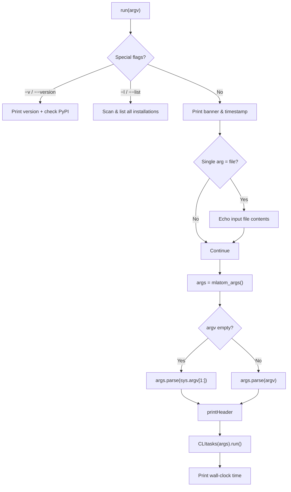
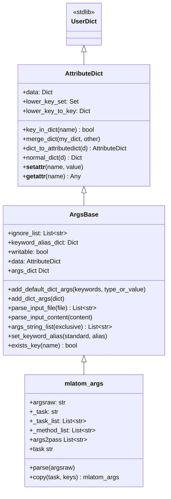
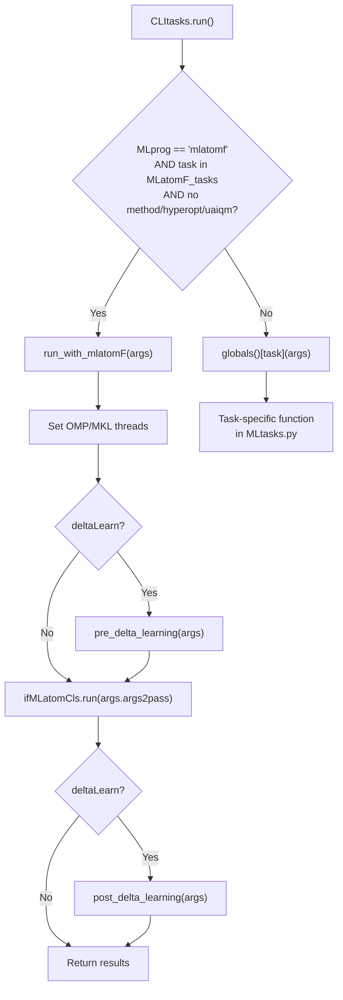

MLatom exposes its entire simulation suite through a unified command-line interface that translates free-form keyword arguments into structured execution plans. This system—built around the `mlatom_args` parser and `CLItasks` dispatcher—serves as the critical bridge between user intent and the package's heterogeneous backends, which span pure Python, Fortran (MLatomF), Julia (KREG), and external quantum chemistry programs. Understanding this pipeline is essential for anyone extending MLatom with new tasks, methods, or backend interfaces.

## Entry Point and Initialization Sequence

Execution begins at the `run()` function in `MLatom.py`, which orchestrates a six-phase startup sequence before delegating to the task dispatcher. The function first performs a dynamic module import using `importlib.util` to guarantee that the mlatom package instance loaded at runtime is precisely the one containing this script file, avoiding ambiguity when multiple installations coexist on `PYTHONPATH` or in site-packages ([MLatom.py](mlatom/MLatom.py#L61-L76)).

Before any argument parsing occurs, the function intercepts two special flag-only modes. The `-v` / `--version` flag prints the current version string from `__version__`, queries the PyPI JSON API for the latest release, and advises upgrading if the installed version is behind ([MLatom.py](mlatom/MLatom.py#L82-L96)). The `-l` / `--list` flag scans `PYTHONPATH` entries and site-packages directories, parses each candidate `__init__.py` for its `__version__` regex match, and prints a table of all discovered mlatom installations with their locations ([MLatom.py](mlatom/MLatom.py#L97-L134)).

Once these pre-checks pass, the runtime prints the package docstring banner, a timestamp, and a reproduction of the full command-line invocation. If a single positional argument is provided and it corresponds to an existing file, the contents of that input file are echoed to stdout before parsing proceeds ([MLatom.py](mlatom/MLatom.py#L136-L152)).

The `mlatom_args` instance is constructed and populated via `parse()`, after which `header.printHeader(args)` resolves and prints relevant literature citations from `ref.json` based on which features and methods are active ([MLatom.py](mlatom/MLatom.py#L153-L162)). Finally, the `CLItasks` dispatcher takes ownership of the parsed arguments and executes the resolved task. Wall-clock timing wraps the entire invocation ([MLatom.py](mlatom/MLatom.py#L164-L168)).

## The Argument Parsing Architecture

MLatom's argument system is a three-layer class hierarchy. At the foundation sits `AttributeDict`, a case-insensitive dictionary wrapper that extends `UserDict` and provides attribute-style access (`args.XYZfile`) alongside bracket notation (`args['XYZfile']`) ([args_class.py](mlatom/args_class.py#L53-L153)). Every key is stored in its original form, but a parallel `lower_key_to_key` mapping enables case-insensitive lookup. Two custom exceptions—`KeyNotFoundException` and `DuplicatedKeyException`—guard against malformed access patterns ([args_class.py](mlatom/args_class.py#L45-L52)).

The middle layer, `ArgsBase`, implements the core parsing engine and is designed to be extended rather than used directly ([args_class.py](mlatom/args_class.py#L153-L172)). It manages keyword registration, input tokenization, type coercion, and alias resolution. The concrete `mlatom_args` subclass populates this engine with the full catalog of MLatom keywords, default values, and domain-specific validation rules ([args_class.py](mlatom/args_class.py#L401-L650)).

### Tokenization: The `_args_extractor` Engine

The static method `ArgsBase._args_extractor(string)` is the lexer that converts raw input text into a flat list of space-delimited tokens ([args_class.py](mlatom/args_class.py#L202-L233)). Its most critical design decision is the handling of nested delimiters: a parenthetical tracking stack (`pair_right`) ensures that content inside parentheses, brackets, braces, and quotation marks is never split on whitespace. This permits inline multi-line values and complex expressions like `hyperopt.sigma(min=0.01, max=10.0)` to survive tokenization intact.

Additionally, the lexer recognizes `#` as a line comment initiator when it appears outside of any delimiter pair, skipping characters until the next newline. This allows users to annotate input files with comments without affecting parsing behavior.

### Type Coercion and Value Resolution

After tokenization, `parse_input_content()` splits each token on the first `=` character to separate keys from values ([args_class.py](mlatom/args_class.py#L240-L267)). Standalone tokens (no `=` sign) are treated as boolean flags and set to `True` in the argument store. Key-value pairs undergo type coercion via the static `_convert_to_value_with_type()` method, which attempts `int` conversion first, then `float`, and falls back to the raw string—unless the value is literally `'true'` or `'false'`, in which case it resolves to the Python boolean ([args_class.py](mlatom/args_class.py#L379-L398)).

Dotted keys (e.g., `hyperopt.max_evals=8`) are expanded into nested dictionaries by `_multi_level_dict()`, which reverses the dot-split segments and progressively wraps each level in a new `AttributeDict` ([args_class.py](mlatom/args_class.py#L269-L278)). This means `ase.fmax=0.02` becomes `{'ase': {'fmax': 0.02}}` in the internal data structure, enabling organized namespacing for subsystem configurations.

### Keyword Alias Resolution

The alias system allows users to refer to methods and tasks by their human-readable literature names rather than their internal identifiers. Aliases are registered with `set_keyword_alias(standard, aliases)` and stored as lowercase mappings in `keyword_alias_dict` ([args_class.py](mlatom/args_class.py#L343-L353)). The `mlatom_args` constructor registers dozens of aliases covering AIQM methods (`AIQM1@DFT*` → `AIQM1DFTstar`), ANI variants (`ANI-1x` → `ani1x`), semiempirical methods (`GFN2-xTB` → `gfn2xtb`), and task names (`ML-NEA` → `crossSection`) ([args_class.py](mlatom/args_class.py#L446-L485)). Resolution is bidirectional: both attribute access (`args.AIQM1DFTstar`) and dict-style access (`args['AIQM1@DFT*']`) route through `_restore_alias_key()`.

> [!TIP]
> The `writable` flag on `ArgsBase` is set to `True` only during `add_default_dict_args()` calls and `False` otherwise. Attempts to write to the `data` dictionary outside of these sanctioned operations are silently redirected to the instance `__dict__` instead, preventing accidental mutation of the argument store after initialization ([args_class.py](mlatom/args_class.py#L177-L180)).

## The `mlatom_args` Concrete Class

The `mlatom_args` constructor is the single largest initialization routine in the argument subsystem, registering over a hundred keyword defaults organized by functional domain ([args_class.py](mlatom/args_class.py#L407-L650)). These registrations fall into distinct categories:

**Task flags.** Every entry in `_task_list` is registered as a boolean default (`False`), encompassing ML tasks (`useMLmodel`, `createMLmodel`, `estAccMLmodel`, `selfCorrect`, `learningCurve`), data tasks (`XYZ2X`, `XYZ2SMI`, `SMI2XYZ`, `analyze`, `sample`, `slice`), simulation tasks (`geomopt`, `ts`, `freq`, `irc`, `ir`, `raman`, `MD`, `MD2vibr`), spectroscopy tasks (`crossSection`), quantum dynamics (`MLQD`), photophysics (`MLTPA`), and active learning (`al`) ([args_class.py](mlatom/args_class.py#L410-L437)).

**Method flags.** The method registry is dynamically populated from `models.known_methods()` rather than hardcoded, ensuring that any method registered with the models subsystem is automatically available as a CLI flag ([args_class.py](mlatom/args_class.py#L444)).

**IO and model parameters.** File path arguments (`XYZfile`, `Yfile`, `MLmodelIn`, `MLmodelOut`), model configuration (`MLmodelType`, `MLprog`), and sampling controls (`Ntrain`, `Ntest`, `Sampling`) are initialized with type-appropriate defaults—empty strings for paths, specific values for numerical parameters ([args_class.py](mlatom/args_class.py#L491-L562)).

**Molecular dynamics parameters.** A large block of defaults covers the MD engine: time step (`dt=0.1 fs`), trajectory length (`trun=1000 fs`), output file patterns (`trajXYZout`, `trajEpot`, etc.), thermostat settings (`ensemble='nve'`, `gamma=0.2`, `temp=300`), and integration controls (`NHClength=3`, `Nc=3`, `Nys=7`) ([args_class.py](mlatom/args_class.py#L594-L632)).

| Parameter Group | Representative Defaults | Registration Method |
|---|---|---|
| Task flags | All `False` | `add_default_dict_args(list, bool)` |
| Method flags | All `False` | `add_default_dict_args(models.known_methods(), bool)` |
| File paths | `''` (empty string) | `add_default_dict_args(list, None)` then `''` |
| Sampling | `Ntrain=None`, `Sampling='random'` | Mixed `None` and dict defaults |
| Hyperopt | `max_evals=8`, `algorithm='tpe'` | `parse_input_content([...])` |
| MD engine | `dt=0.1`, `trun=1000`, `ensemble='nve'` | `add_dict_args({...})` |
| ASE interface | `ase.fmax=0.02`, `ase.steps=200` | `parse_input_content([...])` |
| UAIQM control | `uaiqm=''`, `ncpus=''` | `add_default_dict_args(list, '')` |

## Task Resolution and Dispatch

After raw parsing completes, `mlatom_args.parse()` invokes `_post_operations()`, which chains three validation routines: ML program inference (`_post_operations` lines 669–674), argument consistency checks (`_checkArgs`), and hyperparameter extraction (`_check_hyperopt`) ([args_class.py](mlatom/args_class.py#L668-L677)).

### The `_checkArgs` Resolution Algorithm

Task resolution in `_checkArgs()` follows a deterministic priority cascade ([args_class.py](mlatom/args_class.py#L706-L748)):

1. **Single task.** If exactly one task flag is `True` in the data store, that task is selected directly.
2. **Multiple tasks with composite handling.** If both `selfCorrect` and any other task are present, the task resolves to `selfCorrect`. If `geomopt` and `freq` appear together, the composite task `optfreq` is selected. Similarly, `ts` + `freq` yields `tsfreq`.
3. **Multiple tasks without composite.** The first task in `_task_list` order wins; remaining tasks are set to `False` with a warning. If `useMLmodel` is present alongside another task, it is silently omitted.
4. **Method-only invocation.** If no task flag is set but a method is specified, the task defaults to `useMLmodel`.
5. **UAIQM fallback.** If `uaiqm` is truthy and no task is resolved, `useMLmodel` is assigned.
6. **No task, no method.** The help documentation is printed and execution terminates with an error.

The method resolution follows a complementary path: if the `method` key has a string value matching `_method_list`, its boolean flag is set to `True`. Otherwise, the method list is scanned for the first `True` flag, or any key containing `/` (indicating a file-path-based method specification) ([args_class.py](mlatom/args_class.py#L732-L743)).

### The `CLItasks.run()` Dispatch Gate

The `CLItasks` class in `MLtasks.py` is a thin dispatcher with a single branching decision ([MLtasks.py](mlatom/MLtasks.py#L14-L30)). Its `run()` method checks three conditions that route to the Fortran backend:

1. `MLprog` is `'mlatomf'`
2. The resolved task is in the `MLatomF_tasks` allowlist: `useMLmodel`, `createMLmodel`, `estAccMLmodel`, `XYZ2X`, `analize`, `sample`
3. No `method`, `hyperparameter_optimization`, or `uaiqm` override is active

When all three conditions hold, execution delegates to `run_with_mlatomF()`, which sets OpenMP thread counts from `nthreads`, optionally pre-processes delta-learning arguments, invokes the Fortran interface `interface_MLatomF.ifMLatomCls.run(args.args2pass)`, and post-processes delta-learning results ([MLtasks.py](mlatom/MLtasks.py#L31-L40)). The `args2pass` property filters the full argument list to exclude values that match the defaults recorded at construction time, passing only user-specified overrides to the Fortran backend ([args_class.py](mlatom/args_class.py#L652-L654)).

When the Fortran gate does not apply, dispatch uses Python's `globals()` dictionary to resolve the task name to its corresponding function: `globals()[self.args.task](self.args)` ([MLtasks.py](mlatom/MLtasks.py#L29)). This means every task name in `_task_list` must have a function of exactly the same name defined at module scope in `MLtasks.py`—a convention explicitly documented in the source comments ([MLtasks.py](mlatom/MLtasks.py#L42)).

## Multi-Line Argument Handling and File Spillover

A subtle but important post-processing step handles arguments whose values contain newline characters. The `_multi_lines_to_file()` method detects such arguments in `args2pass`, generates a deterministic filename from the key and an MD5 hash of the value, writes the value to that temporary file, and re-parses the key with the new filename ([args_class.py](mlatom/args_class.py#L679-L689)). Files whose keys contain `'xyz'` receive a `.xyz` extension. This mechanism allows users to pass multi-molecule geometry data directly on the command line or in inline input without creating explicit files.

## Hyperparameter Extraction

The `_check_hyperopt()` method scans `args2pass` for arguments matching the regex pattern `hyperopt\..+?\(.+?\)`, which captures callable-style hyperparameter search spaces like `hyperopt.sigma(min=0.01, max=10.0)` ([args_class.py](mlatom/args_class.py#L691-L705)). Detected parameters are stored in `hyperparameter_optimization['hyperparameters']` as a list of parameter names, while their raw string definitions are preserved in `_hyperopt_str_dict` for later evaluation by the hyperparameter optimization routines in the training pipeline.

## Argument Copying and Selective Re-parsing

The `copy()` method on `mlatom_args` creates a fresh instance re-parsed from either the full `args2pass` list or a filtered subset ([args_class.py](mlatom/args_class.py#L750-L759)). When `keys` is provided, only arguments whose keys (before the `=` sign) match the lowercase key list are retained, plus an optional task override. This is used by the active learning pipeline and self-correction workflow to spawn sub-invocations with a subset of the parent configuration.

## Help System Integration

When parsing encounters a standalone `help`, `-help`, `-h`, or `--help` token (outside any delimiter pair), the `_print_doc()` method delegates to `Doc.printDoc(self.args_dict)` ([args_class.py](mlatom/args_class.py#L280-L283)). The `Doc` class in `doc.py` matches argument keys against a curated `help_text` dictionary and dispatches to interface-specific `printHelp()` functions for ML program backends (TorchANI, GAP, sGDML, DeePMD-kit, PhysNet, MACE, MLatomF) ([doc.py](mlatom/doc.py#L11-L66)). If no specific help topic matches, the overview text is displayed. After printing help, the application terminates cleanly via `stopper.stopMLatom('')`.

## Suggested Next Steps

- **[Architecture Overview](5-architecture-overview)** — for the broader context of how the CLI layer fits within MLatom's module topology
- **[Model Class Hierarchy](9-model-class-hierarchy)** — to trace how `loading_model()` in task functions resolves parsed arguments into concrete model objects
- **[Fortran Backend MLatomF](28-fortran-backend-mlatomf)** — for details on what happens after the `run_with_mlatomF()` dispatch gate
- **[Active Learning Pipeline](24-active-learning-pipeline)** — to see how `mlatom_args.copy()` enables selective argument inheritance in iterative workflows