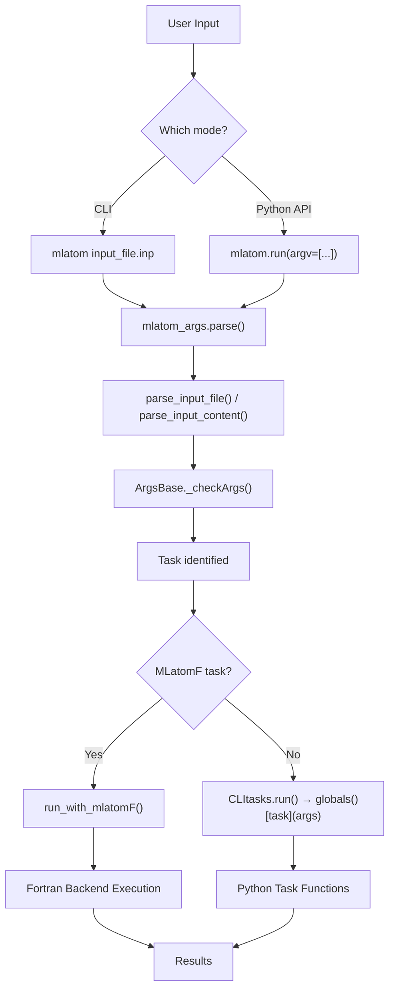

MLatom 3.22.0 offers two primary usage modes — a **command-line interface (CLI)** driven by keyword-based input files, and a **Python API** for programmatic integration. Both modes ultimately funnel through the same internal pipeline: argument parsing → task dispatch → execution. Understanding how these modes work and how input files are structured is the essential first step before exploring any specific ML workflow.

## High-Level Architecture

Every MLatom invocation follows a single, predictable path regardless of the usage mode you choose. Arguments are parsed into a structured dictionary, a task is identified, and the corresponding function in the task engine is invoked.



This diagram illustrates the core insight: **both usage modes converge on the same `mlatom_args` parser and `CLItasks` dispatcher**. The CLI mode is simply a thin wrapper that reads an input file and passes the extracted tokens to the same machinery the Python API uses directly.
Sources: [MLatom.py](mlatom/MLatom.py#L61-L174), [MLtasks.py](mlatom/MLtasks.py#L14-L29)

## The Command-Line Interface (CLI)

The CLI is the most common way to use MLatom. You invoke it by passing a single input file name as an argument. If the file exists, MLatom reads it; if you pass inline keyword-value pairs instead, those are parsed directly.

### Basic Invocation

```bash
# Using an input file (most common)
mlatom my_calculation.inp

# Using inline arguments (less common, but supported)
mlatom useMLmodel XYZfile=molecules.xyz AIQM1

# Check version or list installations
mlatom -v
mlatom -l
```

When a single argument is provided and it corresponds to an existing file, MLatom automatically reads it as an input file and echoes its contents to the console for reproducibility [MLatom.py](mlatom/MLatom.py#L145-L152). If the argument is not a file, it is treated as a space-separated list of keyword-value pairs.

### The Input File Format

MLatom input files use a flat, **keyword=value** syntax — one keyword per logical unit, separated by whitespace or newlines. Comments begin with `#` and are stripped out during parsing. This deliberately simple format means there are no section headers, no nested blocks, and no indentation rules to remember.

Here is a representative input file that trains a KREG model and estimates its accuracy:

```text
# my_calculation.inp - Train and test a ML model

# Task: estimate accuracy (trains + predicts on test set)
estAccMLmodel

# Input data
XYZfile=training_data.xyz
Yfile=reference_energies.dat

# Model type
MLmodelType=KREG
MLmodelOut=my_model.unf

# Sampling settings
Ntrain=800
Nvalidate=100
Ntest=100

# Kernel and descriptor
kernel=Gaussian
molDescriptor=RE
```

### Keyword-Value Syntax Rules

The argument extractor in `ArgsBase._args_extractor()` processes the raw text with a few important rules [args_class.py](mlatom/args_class.py#L202-L233):

| Rule | Behavior | Example |
|------|----------|---------|
| **Whitespace separation** | Keywords are separated by spaces, tabs, or newlines | `XYZfile=data.xyz Ntrain=100` works |
| **Equals sign for values** | `key=value` assigns a value; `key` alone sets it to `True` | `createMLmodel` → `True`; `Ntrain=500` → `500` |
| **Comments** | Everything after `#` on a line is ignored until the next newline | `Ntrain=100 # use 100 structures` |
| **Bracket matching** | Parentheses `()`, brackets `[]`, braces `{}`, and quotes are balanced before splitting | `hyperopt.sigma=(1,10)` is kept intact |
| **Dot notation** | Periods create nested dictionaries | `ase.fmax=0.02` becomes `{'ase': {'fmax': '0.02'}}` |

The `parse_input_content` method further distinguishes between flag-only keywords and keyword-value pairs. If a string contains no `=` sign, it is treated as a boolean flag set to `True` [args_class.py](mlatom/args_class.py#L240-L267).

> [!TIP]
> **Inline multi-line data**: If a keyword value contains newline characters (e.g., inline XYZ geometries), MLatom automatically writes the data to a temporary file using an MD5-based hash for the filename and replaces the value with the file path. This is handled transparently in `_multi_lines_to_file()` [args_class.py](mlatom/args_class.py#L679-L689).

## Supported Tasks

The task system is the backbone of MLatom's CLI. When `mlatom_args._checkArgs()` runs, it scans the parsed arguments against a master task list to determine which workflow to execute [args_class.py](mlatom/args_class.py#L706-L748).

### Complete Task Reference

The `_task_list` in `mlatom_args` defines every available task [args_class.py](mlatom/args_class.py#L410-L437):

| Category | Task Keyword | Description |
|----------|-------------|-------------|
| **ML Tasks** | `useMLmodel` | Predict properties with an existing model or method |
| | `createMLmodel` | Train a new ML model from data |
| | `estAccMLmodel` | Train and evaluate model accuracy on test set |
| | `selfCorrect` | Multi-layer self-correction (delta learning) |
| | `learningCurve` | Generate learning curves with varying training sizes |
| **Data Tasks** | `XYZ2X` | Convert XYZ geometries to descriptor vectors |
| | `XYZ2SMI` | Convert XYZ to SMILES notation |
| | `SMI2XYZ` | Convert SMILES to 3D XYZ geometries |
| | `analyze` | Analyze prediction statistics |
| | `sample` | Sample molecular data into train/validate/test subsets |
| | `slice` / `sampleFromSlices` / `mergeSlices` | Advanced data slicing operations |
| **Potential Energy Surface** | `geomopt` | Geometry optimization |
| | `ts` | Transition state search |
| | `freq` | Frequency and thermochemistry calculation |
| | `irc` | Intrinsic reaction coordinate analysis |
| | `ir` / `raman` | Vibrational spectra calculation |
| **Dynamics** | `MD` | Molecular dynamics simulation |
| | `MD2vibr` | Convert MD trajectories to vibrational spectra |
| | `crossSection` | UV-Vis cross-section via ML-NEA |
| | `MLQD` | Machine learning quantum dynamics |
| | `MLTPA` | ML-based triplet pair annihilation |
| **Active Learning** | `al` | Active learning pipeline |

### Task Resolution Logic

When multiple tasks are specified in a single input file, MLatom applies precedence rules [args_class.py](mlatom/args_class.py#L706-L728):

1. If only **one** task is detected, it is used directly.
2. If `selfCorrect` is among multiple tasks, `selfCorrect` takes priority.
3. The combination `geomopt` + `freq` is resolved to the composite task `optfreq`.
4. The combination `ts` + `freq` is resolved to `tsfreq`.
5. If `useMLmodel` appears alongside other tasks, it is silently omitted.
6. Otherwise, the **first** task in the list wins, and a warning is printed.

If no explicit task is specified but a `method` (like `AIQM1`) is present, MLatom automatically infers `useMLmodel` as the task. If neither a task nor a method is provided, the help documentation is displayed and execution stops [args_class.py](mlatom/args_class.py#L743-L748).

## Key Input Parameters

Beyond the task keyword, input files specify data sources, model configuration, and task-specific settings. The `mlatom_args.__init__()` method registers hundreds of default parameters, all accessible as keyword=value pairs [args_class.py](mlatom/args_class.py#L491-L650).

### Data Input/Output Parameters

These parameters control where MLatom reads data from and writes results to:

| Parameter | Purpose | Default |
|-----------|---------|---------|
| `XYZfile` | Input molecular geometries (XYZ format) | `''` (empty) |
| `jsonfile` | Input molecular database (JSON format) | `''` (empty) |
| `Yfile` | Reference scalar properties (e.g., energies) | `''` (empty) |
| `YgradXYZfile` | Reference gradient properties | `''` (empty) |
| `YestFile` | Output file for predicted scalar values | `''` (empty) |
| `YgradXYZestFile` | Output file for predicted gradients | `''` (empty) |
| `HessianEstFile` | Output file for predicted Hessians | `''` (empty) |
| `MLmodelIn` | Input (pre-trained) ML model file | `''` (empty) |
| `MLmodelOut` | Output (newly trained) ML model file | `''` (empty) |

When both `XYZfile` and `jsonfile` are provided, the JSON file takes precedence with a warning message [MLtasks.py](mlatom/MLtasks.py#L672-L696).

### Model Configuration Parameters

| Parameter | Purpose | Default |
|-----------|---------|---------|
| `MLmodelType` | Type of ML model (e.g., `KREG`, `ANI`, `sGDML`) | `''` (auto: `MLatomF`) |
| `MLprog` | ML program backend | `''` (auto-determined from model type) |
| `method` | Computational method (e.g., `AIQM1`, `ANI-2x`) | `''` (none) |
| `kernel` | Kernel function type for KRR/KREG | `'Gaussian'` |
| `molDescriptor` | Molecular descriptor type | `'RE'` |
| `nthreads` | Number of CPU threads | `None` (system default) |

### Sampling Parameters

| Parameter | Purpose | Default |
|-----------|---------|---------|
| `Nuse` | Total number of data points to use | `None` |
| `Ntrain` | Number of training points | `None` |
| `Nvalidate` | Number of validation points | `None` |
| `Ntest` | Number of test points | `None` |
| `Sampling` | Sampling strategy (`'random'`, `'structure-based'`, etc.) | `'random'` |
| `iTrainIn` / `iTrainOut` | Custom train subset index file in/out | `''` |

## Method Keyword Aliases

MLatom supports a rich set of computational methods and provides convenient aliases so you can use the notation most familiar to you. These aliases are registered via `set_keyword_alias()` in the `mlatom_args` constructor [args_class.py](mlatom/args_class.py#L457-L485):

| Preferred Alias | Internal Key | Example Input |
|----------------|-------------|---------------|
| `AIQM1@DFT*` | `AIQM1DFTstar` | `AIQM1@DFT* XYZfile=mol.xyz` |
| `AIQM2@DFT` | `AIQM2DFT` | `AIQM2@DFT XYZfile=mol.xyz` |
| `AIQM3@DFT` | `AIQM3DFT` | `AIQM3@DFT XYZfile=mol.xyz` |
| `ANI-1ccx` | `ani1ccx` | `ANI-1ccx XYZfile=mol.xyz` |
| `ANI-2x` | `ani2x` | `ANI-2x XYZfile=mol.xyz` |
| `GFN2-xTB` | `gfn2xtb` | `GFN2-xTB XYZfile=mol.xyz` |
| `CCSD(T)*/CBS` | `CCSDTstarCBS` | `CCSD(T)*/CBS XYZfile=mol.xyz` |
| `AIMNet2@B973c` | `aimnet2atb973c` | `AIMNet2@B973c XYZfile=mol.xyz` |
| `omni-p1` | `omnip1` | `omni-p1 XYZfile=mol.xyz` |

The `methods()` function in `models.py` resolves these keywords into the appropriate model class instances [models.py](mlatom/models.py#L627-L693).

## The Python API Mode

For integration into larger workflows, Jupyter notebooks, or custom scripts, MLatom exposes a full Python API. The public interface is re-exported from `__init__.py` [mlatom/__init__.py](mlatom/__init__.py#L1-L17):

### Programmatic Invocation

You can replicate any CLI invocation in Python using `mlatom.run()`:

```python
import mlatom

# Equivalent to: mlatom input_file.inp
mlatom.run(['input_file.inp'])

# Or pass arguments directly (no file needed)
mlatom.run(['useMLmodel', 'XYZfile=molecules.xyz', 'AIQM1'])
```

The `run()` function handles module loading, version checks, argument parsing, task dispatch, and timing — exactly mirroring the CLI path [MLatom.py](mlatom/MLatom.py#L61-L174).

### Direct Python Usage (Advanced)

For finer control, you can import individual components and build your pipeline:

```python
import mlatom

# Load molecules
mol_db = mlatom.molecular_database.from_xyz_file('molecules.xyz')

# Create and use a method
model = mlatom.methods(method='AIQM1')
model.predict(molecular_database=mol_db,
              calculate_energy=True,
              calculate_energy_gradients=True)

# Access results
for mol in mol_db:
    print(f'Energy: {mol.energy:.6f} Hartree')
```

Key imports available from the top-level `mlatom` namespace include: `atom`, `molecule`, `molecular_database`, `kreg`, `ani`, `methods`, `aiqm1`, `aiqm2`, `aiqm3`, `optimize_geometry`, `freq`, `md`, `irc`, `al`, and more [mlatom/__init__.py](mlatom/__init__.py#L2-L14).

## Fortran Backend (MLatomF) Dispatch

Certain tasks are automatically routed to the Fortran backend `MLatomF` for performance. The `CLItasks` class maintains a whitelist of tasks eligible for Fortran execution [MLtasks.py](mlatom/MLtasks.py#L15-L22):

| MLatomF-eligible Tasks | Conditions |
|----------------------|------------|
| `useMLmodel`, `createMLmodel`, `estAccMLmodel`, `XYZ2X`, `sample` | No custom `method`, no `hyperparameter_optimization`, no `uaiqm`, and `MLprog=mlatomf` |

If any of those conditions are violated (e.g., you specify `AIQM1` as the method, or request hyperparameter optimization), execution falls back to the Python implementation via `globals()[self.args.task](self.args)` [MLtasks.py](mlatom/MLtasks.py#L25-L29).

## Putting It All Together: Example Input Files

### Predicting energies with AIQM1

```text
# inp - Calculate energies with the AIQM1 method
useMLmodel
XYZfile=molecules.xyz
AIQM1
```

### Training a KREG model

```text
# train.inp - Train a kernel ridge regression model
createMLmodel
XYZfile=training_data.xyz
Yfile=energies.dat
YgradXYZfile=gradients.dat
MLmodelType=KREG
MLmodelOut=my_model.unf
kernel=Gaussian
molDescriptor=RE
Ntrain=800
Nvalidate=100
```

### Geometry optimization with a trained model

```text
# opt.inp - Optimize geometry with a pre-trained model
geomopt
XYZfile=initial_geometry.xyz
MLmodelIn=my_model.unf
optXYZ=optimized.xyz
ase.fmax=0.0005
ase.steps=500
```

### Estimating model accuracy with cross-validation

```text
# cv.inp - Evaluate model with k-fold cross-validation
estAccMLmodel
XYZfile=data.xyz
Yfile=energies.dat
YgradXYZfile=gradients.dat
MLmodelType=KREG
kernel=Gaussian
molDescriptor=RE
NcvTestFolds=5
hyperopt.max_evals=20
hyperopt.algorithm=tpe
```

> [!TIP]
> **Hyperparameter search syntax**: Hyperparameter optimization uses the dot-notation prefix `hyperopt.`. Ranges are specified with parentheses using a comma-separated format, e.g., `hyperopt.sigma=(1,10)`. The optimization algorithm and loss function are configured separately via `hyperopt.algorithm=tpe` and `hyperopt.losstype=geomean` [args_class.py](mlatom/args_class.py#L540-L547).

## Quick Reference: Common Input Patterns

| Goal | Key Parameters |
|------|---------------|
| **Use a pre-trained model** | `useMLmodel` + `XYZfile` + `MLmodelIn` |
| **Use a built-in method** | `useMLmodel` + `XYZfile` + `method` (e.g., `AIQM1`) |
| **Train a new model** | `createMLmodel` + `XYZfile` + `Yfile` + `MLmodelType` + `MLmodelOut` |
| **Estimate accuracy** | `estAccMLmodel` + `XYZfile` + `Yfile` + `Ntest` |
| **Geometry optimization** | `geomopt` + `XYZfile` + `MLmodelIn` (or `method`) |
| **Run dynamics** | `MD` + `XYZfile` (or `initXYZ`) + `method` + `dt` + `trun` |

---

With these fundamentals in place, you are ready to explore MLatom's deeper systems. The natural next step is understanding the [Architecture Overview](5-architecture-overview) to see how the parsed arguments flow through the model and data layers. From there, depending on your workflow, you may want to jump to [Model Class Hierarchy](9-model-class-hierarchy) for how models are constructed, or [Molecule and Atom Classes](6-molecule-and-atom-classes) for how molecular data is represented internally.