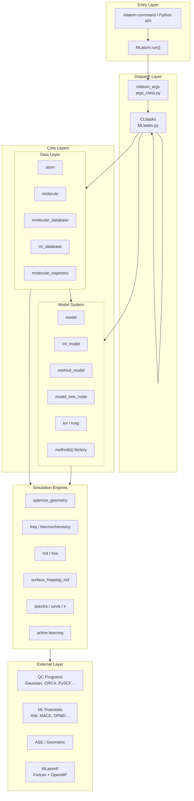
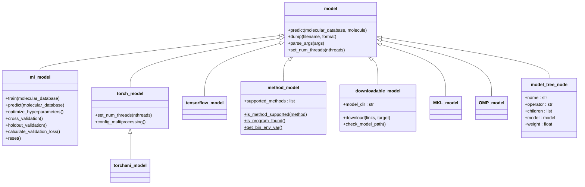

MLatom 3.22.0 is a comprehensive Python package for atomistic simulations powered by machine learning. It unifies molecular data management, a polyglot model system spanning kernel methods and neural network potentials, quantum chemistry program interfaces, and simulation engines (geometry optimization, molecular dynamics, spectroscopy, and nonadiabatic dynamics) under a single coherent framework. This page maps the architectural decisions that make this integration possible, providing the conceptual map you need before diving into any individual subsystem.

## High-Level System Architecture

The entire MLatom runtime can be understood as a pipeline with five functional layers, each with well-defined boundaries and data contracts. Execution enters through a CLI entry point, flows through argument parsing and task dispatch, then branches into one of several domain-specific engines depending on the requested operation.



The dispatch layer receives raw CLI input, normalizes it through the `mlatom_args` parser, and routes execution to the appropriate task function. All tasks consume data objects from the data layer and invoke models from the model system. Simulation engines orchestrate iterative model calls (e.g., geometry optimization loops, MD propagation) and can delegate to external programs through the interface layer.

Sources: [MLatom.py](mlatom/MLatom.py#L61-L175), [MLtasks.py](mlatom/MLtasks.py#L14-L31), [args_class.py](mlatom/args_class.py#L401-L408)

## Project Structure Map

The source tree is organized into clearly separated concerns. The top-level `mlatom/` package contains the core Python modules, while `MLatomF_src/` houses the legacy Fortran backend that still handles high-performance kernel ridge regression.

```
mlatom/
├── MLatom.py                 # CLI entry point & runtime bootstrap
├── __init__.py               # Package version (3.22.0) & public API
├── args_class.py             # Argument parsing infrastructure
├── MLtasks.py                # Task registry & dispatch functions
│
├── data.py                   # atom, molecule, molecular_database, trajectories
├── model_cls.py              # Abstract model hierarchy & hyperparameter system
├── models.py                 # krr, kreg, methods() factory, model I/O
│
├── simulations.py            # Geometry optimization, frequency, DMC
├── md.py                     # Molecular dynamics (NVE, thermostats)
├── namd.py                   # Nonadiabatic / surface-hopping dynamics
├── spectra.py                # IR, Raman, UV-Vis, spectrum comparison
├── al.py                     # Active learning pipeline
│
├── interfaces/               # 25+ external program adapters
│   ├── gaussian_interface.py
│   ├── orca_interface.py
│   ├── pyscf_interface.py
│   ├── torchani_interface.py
│   ├── mace_interface.py
│   ├── dpmd_interface.py
│   ├── ase_interface.py
│   └── ...                   # xtb, xtb_interface, columbus, dftbplus, etc.
│
├── addons/                   # Extended models (separate distribution)
│   ├── aiqm3/                # AIQM3 neural network potential
│   ├── uaiqm/                # Universal AIQM variants
│   └── omnip2x/              # Multi-state OmniP2x potentials
│
├── MLatomF_src/              # Fortran backend (MLatomF)
│   ├── MLatomF.f90           # Main Fortran program
│   ├── MLmodel.f90           # ML model management
│   ├── A_KRR.f90             # Kernel ridge regression (OpenMP)
│   ├── dataset.f90           # Dataset handling
│   └── ...
│
└── interface_MLatomF.py      # Python ↔ Fortran bridge
```

Sources: [__init__.py](mlatom/__init__.py#L16-L17), [MLtasks.py](mlatom/MLtasks.py#L14-L43)

## Entry Point and Dispatch

Execution begins in `MLatom.run()`, which performs a careful dynamic import of the `mlatom` package to guarantee the correct instance is loaded regardless of the invocation context. It then initializes three key objects: `header` (citation output), `CLItasks` (the task router), and `mlatom_args` (the argument parser). The flow proceeds as: parse CLI arguments → print header → execute `CLItasks(args).run()` → report wall-clock time.

The `CLItasks` class maintains a mapping between task keywords (e.g., `'geomopt'`, `'MD'`, `'createMLmodel'`) and their corresponding handler functions defined in the same module. Each handler follows a consistent pattern: load data, load or create a model, perform the computation, and save results. The `run_with_mlatomF()` function provides a fallback path that delegates certain tasks entirely to the Fortran backend for legacy compatibility.

Sources: [MLatom.py](mlatom/MLatom.py#L61-L174), [MLtasks.py](mlatom/MLtasks.py#L14-L31), [MLtasks.py](mlatom/MLtasks.py#L43-L86), [MLtasks.py](mlatom/MLtasks.py#L31-L42)

## Argument Parsing Infrastructure

The argument system is built on a two-tier class hierarchy in `args_class.py`. The base class `ArgsBase` provides a case-insensitive, attribute-style dictionary (`AttributeDict`) with support for nested key-value extraction from input files. It handles type coercion (strings to integers, floats, booleans, lists), multi-level dictionary construction from dotted keys, keyword aliases, and input file parsing that tolerates both `key = value` and `key value` syntaxes.

The concrete `mlatom_args` subclass specializes this for MLatom's domain, adding post-processing steps such as multi-line argument expansion (`_multi_lines_to_file`), hyperparameter optimization detection (`_check_hyperopt`), and argument validation (`_checkArgs`). It also exposes a `task` property that identifies which simulation task was requested, and a `copy()` method that allows task handlers to fork argument sets with selective key filtering.

Sources: [args_class.py](mlatom/args_class.py#L53-L153), [args_class.py](mlatom/args_class.py#L401-L770)

## Data Layer

The data layer in `data.py` is the foundational substrate for every computation in MLatom. It defines two parallel hierarchies: a simple ML-oriented path and a chemistry-oriented path, connected by the model system.

| Class | Purpose | Key Properties |
|-------|---------|---------------|
| `entry` | Generic (x, y) data point | `x`, `y` |
| `ml_database` | Collection of entries | `entries`, `x`, `y`, `size` |
| `atom` | Single atom with identity and coordinates | `nuclear_charge`, `element_symbol`, `xyz_coordinates`, `nuclear_mass` |
| `molecule` | Full molecular system with dynamic properties | `atoms`, `xyz_coordinates`, `energy`, `energy_gradients`, `charges`, `velocities` |
| `molecular_database` | Ordered collection of molecules | `molecules`, plus iteration, indexing, slicing |
| `molecular_trajectory` | Time-series from dynamics/optimization | HDF5-backed storage, step access, checkpointing |

The `molecule` class is notably rich — it uses Python's dynamic attribute system to attach arbitrary scalar, vectorial, and tensor properties (energies, gradients, Hessians, dipole moments, nonadiabatic couplings). It supports periodic boundary conditions (`pbc`, `cell` properties), SMILES parsing, geometric operations (rotate, translate, align, proliferate), and physical property calculations (kinetic energy, angular momentum, moment of inertia). The `molecular_trajectory` class wraps HDF5-based I/O for efficient storage of large trajectory datasets, and the `h5dataloader` provides batched access for training workflows.

Sources: [data.py](mlatom/data.py#L23-L164), [data.py](mlatom/data.py#L191-L315), [data.py](mlatom/data.py#L356-L409), [data.py](mlatom/data.py#L2738-L2741)

## Model Class Hierarchy

The model system is the architectural heart of MLatom, designed to present a uniform `predict()` interface across an enormously diverse set of computational methods — from semiempirical quantum chemistry to deep neural network potentials to composite delta-learning schemes.



The root `model` class establishes the universal contract: every model must implement `predict()` and can optionally override `dump()`, `parse_args()`, and `set_num_threads()`. The `ml_model` subclass extends this with training capabilities (`train()`, `reset()`) and a comprehensive hyperparameter optimization framework that supports grid search, cross-validation, and holdout validation. The `method_model` class adds program-discovery logic — it can check whether a required external binary is available via environment variables and whether a given method string is in its `supported_methods` list. The `model_tree_node` class enables the construction of composite model expressions (e.g., delta-learning corrections like `AIQM1 + Δ-ML`) by combining child models with arithmetic operators.

Sources: [model_cls.py](mlatom/model_cls.py#L20-L137), [model_cls.py](mlatom/model_cls.py#L343-L420), [model_cls.py](mlatom/model_cls.py#L175-L207), [model_cls.py](mlatom/model_cls.py#L208-L313), [model_cls.py](mlatom/model_cls.py#L960-L994)

## Model Factory and Registry

The `models.py` module provides the central `methods()` factory function and a `known_classes` registry that together implement an auto-discovery pattern for computational methods. When `methods(method='AIQM1')` is called without specifying a program, the factory iterates through `known_classes` in priority order and returns the first class that both (a) has its required program installed and (b) supports the requested method string. This design allows users to write program-agnostic code while still supporting explicit program specification when needed.

The `known_classes` list is ordered by priority: `aiqm1 → aiqm2 → aiqm3 → dens → ani_methods → aimnet2_methods → mace_methods → ccsdtstarcbs → gaussian_methods → pyscf_methods → orca_methods → turbomole_methods → mndo_methods → sparrow_methods → xtb_methods → dftbplus_methods → columbus_methods → dftd3_methods → dftd4_methods → uaiqm → omnip2x → omnip1`. The module also provides `load()` / `load_json()` / `load_pickle()` functions for deserializing saved model objects, capable of reconstructing the full class hierarchy including nested `model_tree_node` structures.

Sources: [models.py](mlatom/models.py#L18-L20), [models.py](mlatom/models.py#L624-L627), [models.py](mlatom/models.py#L627-L693), [models.py](mlatom/models.py#L700-L766)

## Interface Layer

The `interfaces/` directory contains 25+ adapter modules, each wrapping an external computational program behind MLatom's `method_model` interface. These adapters follow a consistent structural pattern: they define a class (or classes) inheriting from `method_model`, specify `supported_methods`, implement program-discovery logic via `get_bin_env_var()`, and provide the `predict()` method that handles file I/O, subprocess invocation, and result parsing.

| Category | Interfaces | External Dependency |
|----------|-----------|-------------------|
| **Ab initio / DFT** | `gaussian_interface`, `orca_interface`, `pyscf_interface`, `turbomole_interface`, `columbus_interface` | Gaussian, ORCA, PySCF, Turbomole, Columbus |
| **Semiempirical** | `mndo_interface`, `sparrow_interface`, `xtb_interface`, `dftbplus_interface` | MNDO, Sparrow, xtb, DFTB+ |
| **ML Potentials** | `torchani_interface`, `mace_interface`, `dpmd_interface`, `physnet_interface`, `sgdml_interface`, `gap_interface`, `aimnet2_interface` | TorchANI, MACE, DPMD, PhysNet, sGDML, GAP, AIMNet2 |
| **Dispersion** | `dftd3_interface`, `dftd4_interface` | DFT-D3, DFT-D4 |
| **Simulation Tools** | `ase_interface`, `geometric_interface`, `pysisyphus_interface` | ASE, Geometric, PySisyphus |

The `ase_interface` deserves special mention as a cross-cutting integration layer — it converts MLatom's `molecule` objects to/from ASE's `Atoms` objects, enabling access to ASE's extensive ecosystem of optimizers, dynamics engines, and calculators. This is the bridge that allows MLatom's simulation engines to delegate to ASE when needed.

Sources: [interfaces/](mlatom/interfaces/), [model_cls.py](mlatom/model_cls.py#L175-L207), [models.py](mlatom/models.py#L624-L625)

## Simulation Engines

MLatom provides a suite of simulation engines, each implemented as a self-contained class that accepts a model and data objects, then drives an iterative computation loop.

**Geometry Optimization** (`simulations.py` → `optimize_geometry`): Supports multiple backends — internal ASE-based optimization, Gaussian's built-in optimizer, and the external Geometric program. It handles both minima and transition state searches, accepts constraints, and can dump trajectory data at configurable intervals. The class delegates model evaluation to the supplied model's `predict()` method at each optimization step.

**Frequency Analysis** (`simulations.py` → `freq`): Calculates harmonic vibrational frequencies via numerical differentiation of energy gradients (or analytical Hessians from external programs). It also provides IR and Raman intensity calculations through dipole and polarizability derivative evaluation. The `thermochemistry` class extends this with partition-function-based thermochemical analysis.

**Molecular Dynamics** (`md.py` → `md`): Implements velocity Verlet integration with support for NVE, NVT (Andersen, Nosé-Hoover, Langevin thermostats), and periodic boundary conditions. The `propagate()` method drives the main integration loop with configurable time steps, maximum propagation times, and trajectory dumping. Momentum elimination and angular momentum management are built in.

**Nonadiabatic Dynamics** (`namd.py` → `surface_hopping_md`): A full fewest-switches surface hopping (FSSH) implementation with Landau-Zener-based hopping (`LZBL` algorithm), multiple integrators for the electronic wavefunction (Butcher 5th order, Adams-Moulton 5th order, RK4), decoherence corrections (simple decay model), and frustrated hop handling. It supports multi-state potentials and outputs population analysis over trajectories.

Sources: [simulations.py](mlatom/simulations.py#L92-L405), [simulations.py](mlatom/simulations.py#L440-L613), [md.py](mlatom/md.py#L17-L264), [namd.py](mlatom/namd.py#L21-L178)

## Spectroscopy Module

The `spectra.py` module provides a complete spectroscopy toolkit built on top of the simulation results. The base `spectrum` class handles raw spectral data (x/y pairs), interpolation, normalization, and convolution with various broadening functions (Gaussian, Lorentzian). Specialized subclasses implement domain-specific logic:

- **`uvvis`**: UV-Vis spectra via single-point convolution (SPC) and nuclear ensemble approach (NEA)
- **`ir`**: IR spectra from vibrational frequencies and intensities
- **`raman`**: Raman spectra from vibrational frequencies and Raman activities
- **`spectrum_comparison`**: 15+ spectral similarity metrics including Pearson/Spearman correlation, Tanimoto coefficient, KL/Jeffery/JS divergence, Earth mover's distance, cosine similarity, and spectral information divergence

Sources: [spectra.py](mlatom/spectra.py#L17-L220), [spectra.py](mlatom/spectra.py#L539-L624), [spectra.py](mlatom/spectra.py#L626-L997)

## Fortran Backend (MLatomF)

The `MLatomF_src/` directory contains the original Fortran implementation of MLatom, which remains actively used for high-performance kernel ridge regression calculations. The main program (`MLatomF.f90`) handles tasks like descriptor generation (`getX`), model creation, accuracy estimation, and data sampling. It communicates with the Python layer through the `interface_MLatomF.py` bridge module, which manages subprocess execution, input file generation, and output parsing.

Key Fortran modules include `A_KRR.f90` (OpenMP-parallel kernel ridge regression), `A_KRR_kernel.f90` (kernel function implementations), `MLmodel.f90` (model lifecycle management), `dataset.f90` (data I/O), and `molDescr.f90` (molecular descriptors). The Python `kreg` model class can delegate training and prediction to MLatomF when specified via `ml_program='KREG_API'`, leveraging Fortran's superior performance for the matrix algebra-intensive KRR computations.

Sources: [MLatomF.f90](mlatom/MLatomF_src/MLatomF.f90#L69-L80), [interface_MLatomF.py](mlatom/interface_MLatomF.py#L13-L16), [models.py](mlatom/models.py#L343-L364)

## Add-ons System

The `addons/` directory hosts extended models that are distributed separately from the core package. These include `aiqm3` (the AIQM3 neural network potential), `uaiqm` (universal AIQM variants), and `omnip2x` (multi-state potentials for excited-state simulations). Each add-on is structured as a self-contained Python package with its own `__init__.py`, allowing independent versioning and optional installation. The core `models.py` references these add-ons in `known_classes`, and the `methods()` factory will use them if they are installed.

Sources: [addons/](mlatom/addons/), [models.py](mlatom/models.py#L624-L625)

## Cross-Cutting Concerns

Several architectural patterns recur across the entire codebase and are worth understanding before working with any specific subsystem.

**Dynamic property attachment**: Both the `molecule` and `model` classes use Python's `__setattr__` / `__getattr__` to allow arbitrary named properties. In `molecule`, this means calling `mol.some_property = value` creates a new property accessible as `mol.some_property`. This pattern avoids the need for extensive schema definitions but requires awareness that property names are not statically checked.

**Parallel execution**: The `run_in_parallel()` function in `simulations.py` provides a generic multiprocessing wrapper that distributes model predictions across CPU cores. Thread-level parallelism is managed through the `set_num_threads()` interface on model classes, with framework-specific implementations for PyTorch (`torch_model`), TensorFlow (`tensorflow_model`), OpenMP (`OMP_model`), and MKL (`MKL_model`).

**Serialization**: All core objects support JSON serialization via `dump()` methods. The `model_tree_node` class serializes its full tree structure recursively, enabling complex composite models (like delta-learning corrections) to be saved and restored. The `molecular_trajectory` class uses HDF5 for efficient binary serialization of large trajectory datasets.

Sources: [simulations.py](mlatom/simulations.py#L25-L92), [model_cls.py](mlatom/model_cls.py#L139-L171), [model_cls.py](mlatom/model_cls.py#L109-L116)

---

## Navigating Further

This architecture overview provides the conceptual scaffolding for understanding MLatom's design. From here, the recommended reading path depends on your goals:

- To understand the data structures that flow through every computation, proceed to [Molecule and Atom Classes](6-molecule-and-atom-classes) and [Molecular Database Management](7-molecular-database-management)
- To learn how models are constructed, trained, and composed, read [Model Class Hierarchy](9-model-class-hierarchy) and [AIQM Methods and Delta Learning](11-aiqm-methods-and-delta-learning)
- To understand how external programs are wrapped, see [Quantum Chemistry Program Interfaces](14-quantum-chemistry-program-interfaces) and [Universal ML Potential Interfaces](15-universal-ml-potential-interfaces)
- To explore simulation workflows, jump to [Molecular Dynamics Engine](19-molecular-dynamics-engine) or [Geometry Optimization Workflows](17-geometry-optimization-workflows)
- To understand how commands are parsed and dispatched from the CLI, see [CLI Argument Parsing and Task Dispatch](29-cli-argument-parsing-and-task-dispatch)