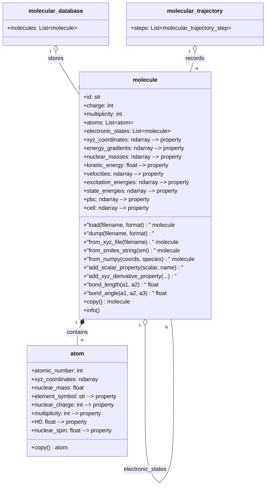

The `atom` and `molecule` classes form the foundational data layer of MLatom. Every simulation, machine learning prediction, and geometry optimization in the package operates on these two objects — they are the vocabulary through which the rest of the system speaks. This page explains how to create, populate, inspect, and serialize them, providing everything a newcomer needs to start working with molecular data in MLatom.

## The Big Picture: Where Atoms and Molecules Fit

Before diving into the API surface, it helps to see where these classes sit in the broader architecture. The diagram below shows the data-layer classes and their immediate relationships to the model system, simulation engine, and I/O subsystems.



The `molecule` class composes `atom` objects and also optionally holds references to other `molecule` instances (for excited electronic states). Collections of molecules live inside `molecular_database` (covered in [Molecular Database Management](7-molecular-database-management)), while time-ordered sequences are captured by `molecular_trajectory` (covered in [Molecular Trajectory and HDF5 I/O](8-molecular-trajectory-and-hdf5-i-o)). Both `atom` and `molecule` are re-exported at the top level of the `mlatom` package, so you can import them directly.

Sources: [mlatom/__init__.py](mlatom/__init__.py#L1-L17), [mlatom/data.py](mlatom/data.py#L191-L410)

## Creating Atom Objects

The `atom` class lives in [`mlatom.data`](mlatom/data.py#L191) and represents a single atomic species with an optional position in 3D space. You identify an atom by providing **one** of three equivalent identifiers — `atomic_number`, `nuclear_charge`, or `element_symbol` — and the class internally resolves the others through a periodic-table lookup table. Positional data is stored as a NumPy array of Cartesian coordinates in **Ångströms**.

Here is the constructor signature and the three ways to create an atom:

```python
# Method 1: by atomic number
from mlatom.data import atom
c_atom = atom(atomic_number=6, xyz_coordinates=[0.0, 0.0, 0.0])

# Method 2: by element symbol (case-insensitive first letter, rest lowercase)
o_atom = atom(element_symbol='O', xyz_coordinates=[1.2, 0.0, 0.0])

# Method 3: by nuclear charge (identical to atomic_number for neutral atoms)
h_atom = atom(nuclear_charge=1, xyz_coordinates=[-0.5, 0.0, 0.0])
```

| Constructor Parameter | Type | Required | Description |
|---|---|---|---|
| `atomic_number` | `int` | No* | Atomic number (1 = H, 6 = C, …, 118 = Og) |
| `nuclear_charge` | `int` | No* | Equivalent to `atomic_number` for neutral atoms |
| `element_symbol` | `str` | No* | Element symbol, e.g. `'C'`, `'Na'`, `'Cl'` |
| `nuclear_mass` | `float` | No | Mass in AMU; defaults to the most abundant isotope's relative isotopic mass |
| `xyz_coordinates` | `array-like` | No | 3D Cartesian coordinates in Ångströms |

*At least one identifier (`atomic_number`, `nuclear_charge`, or `element_symbol`) must be provided.

The resolution chain works as follows: the constructor first checks `atomic_number`, then `element_symbol` (translated via a global dictionary), then `nuclear_charge`. If `nuclear_mass` is omitted, the property lazily looks up the most abundant isotope from the built-in `isotopes` database. This means you pay no cost for mass lookup until you actually request it.

Sources: [mlatom/data.py](mlatom/data.py#L191-L315), [mlatom/data.py](mlatom/data.py#L178-L190)

### Atom Properties

Once created, every `atom` exposes a set of read-only (or set-once) properties derived from periodic-table and isotope data:

| Property | Type | Description |
|---|---|---|
| `atomic_number` | `int` | The resolved atomic number |
| `element_symbol` | `str` | Periodic table symbol (e.g. `'C'`) |
| `nuclear_charge` | `int` | Nuclear charge (same as `atomic_number` for neutral atoms) |
| `nuclear_mass` | `float` | Mass in AMU from the most abundant isotope, or a user-set value |
| `multiplicity` | `int` | Spin multiplicity from isotope data |
| `H0` | `float` | Enthalpy of formation at 0 K from isotope data |
| `nuclear_spin` | `float` | Nuclear spin quantum number from isotope data |

The `element_symbol` and `nuclear_charge` properties use a backing-store pattern (`_element_symbol`, `_nuclear_charge`). When you read them, they synchronize the underlying `atomic_number`, which keeps all three identifiers consistent. Similarly, the `nuclear_mass` property is computed lazily from the isotope database on first access.

Sources: [mlatom/data.py](mlatom/data.py#L222-L315)

### Copying Atoms

The `atom.copy()` method returns a shallow clone that always copies the core identity properties (atomic number, nuclear mass). You can optionally specify additional properties to copy by name:

```python
hydrogen = atom(element_symbol='H', xyz_coordinates=[0.0, 0.0, 0.0])
hydrogen.xyz_velocities = [1.0, 0.0, 0.0]

# Copy without velocities
h_copy = hydrogen.copy()

# Copy with velocities explicitly included
h_copy_with_vel = hydrogen.copy(atomic_labels=['xyz_coordinates', 'xyz_velocities'])
```

Sources: [mlatom/data.py](mlatom/data.py#L299-L315)

## Creating Molecule Objects

The `molecule` class is the primary workhorse of MLatom's data layer. A molecule is defined by a charge, a spin multiplicity, and a list of `atom` objects. It also supports periodic boundary conditions (PBC) for condensed-phase simulations.

### Basic Construction

```python
from mlatom import atom, molecule

# Create atoms
c  = atom(element_symbol='C', xyz_coordinates=[0.0, 0.0, 0.0])
h1 = atom(element_symbol='H', xyz_coordinates=[0.63, 0.63, 0.63])
h2 = atom(element_symbol='H', xyz_coordinates=[-0.63, -0.63, 0.63])
h3 = atom(element_symbol='H', xyz_coordinates=[-0.63, 0.63, -0.63])
h4 = atom(element_symbol='H', xyz_coordinates=[0.63, -0.63, -0.63])

# Assemble the molecule
mol = molecule(atoms=[c, h1, h2, h3, h4], charge=0, multiplicity=1)
```

| Constructor Parameter | Type | Default | Description |
|---|---|---|---|
| `charge` | `int` | `0` | Total molecular charge |
| `multiplicity` | `int` | `1` | Spin multiplicity (2S+1) |
| `atoms` | `List[atom]` | `[]` | Ordered list of constituent atoms |
| `pbc` | `bool` or `list[bool]` | `None` | Periodic boundary conditions per axis |
| `cell` | `array-like` | `None` | Unit cell vectors (converted via ASE's `cellpar_to_cell`) |

Each `molecule` receives a unique `id` (a UUID4 string) at construction time. The `pbc` parameter accepts either a single boolean (applied to all three axes) or a list of three booleans. The `cell` setter delegates to ASE's `cellpar_to_cell` function to convert from the conventional `[a, b, c, alpha, beta, gamma]` parameterization into a 3×3 matrix of lattice vectors.

Sources: [mlatom/data.py](mlatom/data.py#L409-L460)

### Loading Molecules from Files and Strings

MLatom provides a rich loading infrastructure that works both as **instance methods** (updating an existing molecule) and **class methods** (returning a new molecule). The dual behavior is implemented via a Python descriptor (`load_molecule_cls`) that dispatches based on whether it is accessed from a class or an instance.

```python
# Class method — returns a new molecule
mol = molecule.load(filename='methanol.xyz', format='xyz')

# Instance method — updates an existing molecule in place
mol = molecule()
mol.load(filename='methanol.json', format='json')
```

The following table summarizes all supported formats:

| Format String | Source Type | Description |
|---|---|---|
| `'json'` | File | Full molecule serialization including all properties |
| `'xyz'` | File | Standard XYZ geometry file |
| `'xyzstring'` | String (passed as filename) | XYZ-formatted string in memory |
| `'gaussian'` | File | Gaussian output file (parsed via `gaussian_interface`) |
| `'orca'` | File | ORCA output file (parsed via `orca_interface`) |
| `'mndo'` | File | MNDO output file (parsed via `mndo_interface`) |

In addition to the generic `load()` method, the `molecule` class provides dedicated class-method constructors for common workflows:

| Method | Input | Use Case |
|---|---|---|
| `molecule.from_xyz_file(filename)` | XYZ file path | Quick geometry loading from standard XYZ |
| `molecule.from_xyz_string(string)` | XYZ-format string | Parsing XYZ data already in memory |
| `molecule.from_numpy(coords, species)` | Two NumPy arrays | Building from numerical arrays (shapes `(N,3)` and `(N,)`) |
| `molecule.from_smiles_string(smi)` | SMILES string | Generate 3D geometry via Open Babel's `make3D()` |

For the XYZ reader specifically, extra format specifiers are supported via the `format` parameter: `'COLUMBUS'`, `'NEWTON-X'` (or `'NX'`), and `'turbomol'`. These handle program-specific coordinate formats (Bohr-to-Ångström conversion is applied automatically for Columbus and Turbomole).

Sources: [mlatom/data.py](mlatom/data.py#L317-L410), [mlatom/data.py](mlatom/data.py#L475-L603)

> [!TIP]
> **The `from_numpy` constructor** is particularly useful when integrating with other chemistry libraries. Pass `coordinates` as a NumPy array of shape `(N, 3)` and `species` as a 1-D array of element symbols or atomic numbers — this lets you bridge directly into MLatom from RDKit, ASE, or any NumPy-based pipeline without going through file I/O.

## Storing and Retrieving Properties on Molecules

MLatom uses a **dynamic attribute** pattern for molecular properties. Rather than requiring a rigid schema, the `molecule` class allows you to attach arbitrary scalar, vectorial, derivative, and matrix properties at runtime. This flexibility is essential because different quantum chemistry methods produce different property sets.

### Scalar Properties

The simplest form of data attachment. Use `add_scalar_property` or direct attribute assignment:

```python
mol.add_scalar_property(-76.404, property_name='energy')
# Equivalent shorthand:
mol.energy = -76.404  # also works
```

### XYZ Derivative Properties (Gradients)

Energy gradients are the most common derivative property. When you set `energy_gradients` (or call `add_xyz_derivative_property`), MLatom stores a `(3,)` vector on each constituent atom and records the parent–child relationship in a `properties_and_their_derivatives` dictionary:

```python
gradients = np.array([[0.0, 0.0, 0.01],
                      [0.0, 0.01, 0.0],
                      ...])  # shape: (N_atoms, 3)
mol.energy_gradients = gradients
```

### Hessian (Second Derivatives)

The Hessian is stored as a `(3N, 3N)` matrix on the molecule object itself:

```python
mol.add_hessian_property(hessian_matrix, hessian_propety='hessian')
```

### XYZ Vectorial Properties

Any per-atom 3-vector (e.g., velocities, dipole contributions) can be attached. The data is distributed across the individual `atom` objects:

```python
mol.add_xyz_vectorial_property(velocities, xyz_vectorial_property='xyz_velocities')
```

### Generic Property Access

The `get_property` method provides unified access that checks the molecule's own `__dict__` first, then class-level `@property` descriptors, and finally falls back to per-atom attributes (aggregated into an array):

```python
energy = mol.get_property('energy')        # from mol.__dict__
coords = mol.get_property('xyz_coordinates')  # aggregated from atoms
```

| Method | Storage Location | Typical Use |
|---|---|---|
| `add_scalar_property(scalar, name)` | `mol.__dict__` | Energy, enthalpy, free energy |
| `add_xyz_derivative_property(deriv, ...)` | Per-atom `__dict__` | Energy gradients, dipole gradients |
| `add_hessian_property(hessian, ...)` | `mol.__dict__` | Force constants, vibrational analysis |
| `add_xyz_vectorial_property(vector, ...)` | Per-atom `__dict__` | Velocities, non-energy vectors |
| `set_property(**kwargs)` | Direct `setattr` | Batch assignment of any properties |

Sources: [mlatom/data.py](mlatom/data.py#L618-L830)

## Inspecting Molecules

### Convenience Properties

The `molecule` class exposes a rich set of computed properties that aggregate data from its constituent atoms:

| Property | Returns | Unit | Description |
|---|---|---|---|
| `xyz_coordinates` | `ndarray (N,3)` | Å | Atomic positions |
| `atomic_numbers` | `ndarray (N,)` | — | Integer atomic numbers |
| `element_symbols` | `ndarray (N,)` | — | Element symbols |
| `nuclear_masses` | `ndarray (N,)` | AMU | Nuclear masses (from isotope data) |
| `energy_gradients` | `ndarray (N,3)` | Hartree/Å | Forces on each atom |
| `kinetic_energy` | `float` | Hartree | Computed from velocities and masses |
| `velocities` | `ndarray (N,3)` | Å/fs | Atomic velocities |
| `CoM` | `ndarray (3,)` | Å | Center of mass |
| `linear_momentum` | `ndarray (3,)` | — | Total linear momentum |
| `angular_momentum` | `ndarray (3,)` | — | Total angular momentum |
| `moment_of_inertia_tensor` | `ndarray (3,3)` | — | Inertia tensor |
| `smiles` | `str` | — | SMILES string (via `conversions.xyz2smi`) |

### Geometry Measurements

Built-in methods provide common geometric calculations. All atom indices are **zero-based**:

```python
# Distance between atoms 0 and 1
r = mol.bond_length(0, 1)          # returns float in Å

# Bond angle 0-1-2
angle = mol.bond_angle(0, 1, 2)    # degrees by default

# Dihedral angle 0-1-2-3
dihedral = mol.dihedral_angle(0, 1, 2, 3)

# Full internuclear distance matrix (N×N)
distmat = mol.get_internuclear_distance_matrix()

# Bond connectivity (simple distance-based heuristic)
bonds = mol.get_bonds()            # list of [i, j] pairs

# Linearity check
mol.is_it_linear()                 # True / False
```

The `info()` method prints a human-readable summary of all key properties to the console:

```python
mol.info()
# Molecule with 4 atom(s): C, H, H, H, H
#
#  XYZ coordinates, Angstrom
#  1    C          0.000000       0.000000       0.000000
#  2    H          0.630000       0.630000       0.630000
#  ...
```

Sources: [mlatom/data.py](mlatom/data.py#L728-L1280)

## Manipulating Molecules

### Spatial Transformations

The `molecule` class provides basic rigid-body operations:

```python
mol.translate(vector)       # shift all atoms by a 3-vector
mol.rotate(matrix=rot_mat)  # apply a 3×3 rotation matrix
mol.scale(factor, pivot)    # uniform scaling about a pivot point
```

### Velocity Rescaling

For molecular dynamics preparations, `rescale_velocities` adjusts the atomic velocities to achieve a target kinetic energy change or to zero out specific momentum components:

```python
mol.rescale_velocities(kinetic_energy_change=0.001)  # add 0.001 a.u. of KE
```

### Angular Momentum Management

```python
mol.zero_angular_momentum()        # remove rotational motion
mol.adjust_momenta(P=target_P, L=target_L)  # set linear and angular momentum
```

### Copying and Updating

The `copy()` method supports selective property copying, which is crucial for trajectory analysis where you need geometry-only clones:

```python
# Full deep copy (expensive)
mol_clone = mol.copy()

# Geometry-only copy
geom_only = mol.copy(atomic_labels=['xyz_coordinates'])

# Geometry + specific molecular property
geom_and_energy = mol.copy(atomic_labels=['xyz_coordinates'],
                           molecular_labels=['energy'])
```

The `update_from()` method merges all properties from another molecule into the current one, respecting property descriptors:

```python
mol1.update_from(mol2)  # mol1 now has all of mol2's properties
```

Sources: [mlatom/data.py](mlatom/data.py#L871-L975), [mlatom/data.py](mlatom/data.py#L1214-L1280)

## Writing and Serializing Molecules

### XYZ File Output

```python
mol.write_file_with_xyz_coordinates('output.xyz')              # standard XYZ
mol.write_file_with_xyz_coordinates('output.nx', format='NX')  # Newton-X format
mol.write_file_with_xyz_coordinates('output.coord', format='turbomole')  # Turbomole
```

Supported output formats mirror the input side: standard XYZ, Columbus/Newton-X (Bohr units, includes nuclear charge and mass), and Turbomole (`$coord` block).

### JSON Serialization

The `dump()` method serializes the entire molecule — including all dynamic properties, electronic states, and nested objects — to JSON:

```python
mol.dump(filename='mymol.json', format='json')
```

The deserialization path uses `molecule.load(filename='mymol.json')` and walks through a recursive `dict_to_molecule_class_instance` function that reconstructs atom objects, electronic states (themselves `molecule` instances), optimization trajectories, and even `properties_tree_node` objects. NumPy arrays are automatically converted to/from Python lists during serialization.

### Getting XYZ Strings

When you need the geometry as a string (for piping to other tools, writing custom formats, or debugging), `get_xyz_string()` returns the standard XYZ text:

```python
xyz_str = mol.get_xyz_string()               # full XYZ with header
coords_only = mol.get_xyz_string(only_coordinates=True)  # just atom lines
```

Sources: [mlatom/data.py](mlatom/data.py#L666-L728), [mlatom/data.py](mlatom/data.py#L1149-L1158), [mlatom/data.py](mlatom/data.py#L2615-L2722)

## Electronic States Support

The `molecule` class natively supports multi-state quantum chemistry data through its `electronic_states` list. Each electronic state is itself a `molecule` instance, allowing per-state energies, gradients, and other properties. This design underpins the nonadiabatic dynamics features covered in [Nonadiabatic and Surface-Hopping Dynamics](20-nonadiabatic-and-surface-hopping-dynamics).

| Property | Type | Description |
|---|---|---|
| `electronic_states` | `List[molecule]` | List of state-specific molecule objects |
| `state_energies` | `ndarray` | Energies of all electronic states |
| `state_gradients` | `ndarray` | Gradients for each electronic state |
| `energy_gaps` | `ndarray` | Pairwise energy differences |
| `excitation_energies` | `ndarray` | Vertical excitation energies from ground state |
| `nstates` | `int` | Number of electronic states |

Sources: [mlatom/data.py](mlatom/data.py#L1280-L1335)

## Python Dunder Methods and Iteration

The `molecule` class implements several dunder methods that make it behave like a Python sequence over its atoms:

```python
# Iteration
for a in mol:
    print(a.element_symbol, a.xyz_coordinates)

# Length
n_atoms = len(mol)           # number of atoms

# Indexing (zero-based)
first_atom = mol[0]

# String representation (same as mol.info())
print(mol)

# Addition creates a molecular_database
db = mol + another_mol       # returns molecular_database([mol, another_mol])
```

Sources: [mlatom/data.py](mlatom/data.py#L1259-L1277)

## Quick Reference: Common Patterns

The table below consolidates the most frequently used patterns for beginners:

| Goal | Code |
|---|---|
| Create atom by symbol | `atom(element_symbol='C')` |
| Create atom by number | `atom(atomic_number=6, xyz_coordinates=[0,0,0])` |
| Build molecule from atoms | `molecule(atoms=[at1, at2, ...], charge=0, multiplicity=1)` |
| Load from XYZ file | `molecule.from_xyz_file('geom.xyz')` |
| Load from SMILES | `molecule.from_smiles_string('CCO')` |
| Load full state from JSON | `molecule.load('state.json')` |
| Set energy | `mol.energy = -76.4` |
| Set gradients | `mol.energy_gradients = grads_array` |
| Get coordinates | `mol.xyz_coordinates` |
| Measure bond length | `mol.bond_length(0, 1)` |
| Print molecule info | `mol.info()` |
| Save to JSON | `mol.dump('out.json')` |
| Save to XYZ | `mol.write_file_with_xyz_coordinates('out.xyz')` |
| Deep copy | `mol.copy()` |
| Geometry-only copy | `mol.copy(atomic_labels=['xyz_coordinates'])` |

> [!TIP]
> **Lazy isotope resolution:** The `atom.nuclear_mass` property is not computed at construction time — it queries the isotope database on first access and caches the result. This means creating thousands of atoms is essentially free, and you only pay the lookup cost when masses are actually needed (e.g., for molecular dynamics).

## What's Next

Now that you understand the fundamental data objects, the natural next steps depend on your goal:

- If you need to work with **collections of molecules** for training or analysis, proceed to [Molecular Database Management](7-molecular-database-management) to learn about the `molecular_database` class.
- If you are interested in **time-ordered data** from dynamics or optimization runs, see [Molecular Trajectory and HDF5 I/O](8-molecular-trajectory-and-hdf5-i-o).
- To understand how **models consume** molecule objects for predictions, move to the [Model Class Hierarchy](9-model-class-hierarchy).
- For the full simulation pipeline (optimization, frequency, MD), start with [Geometry Optimization Workflows](17-geometry-optimization-workflows).