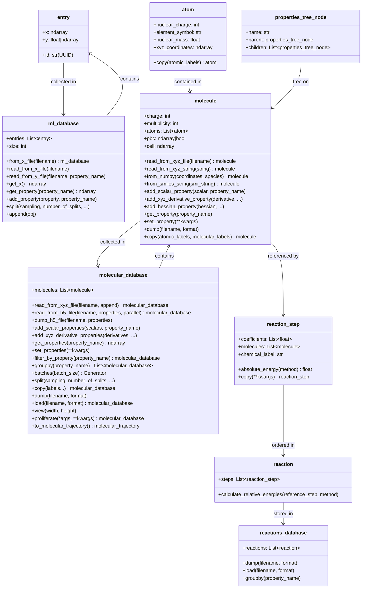
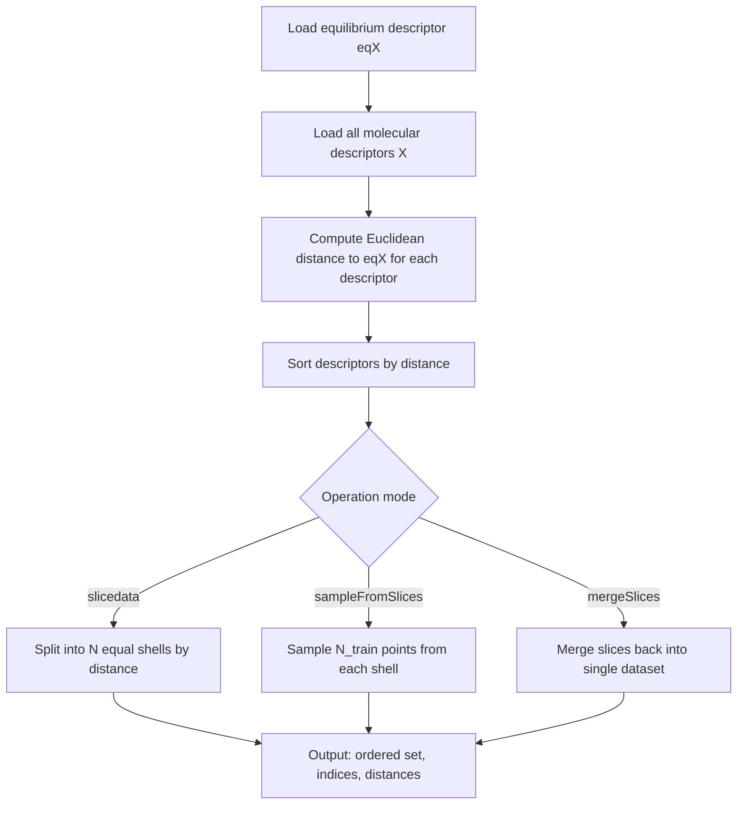
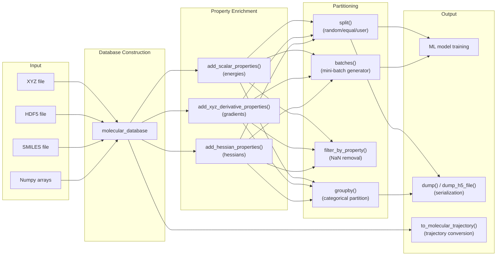

The molecular database layer is the foundational data substrate of MLatom — every machine learning workflow, every quantum chemistry interface, and every simulation pipeline converges on the data structures defined in [`data.py`](mlatom/data.py). This page examines the full architecture: how molecules are stored, how properties flow through the system, how databases are constructed from diverse input formats, and how data is partitioned, serialized, and interrogated for downstream tasks.

## Class Hierarchy Overview

MLatom's data model is built around three tiers: **entries** (descriptor-level), **molecules** (quantum-chemical objects with geometry and properties), and **databases** (ordered collections with bulk operations). A secondary track handles **reactions** and **trajectories** for specialized workflows. The hierarchy is intentionally flat at the storage level — databases hold direct references to molecule objects, not copies — which means property mutations propagate immediately without explicit re-syncing.

The `entry`/`ml_database` branch exists for descriptor-level machine learning — when you have precomputed feature vectors (`x`) and target values (`y`) without explicit molecular geometry. The `molecule`/`molecular_database` branch is the primary system for quantum chemistry workflows. Both branches implement the same operator protocol (`__add__`, `__len__`, `__iter__`, `__getitem__`, `split`, `append`) so they can be interchanged in ML pipelines.

Sources: [data.py](mlatom/data.py#L23-L170), [data.py](mlatom/data.py#L1526-L1560)

## The `molecule` Class: Atomic Data Container

Each `molecule` object encapsulates a complete quantum-chemical snapshot: geometry, charge, spin multiplicity, and an open property dictionary. The `atoms` list holds `atom` instances, each carrying nuclear charge, element symbol, nuclear mass, and XYZ coordinates. Properties are stored as direct attributes on the molecule (e.g., `mol.energy = -76.4`) or on individual atoms (e.g., `atom.energy_gradients = np.array([0.0, 0.0, 0.1])`), following a deliberate duck-typing strategy.

Three categories of properties are formally distinguished by dedicated setter methods:

| Property Category | Setter Method | Storage Location | Shape Convention |
|---|---|---|---|
| Scalar | `add_scalar_property(scalar, 'energy')` | `molecule.energy` | `float` or `ndarray` of shape `(1,)` |
| XYZ derivative (per-atom) | `add_xyz_derivative_property(derivative, 'energy', 'energy_gradients')` | `atom.energy_gradients` | `(N, 3)` where N = atoms |
| Hessian | `add_hessian_property(hessian, 'hessian')` | `molecule.hessian` | `(3N, 3N)` |

The `properties_tree_node` class at [line 1471](mlatom/data.py#L1471-L1525) provides a tree structure for tracking property provenance — linking derived properties (like delta-learned corrections) back to their parent properties through `parent`/`children` references. This is essential for composite methods like AIQM where energy corrections cascade through multiple levels.

Periodic boundary conditions are supported through the `pbc` and `cell` properties on `molecule`. Setting `mol.pbc = True` expands to `[True, True, True]` for all three axes, and the `cell` setter delegates to ASE's `cellpar_to_cell()` for flexible cell parameterization. The `map_to_unicell()` method folds atoms outside the unit cell back inside, while `proliferate()` replicates the unit cell along specified shift vectors — critical for periodic ML potential training.

Sources: [data.py](mlatom/data.py#L191-L316), [data.py](mlatom/data.py#L356-L410), [data.py](mlatom/data.py#L422-L472), [data.py](mlatom/data.py#L618-L665), [data.py](mlatom/data.py#L1047-L1148), [data.py](mlatom/data.py#L1471-L1525)

## The `molecular_database` Class: Bulk Operations Engine

The `molecular_database` class wraps a list of `molecule` objects and provides a rich API for bulk property manipulation, I/O, filtering, and partitioning. It is the central data structure passed between ML model training, prediction, and simulation stages.

### Construction and I/O

The database can be constructed from virtually any common chemistry data format:

| Method | Input Format | Key Behavior |
|---|---|---|
| `from_xyz_file(filename)` | Multi-molecule XYZ | Parses concatenated XYZ blocks |
| `from_xyz_string(string)` | XYZ string | Splits via `conversions.split_xyz_string` |
| `from_numpy(coordinates, species)` | `ndarray (M, N, 3)` + `ndarray (M, N)` | M molecules, N atoms each |
| `from_smiles_file(smi_file)` | SMILES text file | Generates 3D via Pybel `make3D()` |
| `from_smiles_string(smi_string)` | SMILES string(s) | Same as above, from string |
| `read_from_h5_file(filename, ...)` | Hierarchical HDF5 | Supports parallel loading via `joblib` |
| `load(filename, format)` | JSON / NPZ / Gaussian | General-purpose deserialization |

The `from_*` classmethods and `read_*` instance methods follow a consistent pattern: classmethods construct a fresh database, while instance methods support an `append` flag for incremental loading. The HDF5 reader at [line 1590](mlatom/data.py#L1590-L1795) is notably sophisticated — it groups conformations by atom count in the HDF5 hierarchy, supports selective property loading, and can parallelize across CPU cores using configurable batch sizes. The internal `h5dataloader` class at [line 3282](mlatom/data.py#L3282-L3330) recursively iterates through HDF5 groups using a generator pattern, yielding configuration dictionaries one at a time to keep memory usage constant regardless of dataset size.

Sources: [data.py](mlatom/data.py#L1526-L1860), [data.py](mlatom/data.py#L3282-L3330)

### Property Management at Scale

The database layer mirrors molecule-level property methods with bulk variants that operate on all contained molecules simultaneously. Scalar properties are added via `add_scalar_properties(scalars, property_name)`, which expects a 1D array with one value per molecule. XYZ derivative properties accept 3D arrays of shape `(M, N, 3)` and distribute per-atom vectors to the corresponding atoms in each molecule. The internal `properties_and_their_derivatives` dictionary tracks which derivative properties are linked to which scalar properties — enabling the system to reason about consistency (e.g., energy gradients correspond to energy values).

Property retrieval is uniform: `get_properties('energy')` returns an ndarray across all molecules, while `get_xyz_vectorial_properties('energy_gradients')` returns shape `(M, N, 3)`. The `set_properties(**kwargs)` method accepts keyword arguments for batch assignment. A `filter_by_property(property_name)` method at [line 2243](mlatom/data.py#L2243) removes molecules with NaN values for a given property — a practical filter for cleaning datasets after failed quantum chemistry calculations.

Sources: [data.py](mlatom/data.py#L1860-L2000), [data.py](mlatom/data.py#L2000-L2110), [data.py](mlatom/data.py#L2243-L2250)

### Indexing, Slicing, and Iteration

The `molecular_database` implements the full Python sequence protocol. Integer indexing returns a single `molecule` object, while slices, lists, boolean arrays, and integer arrays all return new `molecular_database` instances — maintaining the type contract throughout slicing chains. This means `db[:100:4]` returns a database of every 4th molecule in the first 100, and `db[~np.isnan(db.get_properties('energy'))]` filters by valid energies without explicit `filter_by_property`.

The `batches(batch_size)` method returns a generator that yields sub-databases of fixed size, designed for mini-batch model training. The `groupby(property_name)` method partitions the database by unique property values (e.g., grouping by number of atoms or by charge state), returning a list of sub-databases.

Sources: [data.py](mlatom/data.py#L2299-L2330), [data.py](mlatom/data.py#L2223-L2240)

### Data Splitting and Sampling

The `split()` method delegates to the module-level `sample()` function at [line 3331](mlatom/data.py#L3331-L3383), which implements three sampling strategies:

| Strategy | `sampling` Parameter | Behavior |
|---|---|---|
| Random shuffle | `'random'` (default) | Shuffles indices then partitions |
| No shuffle | `'none'` | Sequential partition (time-series safe) |
| User-defined | `'user-defined'` | Explicit index lists per split |

For a 2-way split without explicit ratios, the default is 80/20 (training/test). For N-way splits, the database is divided equally by default. Fraction-based splitting accepts a list like `[0.6, 0.2, 0.2]` and corrects rounding errors by distributing residuals across the first splits.

> [!TIP]
> The `sample()` function is polymorphic — it uses `type(molDB)()` to construct split results, meaning it works identically for both `molecular_database` and `ml_database` instances. When splitting reaction databases or other derived types, this ensures the returned splits match the input type.

Sources: [data.py](mlatom/data.py#L3331-L3383), [data.py](mlatom/data.py#L131-L133), [data.py](mlatom/data.py#L2374-L2386)

## Serialization: JSON, NPZ, HDF5, and Plain Text

MLatom provides multiple serialization pathways depending on the use case. The `dump()` method at [line 2252](mlatom/data.py#L2252-L2258) and its counterpart `load()` at [line 2266](mlatom/data.py#L2266-L2298) handle JSON and NPZ formats, with automatic numpy type conversion during serialization (all `np.float64`, `np.int32`, etc., are reduced to native Python types). The deserialization path reconstructs the full object graph — including atom lists, `properties_tree_node` hierarchies, electronic states, and even optimization trajectories — using a chain of `dict_to_*_class_instance` converter functions.

For large-scale data, the HDF5 pathway is preferred. `dump_h5_file()` at [line 1802](mlatom/data.py#L1802-L1849) organizes data by atom count at the top level (grouping conformers with the same number of atoms together), which is the same structure expected by `read_from_h5_file()`. The standard HDF5 schema always includes `coordinates`, `species`, and `id` datasets, with additional properties appended on demand.

The `reactions_database` also supports JSON round-tripping via its own `dump()`/`load()` methods, preserving the full reaction step graph including stoichiometric coefficients and chemical labels.

Sources: [data.py](mlatom/data.py#L2252-L2298), [data.py](mlatom/data.py#L2615-L2730), [data.py](mlatom/data.py#L1802-L1849), [data.py](mlatom/data.py#L2596-L2612)

## Descriptor-Level Database: `ml_database`

The `ml_database` class at [line 38](mlatom/data.py#L38-L170) serves workflows where molecular geometry is abstracted away in favor of precomputed feature vectors. Each `entry` holds an `x` descriptor vector and a `y` target value, both optional. Construction from files follows the familiar pattern: `from_x_file()` reads space-delimited feature rows, while `read_from_y_file()` attaches scalar targets to existing entries.

The `x` and `y` properties use custom setters that handle both initialization from scratch (creating new `entry` objects) and mutation of existing entries. The `__getitem__` method supports the same slicing semantics as `molecular_database` — boolean masks, integer arrays, and slices all return `ml_database` sub-sets. This design allows the same `sample()` function to split both database types transparently, enabling descriptor-level and molecule-level ML to share a common data partitioning interface.

Sources: [data.py](mlatom/data.py#L23-L37), [data.py](mlatom/data.py#L38-L170)

## Distance-Based Data Slicing

The [`sliceData.py`](mlatom/sliceData.py) module implements a complementary partitioning strategy based on geometric similarity in descriptor space. Unlike the random splitting in `sample()`, `sliceDataCls` orders molecules by their Euclidean distance from a reference configuration (equilibrium geometry) and then partitions them into concentric shells.

The `sortByDistance()` method computes `‖x_i − x_eq‖` for every descriptor and sorts the indices accordingly. `slicedata()` then divides this sorted list into `nslices` equal partitions. `sampleFromSlices()` draws training points uniformly from each shell — a stratified sampling approach that ensures the training set covers the full range of conformational diversity. `mergeSlices()` reverses the process, concatenating slice files back into a unified dataset. This module is particularly useful for creating training sets that are geometrically representative of the full conformational landscape.

Sources: [sliceData.py](mlatom/sliceData.py#L13-L215)

## Conversion Utilities

The [`conversions.py`](mlatom/conversions.py) module provides the low-level format transformation functions that the database classes depend on:

| Function | Transformation | Used By |
|---|---|---|
| `smi2xyz(smi_strings)` | SMILES → XYZ geometry (via Pybel) | `molecule.from_smiles_string`, `molecular_database.from_smiles_string` |
| `xyz2smi(xyz_strings)` | XYZ geometry → SMILES | `molecular_database.smiles` property |
| `split_xyz_string(string)` | Concatenated XYZ → list of XYZ blocks | All XYZ readers |
| `distance_matrix(x, y)` | Pairwise distance computation | Descriptor analysis |
| `xyz2re(xyz, eq)` | XYZ → redundant internal coordinates | Geometry representation |
| `re2xyz(re, eq)` | Redundant internal coordinates → XYZ | Inverse transformation |

The `split_xyz_string()` function is particularly critical — it is the sole parser for all XYZ-format input, handling the standard N-atom / comment-line / N-coordinate-lines block structure. Any multi-molecule XYZ file processed by MLatom passes through this function.

Sources: [conversions.py](mlatom/conversions.py#L3-L53)

## Data Flow in Typical Workflows

Understanding how molecular databases flow through MLatom clarifies the architecture. In a standard ML potential training pipeline, the database is constructed from XYZ files, enriched with reference energies and gradients from quantum chemistry programs, split into training/test sets, and then consumed by model classes. The diagram below traces this canonical path:

> [!TIP]
> The `copy()` method on `molecular_database` at [line 2233](mlatom/data.py#L2233-L2242) accepts `atomic_labels`, `molecular_labels`, and `molecular_database_labels` parameters for selective deep copying. When no labels are specified, it performs a full `copy.deepcopy`. This selective copying is essential for active learning workflows where you need to duplicate a database structure without copying expensive property arrays, or when you need to fork a dataset with only geometry preserved.

Sources: [data.py](mlatom/data.py#L1860-L1900), [data.py](mlatom/data.py#L2100-L2243), [data.py](mlatom/data.py#L2388-L2393)

## Summary of Key API Patterns

| Pattern | Code Example | Returns |
|---|---|---|
| Construct from XYZ | `molDB = molecular_database.from_xyz_file('data.xyz')` | `molecular_database` |
| Construct from HDF5 (parallel) | `molDB.read_from_h5_file('data.h5', properties=['energy'], parallel=(4, 1000))` | `molecular_database` (self) |
| Add energies from file | `molDB.add_scalar_properties_from_file('energies.dat', 'energy')` | `None` (mutates in-place) |
| Add gradients from array | `molDB.add_xyz_derivative_properties(grads, 'energy', 'energy_gradients')` | `None` (mutates in-place) |
| Filter invalid entries | `clean_db = molDB.filter_by_property('energy')` | New `molecular_database` |
| Train/test split | `train_db, test_db = molDB.split(sampling='random', fraction_of_points_in_splits=[0.8, 0.2])` | List of 2 databases |
| Batch iteration | `for batch in molDB.batches(32): ...` | Generator of sub-databases |
| Group by property | `groups = molDB.groupby('charge')` | List of databases |
| Serialize to JSON | `molDB.dump('dataset.json', format='json')` | File written |
| Load from JSON | `molDB = molecular_database.load('dataset.json', format='json')` | `molecular_database` |
| Export to HDF5 | `molDB.dump_h5_file('dataset.h5', properties=['energy'])` | File written |
| Visualize | `molDB.view(width=600, height=400)` | Interactive py3Dmol viewer |
| To trajectory | `traj = molDB.to_molecular_trajectory()` | `molecular_trajectory` |

## Where to Go Next

Having understood the molecular database management layer, the logical next steps depend on your use case:

- For how individual molecules and atoms are structured within these databases, see [Molecule and Atom Classes](6-molecule-and-atom-classes)
- For how trajectory data is stored and serialized (H5MD format, plain text), proceed to [Molecular Trajectory and HDF5 I/O](8-molecular-trajectory-and-hdf5-i-o)
- For how databases feed into ML model training, see [Model Class Hierarchy](9-model-class-hierarchy)
- For advanced data partitioning strategies in the active learning context, see [Data Sampling and Cross-Validation Strategies](25-data-sampling-and-cross-validation-strategies)