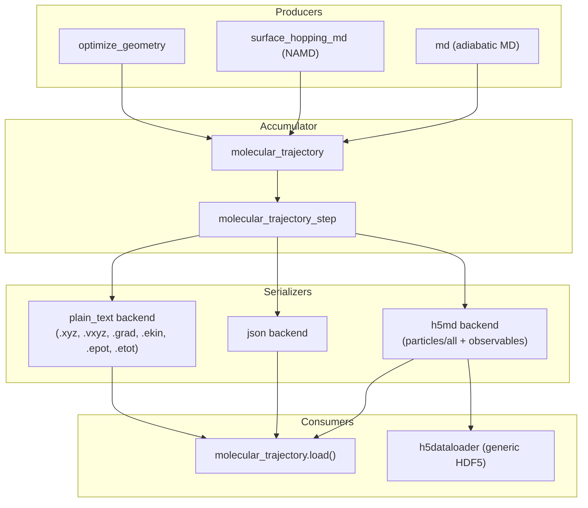
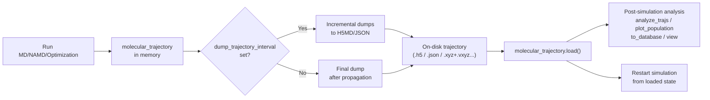

MLatom's trajectory subsystem is the bridge between simulation engines (molecular dynamics, geometry optimization, nonadiabatic dynamics) and persistent storage. It transforms per-step molecular snapshots into structured, queryable time-series data through a unified `molecular_trajectory` class with three serialization backends: H5MD (the default and most capable), JSON, and plain text. Understanding this subsystem is essential for any workflow that generates, inspects, or restarts simulations — and it becomes critical when dealing with large-scale nonadiabatic dynamics where trajectory data can span tens of thousands of steps with multi-state electronic structure information.

## Architectural Overview

The trajectory architecture follows a **producer → accumulator → serializer** pattern. Simulation engines produce `molecular_trajectory_step` objects one at a time, accumulate them inside a `molecular_trajectory`, and periodically or finally serialize the accumulated data. The H5MD backend serves as both the primary storage format and the restart mechanism for long-running simulations.



## The `molecular_trajectory_step` and `molecular_trajectory` Classes

Every simulation step is encapsulated in a `molecular_trajectory_step`, which is intentionally minimal: it stores only a `step` index, a reference `time`, and a full `molecule` object. All physical quantities — coordinates, velocities, gradients, energies, multi-state data — live as attributes on the molecule itself, not on the step wrapper. This design mirrors how MLatom's `molecule` class already carries scalar, vectorial, and derivative properties, avoiding data duplication between the step and the molecule [molecular_trajectory_step](mlatom/data.py#L3124-L3130).

Sources: [data.py](mlatom/data.py#L3124-L3130)

The `molecular_trajectory` class maintains an ordered list of these steps and provides the full lifecycle API: `dump()` for serialization, `load()` for deserialization, `to_database()` for conversion to a `molecular_database`, `get_xyz_string()` for quick inspection, and `view()` for interactive 3D visualization via py3Dmol [molecular_trajectory](mlatom/data.py#L2737-L2744).

Sources: [data.py](mlatom/data.py#L2737-L2744)

```python
# The step object is thin — the molecule carries all physical data
class molecular_trajectory_step(object):
    def __init__(self, step=None, molecule=None):
        self.step = step
        self.molecule = molecule
        # time is set externally during propagation
```

## Trajectory Producers: How Simulations Feed the Accumulator

Three main simulation engines populate `molecular_trajectory` objects during their `propagate()` methods. Each follows the same pattern but differs in what additional data gets attached to each step.

### Adiabatic MD (`md` class)

The velocity Verlet propagator in [md.propagate()](mlatom/md.py#L158-L247) creates a fresh `molecular_trajectory` at the start, then appends one `molecular_trajectory_step` per integration step. Each step's molecule carries coordinates, velocities, energy gradients, kinetic energy, potential energy, total energy, and temperature. The `dump_trajectory_interval` parameter controls periodic flushing — when set, every N-th step triggers an incremental dump to disk [md.py](mlatom/md.py#L137-L145).

Sources: [md.py](mlatom/md.py#L158-L247)

### Nonadiabatic Surface-Hopping MD (`surface_hopping_md` class)

NAMD trajectories are substantially richer. Beyond the standard MD quantities, each step can carry `current_state`, `random_number`, `hopping_probabilities`, `state_coefficients` (complex), `nacv` (nonadiabatic coupling vectors), and a suite of substep data: `substep_potential_energy`, `substep_velocities`, `substep_nonadiabatic_coupling_vectors`, `substep_time_derivative_coupling`, `substep_phase`, `substep_state_coefficients`, `substep_state_coefficients_dot`, `substep_random_numbers`, and `substep_hopping_probabilities` [namd.py](mlatom/namd.py#L273-L459). The memory management strategy is notable — when `reduce_memory_usage=True`, the accumulator aggressively deletes in-memory steps after flushing to H5MD, keeping only the last few steps needed for the LZBL/FSSH hopping logic [namd.py](mlatom/namd.py#L436-L453).

Sources: [namd.py](mlatom/namd.py#L273-L459)

### Geometry Optimization (`optimize_geometry`)

The optimizer also supports `dump_trajectory_interval` and `filename`/`format` parameters [simulations.py](mlatom/simulations.py#L155-L175), producing trajectory objects where steps lack the time dimension (optimization steps are indexed by iteration, not physical time). Trajectories from optimization can be loaded from Gaussian output files using the special `'gaussian'` format [data.py](mlatom/data.py#L3083-L3089).

Sources: [simulations.py](mlatom/simulations.py#L155-L175), [data.py](mlatom/data.py#L3083-L3089)

> [!TIP]
> **Producer distinction**: MD and NAMD trajectories include a `time` field (step index × time_step in femtoseconds) and velocity data. Optimization trajectories have no time or velocities — they store iteration index and gradient/energy convergence data. The `load()` method detects this automatically based on format and available keys.

## H5MD Backend: The Default Serialization Format

The `h5md` class wraps the `pyh5md` library to implement the [H5MD specification](http://dx.doi.org/10.1016/j.cpc.2014.01.018) — a community standard for molecular simulation data built on top of HDF5. It is the default format for all trajectory dumping in both `md` and `surface_hopping_md` [data.py](mlatom/data.py#L3131-L3183).

Sources: [data.py](mlatom/data.py#L3131-L3183)

### HDF5 Data Organization

The H5MD file organizes data into two top-level groups following the H5MD convention:

| HDF5 Group | Stored Properties | Description |
|---|---|---|
| `particles/all/` | `position`, `velocities`, `gradients`, `species`, `mass`, `nad` | Per-atom, per-timestep data stored with time dimension |
| `observables/` | `kinetic_energy`, `potential_energy`, `total_energy`, `state_energies`, `state_gradients`, `random_number`, `hopping_probabilities`, `state_coefficients_r`, `state_coefficients_i`, `current_state`, `uncertain`, `need_to_be_labeled`, plus all substep data | Per-timestep scalar and array observables |

Sources: [data.py](mlatom/data.py#L3185-L3196), [data.py](mlatom/data.py#L3171-L3179)

### Property Classification

The `h5md` class categorizes properties into three storage categories, which determine how they are written to the HDF5 file [data.py](mlatom/data.py#L3185-L3196):

| Category | Properties | Storage Mode |
|---|---|---|
| **Fixed** (per-system, not per-step) | `species`, `mass` | Written once, shape `(N_atoms,)` |
| **Particle** (per-atom, per-step) | `position`, `velocities`, `accelerations`, `gradients`, `nad`, `names` | Time-series, shape `(N_atoms, 3)` per step |
| **Observable** (per-step scalars/arrays) | Everything else (energies, probabilities, coefficients, substep data) | Time-series in `observables/` group |

Sources: [data.py](mlatom/data.py#L3185-L3196)

### Write Mechanics

The `write()` method handles two distinct shapes: **scalar time** (single timestep) and **array time** (multiple timesteps). When `data['time']` is a scalar, all properties are appended at a single step index. When it is an array, each element is written at successive step indices, enabling batch writes from interval dumps [data.py](mlatom/data.py#L3228-L3245). The step counter is maintained internally and auto-incremented, so successive `write()` calls (e.g., during incremental MD dumping) seamlessly append to the file [data.py](mlatom/data.py#L3232-L3245).

Sources: [data.py](mlatom/data.py#L3228-L3245)

### Read/Export Mechanics

The `export()` method traverses both the `particles/all` group and the `observables` group, collecting all datasets into a flat dictionary keyed by property name [data.py](mlatom/data.py#L3247-L3265). Fixed properties return their full arrays; time-series properties return their value arrays. The returned dictionary is then consumed by `molecular_trajectory.load()` which reconstructs `molecule` objects with the correct atomic species, masses, and per-step properties [data.py](mlatom/data.py#L2962-L3064).

Sources: [data.py](mlatom/data.py#L3247-L3265), [data.py](mlatom/data.py#L2962-L3064)

> [!TIP]
> **File mode auto-detection**: When opening an H5MD file, the `h5md` constructor checks if the file already exists and automatically switches from write mode (`'w'`) to append mode (`'r+'`). This is what enables incremental trajectory dumping — each interval dump opens the existing file and appends new steps [data.py](mlatom/data.py#L3198-L3214).

### H5MD Context Manager and Callable Interface

The class implements the Python context manager protocol (`__enter__`/`__exit__`) for safe resource handling, and aliases `__call__` to `export()` for concise one-liner reads [data.py](mlatom/data.py#L3273-L3279):

```python
# Context manager (recommended for writes)
with h5md('trajectory.h5') as traj:
    traj.write(data)

# Callable shorthand for reads
data = h5md('trajectory.h5', mode='r')()
```

Sources: [data.py](mlatom/data.py#L3273-L3279)

## The `dump()` Method: Format-Branching Serialization

The `molecular_trajectory.dump()` method is the central serialization entry point. It branches on the `format` argument into three distinct code paths, each with different capabilities and output structures [data.py](mlatom/data.py#L2746-L2960).

### H5MD Format Path

This is the most comprehensive path. It begins by probing the first step's molecule to detect which optional properties exist (NACVs, dipole moments, uncertainty flags, state coefficients, substep data) and conditionally initializes the corresponding data arrays. It then iterates through all steps, extracting per-step properties. Complex quantities (state coefficients) are split into real and imaginary parts for storage as separate HDF5 datasets. Finally, the data dictionary is handed to the `h5md` context manager [data.py](mlatom/data.py#L2758-L2923).

A key detail is the **optional-property detection pattern**: the method checks `self.steps[0].molecule.__dict__` and `self.steps[0].__dict__` for the presence of keys like `'nacv'`, `'state_coefficients'`, `'uncertain'`, `'current_state'`, and various `'substep_*'` attributes before adding them to the data dictionary. This means the H5MD file schema is not fixed — it adapts to the actual data present in the trajectory steps [data.py](mlatom/data.py#L2772-L2791).

Sources: [data.py](mlatom/data.py#L2758-L2923)

### Plain Text Format Path

The plain text path converts the trajectory to a `molecular_database` and writes multiple companion files with specific extensions [data.py](mlatom/data.py#L2925-L2939):

| File Extension | Content | Format |
|---|---|---|
| `.xyz` | Atomic coordinates per step | Standard XYZ |
| `.vxyz` | XYZ velocities per step | Vectorial XYZ |
| `.grad` | Energy gradients per step | Gradient format |
| `.ekin` | Kinetic energy per step | Scalar properties |
| `.epot` | Potential energy per step | Scalar properties |
| `.etot` | Total energy per step | Scalar properties |
| `.temp` | Temperature per step | Scalar properties |
| `.dp` | Dipole moment (if available) | 4-column (μx, μy, μz, |μ|) |

Sources: [data.py](mlatom/data.py#L2925-L2939)

### JSON Format Path

The JSON path serializes the full `molecular_trajectory` object via `class_instance_to_dict()`, with special handling for complex-valued state coefficients which are stacked as `[real, imag]` pairs before serialization [data.py](mlatom/data.py#L2941-L2960).

Sources: [data.py](mlatom/data.py#L2941-L2960)

## The `load()` Method: Reconstruction from Disk

The `load()` method reconstructs a `molecular_trajectory` from a previously dumped file. It supports four format modes, each with distinct reconstruction logic [data.py](mlatom/data.py#L2962-L3089).

### H5MD Loading

The H5MD loader first creates a template `molecule` from the fixed `species` and `mass` arrays, then iterates through every timestep. For each step it creates a fresh copy of the template molecule, populates coordinates, velocities, and gradients at the per-atom level, and then conditionally restores multi-state data (electronic_states, state_energies, state_gradients, aux_state_energies), NAMD-specific data (nacv, random_number, hopping_probabilities, current_state), and substep data. Complex quantities are reassembled from their real/imaginary HDF5 datasets. Boolean flags like `uncertain` and `need_to_be_labeled` are restored from integer (0/1) encodings [data.py](mlatom/data.py#L2967-L3064).

Sources: [data.py](mlatom/data.py#L2967-L3064)

### JSON Loading

JSON loading uses the `dict_to_molecule_class_instance()` deserializer to reconstruct each step's molecule from the serialized dictionary, with post-processing to reassemble complex state coefficients from their real/imaginary splits [data.py](mlatom/data.py#L3066-L3082).

### Gaussian Loading

A specialized loader parses Gaussian output files by first loading the file as a `molecule`, then extracting any `optimization_trajectory` attribute that the Gaussian interface may have attached [data.py](mlatom/data.py#L3083-L3089).

## The `h5dataloader`: Generic HDF5 Data Iteration

Beyond the H5MD-specific I/O, MLatom provides a generic `h5dataloader` class for iterating over arbitrary HDF5 files that follow a group/dataset structure. It recursively walks all groups in the file and yields dictionaries for each leaf group containing its datasets [data.py](mlatom/data.py#L3281-L3329). This is particularly useful for reading datasets generated by external tools or by the DMC simulation module, where HDF5 is used as a general-purpose data container rather than through the H5MD schema.

Sources: [data.py](mlatom/data.py#L3281-L3329)

```python
# Generic HDF5 iteration over any file
loader = h5dataloader('external_data.h5')
for data_dict in loader:
    coordinates = data_dict['coordinates']
    energies = data_dict['energies']
    # process each entry...
total_entries = loader.size()
```

## Practical Workflow: Dump, Load, and Analyze

The following flowchart shows the typical trajectory data lifecycle, from simulation generation through serialization to post-simulation analysis:



## Incremental Dumping and Memory Management

For long-running simulations, the `dump_trajectory_interval` parameter is critical. Both `md` and `surface_hopping_md` support periodic flushing to disk during propagation. The behavior differs subtly between formats and engines.

In adiabatic MD, when `format='h5md'`, only the latest single step is written per interval, leveraging H5MD's append mode. When `format='json'`, the entire accumulated trajectory is rewritten each time [md.py](mlatom/md.py#L237-L245). In NAMD, the memory management is more aggressive: when `reduce_memory_usage=True`, the engine deletes already-dumped steps from memory and only retains the few steps needed for hopping logic, keeping RAM usage bounded regardless of total simulation length [namd.py](mlatom/namd.py#L413-L453).

Sources: [md.py](mlatom/md.py#L237-L245), [namd.py](mlatom/namd.py#L413-L453)

## Complete Data Schema Reference

The table below lists all properties that the `dump()` method may write to an H5MD file, along with their data provenance and typical shape. Properties marked **optional** are only included when the corresponding attributes exist on the trajectory steps.

| HDF5 Key | Group | Shape per Step | Required | Source |
|---|---|---|---|---|
| `time` | observables | scalar (fs) | Yes | `istep * time_step` |
| `position` | particles/all | `(N_atoms, 3)` | Yes | `molecule.xyz_coordinates` |
| `velocities` | particles/all | `(N_atoms, 3)` | Yes | `molecule.xyz_velocities` |
| `gradients` | particles/all | `(N_atoms, 3)` | Yes | `molecule.energy_gradients` |
| `species` | particles/all | `(N_atoms,)` fixed | Yes | `molecule.atomic_numbers` |
| `mass` | particles/all | `(N_atoms,)` fixed | Yes | `molecule.nuclear_masses` |
| `kinetic_energy` | observables | scalar | Yes | `molecule.kinetic_energy` |
| `potential_energy` | observables | scalar | Yes | `molecule.energy` |
| `total_energy` | observables | scalar | Yes | `KE + PE` |
| `state_energies` | observables | `(N_states,)` | Optional | multi-state molecules |
| `state_gradients` | observables | `(N_states, N_atoms, 3)` | Optional | multi-state gradients |
| `aux_state_energies` | observables | `(N_states,)` | Optional | auxiliary energies |
| `nacv` | particles/all | `(N_states, N_states, N_atoms, 3)` | Optional | NAMD nonadiabatic coupling |
| `random_number` | observables | scalar | Optional | NAMD hop decision |
| `hopping_probabilities` | observables | scalar (max) | Optional | NAMD hop probabilities |
| `state_coefficients_r/i` | observables | `(N_states,)` | Optional | NAMD electronic state amplitudes |
| `current_state` | observables | scalar (int) | Optional | NAMD active state index |
| `uncertain` | observables | scalar (0/1) | Optional | uncertainty flag |
| `state_uncertain` | observables | `(N_states,)` | Optional | per-state uncertainty |
| `need_to_be_labeled` | observables | scalar (0/1) | Optional | active learning flag |
| `dipole_moment` | observables | `(4,)` | Optional | molecular dipole |
| `substep_potential_energy` | observables | `(N_substeps,)` | Optional | substep energies (NAMD) |
| `substep_velocities` | observables | `(N_substeps, N_atoms, 3)` | Optional | substep velocities (NAMD) |
| `substep_nonadiabatic_coupling_vectors` | observables | variable | Optional | substep NACVs (NAMD) |
| `substep_time_derivative_coupling` | observables | variable | Optional | substep TDC (NAMD) |
| `substep_phase` | observables | `(N_substeps, N_states)` | Optional | substep phases (NAMD) |
| `substep_state_coefficients_r/i` | observables | `(N_substeps, N_states)` | Optional | substep coefficients (NAMD) |
| `substep_state_coefficients_dot_r/i` | observables | variable | Optional | substep coeff derivatives (NAMD) |
| `substep_random_numbers` | observables | variable | Optional | substep randoms (NAMD) |
| `substep_hopping_probabilities` | observables | variable | Optional | substep hop probs (NAMD) |

Sources: [data.py](mlatom/data.py#L2758-L2923)

## Conversion and Utility Methods

Beyond dump/load, the `molecular_trajectory` class provides several utility methods for working with trajectory data after it has been generated or loaded. The `to_database()` method converts the trajectory into a `molecular_database` containing all step molecules, enabling use of database-level operations like sampling, splitting, or statistical analysis [data.py](mlatom/data.py#L3100-L3104). The `get_xyz_string()` method concatenates all step geometries into a single multi-frame XYZ string for quick inspection or export to external tools [data.py](mlatom/data.py#L3091-L3098). The `reset_step_index()` method renumbers all steps sequentially, which is useful after filtering or concatenating trajectories from multiple sources [data.py](mlatom/data.py#L3117-L3122). The `view()` method delegates to the molecular database's py3Dmol-based visualization, providing an interactive 3D animation of the trajectory [data.py](mlatom/data.py#L3106-L3115).

Sources: [data.py](mlatom/data.py#L3091-L3122)

## Recommended Reading Path

This page covered the data structures and I/O mechanisms for trajectories. To understand how trajectories are generated, continue to:

- **[Molecular Dynamics Engine](19-molecular-dynamics-engine)** — the adiabatic MD propagation loop that fills `molecular_trajectory`
- **[Nonadiabatic and Surface-Hopping Dynamics](20-nonadiabatic-and-surface-hopping-dynamics)** — NAMD-specific trajectory data and the substep recording mechanism
- **[Geometry Optimization Workflows](17-geometry-optimization-workflows)** — optimization trajectories and their simpler data schema
- **[Molecular Database Management](7-molecular-database-management)** — the `molecular_database` class that `to_database()` converts trajectories into