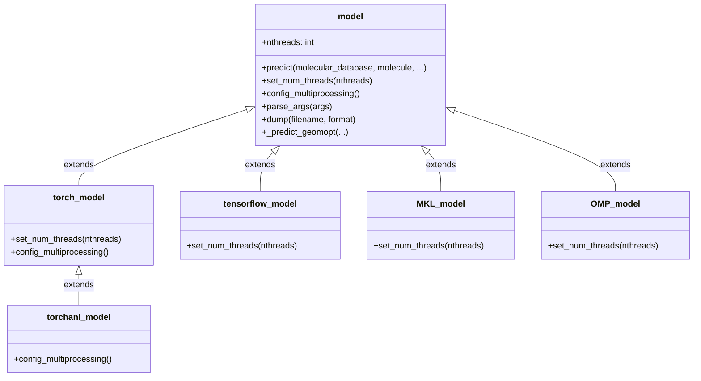
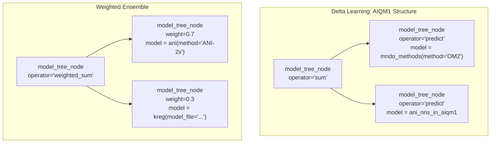

MLatom's model system is built on a layered inheritance architecture that unifies three fundamentally different categories of computational chemistry models under a single polymorphic interface: trainable machine learning potentials, pre-trained method models (both ML-based and conventional QM), and composite model trees. Every model in the framework ultimately descends from the `model` base class, ensuring that downstream simulation code—geometry optimizers, molecular dynamics engines, spectrum calculators—can treat all models identically through a shared `predict()` contract. This page traces the full inheritance tree, explains the role of each abstraction layer, and maps concrete model implementations to their positions in the hierarchy.

## The Foundational Layer: `model`

The `model` class in [model_cls.py](/dralgroup/mlatom/blob/main/mlatom/model_cls.py#L20-L138) is the absolute root of the hierarchy. It establishes the universal interface that every model in MLatom must satisfy, regardless of whether that model is a neural network, a kernel ridge regression model, or a Gaussian input file wrapper. The class defines three core capabilities that all descendants inherit:

| Method | Purpose | Default Behavior |
|---|---|---|
| `predict(molecular_database, molecule, calculate_energy, calculate_energy_gradients, calculate_hessian)` | Universal prediction interface | Delegates to subclass; normalizes database/molecule inputs |
| `set_num_threads(nthreads)` | Concurrency control | Stores value; subclasses override with backend-specific logic |
| `dump(filename, format)` | Serialization | Writes model metadata to JSON |
| `_predict_geomopt(...)` | Geometry optimization prediction loop | Calls `predict()` and optionally dumps trajectory snapshots |

The `predict()` method at [line 78](/dralgroup/mlatom/blob/main/mlatom/model_cls.py#L78-L107) serves as the central polymorphic entry point. It accepts either a `molecular_database` or a single `molecule`, along with boolean flags for which properties to compute. Internally, it normalizes the inputs (converting a single molecule to a one-entry database if needed) and calls `set_num_threads()`, giving every subclass an opportunity to configure its parallelism before computation begins.

The `_predict_geomopt()` method at [line 40](/dralgroup/mlatom/blob/main/mlatom/model_cls.py#L40-L76) is specifically designed for the geometry optimization workflow—it wraps `predict()` with trajectory logging, NaN-gradient warnings, and incremental dump-to-file logic that the optimizer can call at each iteration step.

> [!TIP]
> The `model` base class uses `nthreads = 0` as the class-level default, which means "unset"—subclasses interpret this as "use the framework's default parallelism." Only when a positive integer is provided do threading mixins activate their backend-specific configuration.

## Threading and Backend Mixins

MLatom provides a set of lightweight mixin classes that adapt the generic `set_num_threads()` contract to specific computational backends. These mixins are not standalone models—they exist solely to be combined with other base classes through multiple inheritance. All five are defined in [model_cls.py](/dralgroup/mlatom/blob/main/mlatom/model_cls.py#L139-L174).

**`torch_model`** (line 139) calls `torch.set_num_threads()` when `nthreads > 0`, and its `config_multiprocessing()` override sets the thread count to 1—a common requirement for PyTorch's multiprocessing data loaders to avoid oversubscription. **`torchani_model`** (line 152) inherits this behavior unchanged, since TorchANI is built on PyTorch. **`tensorflow_model`** (line 157) sets the `TF_INTRA_OP_PARALLELISM_THREADS` environment variable. **`MKL_model`** (line 163) and **`OMP_model`** (line 169) control Intel MKL and OpenBLAS/OpenMP threading respectively through their corresponding environment variables (`MKL_NUM_THREADS`, `OMP_NUM_THREADS`). The `kreg` class provides a concrete example of combining multiple threading mixins: it inherits from both `OMP_model` and `MKL_model` alongside `krr` to control Fortran-backend parallelism.

## The Trainable Model Layer: `ml_model`

The `ml_model` class at [line 343](/dralgroup/mlatom/blob/main/mlatom/model_cls.py#L343-L818) is the second major branch of the hierarchy, designed specifically for machine learning models that require training from data. It extends `model` and adds the full training lifecycle:

- **`train(ml_database, molecular_database, property_to_learn, xyz_derivative_property_to_learn)`** at [line 347](/dralgroup/mlatom/blob/main/mlatom/model_cls.py#L347-L362): Accepts training data and specifies which molecular properties to learn (energies, forces, Hessians).
- **`predict(...)`** at [line 366](/dralgroup/mlatom/blob/main/mlatom/model_cls.py#L366-L389): Overrides the base `predict()` with an extended signature that includes `ml_database`, `entry`, and property label parameters (e.g., `property_to_predict`, `xyz_derivative_property_to_predict`).
- **`generate_model_dict()`** at [line 392](/dralgroup/mlatom/blob/main/mlatom/model_cls.py#L392-L405): Creates a serializable dictionary of model metadata for JSON persistence.
- **`reset()`** at [line 407](/dralgroup/mlatom/blob/main/mlatom/model_cls.py#L407-L409): Deletes the model file from disk, clearing trained parameters.
- **`dump()` / `load()`**: Serialization pair—`dump()` at [line 413](/dralgroup/mlatom/blob/main/mlatom/model_cls.py#L413-L427) writes metadata to JSON; subclasses implement `save()` and `load()` for actual parameter persistence.

Critically, `ml_model` also provides the **hyperparameter optimization infrastructure**: `optimize_hyperparameters()` at [line 609](/dralgroup/mlatom/blob/main/mlatom/model_cls.py#L609-L727), `calculate_validation_loss()` at [line 450](/dralgroup/mlatom/blob/main/mlatom/model_cls.py#L450-L607), `holdout_validation()` at [line 729](/dralgroup/mlatom/blob/main/mlatom/model_cls.py#L729-L740), and `cross_validation()` at [line 742](/dralgroup/mlatom/blob/main/mlatom/model_cls.py#L742-L770). These methods implement grid-based optimization, holdout splitting, and k-fold cross-validation respectively, and are inherited by all trainable models. The `hyperparameter()` class at [line 856](/dralgroup/mlatom/blob/main/mlatom/model_cls.py#L856-L905) and `hyperparameters(UserDict)` at [line 907](/dralgroup/mlatom/blob/main/mlatom/model_cls.py#L907-L957) provide structured, optimizable parameter containers with `optimization_space`, `dtype`, and `choices` metadata.

## The Method Model Layer: `method_model`

The `method_model` class at [line 175](/dralgroup/mlatom/blob/main/mlatom/model_cls.py#L175-L206) is the third major branch, designed for models that represent external computational chemistry methods (QM programs, semiempirical methods, DFT functionals). Rather than training from data, these models delegate computation to an external program. The class provides class-method utilities:

- **`is_method_supported(method)`** at [line 177](/dralgroup/mlatom/blob/main/mlatom/model_cls.py#L177-L184): Checks if a given method string appears in the class's `supported_methods` list (case-insensitive).
- **`is_program_found()`** at [line 186](/dralgroup/mlatom/blob/main/mlatom/model_cls.py#L186-L197): Verifies that the required external program is available by checking the `bin_env_name` environment variable.
- **`get_bin_env_var()`** at [line 199](/dralgroup/mlatom/blob/main/mlatom/model_cls.py#L199-L204): Retrieves the path from the environment.
- **`raise_unsupported_method_error(method)`** at [line 205](/dralgroup/mlatom/blob/main/mlatom/model_cls.py#L205-L206): Raises a descriptive `ValueError` when a method is not recognized.

This pattern enables the factory function `methods()` in [models.py](/dralgroup/mlatom/blob/main/mlatom/models.py#L627-L691) to auto-discover which `method_model` subclass can handle a given method name by iterating over the `known_classes` list and calling `is_method_supported()` on each.

## The Downloadable Model Mixin

The `downloadable_model` class at [line 208](/dralgroup/mlatom/blob/main/mlatom/model_cls.py#L208-L340) is a mixin that adds automatic model downloading capabilities. It checks three search paths in order: `$MODELSPATH`, the `mlatom_models/` directory within the MLatom installation, and `~/.mlatom/models/`. If model files are not found, it downloads them from a URL, extracts ZIP archives, and optionally flattens nested directories. This mixin is combined with `method_model` for pre-trained methods like AIQM1, AIQM2, AIQM3, OMNI-P1, and OMNI-P2x.

## Concrete Model Implementations

All concrete models live in their respective modules and combine the appropriate base classes. The following diagram shows the complete inheritance landscape with every significant concrete model mapped to its position.

```mermaid
classDiagram
    direction TB
    
    class model {
        <<abstract>>
        +predict"()"
        +set_num_threads"()"
    }
    
    class ml_model {
        <<abstract>>
        +train"()"
        +optimize_hyperparameters"()"
        +cross_validation"()"
    }
    
    class method_model {
        <<abstract>>
        +is_method_supported"()"
        +is_program_found"()"
    }
    
    class torch_model
    class tensorflow_model
    class torchani_model
    class MKL_model
    class OMP_model
    class downloadable_model
    
    %% Trainable ML models
    class krr {
        kernel_function
        "ml_program: 'scipy'"
    }
    
    class kreg {
        hyperparameters
        equilibrium_molecule
    }
    
    class ani {
        species_order
        device
        +train"()"
        +save"()"
        +load"()"
    }
    
    class msani {
        nstates
        +train"()"
        +predict"()"
    }
    
    class ani_methods {
        "supported_methods: ANI-1x, ANI-2x..."
        +predict"()"
    }
    
    class mace {
        device
        +train"()"
        +predict"()"
    }
    
    class physnet {
        session
        +train"()"
        +predict"()"
    }
    
    class dpmd {
        json_input
        type_map
        +train"()"
        +predict"()"
    }
    
    class gap {
        gapdict
        +train"()"
        +predict"()"
    }
    
    class sgdml {
        gdml_train
        +train"()"
        +predict"()"
    }
    
    class EEEDDDD {
        model_file
        +train"()"
        +propagate"()"
    }
    
    %% Method models
    class aiqm1 {
        "supported_methods: AIQM1, AIQM1@DFT"
    }
    
    class aiqm2 {
        "supported_methods: AIQM2, AIQM2@DFT"
    }
    
    class aiqm3 {
        "supported_methods: AIQM3, AIQM3@DFT"
    }
    
    class omnip1 {
        "supported_methods: OMNI-P1"
    }
    
    class omnip2x {
        "supported_methods: OMNI-P2x"
    }
    
    class uaiqm {
        "supported_methods: uaiqm_optimal..."
    }
    
    class dens {
        +predict"()"
    }
    
    class gaussian_methods {
        "supported_methods: DFT, HF, ab initio"
    }
    
    class pyscf_methods {
        "supported_methods: DFT, ab initio"
    }
    
    class orca_methods {
        "supported_methods: DFT, CCSD(T)*/CBS"
    }
    
    class ccsdtstarcbs {
        "supported_methods: CCSD(T)*/CBS"
    }
    
    class xtb_methods
    class mndo_methods
    class sparrow_methods
    class turbomole_methods
    class dftbplus_methods
    class columbus_methods
    class dftd3_methods
    class dftd4_methods
    class mace_methods
    
    %% Model tree
    class model_tree_node {
        name
        parent
        children
        "operator: sum/weighted_sum/average"
        +predict"()"
    }
    
    %% ===== Inheritance Lines (修复了多重继承导致的死循环结构) =====
    
    %% 1. Base Abstract Classes
    model <|-- ml_model
    model <|-- method_model
    model <|-- model_tree_node
    model <|-- torch_model
    model <|-- tensorflow_model
    model <|-- MKL_model
    model <|-- OMP_model
    model <|-- downloadable_model
    
    %% 2. ML Models inheriting from ml_model
    ml_model <|-- krr
    ml_model <|-- ani
    ml_model <|-- msani
    ml_model <|-- mace
    ml_model <|-- physnet
    ml_model <|-- dpmd
    ml_model <|-- gap
    ml_model <|-- sgdml
    ml_model <|-- EEEDDDD
    
    %% 3. Method Models inheriting from method_model
    method_model <|-- ani_methods
    method_model <|-- aiqm1
    method_model <|-- aiqm2
    method_model <|-- aiqm3
    method_model <|-- omnip1
    method_model <|-- omnip2x
    method_model <|-- uaiqm
    method_model <|-- dens
    method_model <|-- gaussian_methods
    method_model <|-- pyscf_methods
    method_model <|-- orca_methods
    method_model <|-- ccsdtstarcbs
    method_model <|-- xtb_methods
    method_model <|-- mndo_methods
    method_model <|-- sparrow_methods
    method_model <|-- turbomole_methods
    method_model <|-- dftbplus_methods
    method_model <|-- columbus_methods
    method_model <|-- dftd3_methods
    method_model <|-- dftd4_methods
    method_model <|-- mace_methods
    
    %% 4. Specific Model Inheritance (Single Path Only)
    krr <|-- kreg
    
    %% torchani_model 汇总了 ani, msani, ani_methods, torch_model 的特性
    torch_model <|-- torchani_model
    ani <|-- torchani_model
    msani <|-- torchani_model
    ani_methods <|-- torchani_model
    
    %% mace 汇总了 mace_methods, torch_model 的特性
    mace_methods <|-- mace
    mace <|-- torch_model
    
    %% physnet, dpmd 汇总了 tensorflow_model 的特性
    physnet <|-- tensorflow_model
    dpmd <|-- tensorflow_model
    
    %% downloadable_model 汇总了其它具体 Model 的特性
    ani_methods <|-- downloadable_model
    aiqm2 <|-- downloadable_model
    aiqm3 <|-- downloadable_model
    omnip1 <|-- downloadable_model
    omnip2x <|-- downloadable_model
    EEEDDDD <|-- downloadable_model
    
    %% MKL/OMP 归属
    kreg <|-- OMP_model
    kreg <|-- MKL_model
```

### Trainable ML Models (extend `ml_model`)

These models can be trained from molecular databases and inherit the full hyperparameter optimization stack:

| Class | Module | Backend | Key Characteristics |
|---|---|---|---|
| `krr` | [models.py](/dralgroup/mlatom/blob/main/mlatom/models.py#L18-L342) | SciPy / Julia | Kernel Ridge Regression with configurable kernel functions |
| `kreg` | [models.py](/dralgroup/mlatom/blob/main/mlatom/models.py#L343-L554) | KREG Fortran API | KRR with RE descriptors; combines `OMP_model` + `MKL_model` |
| `ani` | [torchani_interface.py](/dralgroup/mlatom/blob/main/mlatom/interfaces/torchani_interface.py#L92-L822) | TorchANI/PyTorch | ANI-style neural network with AEV descriptors; trainable |
| `msani` | [torchani_interface.py](/dralgroup/mlatom/blob/main/mlatom/interfaces/torchani_interface.py#L823-L1579) | TorchANI/PyTorch | Multi-state ANI for excited-state potentials |
| `mace` | [mace_interface.py](/dralgroup/mlatom/blob/main/mlatom/interfaces/mace_interface.py#L117-L842) | MACE/PyTorch | Equivariant message-passing neural network |
| `physnet` | [physnet_interface.py](/dralgroup/mlatom/blob/main/mlatom/interfaces/physnet_interface.py#L62-L713) | TensorFlow | PhysNet neural network potential |
| `dpmd` | [dpmd_interface.py](/dralgroup/mlatom/blob/main/mlatom/interfaces/dpmd_interface.py#L66-L394) | DeePMD-kit/TF | Deep Potential molecular dynamics model |
| `gap` | [gap_interface.py](/dralgroup/mlatom/blob/main/mlatom/interfaces/gap_interface.py#L48-L244) | QUIP (external) | Gaussian Approximation Potentials |
| `sgdml` | [sgdml_interface.py](/dralgroup/mlatom/blob/main/mlatom/interfaces/sgdml_interface.py#L65-L1129) | sGDML (external) | Symmetric Gradient Domain Machine Learning |
| `EEEDDDD` | [EEEDDDD.py](/dralgroup/mlatom/blob/main/mlatom/EEEDDDD.py#L199-L718) | PyTorch/e3nn | Equivariant attention model for trajectory prediction |

### Method Models (extend `method_model`)

These models wrap external computational chemistry programs and do not support training:

| Class | Module | External Dependency | Supported Methods |
|---|---|---|---|
| `gaussian_methods` | [gaussian_interface.py](/dralgroup/mlatom/blob/main/mlatom/interfaces/gaussian_interface.py#L19-L148) | Gaussian | DFT, HF, ab initio methods |
| `pyscf_methods` | [pyscf_interface.py](/dralgroup/mlatom/blob/main/mlatom/interfaces/pyscf_interface.py) | PySCF | DFT, ab initio methods |
| `orca_methods` | [orca_interface.py](/dralgroup/mlatom/blob/main/mlatom/interfaces/orca_interface.py) | ORCA | DFT, composite methods |
| `xtb_methods` | [xtb_interface.py](/dralgroup/mlatom/blob/main/mlatom/interfaces/xtb_interface.py) | xtb | GFN2-xTB, semiempirical GFNx-TB |
| `mndo_methods` | [mndo_interface.py](/dralgroup/mlatom/blob/main/mlatom/interfaces/mndo_interface.py) | MNDO | NDDO semiempirical methods |
| `sparrow_methods` | [sparrow_interface.py](/dralgroup/mlatom/blob/main/mlatom/interfaces/sparrow_interface.py) | Sparrow | OMx, DFTB, PM6 |
| `dens` | [dens.py](/dralgroup/mlatom/blob/main/mlatom/dens.py#L4-L110) | PySCF/Orca | DENS composite DFT methods |
| `ccsdtstarcbs` | [composite_methods.py](/dralgroup/mlatom/blob/main/mlatom/composite_methods.py#L12-L33) | Orca | CCSD(T)*/CBS |

### Pre-Trained AIQM and Universal Models

These models combine `method_model` with `downloadable_model` to provide ready-to-use methods with automatic model file management:

| Class | Module | Backend Mixin | Supported Methods |
|---|---|---|---|
| `aiqm1` | [aiqm1.py](/dralgroup/mlatom/blob/main/mlatom/aiqm1.py#L15-L152) | `torchani_model` | AIQM1, AIQM1@DFT, AIQM1@DFT* |
| `aiqm2` | [aiqm2.py](/dralgroup/mlatom/blob/main/mlatom/aiqm2.py#L5-L199) | — | AIQM2, AIQM2@DFT, AIQM2@DFT* |
| `aiqm3` | [aiqm3.py](/dralgroup/mlatom/blob/main/mlatom/addons/aiqm3/aiqm3.py#L5-L48) | — | AIQM3, AIQM3@DFT |
| `omnip1` | [omnip1.py](/dralgroup/mlatom/blob/main/mlatom/omnip1.py#L4-L113) | — | OMNI-P1 |
| `omnip2x` | [omnip2x.py](/dralgroup/mlatom/blob/main/mlatom/addons/omnip2x/omnip2x.py#L16-L260) | — | OMNI-P2x |
| `uaiqm` | [uaiqm.py](/dralgroup/mlatom/blob/main/mlatom/addons/uaiqm/uaiqm.py#L16-L72) | — | uaiqm_optimal, uaiqm_gfn2xtbstar@cc... |
| `ani_methods` | [torchani_interface.py](/dralgroup/mlatom/blob/main/mlatom/interfaces/torchani_interface.py#L1637-L1896) | `torchani_model` | ANI-1x, ANI-1ccx, ANI-2x, ANI-1x-D4, ANI-2x-D4 |

> [!TIP]
> The distinction between `ani` (trainable) and `ani_methods` (pre-trained) is intentional. `ani` supports `train()`, `save()`, and `load()` for building new ANI models from scratch, while `ani_methods` wraps pre-trained checkpoints for immediate prediction with named methods like `'ANI-2x'`. Both share the `torchani_model` mixin but serve fundamentally different workflows.

## The Model Tree: Composite and Delta-Learning Models

The `model_tree_node` class at [line 960](/dralgroup/mlatom/blob/main/mlatom/model_cls.py#L960-L1139) extends `model` to enable **composite model construction**—the mechanism behind delta learning, ensemble averaging, and weighted combinations of models. Each node in the tree has a `name`, optional `parent` and `children` references, an `operator` (one of `'sum'`, `'weighted_sum'`, `'average'`, or `'predict'`), and an optional `model` reference to a concrete model instance.

When `predict()` is called on a tree node at [line 994](/dralgroup/mlatom/blob/main/mlatom/model_cls.py#L994-L1083), the node recursively invokes prediction on all children, then applies its operator to combine their results. A leaf node (with `operator='predict'` and no children) simply delegates to its wrapped `model`. An internal node with `operator='sum'` adds the energy/gradient contributions of all children—this is the pattern used for delta-learning (e.g., AIQM1 = baseline semiempirical + Δ-ML correction). The `weighted_sum` operator applies per-child weights, while `average` divides the sum by the number of children.

The tree also handles **multi-state prediction** (`nstates > 1`), creating `properties_tree_node` objects on each molecule's `electronic_states` to track per-state property values. Thread configuration propagates recursively from parent to children through `set_num_threads()` at [line 985](/dralgroup/mlatom/blob/main/mlatom/model_cls.py#L985-L992).

Serialization of model trees is handled by the recursive `dump()` at [line 1120](/dralgroup/mlatom/blob/main/mlatom/model_cls.py#L1120-L1137), which produces nested JSON. The complementary `load_dict()` function in [models.py](/dralgroup/mlatom/blob/main/mlatom/models.py#L721-L764) reconstructs the full tree from such JSON by recursively deserializing children and the wrapped model.

## The `methods()` Factory and Model Resolution

The `methods()` function at [line 627](/dralgroup/mlatom/blob/main/mlatom/models.py#L627-L691) is the primary entry point for creating model instances by method name. It operates in two modes:

1. **Program-specified**: If `program` is provided (e.g., `program='gaussian'`), it looks up `gaussian_methods` in the module's global namespace and instantiates it with the requested `method`.
2. **Auto-discovery**: If only `method` is provided, it iterates over the `known_classes` list at [line 625](/dralgroup/mlatom/blob/main/mlatom/models.py#L625-L626), calling `is_program_found()` (to skip unavailable programs) and then `is_method_supported()` (to match the method name). The first class that claims the method wins, and the ordering of `known_classes` determines priority.

This factory pattern means that adding a new method model to MLatom requires only: (a) defining a class that extends `method_model`, (b) setting `supported_methods` as a class attribute, (c) implementing `predict()`, and (d) adding the class to `known_classes` in `models.py`.

## Summary: Architectural Principles

The model hierarchy follows three key design principles that developers extending MLatom should understand:

**Polymorphic uniformity**. Every model—whether a neural network, a Gaussian wrapper, or a composite delta-learning tree—satisfies the same `predict()` signature. This allows simulation workflows to accept any model without type checking.

**Composable mixins**. Backend-specific behavior (threading, downloading, method lookup) is factored into orthogonal mixin classes rather than embedded in monolithic base classes. A model like `kreg` combines four parents (`krr`, `OMP_model`, `MKL_model`) to inherit training logic and two independent threading strategies.

**Separation of trainability from predictability**. The split between `ml_model` (trainable) and `method_model` (pre-trained/wrapper) reflects a fundamental distinction: trainable models own their parameters and lifecycle, while method models are stateless delegates to external programs. The `model_tree_node` bridges both worlds by wrapping any model type in a composable graph.
