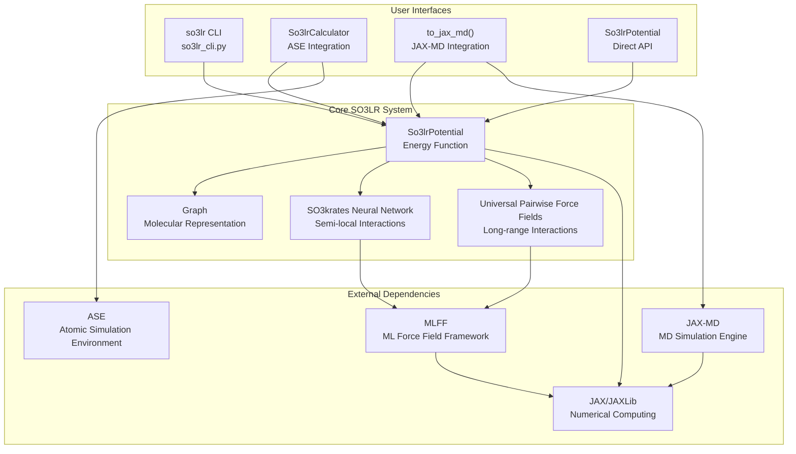
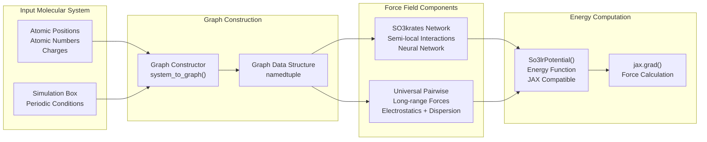
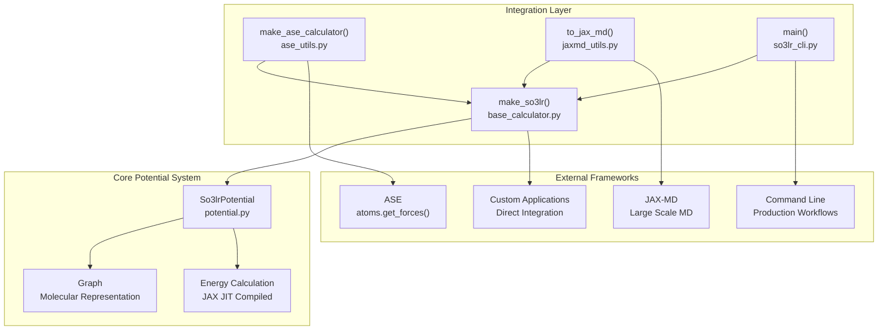
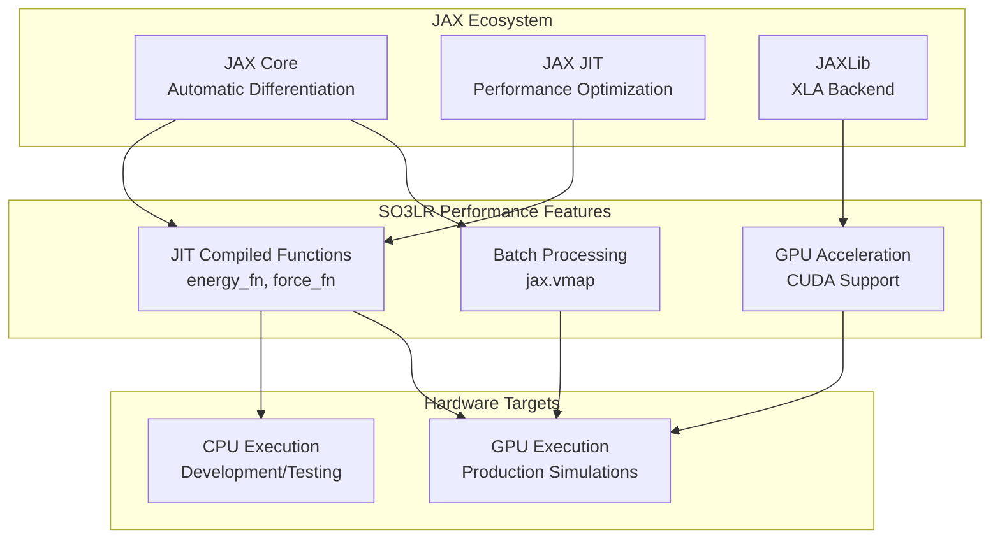

# Overview

Relevant source files

The following files were used as context for generating this wiki page:

- [README.md](README.md)
- [examples/data/sapt10k.zip](examples/data/sapt10k.zip)
- [pyproject.toml](pyproject.toml)

This document provides a comprehensive overview of SO3LR (pronounced "Solar"), a pretrained machine-learned force field for molecular simulations. SO3LR combines the SO3krates neural network architecture with universal pairwise force fields to enable accurate and efficient molecular dynamics simulations across diverse chemical systems.

For specific implementation details of core components, see [Core Components](#5). For usage examples and tutorials, see [Examples and Tutorials](#4). For command-line usage, see [Command Line Interface](#2), and for programmatic integration, see [Python API](#3).

## System Architecture

SO3LR implements a hybrid force field architecture that integrates two complementary computational approaches: neural network-based semi-local interactions through SO3krates and classical universal pairwise force fields for long-range interactions.

### High-Level System Components

Sources: [README.md:1-303](), [pyproject.toml:1-31]()

## Core Architecture Components

SO3LR's architecture centers around three primary computational components that work together to provide accurate molecular force field predictions.

### Force Field Hybrid Design

Sources: [README.md:256-275]()

## Integration Interfaces

SO3LR provides multiple integration pathways to accommodate different simulation workflows and computational frameworks.

### API Integration Points

| Interface | Primary Use Case | Key Functions | Target Users |
|-----------|------------------|---------------|--------------|
| CLI | Production simulations | `so3lr nvt`, `so3lr npt`, `so3lr opt` | End users, HPC workflows |
| ASE Calculator | Standard workflows | `So3lrCalculator()` | Computational chemists |
| JAX-MD Integration | Large-scale simulations | `to_jax_md()` | Performance-critical applications |
| Direct API | Custom applications | `So3lrPotential()`, `Graph()` | Developers, method development |

Sources: [README.md:38-255](), [pyproject.toml:29-30]()

## Performance and Computational Framework

SO3LR is built on the JAX ecosystem to provide high-performance molecular simulations with automatic differentiation and JIT compilation capabilities.

### Computational Backend

### Key Performance Characteristics

- **GPU Acceleration**: Optimized for CUDA-enabled GPUs with significant performance improvements over CPU execution
- **JIT Compilation**: Energy and force functions are JIT-compiled for optimal performance
- **Automatic Differentiation**: Forces computed via automatic differentiation of energy functions
- **Scalable Simulations**: Integration with JAX-MD enables large-scale molecular dynamics

Sources: [README.md:16-30](), [README.md:182-254](), [pyproject.toml:14-21]()

## Dependencies and Requirements

SO3LR relies on a carefully curated set of dependencies to provide its full functionality:

### Core Dependencies

- **JAX/JAXLib (==0.5.3)**: Numerical computing and automatic differentiation
- **MLFF**: Machine learning force field framework (custom fork)
- **JAX-MD**: Molecular dynamics simulation engine (custom fork) 
- **ASE**: Atomic Simulation Environment integration
- **JAX-PME**: Particle mesh Ewald for long-range electrostatics

### Installation Requirements

- **Python >=3.12**: Modern Python version required
- **GPU Support**: Optional but recommended for production simulations
- **CUDA 12**: Required for GPU acceleration

The system supports both CPU and GPU execution modes, with GPU providing significantly better performance for large-scale simulations.

Sources: [pyproject.toml:9-22](), [README.md:15-36]()

---