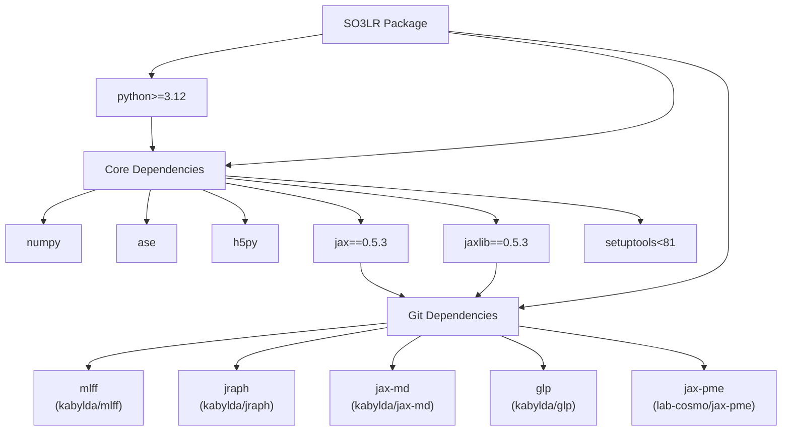
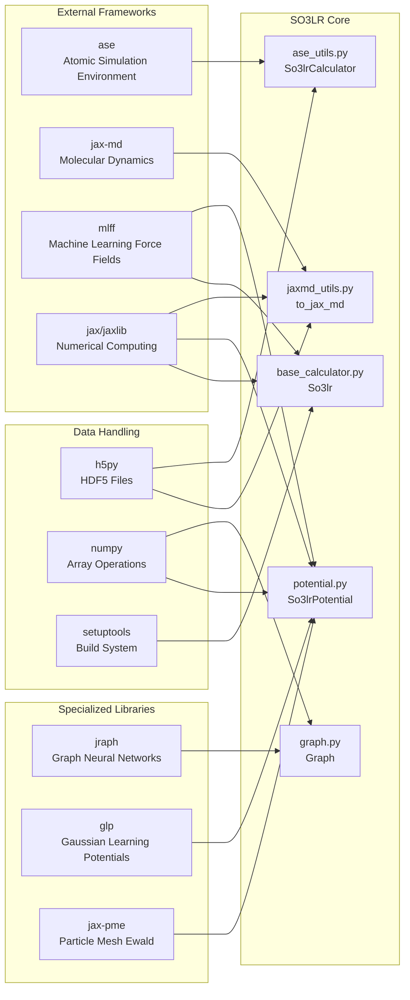
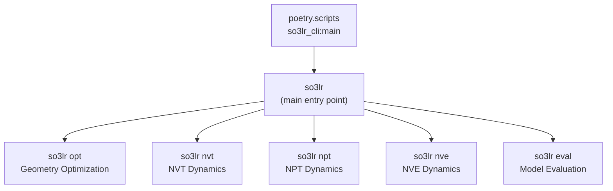

# Installation and Setup

<details>
<summary>Relevant source files</summary>

The following files were used as context for generating this wiki page:

- [.github/workflows/CI.yml](.github/workflows/CI.yml)
- [pyproject.toml](pyproject.toml)
- [so3lr/__init__.py](so3lr/__init__.py)

</details>


This document provides comprehensive instructions for installing SO3LR and its dependencies, configuring the development environment, and verifying that the installation works correctly. It covers both user installations for running simulations and developer setups for contributing to the codebase.

For information about using SO3LR's command line interface after installation, see [Command Line Interface](#2). For Python API usage, see [Python API](#3).

## Prerequisites

SO3LR requires Python 3.12 or higher and depends on several scientific computing libraries. The system integrates with multiple external frameworks for molecular simulation and machine learning.

### System Requirements

| Component | Requirement | Notes |
|-----------|-------------|-------|
| Python | ≥ 3.12 | Required for all SO3LR functionality |
| JAX/JAXLib | 0.5.3 | Exact version required for compatibility |
| Operating System | Linux/macOS | Windows support not officially tested |

**Installation Dependencies Flow**


Sources: [pyproject.toml:9-21](), [.github/workflows/CI.yml:18-20]()

## Installation Methods

### Standard Installation

The recommended installation method uses pip to install SO3LR directly from the repository:

```bash
pip install git+https://github.com/general-molecular-simulations/so3lr.git
```

This will automatically install all dependencies specified in the project configuration.

### Development Installation

For development work or to access the latest features, clone the repository and install in editable mode:

```bash
git clone https://github.com/general-molecular-simulations/so3lr.git
cd so3lr
pip install -e .
```

The editable installation allows changes to the source code to be immediately reflected without reinstalling.

Sources: [.github/workflows/CI.yml:36](), [pyproject.toml:24-26]()

## Dependency Architecture

SO3LR's dependency structure reflects its role as an integration layer between multiple scientific computing frameworks.

**SO3LR Dependency Architecture**


Sources: [pyproject.toml:11-21](), [so3lr/__init__.py:3-7]()

### Git Dependencies

SO3LR depends on several forked versions of scientific libraries that include specific features or modifications:

| Package | Repository | Branch | Purpose |
|---------|------------|---------|---------|
| `mlff` | kabylda/mlff | v1.0-tfds-pme | Machine learning force fields with PME support |
| `jraph` | kabylda/jraph | master | Graph neural network operations |
| `jax-md` | kabylda/jax-md | main | Molecular dynamics with JAX |
| `glp` | kabylda/glp | electrostatics_neighbourlist | Gaussian learning potentials |
| `jax-pme` | lab-cosmo/jax-pme | main | Particle mesh Ewald implementation |

These dependencies are installed automatically during SO3LR installation.

Sources: [pyproject.toml:17-21]()

## Command Line Interface Setup

After installation, SO3LR provides a command line interface accessible via the `so3lr` command. The CLI entry point is configured in the project setup.

**CLI Command Structure**


Sources: [pyproject.toml:29-30]()

## Installation Verification

### Testing Core Functionality

Verify the installation by testing the main components:

```bash
# Test CLI availability
so3lr --help

# Test Python imports
python -c "from so3lr import So3lrCalculator, Graph, So3lrPotential; print('Import successful')"

# Run test suite (development installation)
pytest tests/
```

### Component Verification

Test individual SO3LR components to ensure proper installation:

```python
# Test ASE integration
from so3lr import So3lrCalculator

# Test JAX-MD integration  
from so3lr import to_jax_md

# Test direct API
from so3lr import So3lr

# Test graph functionality
from so3lr import Graph

# Test potential functions
from so3lr import So3lrPotential
```

Sources: [so3lr/__init__.py:3-7](), [.github/workflows/CI.yml:34-37]()

### JAX Backend Verification

Since SO3LR relies heavily on JAX for numerical computations, verify JAX installation:

```python
import jax
import jax.numpy as jnp

# Check JAX version
print(f"JAX version: {jax.__version__}")  # Should be 0.5.3

# Test basic JAX functionality
x = jnp.array([1.0, 2.0, 3.0])
print(f"JAX array operations work: {jnp.sum(x)}")

# Test JIT compilation
@jax.jit
def square(x):
    return x ** 2

print(f"JIT compilation works: {square(5.0)}")
```

## Troubleshooting

### Common Installation Issues

| Issue | Symptoms | Solution |
|-------|----------|----------|
| JAX version conflict | Import errors, compilation failures | Ensure `jax==0.5.3` and `jaxlib==0.5.3` |
| Git dependency failures | Network errors during install | Check internet connection, Git access |
| Python version mismatch | Syntax errors, import failures | Use Python ≥ 3.12 |
| CUDA/GPU issues | JAX GPU detection failures | Install appropriate JAXLib CUDA version |

### Dependency Resolution

If dependency conflicts occur, create a clean virtual environment:

```bash
python -m venv so3lr_env
source so3lr_env/bin/activate  # Linux/macOS
# or
so3lr_env\Scripts\activate     # Windows

pip install --upgrade pip
pip install git+https://github.com/general-molecular-simulations/so3lr.git
```

### Development Environment Setup

For development work, ensure testing capabilities:

```bash
pip install -e .
pip install pytest  # If not included in dependencies
pytest tests/ -v
```

Sources: [.github/workflows/CI.yml:15-37](), [pyproject.toml:14-16]()

The installation process integrates SO3LR with the broader ecosystem of molecular simulation tools, providing interfaces to ASE, JAX-MD, and other frameworks while maintaining precise dependency versioning for reproducible scientific computing.

---