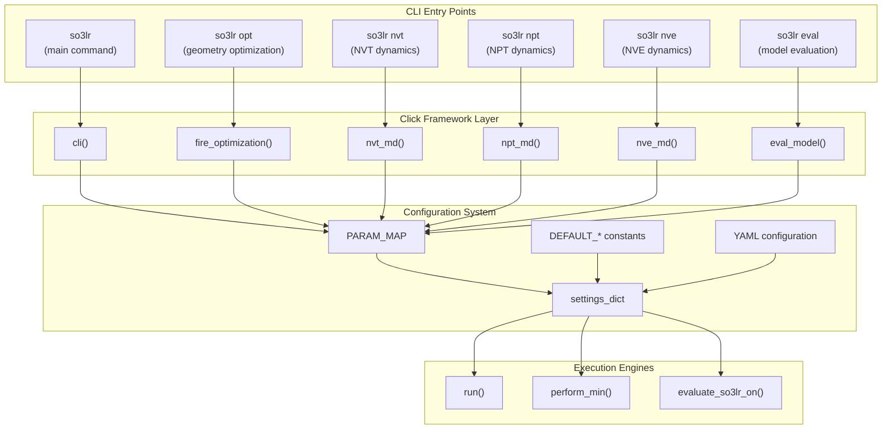
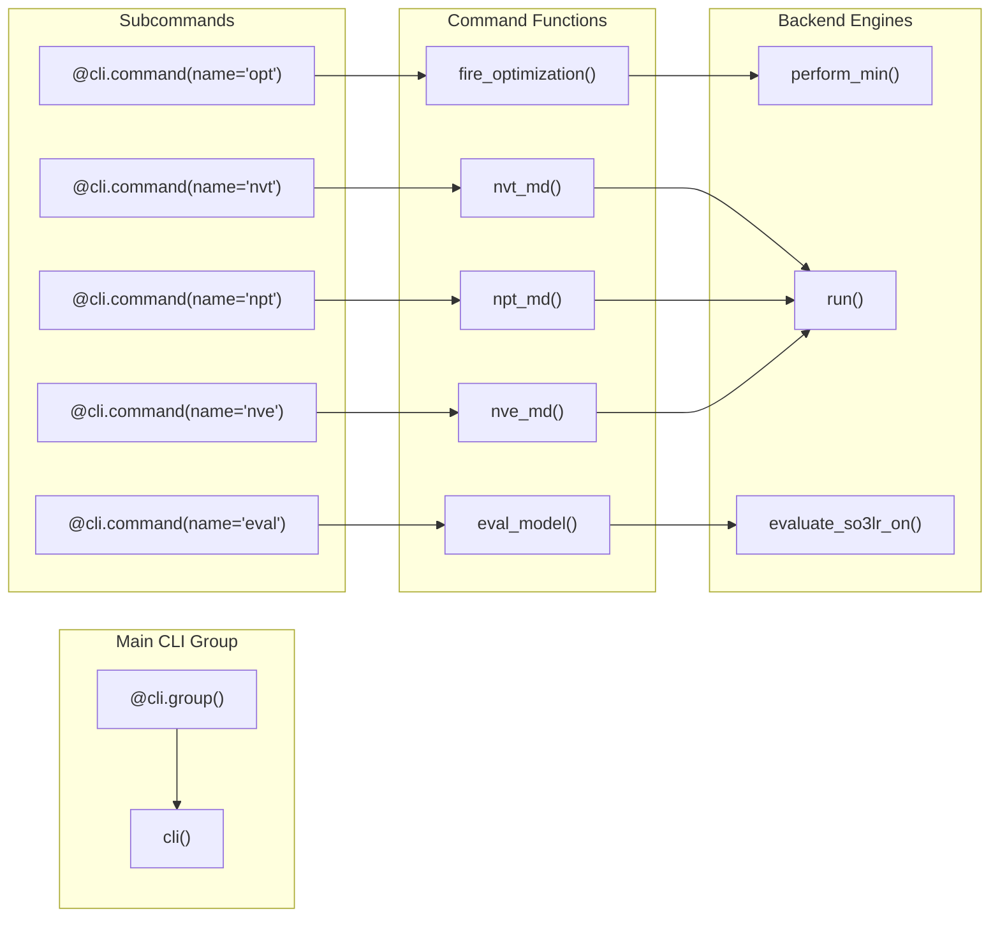
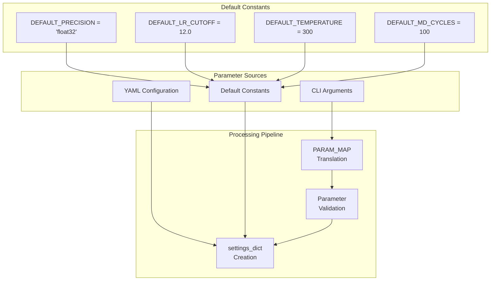
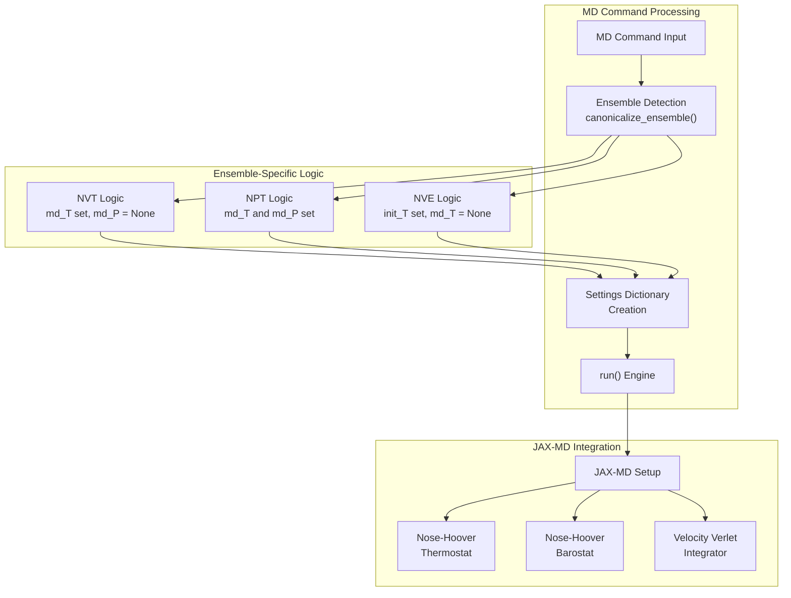
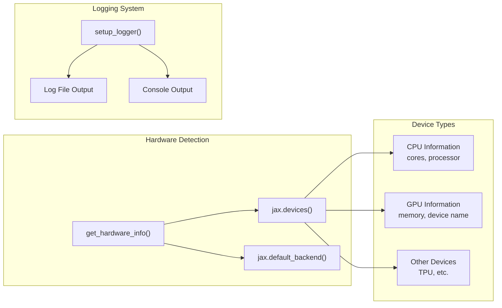

# Command Line Interface

Relevant source files

The following files were used as context for generating this wiki page:

- [README.md](README.md)
- [examples/data/sapt10k.zip](examples/data/sapt10k.zip)
- [so3lr/cli/so3lr_cli.py](so3lr/cli/so3lr_cli.py)

The SO3LR Command Line Interface (CLI) provides a unified interface for running molecular dynamics simulations, geometry optimization, and model evaluation using SO3LR force fields. The CLI abstracts the complexity of the underlying JAX-MD simulation engine and SO3LR potential system into simple, intuitive commands.

This document covers the CLI architecture, available commands, parameter system, and configuration options. For information about the underlying Python API that the CLI uses, see [Python API](#3). For examples of using the CLI in practice, see [Examples and Tutorials](#4).

## CLI Architecture Overview

The SO3LR CLI is built using the Click framework and provides five main commands through a unified interface. The CLI handles parameter validation, default value management, hardware detection, and logging configuration before delegating to the appropriate simulation engines.

Sources: [so3lr/cli/so3lr_cli.py:1-1814]()

## Command Structure and Functions

The CLI implements a hierarchical command structure where each simulation type is implemented as a Click subcommand with its own parameter set and validation logic.

Sources: [so3lr/cli/so3lr_cli.py:499-585](), [so3lr/cli/so3lr_cli.py:865-925](), [so3lr/cli/so3lr_cli.py:1022-1113](), [so3lr/cli/so3lr_cli.py:1243-1338](), [so3lr/cli/so3lr_cli.py:1476-1551](), [so3lr/cli/so3lr_cli.py:1674-1715]()

## Parameter System and Configuration

The CLI uses a sophisticated parameter mapping system that translates command-line arguments into internal settings dictionaries. This system supports both direct CLI parameters and YAML configuration files.

| CLI Parameter | Internal Setting | Default Value | Description |
|---------------|------------------|---------------|-------------|
| `--input` | `input_file` | None | Input geometry file |
| `--output` | `output_file` | None | Output trajectory file |
| `--temperature` | `md_T` | 300 | Simulation temperature (K) |
| `--pressure` | `md_P` | None | Simulation pressure (atm) |
| `--dt` | `md_dt` | 0.5 | MD timestep (fs) |
| `--md-cycles` | `md_cycles` | 100 | Number of MD cycles |
| `--md-steps` | `md_steps` | 100 | Steps per MD cycle |
| `--lr-cutoff` | `lr_cutoff` | 12.0 | Long-range cutoff (Å) |
| `--nhc-chain` | `nhc_chain_length` | 3 | Nose-Hoover chain length |
| `--nhc-thermo` | `nhc_thermo` | 100.0 | Thermostat damping factor |

The parameter mapping is defined in the `PARAM_MAP` dictionary and processed by the `update_settings_from_defaults()` method:

Sources: [so3lr/cli/so3lr_cli.py:325-358](), [so3lr/cli/so3lr_cli.py:97-125](), [so3lr/cli/so3lr_cli.py:466-481]()

## Simulation Commands

### Geometry Optimization (`so3lr opt`)

The `opt` command performs geometry optimization using the FIRE algorithm implemented in JAX-MD. It supports convergence-based stopping criteria or fixed iteration limits.

**Key Parameters:**
- `--force-conv`: Force convergence threshold (eV/Å)
- `--min-cycles`: Number of optimization cycles
- `--min-start-dt`: Initial timestep for FIRE algorithm
- `--min-max-dt`: Maximum timestep for FIRE algorithm

**Function Flow:**
1. `fire_optimization()` validates inputs and creates settings dictionary
2. `perform_min()` executes the optimization using JAX-MD FIRE implementation
3. Results saved to specified output file

Sources: [so3lr/cli/so3lr_cli.py:865-925](), [so3lr/cli/so3lr_cli.py:903-1020]()

### Molecular Dynamics Commands

The MD commands (`nvt`, `npt`, `nve`) share a common implementation through the `run()` function but differ in their ensemble-specific parameters and thermostat/barostat configuration.

#### NVT Ensemble (`so3lr nvt`)
Constant volume and temperature simulation using Nose-Hoover chain thermostat.

**Key Parameters:**
- `--temperature`: Target temperature (K)
- `--nhc-chain`: Nose-Hoover chain length
- `--nhc-thermo`: Thermostat damping factor

#### NPT Ensemble (`so3lr npt`) 
Constant pressure and temperature simulation using Nose-Hoover chain thermostat and barostat.

**Key Parameters:**
- `--temperature`: Target temperature (K)
- `--pressure`: Target pressure (atm)
- `--nhc-baro`: Barostat damping factor

#### NVE Ensemble (`so3lr nve`)
Constant volume and energy simulation with no thermostat.

**Key Parameters:**
- `--temperature`: Initial temperature for velocity initialization (K)

Sources: [so3lr/cli/so3lr_cli.py:1022-1113](), [so3lr/cli/so3lr_cli.py:1243-1338](), [so3lr/cli/so3lr_cli.py:1476-1551](), [so3lr/cli/so3lr_cli.py:483-497]()

### Model Evaluation (`so3lr eval`)

The `eval` command evaluates SO3LR model performance on molecular datasets, computing metrics for energy, forces, dipole moments, and Hirshfeld ratios.

**Key Parameters:**
- `--datafile`: Input dataset file (EXTXYZ format)
- `--save-to`: Output file for predictions
- `--targets`: Comma-separated list of properties to evaluate
- `--batch-size`: Number of molecules per batch
- `--jit-compile`: Enable JIT compilation for performance

**Function Flow:**
1. `eval_model()` validates inputs and creates evaluation settings
2. `evaluate_so3lr_on()` processes the dataset in batches
3. Metrics computed and predictions optionally saved

Sources: [so3lr/cli/so3lr_cli.py:1674-1715](), [so3lr/cli/so3lr_cli.py:1700-1801]()

## Hardware Detection and Logging

The CLI includes comprehensive hardware detection and logging functionality to provide users with information about their computational environment and simulation progress.

The `get_hardware_info()` function detects the computational backend and provides detailed information about available devices, including memory usage for GPU systems.

Sources: [so3lr/cli/so3lr_cli.py:42-94]()

## Error Handling and Validation

The CLI implements comprehensive error handling and input validation to provide clear feedback to users:

1. **File Validation**: Checks for input file existence and output path validity
2. **Parameter Validation**: Ensures parameter values are within valid ranges
3. **Ensemble Validation**: Prevents conflicting ensemble specifications
4. **Hardware Validation**: Warns about potential hardware limitations

Sources: [so3lr/cli/so3lr_cli.py:757-761](), [so3lr/cli/so3lr_cli.py:769-782](), [so3lr/cli/so3lr_cli.py:485-486]()

---