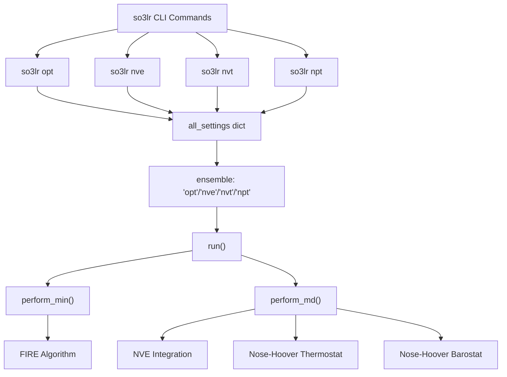
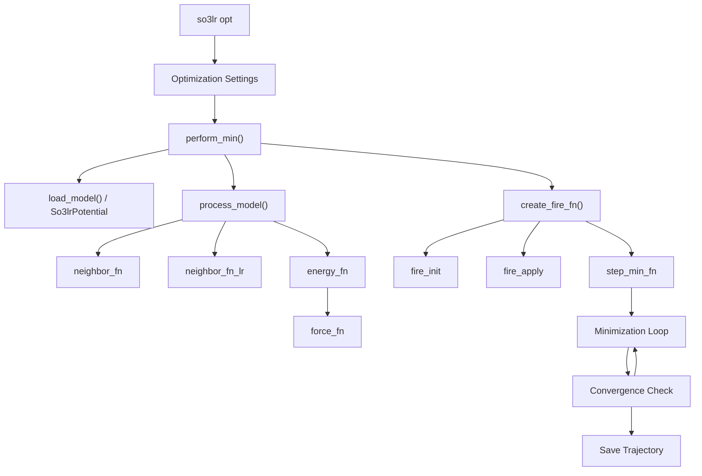
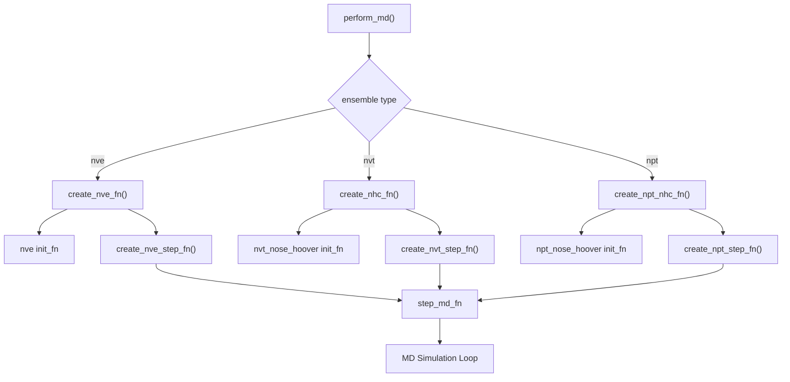
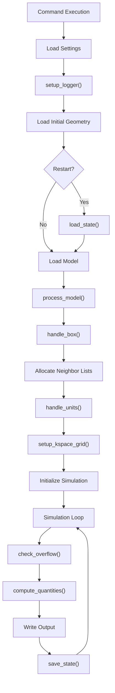

# Simulation Commands

Relevant source files

The following files were used as context for generating this wiki page:

- [so3lr/cli/md_settings.yaml](so3lr/cli/md_settings.yaml)
- [so3lr/cli/so3lr_md.py](so3lr/cli/so3lr_md.py)

This page documents the core simulation commands available in the SO3LR command-line interface for performing molecular dynamics simulations and geometry optimization. These commands provide the primary interface for running production simulations with the SO3LR machine learning force field.

For information about model evaluation workflows, see [Model Evaluation](#2.2). For programming interfaces that bypass the CLI, see [Python API](#3).

## Overview

SO3LR provides four main simulation commands that map directly to computational chemistry simulation types:

| Command | Purpose | Ensemble | Implementation Function |
|---------|---------|----------|----------------------|
| `so3lr opt` | Geometry optimization | - | `perform_min()` |
| `so3lr nve` | Microcanonical dynamics | NVE | `perform_md()` |
| `so3lr nvt` | Canonical dynamics | NVT | `perform_md()` |
| `so3lr npt` | Isothermal-isobaric dynamics | NPT | `perform_md()` |

All commands share a common parameter system based on settings files and command-line overrides, with simulation-specific parameters controlled through the `ensemble` setting.

**Command to Implementation Mapping**

Sources: [so3lr/cli/so3lr_md.py:2322-2372](), [so3lr/cli/so3lr_md.py:1402-1838](), [so3lr/cli/so3lr_md.py:1932-2173]()

## Geometry Optimization

The `so3lr opt` command performs energy minimization using the FIRE (Fast Inertial Relaxation Engine) algorithm to find local energy minima of molecular structures.

### FIRE Algorithm Implementation

The optimization uses FIRE minimization with configurable parameters:

Key optimization parameters:

| Parameter | Setting Key | Default | Description |
|-----------|-------------|---------|-------------|
| Cycles | `min_cycles` | 10 | Maximum optimization cycles |
| Steps per cycle | `min_steps` | 10 | FIRE steps per cycle |
| Initial timestep | `min_start_dt` | 0.05 | Starting FIRE timestep factor |
| Maximum timestep | `min_max_dt` | 0.1 | Maximum FIRE timestep factor |
| Force convergence | `force_convergence` | null | Convergence threshold (eV/Å) |

Sources: [so3lr/cli/so3lr_md.py:1932-2173](), [so3lr/cli/so3lr_md.py:1891-1929](), [so3lr/cli/md_settings.yaml:26-33]()

### Optimization Workflow

The optimization process follows this sequence:

1. **Initialize System**: Load geometry, validate cell, setup potential
2. **Create Functions**: Generate neighbor lists, energy/force functions
3. **FIRE Setup**: Initialize FIRE state and step functions  
4. **Optimization Loop**: Run cycles until convergence or max cycles
5. **Output**: Save trajectory and final optimized geometry

Sources: [so3lr/cli/so3lr_md.py:1972-2173]()

## Molecular Dynamics Commands

The molecular dynamics commands (`nve`, `nvt`, `npt`) all use the same underlying `perform_md()` function but with different ensemble-specific integrators and thermostats/barostats.

### Ensemble-Specific Integration

**MD Integration Function Creation**

Sources: [so3lr/cli/so3lr_md.py:1631-1662](), [so3lr/cli/so3lr_md.py:998-1032](), [so3lr/cli/so3lr_md.py:1034-1072](), [so3lr/cli/so3lr_md.py:1075-1099]()

### NVE (Microcanonical) Dynamics

NVE simulations conserve total energy using basic Verlet integration:

- **Energy**: Constant total energy (E)
- **Volume**: Constant volume (V) 
- **Particles**: Constant number (N)
- **Integration**: `jax_md.simulate.nve()`
- **Thermostat**: None (initial temperature from velocities)

Key NVE parameters:

| Parameter | Setting Key | Description |
|-----------|-------------|-------------|
| Timestep | `md_dt` | Integration timestep (fs) |
| Initial temperature | `md_T` | For velocity initialization only |

Sources: [so3lr/cli/so3lr_md.py:998-1032](), [so3lr/cli/so3lr_md.py:1101-1158]()

### NVT (Canonical) Dynamics  

NVT simulations maintain constant temperature using Nosé-Hoover chain thermostats:

- **Temperature**: Constant temperature (T) 
- **Volume**: Constant volume (V)
- **Particles**: Constant number (N)
- **Integration**: `jax_md.simulate.nvt_nose_hoover()`
- **Thermostat**: Nosé-Hoover chain

NVT-specific parameters:

| Parameter | Setting Key | Default | Description |
|-----------|-------------|---------|-------------|
| Temperature | `md_T` | 300.0 | Target temperature (K) |
| Chain length | `nhc_chain_length` | 3 | Thermostat chain length |
| Chain steps | `nhc_steps` | 2 | Integration steps per MD step |
| Thermostat timescale | `nhc_thermo` | 100.0 | Damping factor (τ = dt × factor) |

Sources: [so3lr/cli/so3lr_md.py:1034-1072](), [so3lr/cli/so3lr_md.py:1160-1216](), [so3lr/cli/md_settings.yaml:40-44]()

### NPT (Isothermal-Isobaric) Dynamics

NPT simulations maintain constant temperature and pressure using coupled Nosé-Hoover thermostats and barostats:

- **Pressure**: Constant pressure (P)
- **Temperature**: Constant temperature (T)  
- **Particles**: Constant number (N)
- **Integration**: `jax_md.simulate.npt_nose_hoover()`
- **Thermostat**: Nosé-Hoover chain for temperature
- **Barostat**: Nosé-Hoover chain for pressure

NPT-specific parameters:

| Parameter | Setting Key | Default | Description |
|-----------|-------------|---------|-------------|
| Pressure | `md_P` | 1.0 | Target pressure (atm) |
| Barostat timescale | `nhc_baro` | 1000.0 | Barostat damping factor |
| SY steps | `nhc_sy_steps` | 3 | Suzuki-Yoshida integration steps |

Sources: [so3lr/cli/so3lr_md.py:1075-1099](), [so3lr/cli/so3lr_md.py:1218-1288](), [so3lr/cli/md_settings.yaml:46-49]()

## Simulation Workflow

All simulation commands follow a common computational workflow:

**Complete Simulation Pipeline**

Sources: [so3lr/cli/so3lr_md.py:1402-1838](), [so3lr/cli/so3lr_md.py:2322-2372]()

### Critical Simulation Components

The simulation workflow depends on several key computational components:

**Neighbor List Management**: 
- Short-range: `neighbor_fn` with model cutoff
- Long-range: `neighbor_fn_lr` with `lr_cutoff` 
- Overflow detection: `check_overflow()` reallocates on buffer overflow

**Energy and Force Functions**:
- Energy calculation: `energy_fn` from `process_model()`
- Force calculation: `jax_md.quantity.force(energy_fn)`
- k-space electrostatics: `setup_kspace_grid()` for Ewald/PME

**Output and Restart**:
- Trajectory formats: HDF5 (`write_to_hdf5()`) or EXTXYZ (`write_to_extxyz()`)
- State persistence: `save_state()` and `load_state()` for NPZ restart files
- Observable tracking: partial charges, forces, energies

Sources: [so3lr/cli/so3lr_md.py:831-872](), [so3lr/cli/so3lr_md.py:573-601](), [so3lr/cli/so3lr_md.py:1370-1400](), [so3lr/cli/so3lr_md.py:307-366](), [so3lr/cli/so3lr_md.py:2175-2234](), [so3lr/cli/so3lr_md.py:2237-2319]()

---