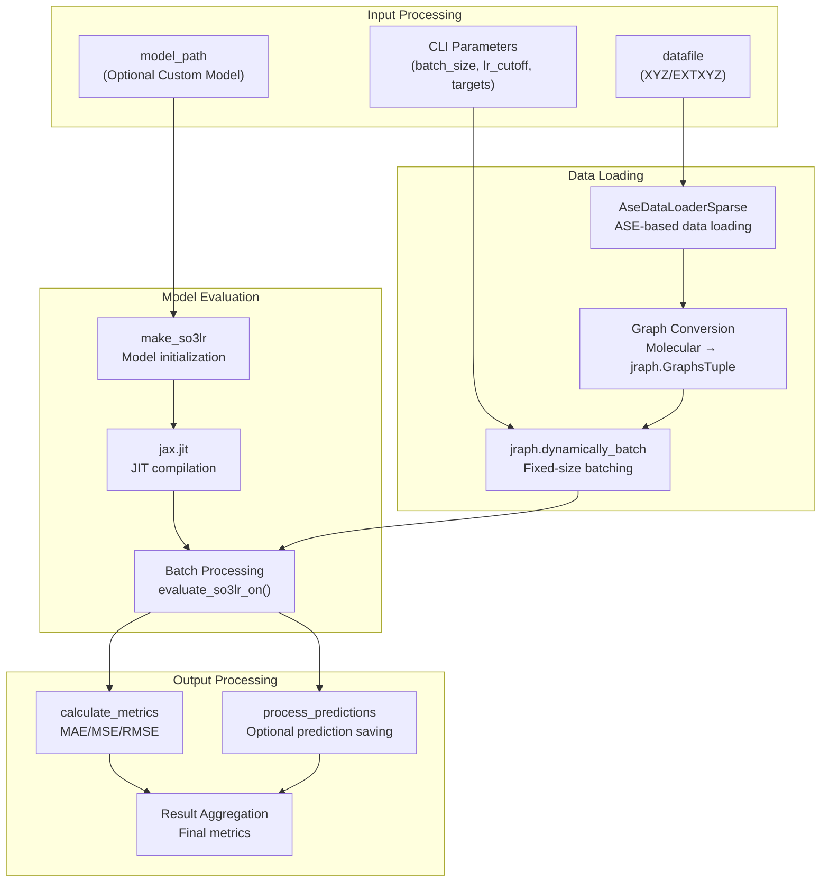
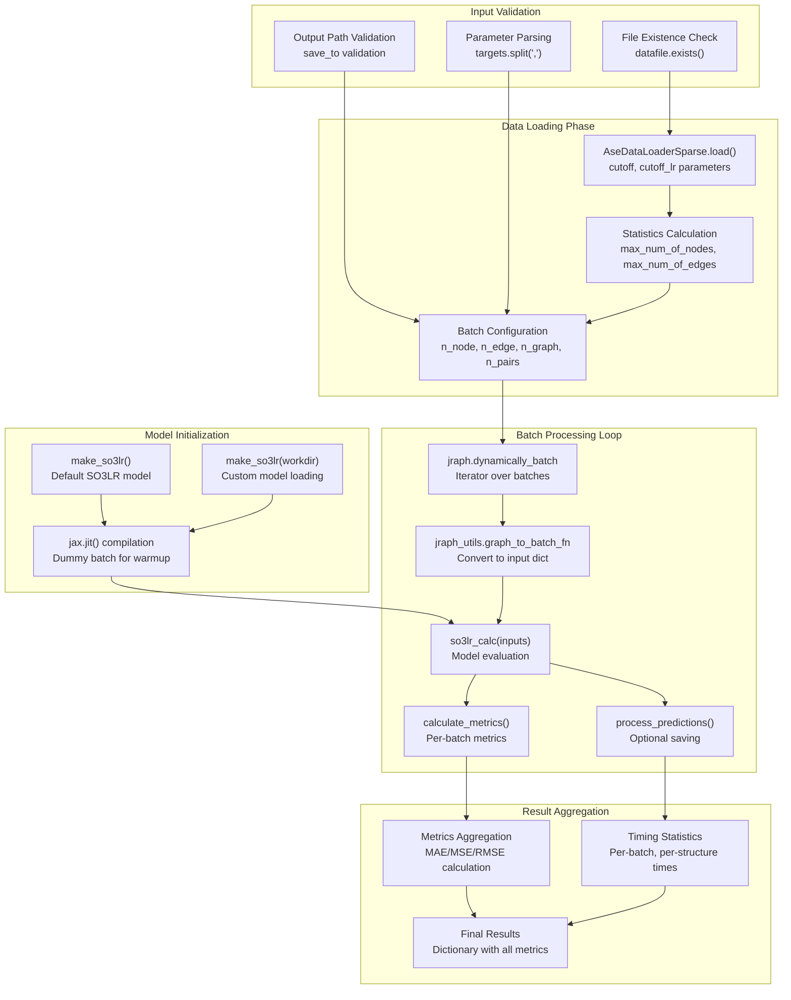
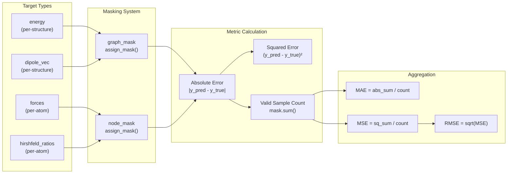
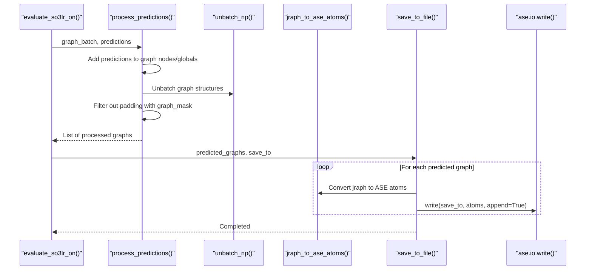

# Model Evaluation

Relevant source files

The following files were used as context for generating this wiki page:

- [examples/evaluate_so3lr_on_dataset.ipynb](examples/evaluate_so3lr_on_dataset.ipynb)
- [so3lr/cli/so3lr_eval.py](so3lr/cli/so3lr_eval.py)

This document covers the SO3LR model evaluation system, which provides functionality to assess model performance on molecular datasets through the `so3lr eval` command. The evaluation system calculates accuracy metrics (MAE, MSE, RMSE) for various targets including forces, energies, dipole moments, and Hirshfeld charge ratios.

For information about running molecular dynamics simulations, see [Simulation Commands](#2.1). For practical evaluation examples, see [Model Evaluation Examples](#4.3).

## Overview

The SO3LR evaluation system is built around the `evaluate_so3lr_on()` function in [so3lr/cli/so3lr_eval.py:141-410](), which provides a comprehensive framework for assessing model performance on molecular datasets. The system supports batch processing with JAX JIT compilation for efficient evaluation of large datasets.

### Evaluation Architecture

**Sources:** [so3lr/cli/so3lr_eval.py:141-410](), [so3lr/cli/so3lr_eval.py:20-21]()

## Command Interface

The evaluation system is accessed through the `so3lr eval` command, which accepts the following key parameters:

| Parameter | Type | Default | Description |
|-----------|------|---------|-------------|
| `datafile` | str | Required | Path to dataset file (XYZ/EXTXYZ format) |
| `batch_size` | int | 1 | Number of molecules per batch |
| `lr_cutoff` | float | 12.0 | Long-range cutoff in Ångströms |
| `dispersion_damping` | float | 2.0 | Damping for long-range interactions |
| `jit_compile` | bool | True | Enable JAX JIT compilation |
| `save_to` | str | None | Output path for predictions (EXTXYZ format) |
| `model_path` | str | None | Path to custom model (uses default if None) |
| `precision` | str | 'float32' | Numerical precision |
| `targets` | str | 'forces,dipole_vec,hirshfeld_ratios' | Comma-separated evaluation targets |

**Sources:** [so3lr/cli/so3lr_eval.py:141-190]()

## Evaluation Workflow

### Data Processing Pipeline

**Sources:** [so3lr/cli/so3lr_eval.py:201-261](), [so3lr/cli/so3lr_eval.py:271-291](), [so3lr/cli/so3lr_eval.py:322-364]()

### Metrics Calculation System

The evaluation system calculates metrics using the `calculate_metrics()` function, which supports multiple targets with appropriate masking:

**Sources:** [so3lr/cli/so3lr_eval.py:68-108](), [so3lr/cli/so3lr_eval.py:417-449]()

## Output Formats and Saving

### Prediction Saving Workflow

The evaluation system can optionally save predictions to EXTXYZ format through the `process_predictions()` and `save_to_file()` functions:

**Sources:** [so3lr/cli/so3lr_eval.py:27-66](), [so3lr/cli/so3lr_eval.py:111-138]()

### Output Data Structure

The evaluation function returns a comprehensive metrics dictionary:

| Metric Category | Keys | Description |
|----------------|------|-------------|
| **Accuracy Metrics** | `{target}_mae`, `{target}_mse`, `{target}_rmse` | Mean Absolute/Squared Error and Root MSE for each target |
| **Timing Metrics** | `time_per_batch`, `time_per_structure`, `time_evaluation`, `time_compile` | Performance timing information |
| **Metadata** | `datafile` | URI of the evaluated dataset |

**Sources:** [so3lr/cli/so3lr_eval.py:384-394](), [so3lr/cli/so3lr_eval.py:396-410]()

## Performance Considerations

### JAX JIT Compilation

The evaluation system leverages JAX JIT compilation for performance optimization. The compilation process includes:

1. **Dummy Batch Compilation**: Uses a representative batch for initial compilation [so3lr/cli/so3lr_eval.py:284-305]()
2. **Static Shape Requirements**: Ensures consistent tensor shapes through batching [so3lr/cli/so3lr_eval.py:271-278]()
3. **Compilation Timing**: Measures and reports compilation overhead [so3lr/cli/so3lr_eval.py:294-303]()

### Batch Processing Strategy

The system uses `jraph.dynamically_batch()` to ensure efficient processing:

- **Fixed Shapes**: All batches have consistent tensor dimensions for JIT compatibility
- **Padding Handling**: Automatically filters out padded structures using masks
- **Memory Efficiency**: Balances batch size with memory constraints

**Sources:** [so3lr/cli/so3lr_eval.py:263-278](), [examples/evaluate_so3lr_on_dataset.ipynb:275-295]()

### Progress Tracking

The evaluation includes comprehensive progress tracking using `tqdm`:

- **Structure-level Progress**: Tracks individual structures rather than batches [so3lr/cli/so3lr_eval.py:324-332]()
- **Timing Information**: Provides detailed timing breakdowns for optimization [so3lr/cli/so3lr_eval.py:381-388]()
- **Memory Monitoring**: Logs batch size parameters for memory planning [so3lr/cli/so3lr_eval.py:269]()

**Sources:** [so3lr/cli/so3lr_eval.py:319-363](), [so3lr/cli/so3lr_eval.py:133-137]()

---