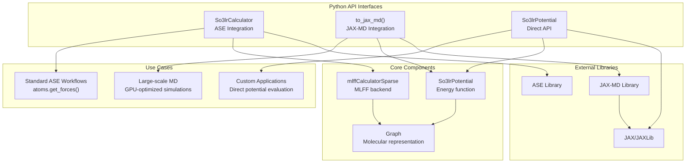
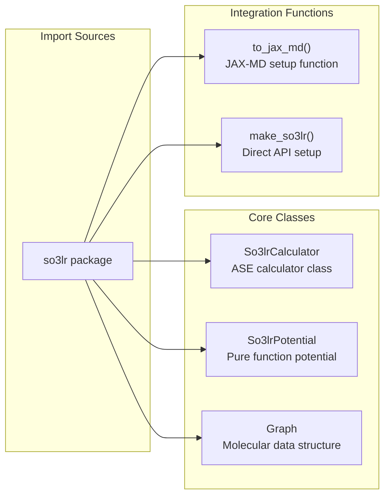

# Python API

Relevant source files

The following files were used as context for generating this wiki page:

- [README.md](README.md)
- [examples/data/sapt10k.zip](examples/data/sapt10k.zip)
- [tests/test_ase.py](tests/test_ase.py)
- [tests/test_readme.py](tests/test_readme.py)

This document covers the three main Python programming interfaces for integrating SO3LR into your applications: ASE integration via `So3lrCalculator`, JAX-MD integration via `to_jax_md`, and direct API usage via `So3lrPotential`. For command-line usage, see [Command Line Interface](#2). For implementation details of core components, see [Core Components](#5).

## API Overview

SO3LR provides three distinct programming interfaces that cater to different use cases and integration requirements:

**Python API Interface Architecture**
Sources: [README.md:155-275](), [tests/test_ase.py:97-173](), [tests/test_readme.py:15-103]()

## API Comparison

| Interface | Primary Use Case | Performance | Complexity | External Dependencies |
|-----------|------------------|-------------|------------|----------------------|
| `So3lrCalculator` | Standard molecular simulations | Moderate | Low | ASE |
| `to_jax_md()` | Large-scale GPU simulations | High | Moderate | JAX-MD, JAX |
| `So3lrPotential` | Custom applications | High | High | JAX |

## Key Classes and Functions

The main entry points for the SO3LR Python API are:

**SO3LR Python API Components**
Sources: [README.md:157-275](), [tests/test_ase.py:98](), [tests/test_readme.py:10-12]()

## Constructor Parameters

### So3lrCalculator Parameters

| Parameter | Type | Default | Description |
|-----------|------|---------|-------------|
| `calculate_stress` | `bool` | `False` | Enable stress tensor calculation |
| `lr_cutoff` | `float` | `12.0` | Long-range cutoff distance |
| `dtype` | `numpy.dtype` | `np.float32` | Numerical precision |

### So3lrPotential Parameters

| Parameter | Type | Default | Description |
|-----------|------|---------|-------------|
| `lr_cutoff` | `float` | `12.0` | Long-range cutoff distance |
| `dtype` | `numpy.dtype` | `np.float32` | Numerical precision |

### to_jax_md Parameters

| Parameter | Type | Description |
|-----------|------|-------------|
| `potential` | `So3lrPotential` | SO3LR potential instance |
| `displacement_or_metric` | `function` | JAX-MD displacement function |
| `box_size` | `array` or `None` | Simulation box dimensions |
| `species` | `array` | Atomic numbers |
| `capacity_multiplier` | `float` | Neighbor list buffer size |

Sources: [README.md:166-221](), [tests/test_ase.py:106-108](), [tests/test_readme.py:25-73]()

## Common Usage Patterns

### Error Handling

All SO3LR Python APIs will raise appropriate exceptions for:
- Invalid molecular structures (missing atomic numbers, positions)
- Incompatible data types or shapes  
- Missing charge information for systems requiring it
- Cutoff distances that are too small or large

### Performance Considerations

- **JIT Compilation**: JAX-based interfaces (`to_jax_md`, `So3lrPotential`) benefit from JIT compilation
- **Data Types**: Use `np.float32` for better GPU performance, `np.float64` for higher precision
- **Cutoff Selection**: Use `lr_cutoff=1000` for gas-phase systems, `lr_cutoff=12.0` for condensed phase

### Memory Management

- Neighbor lists in JAX-MD are allocated once and reused
- Graph objects are lightweight and can be created frequently
- Large systems benefit from batching when possible

Sources: [README.md:168-221](), [tests/test_ase.py:145-173](), [tests/test_readme.py:39-103]()

---