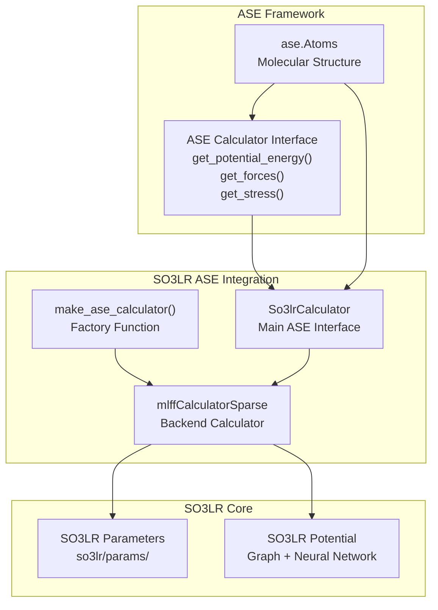
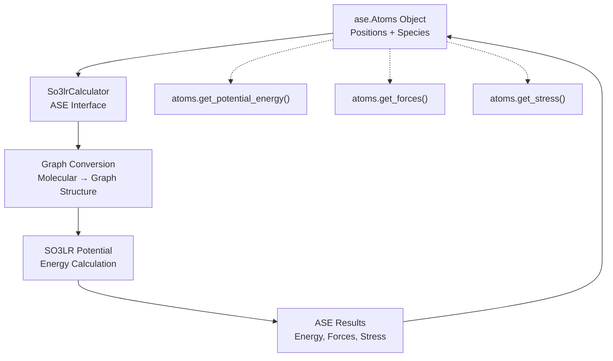
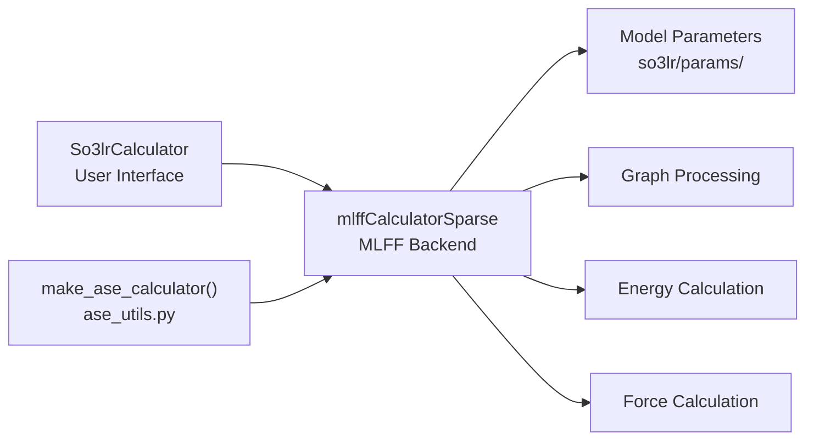

# ASE Integration

<details>
<summary>Relevant source files</summary>

The following files were used as context for generating this wiki page:

- [so3lr/ase_utils.py](so3lr/ase_utils.py)
- [tests/test_ase.py](tests/test_ase.py)
- [tests/test_readme.py](tests/test_readme.py)

</details>


This page documents how to use SO3LR with the Atomic Simulation Environment (ASE) framework through the `So3lrCalculator` class. ASE integration provides a standardized interface for energy and force calculations that works seamlessly with existing ASE workflows and tools.

For JAX-MD integration for large-scale simulations, see [JAX-MD Integration](#3.2). For direct API usage without framework dependencies, see [Direct API Usage](#3.3).

## Overview

The SO3LR ASE integration enables users to perform molecular simulations using the standard ASE calculator interface. The `So3lrCalculator` class implements ASE's calculator protocol, allowing SO3LR to be used as a drop-in replacement for other ASE calculators in existing workflows.

## ASE Calculator Architecture



Sources: [tests/test_ase.py:96-143](), [so3lr/ase_utils.py:7-26](), [tests/test_readme.py:16-37]()

## Using So3lrCalculator

The primary interface for ASE integration is the `So3lrCalculator` class, which implements the standard ASE calculator protocol.

### Basic Usage Pattern

```python
from so3lr import So3lrCalculator
from ase.io import read

# Load molecular structure
atoms = read('molecule.xyz')
atoms.cell = None  # Remove periodic boundary conditions
atoms.pbc = False

# Create SO3LR calculator
calc = So3lrCalculator(dtype=np.float64)
atoms.calc = calc

# Calculate properties
energy = atoms.get_potential_energy()
forces = atoms.get_forces()
```

### Calculator Parameters

The `So3lrCalculator` supports the following key parameters:

| Parameter | Type | Default | Description |
|-----------|------|---------|-------------|
| `dtype` | `numpy.dtype` | `np.float32` | Numerical precision for calculations |
| `calculate_stress` | `bool` | `False` | Enable stress tensor calculations |

## Calculation Workflow



Sources: [tests/test_ase.py:106-130](), [tests/test_readme.py:25-36]()

## Stress Tensor Calculations

Stress tensor calculations are controlled by the `calculate_stress` parameter and must be enabled at calculator creation time:

```python
# Enable stress calculations
calc = So3lrCalculator(calculate_stress=True)
atoms.calc = calc

# Calculate stress tensor (Voigt notation, shape=(6,))
stress = atoms.get_stress()
```

If `calculate_stress=False`, calling `atoms.get_stress()` will raise a `NotImplementedError`.

Sources: [tests/test_ase.py:145-172]()

## Backend Calculator Details

Internally, `So3lrCalculator` uses the `mlffCalculatorSparse` backend through the `make_ase_calculator` factory function. This backend handles:

- Loading SO3LR model parameters from `so3lr/params/`
- Managing long-range cutoff distances (`lr_cutoff=12.0`)
- Dispersion energy calculations (`dispersion_energy_cutoff_lr_damping=2.0`)
- Numerical precision control

### Internal Architecture



Sources: [so3lr/ase_utils.py:7-26](), [tests/test_ase.py:17-25]()

## Molecular System Compatibility

The ASE integration supports both molecular and periodic systems:

### Molecular Systems (No PBC)
- Set `atoms.cell = None` and `atoms.pbc = False`
- Suitable for isolated molecules and clusters
- No periodic boundary condition handling required

### Periodic Systems
- Maintain `atoms.cell` and `atoms.pbc` settings
- Supports periodic boundary conditions for bulk materials
- Automatic handling of long-range interactions across cell boundaries

Sources: [tests/test_ase.py:27-29](), [tests/test_ase.py:112-114]()

## Performance Considerations

### Numerical Precision
- `dtype=np.float32`: Faster computation, reduced memory usage
- `dtype=np.float64`: Higher precision for sensitive calculations

### System Size Scaling
- Short-range interactions: Linear scaling with system size
- Long-range interactions: Managed through efficient cutoff schemes
- Memory usage scales with neighbor list size

### JIT Compilation
The underlying JAX implementation benefits from just-in-time compilation, with performance improvements after initial compilation overhead.

Sources: [tests/test_ase.py:107-108](), [tests/test_ase.py:155-158]()

## Integration with ASE Workflows

The `So3lrCalculator` works seamlessly with standard ASE tools:

- **Geometry Optimization**: Compatible with ASE optimizers (`BFGS`, `FIRE`, etc.)
- **Molecular Dynamics**: Works with ASE MD classes (`VelocityVerlet`, `Langevin`, etc.)
- **Property Analysis**: Supports vibrational analysis, equation of state calculations
- **I/O Operations**: Standard ASE trajectory writing and structure manipulation

The calculator follows ASE conventions for units (eV for energy, eV/Šfor forces, eV/ų for stress) and coordinate systems.

Sources: [tests/test_ase.py:31-32](), [tests/test_ase.py:116-117]()

---