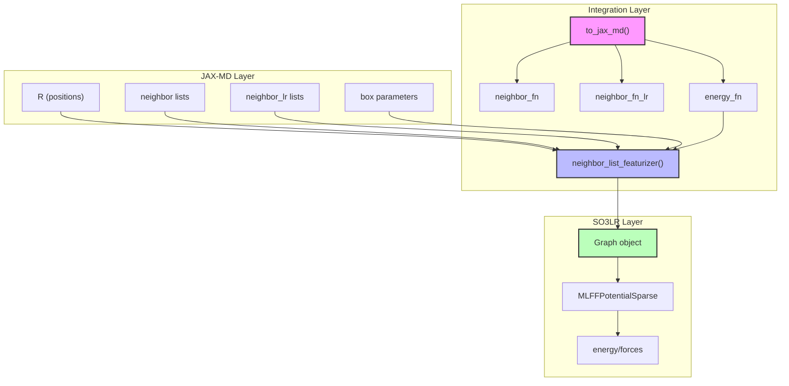
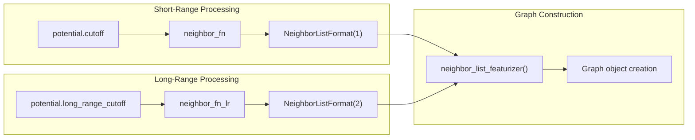
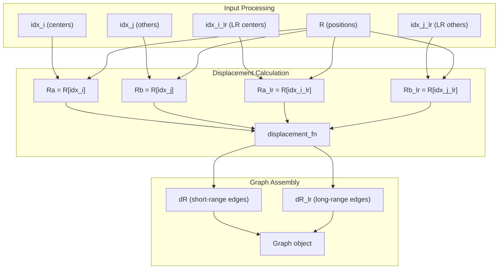

# JAX-MD Integration

<details>
<summary>Relevant source files</summary>

The following files were used as context for generating this wiki page:

- [so3lr/jaxmd_utils.py](so3lr/jaxmd_utils.py)
- [tests/test_jaxmd.py](tests/test_jaxmd.py)

</details>


This page documents the integration between SO3LR potentials and the JAX-MD molecular dynamics library. The integration enables the use of SO3LR's hybrid SO3krates neural network and universal pairwise force fields within JAX-MD's high-performance simulation framework.

For information about direct API usage of SO3LR potentials, see [Direct API Usage](#3.3). For ASE integration, see [ASE Integration](#3.1).

## Purpose and Scope

The JAX-MD integration provides a bridge that converts SO3LR's `MLFFPotentialSparse` or `So3lrPotential` objects into JAX-MD compatible energy functions. This enables users to leverage JAX-MD's optimized simulation infrastructure while utilizing SO3LR's machine learning force fields for both short-range and long-range interactions.

## Integration Architecture

The integration follows a three-layer architecture that transforms JAX-MD data structures into SO3LR's Graph representation:



Sources: [so3lr/jaxmd_utils.py:80-143](), [so3lr/jaxmd_utils.py:11-77]()

## Core Integration Functions

### to_jax_md Function

The primary integration function `to_jax_md()` converts SO3LR potentials into JAX-MD compatible components:

| Parameter | Type | Description |
|-----------|------|-------------|
| `potential` | `MLFFPotentialSparse` | The SO3LR potential to integrate |
| `displacement_or_metric` | `DisplacementOrMetricFn` | JAX-MD displacement function |
| `box_size` | `Box` | Simulation box parameters |
| `species` | `jnp.ndarray` | Atomic species array |
| `dr_threshold` | `float` | Neighbor list update threshold |
| `capacity_multiplier` | `float` | Memory allocation multiplier |
| `fractional_coordinates` | `bool` | Use fractional coordinates |

The function returns three components:
- `neighbor_fn`: Short-range neighbor list function
- `neighbor_fn_lr`: Long-range neighbor list function  
- `energy_fn`: JAX-MD compatible energy function

Sources: [so3lr/jaxmd_utils.py:80-94](), [so3lr/jaxmd_utils.py:129-143]()

### Neighbor List Processing

The integration handles both short-range and long-range neighbor lists through separate neighbor functions:



Sources: [so3lr/jaxmd_utils.py:95-107](), [so3lr/jaxmd_utils.py:109-121]()

## Graph Object Construction

The `neighbor_list_featurizer()` function transforms JAX-MD neighbor lists into SO3LR's Graph representation:



Sources: [so3lr/jaxmd_utils.py:11-77]()

## Configuration Parameters

### Buffer and Capacity Settings

The integration provides several parameters to control memory allocation and performance:

| Parameter | Default | Purpose |
|-----------|---------|---------|
| `capacity_multiplier` | 1.25 | Overall memory allocation factor |
| `buffer_size_multiplier_sr` | 1.25 | Short-range buffer sizing |
| `buffer_size_multiplier_lr` | 1.25 | Long-range buffer sizing |
| `minimum_cell_size_multiplier_sr` | 1.0 | Minimum cell size for short-range |
| `minimum_cell_size_multiplier_lr` | 1.0 | Minimum cell size for long-range |

### Coordinate Systems

The integration supports both fractional and Cartesian coordinate systems through the `fractional_coordinates` parameter:

- `fractional_coordinates=True`: Positions are treated as fractions of the box dimensions
- `fractional_coordinates=False`: Positions are in absolute units

Sources: [so3lr/jaxmd_utils.py:85-93](), [tests/test_jaxmd.py:64-66](), [tests/test_jaxmd.py:215-218]()

## Usage Examples

### Basic Setup for Periodic Systems

```python
# Set up displacement function and box
displacement, shift = space.periodic_general(box, fractional_coordinates=True)

# Create JAX-MD integration
neighbor_fn, neighbor_fn_lr, energy_fn = jaxmd_utils.to_jax_md(
    potential=mlff_potential,
    displacement_or_metric=displacement, 
    box_size=box,
    species=species
)

# Allocate neighbor lists and compute energy
nbrs = neighbor_fn.allocate(R0, box=box)
nbrs_lr = neighbor_fn_lr.allocate(R0, box=box)
energy = energy_fn(R0, neighbor=nbrs.idx, neighbor_lr=nbrs_lr.idx, box=box)
```

### Free Boundary Conditions

```python
# Set up free space
displacement, shift = space.free()

# Integration works identically for free systems
neighbor_fn, neighbor_fn_lr, energy_fn = jaxmd_utils.to_jax_md(
    potential=mlff_potential,
    displacement_or_metric=displacement,
    box_size=None,  # No box for free systems
    species=species
)
```

Sources: [tests/test_jaxmd.py:63-78](), [tests/test_jaxmd.py:138-150]()

## Energy Function Interface

The generated `energy_fn` provides a JAX-MD compatible interface:

| Parameter | Type | Description |
|-----------|------|-------------|
| `R` | `jnp.ndarray` | Atomic positions |
| `neighbor` | neighbor indices | Short-range neighbor list |
| `neighbor_lr` | neighbor indices | Long-range neighbor list |
| `has_aux` | `bool` | Return auxiliary data |
| `**energy_fn_kwargs` | dict | Additional parameters (box, k_grid, etc.) |

The function returns either a scalar energy (default) or energy with auxiliary data when `has_aux=True`.

Sources: [so3lr/jaxmd_utils.py:129-142]()

## Performance Considerations

### JIT Compilation

JAX-MD integration is designed to work with JIT compilation for optimal performance:

```python
energy_fn = jax.jit(energy_fn)
force_fn = jax.jit(quantity.force(energy_fn))
```

### Cell List Management

The integration supports disabling cell lists for small systems through the `disable_cell_list` parameter, which can improve performance for molecular systems where cell lists provide no benefit.

Sources: [tests/test_jaxmd.py:80-82](), [tests/test_jaxmd.py:231-232](), [so3lr/jaxmd_utils.py:91]()

---