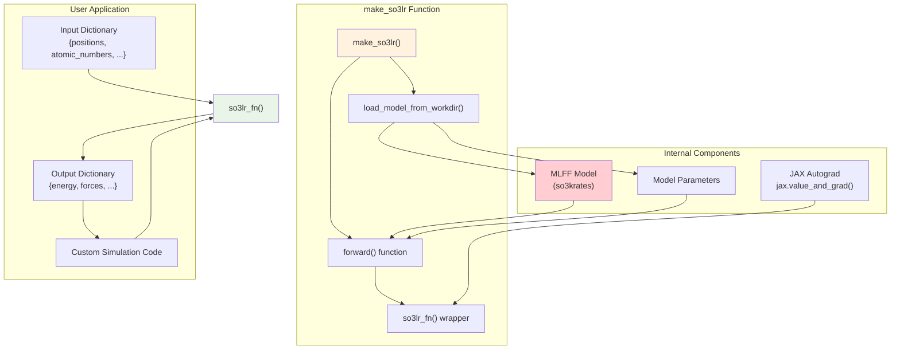
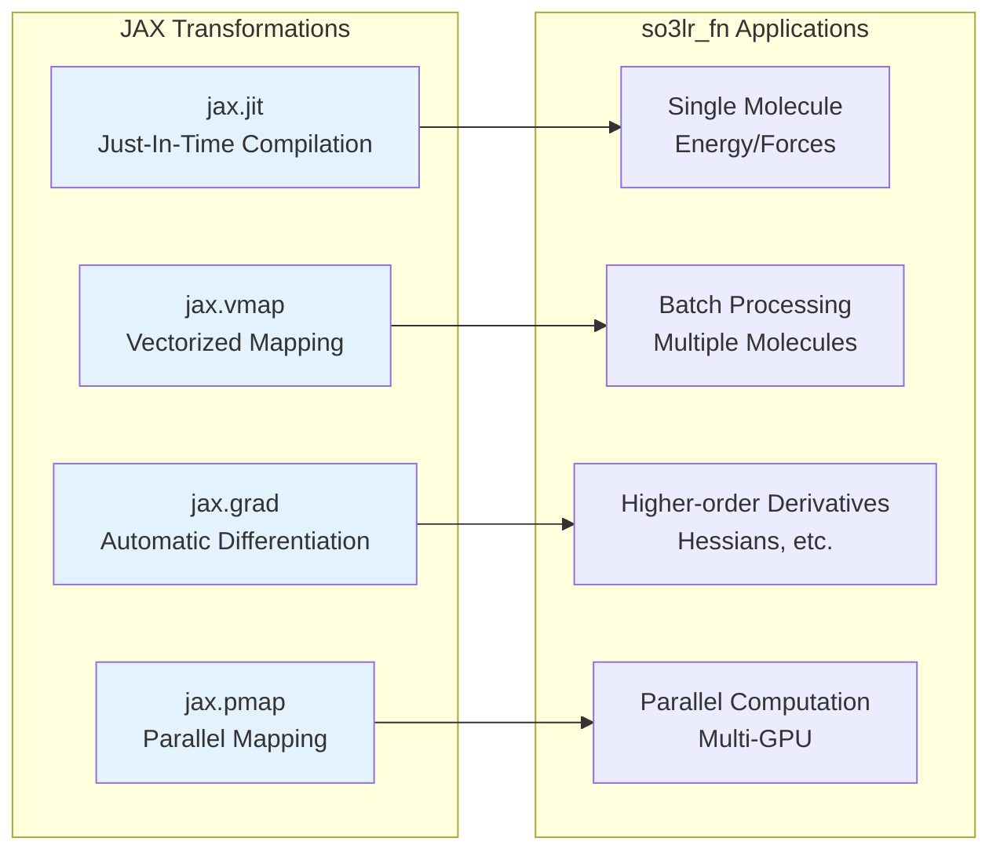
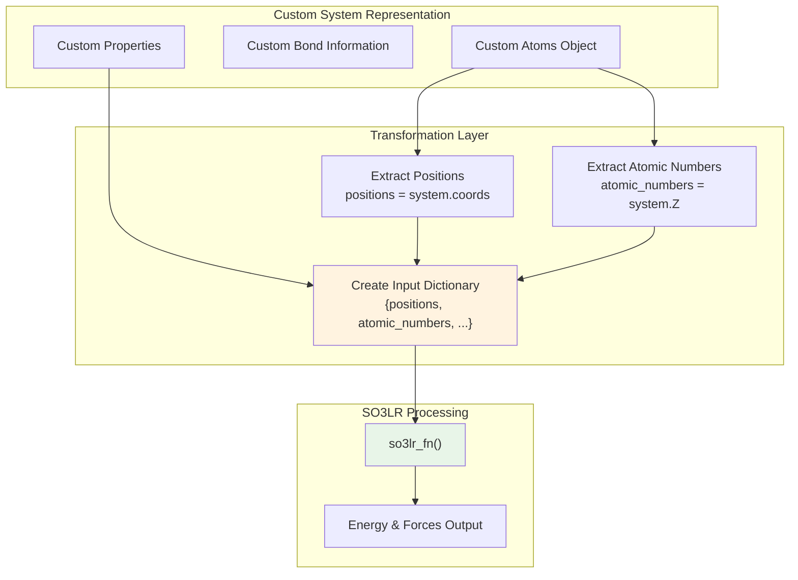

# Direct API Usage

<details>
<summary>Relevant source files</summary>

The following files were used as context for generating this wiki page:

- [README.md](README.md)
- [examples/data/sapt10k.zip](examples/data/sapt10k.zip)
- [so3lr/base_calculator.py](so3lr/base_calculator.py)

</details>


This page documents how to use SO3LR potential functions directly for custom applications and workflows. This approach provides the lowest-level interface to SO3LR, allowing maximum flexibility for developers building custom molecular simulation tools.

For standard molecular simulation workflows, see [ASE Integration](#3.1) or [JAX-MD Integration](#3.2). For details on the underlying data structures, see [Graph Data Structure](#5.1) and [Potential Functions](#5.2).

## Core Function: make_so3lr

The primary entry point for direct API usage is the `make_so3lr` function, which creates a JAX-compatible potential energy function that can be integrated into custom simulation frameworks.

### Function Signature and Parameters

The `make_so3lr` function accepts several configuration parameters:

| Parameter | Type | Default | Description |
|-----------|------|---------|-------------|
| `lr_cutoff` | float | 12.0 | Long-range interaction cutoff distance in Ångström |
| `dispersion_energy_cutoff_lr_damping` | float | 2.0 | Damping parameter for dispersion energy cutoff |
| `calculate_forces` | bool | True | Whether to enable automatic force calculation via autograd |
| `workdir` | str/Path | None | Custom model parameter directory (uses default if None) |

### Basic Usage Pattern

```python
from so3lr.base_calculator import make_so3lr

# Create the potential function
so3lr_fn = make_so3lr(
    lr_cutoff=12.0,
    calculate_forces=True
)

# Use with input dictionary
inputs = {
    'positions': positions_array,
    'atomic_numbers': atomic_numbers_array,
    # ... other required inputs
}

output = so3lr_fn(inputs)
```

Sources: [so3lr/base_calculator.py:8-124](), [README.md:256-275]()

## API Function Architecture



Sources: [so3lr/base_calculator.py:57-123]()

## Input Data Structure Requirements

The `so3lr_fn` function expects a dictionary with specific keys and data formats:

### Required Inputs

| Key | Type | Shape | Description |
|-----|------|-------|-------------|
| `positions` | jax.Array | `(n_atoms, 3)` | Atomic coordinates in Ångström |
| `atomic_numbers` | jax.Array | `(n_atoms,)` | Atomic numbers (integers) |

### Optional Inputs

| Key | Type | Shape | Description |
|-----|------|-------|-------------|
| `batch_segments` | jax.Array | `(n_atoms,)` | Batch segmentation for multiple molecules |
| `graph_mask` | jax.Array | `(n_graphs,)` | Boolean mask for valid graphs in batch |
| `residue_segments` | jax.Array | `(n_atoms,)` | Residue segmentation for dimer calculations |
| `residue_charge` | jax.Array | `(n_residues,)` | Charges for each residue |

### Automatic Batch Handling

When batch information is not provided, the function automatically creates single-molecule batching:

```python
# For single molecules, these are created automatically:
batch_segments = jnp.zeros((num_atoms,), dtype=jnp.int32)
graph_mask = jnp.array([True])
```

Sources: [so3lr/base_calculator.py:61-71](), [so3lr/base_calculator.py:74-86]()

## Output Structure and Force Calculation

The returned potential function produces a dictionary containing computed properties:

### Standard Output

| Key | Type | Shape | Description |
|-----|------|-------|-------------|
| `energy` | jax.Array | `(n_graphs,)` | Potential energy per graph in eV |

### With Force Calculation

When `calculate_forces=True`, the output additionally contains:

| Key | Type | Shape | Description |
|-----|------|-------|-------------|
| `forces` | jax.Array | `(n_atoms, 3)` | Atomic forces in eV/Ångström |

### Force Calculation Implementation

Forces are computed automatically using JAX's reverse-mode automatic differentiation:

```python
(_, output), forces = jax.value_and_grad(
    forward,
    has_aux=True,
    argnums=0
)(positions, other_inputs)

output['forces'] = forces
```

Sources: [so3lr/base_calculator.py:100-112]()

## JAX Transformations and Performance

The returned `so3lr_fn` function is designed to be compatible with JAX's transformation system for high-performance computing:

### Supported Transformations



### Performance Optimization Example

```python
import jax

# Create and optimize the potential function
so3lr_fn = make_so3lr(lr_cutoff=12.0)
so3lr_fn_jit = jax.jit(so3lr_fn)

# For batch processing
so3lr_fn_vmap = jax.vmap(so3lr_fn_jit)

# For higher-order derivatives
hessian_fn = jax.hessian(lambda pos, other: so3lr_fn_jit({
    'positions': pos, **other
})['energy'])
```

Sources: [README.md:271-272]()

## Custom Integration Patterns

### Pattern 1: Single Molecule Energy Evaluation

```python
def evaluate_single_molecule(positions, atomic_numbers):
    so3lr_fn = make_so3lr(calculate_forces=False)
    
    inputs = {
        'positions': jnp.array(positions),
        'atomic_numbers': jnp.array(atomic_numbers)
    }
    
    output = so3lr_fn(inputs)
    return output['energy']
```

### Pattern 2: Custom MD Integration

```python
def custom_md_step(positions, velocities, atomic_numbers, dt):
    so3lr_fn = make_so3lr(calculate_forces=True)
    
    inputs = {
        'positions': positions,
        'atomic_numbers': atomic_numbers
    }
    
    output = so3lr_fn(inputs)
    forces = output['forces']
    
    # Custom integrator implementation
    velocities = velocities + forces * dt
    positions = positions + velocities * dt
    
    return positions, velocities
```

### Pattern 3: System-to-Graph Transformation

For integration with custom molecular representations:



Sources: [README.md:272-275]()

## Error Handling and Validation

### Input Validation Requirements

The direct API requires careful attention to input shapes and types:

- Positions must be float arrays with shape `(n_atoms, 3)`
- Atomic numbers must be integer arrays with shape `(n_atoms,)`
- All JAX arrays should use consistent dtypes (typically `float32` for performance)

### Common Integration Issues

1. **Batch Dimension Mismatch**: Ensure batch_segments and graph_mask are consistent when provided
2. **Dtype Consistency**: Use consistent JAX array dtypes throughout the computation
3. **Memory Management**: Consider JAX device memory constraints for large systems

Sources: [so3lr/base_calculator.py:61-86]()

---