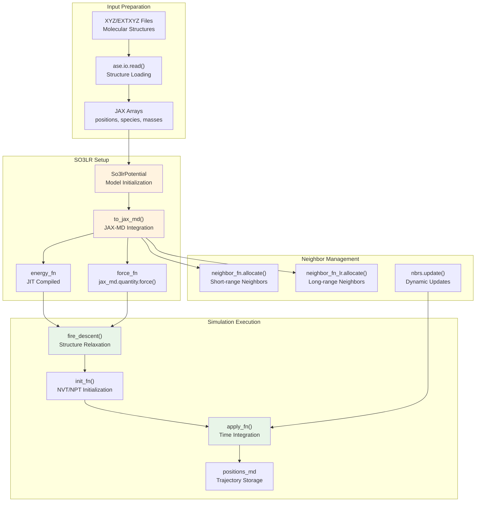
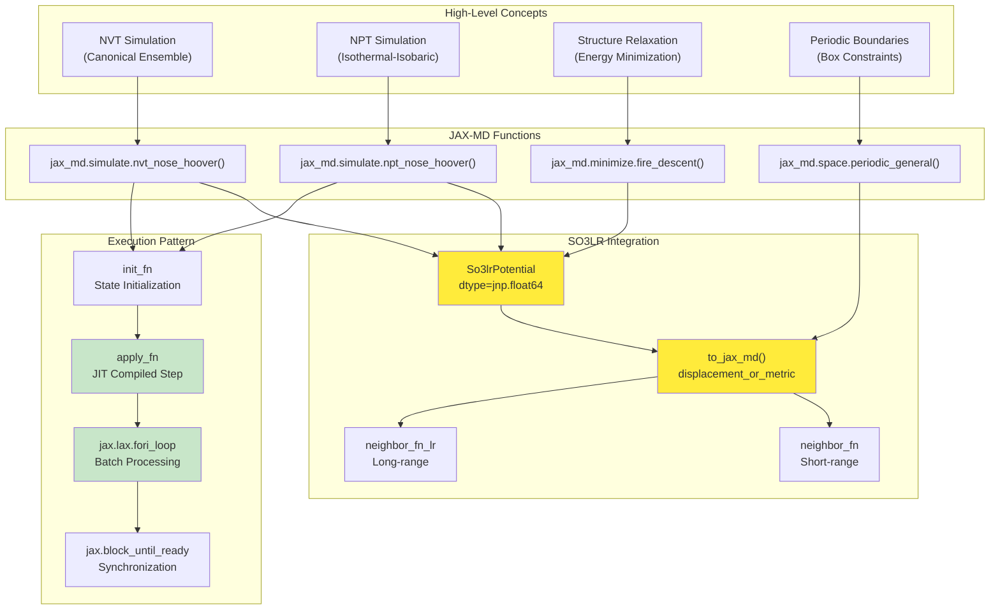
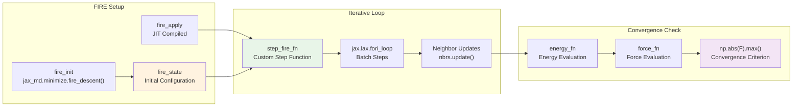

# Examples and Tutorials

<details>
<summary>Relevant source files</summary>

The following files were used as context for generating this wiki page:

- [examples/npt_jaxmd.ipynb](examples/npt_jaxmd.ipynb)
- [examples/nvt_jaxmd.ipynb](examples/nvt_jaxmd.ipynb)

</details>


This page provides practical examples demonstrating how to use SO3LR for molecular dynamics simulations. The examples cover basic NVT and NPT simulations using JAX-MD integration, structure relaxation workflows, and efficient data handling for production runs. These tutorials bridge the gap between the high-level SO3LR concepts and their implementation in working simulation code.

For information about the Python API interfaces, see [Python API](#3). For details about the CLI tools, see [Command Line Interface](#2). For technical documentation of the core components, see [Core Components](#5).

## Example Workflow Overview

The SO3LR examples demonstrate three main simulation workflows: structure relaxation, canonical (NVT) dynamics, and isothermal-isobaric (NPT) dynamics. Each workflow follows a common pattern of system setup, potential initialization, neighbor list allocation, and iterative simulation steps.

### Basic Simulation Workflow



Sources: [examples/nvt_jaxmd.ipynb:1-606](), [examples/npt_jaxmd.ipynb:1-737]()

### Code Entity Mapping



Sources: [examples/nvt_jaxmd.ipynb:21-33](), [examples/nvt_jaxmd.ipynb:138-151](), [examples/npt_jaxmd.ipynb:186-199]()

## Basic Molecular Dynamics Examples

### NVT Simulation in Vacuum

The NVT (canonical ensemble) example demonstrates molecular dynamics simulation of a small molecule in vacuum without periodic boundary conditions. This workflow is suitable for isolated molecular systems.

**Key Components:**
- **Structure Loading**: Uses `ase.io.read()` to load molecular geometry from XYZ files
- **Vacuum Simulation**: Employs `jax_md.space.free()` for unbounded space
- **Temperature Control**: Implements Nosé-Hoover chain thermostat via `jax_md.simulate.nvt_nose_hoover()`

**Critical Code Pattern:**
```python
displacement, shift = jax_md.space.free()
neighbor_fn, neighbor_fn_lr, energy_fn = to_jax_md(
    potential=So3lrPotential(dtype=jnp.float64),
    displacement_or_metric=displacement,
    disable_cell_list=True
)
```

The example includes structure relaxation using the FIRE algorithm before starting dynamics, demonstrating the typical workflow of optimizing initial configurations.

Sources: [examples/nvt_jaxmd.ipynb:88-101](), [examples/nvt_jaxmd.ipynb:134-151](), [examples/nvt_jaxmd.ipynb:227-233]()

### NPT Simulation with Periodic Boundaries

The NPT (isothermal-isobaric ensemble) example shows simulation of a water box with periodic boundary conditions and pressure control. This represents the most common production simulation scenario.

**Key Components:**
- **Periodic Boundaries**: Uses `jax_md.space.periodic_general()` with fractional coordinates
- **Pressure Control**: Implements Nosé-Hoover chain barostat alongside thermostat
- **Box Updates**: Handles dynamic simulation box changes via `jax_md.simulate.npt_box()`

**Critical Code Pattern:**
```python
box = jnp.array([lattice_parameter])
displacement, shift = jax_md.space.periodic_general(
    box=box, 
    fractional_coordinates=True
)
```

The example demonstrates proper handling of both short-range and long-range neighbor list updates as the simulation box fluctuates during NPT dynamics.

Sources: [examples/npt_jaxmd.ipynb:84-91](), [examples/npt_jaxmd.ipynb:127-141](), [examples/npt_jaxmd.ipynb:509-520]()

## Neighbor List Management

Both examples showcase the dual neighbor list architecture required by SO3LR's hybrid potential design:

**Neighbor List Allocation:**
```python
nbrs = neighbor_fn.allocate(positions_init, box=box)
nbrs_lr = neighbor_fn_lr.allocate(positions_init, box=box)
```

**Dynamic Updates:**
```python
nbrs = nbrs.update(state.position, neighbor=nbrs.idx, box=box)
nbrs_lr = nbrs_lr.update(state.position, neighbor_lr=nbrs_lr.idx, box=box)
```

**Overflow Handling:**
The examples include proper overflow detection and reallocation logic to handle cases where neighbor lists exceed their allocated capacity during simulation.

Sources: [examples/nvt_jaxmd.ipynb:157-165](), [examples/npt_jaxmd.ipynb:205-213](), [examples/npt_jaxmd.ipynb:605-617]()

## Structure Relaxation Workflow

Both examples begin with FIRE algorithm optimization to relax initial structures:

### FIRE Implementation Pattern



**Typical Parameters:**
- `dt_start = 0.05` - Initial time step
- `dt_max = 0.1` - Maximum time step
- `n_min = 2` - Minimum steps before acceleration

Sources: [examples/nvt_jaxmd.ipynb:227-233](), [examples/npt_jaxmd.ipynb:299-305](), [examples/nvt_jaxmd.ipynb:243-265]()

## Production Simulation Considerations

The examples demonstrate several patterns important for production simulations:

### Performance Optimization
- **JIT Compilation**: All simulation functions are wrapped with `jax.jit()` for optimal performance
- **Batch Processing**: Uses `jax.lax.fori_loop()` for efficient batched time stepping
- **Memory Management**: Includes `jax.clear_caches()` to prevent memory accumulation

### Data Management
- **Trajectory Storage**: Simple list accumulation for short runs: `positions_md.append(np.array(state.position))`
- **Synchronization**: Uses `jax.block_until_ready()` for accurate timing measurements
- **Unit Conversion**: Proper handling of JAX-MD metal unit system

### Error Handling
- **Buffer Overflow**: Automatic detection and reallocation of neighbor lists
- **State Recovery**: Proper state management during neighbor list reallocation

Sources: [examples/nvt_jaxmd.ipynb:460-532](), [examples/npt_jaxmd.ipynb:594-601](), [examples/npt_jaxmd.ipynb:659-660]()

## Visualization and Output

Both examples include patterns for trajectory visualization and file output:

**ASE Integration for Visualization:**
```python
atoms_traj = []
for positions in positions_md:
    atoms_traj.append(
        Atoms(numbers=species, positions=positions)
    )
nv.show_asetraj(atoms_traj)
```

**XYZ File Output:**
```python
for frame in atoms_traj:
    write('trajectory.xyz', frame, append=True)
```

The examples note that for production runs, HDF5 format should be used instead of XYZ for efficient I/O operations with large systems.

Sources: [examples/nvt_jaxmd.ipynb:556-562](), [examples/npt_jaxmd.ipynb:684-693](), [examples/npt_jaxmd.ipynb:670-671]()

---