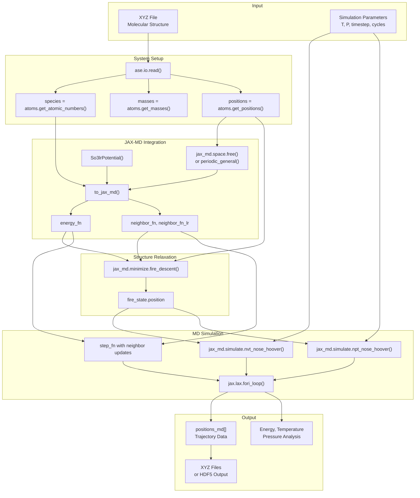
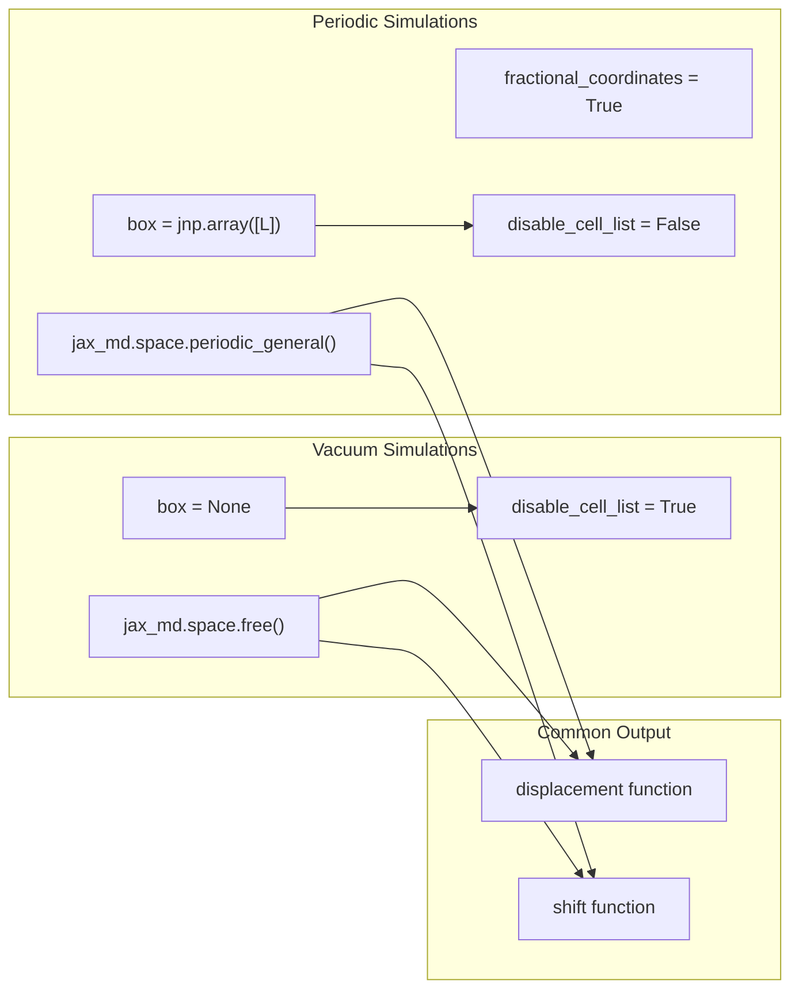
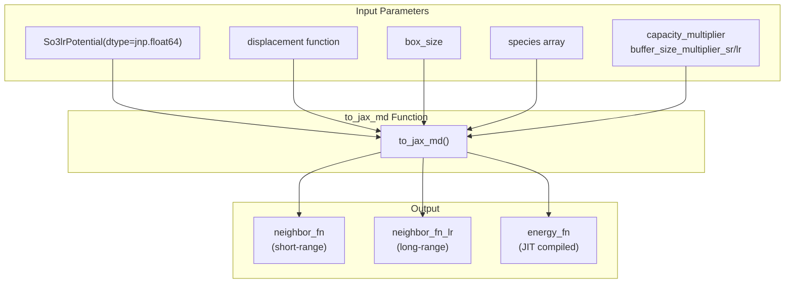
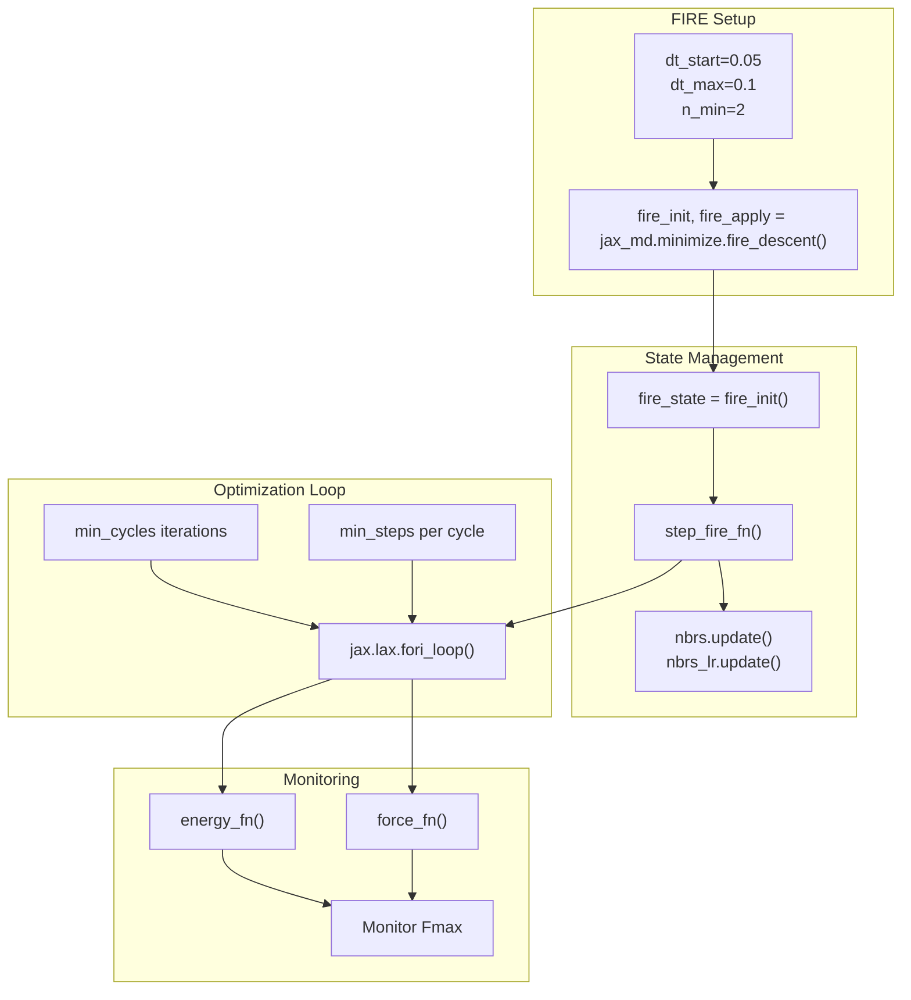
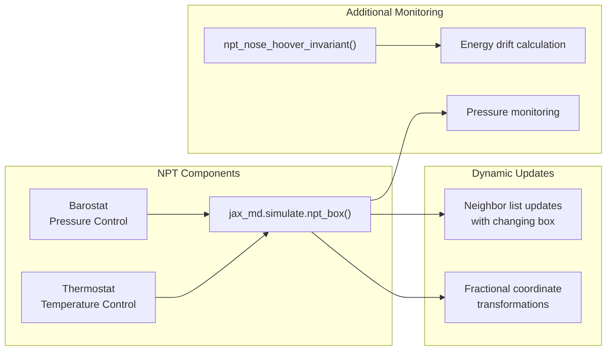
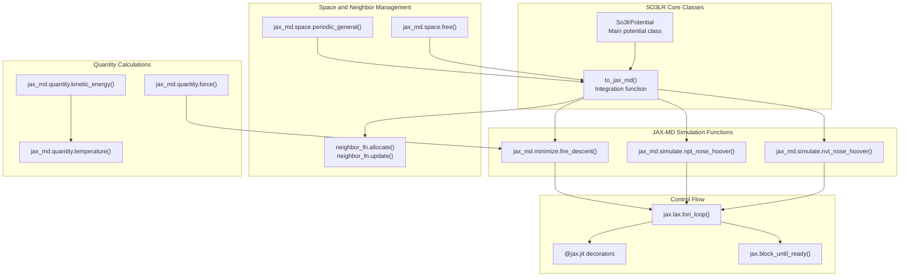

# Basic Molecular Dynamics

<details>
<summary>Relevant source files</summary>

The following files were used as context for generating this wiki page:

- [examples/npt_jaxmd.ipynb](examples/npt_jaxmd.ipynb)
- [examples/nvt_jaxmd.ipynb](examples/nvt_jaxmd.ipynb)

</details>


This document provides step-by-step tutorials for running molecular dynamics simulations using SO3LR with JAX-MD integration. It covers NVT (canonical ensemble) and NPT (isothermal-isobaric ensemble) simulations, including structure relaxation and simulation monitoring. For information about production-scale simulations with efficient data handling, see [Production Simulations](#4.2). For ASE-based workflow examples, see [ASE Integration](#3.1).

## Simulation Workflow Overview

The following diagram shows the complete workflow for running molecular dynamics simulations with SO3LR:



**Sources:** [examples/nvt_jaxmd.ipynb:1-605](), [examples/npt_jaxmd.ipynb:1-737]()

## System Setup and Initialization

### Loading Molecular Structures

The first step involves loading a molecular structure and extracting essential atomic properties:

| Property | Code | Purpose |
|----------|------|---------|
| Atomic positions | `atoms.get_positions()` | Initial coordinates |
| Atomic numbers | `atoms.get_atomic_numbers()` | Species identification |
| Atomic masses | `atoms.get_masses()` | Dynamics calculations |

### Boundary Conditions Setup

Different simulation scenarios require different spatial treatments:



**Sources:** [examples/nvt_jaxmd.ipynb:135-136](), [examples/npt_jaxmd.ipynb:136-140]()

### SO3LR Potential Integration

The `to_jax_md()` function converts SO3LR potentials into JAX-MD compatible format:



**Sources:** [examples/nvt_jaxmd.ipynb:138-151](), [examples/npt_jaxmd.ipynb:186-199]()

## Structure Relaxation with FIRE Algorithm

Before running dynamics, structures are typically relaxed using the FIRE (Fast Inertial Relaxation Engine) algorithm:

### FIRE Implementation Pattern



**Sources:** [examples/nvt_jaxmd.ipynb:227-293](), [examples/npt_jaxmd.ipynb:299-367]()

## NVT Simulations (Canonical Ensemble)

NVT simulations maintain constant number of particles, volume, and temperature using Nosé-Hoover thermostats.

### Key NVT Components

| Component | Function | Purpose |
|-----------|----------|---------|
| Thermostat | `jax_md.simulate.nvt_nose_hoover()` | Temperature control |
| Chain parameters | `default_nhc_kwargs()` | Thermostat configuration |
| Time integration | `apply_fn()` | State evolution |
| Invariant monitoring | `nvt_nose_hoover_invariant()` | Energy conservation |

### NVT Simulation Loop Structure

The simulation follows a standard pattern with JIT-compiled step functions and neighbor list management:

```python
@jax.jit
def step_nvt_fn(i, state):
    state, nbrs, nbrs_lr, box, temp_i = state
    
    state = apply_fn(state, neighbor=nbrs.idx, neighbor_lr=nbrs_lr.idx, kT=temp_i, box=box)
    
    nbrs = nbrs.update(state.position, neighbor=nbrs.idx, box=box)
    nbrs_lr = nbrs_lr.update(state.position, neighbor_lr=nbrs_lr.idx, box=box)
    
    return state, nbrs, nbrs_lr, box, temp_i
```

**Sources:** [examples/nvt_jaxmd.ipynb:410-532]()

## NPT Simulations (Isothermal-Isobaric Ensemble)

NPT simulations maintain constant number of particles, pressure, and temperature, allowing volume fluctuations.

### NPT-Specific Features



### Periodic Boundary Conditions in NPT

NPT simulations typically use periodic boundary conditions with fractional coordinates:

| Aspect | Implementation | Purpose |
|--------|----------------|---------|
| Box representation | `box = jnp.array([L])` | Cubic cell |
| Coordinate system | `fractional_coordinates=True` | Handle box changes |
| Position scaling | `positions_init / box` | Normalize to [0,1] |
| Real space conversion | `jax_md.space.transform()` | Output processing |

**Sources:** [examples/npt_jaxmd.ipynb:509-661]()

## Key Classes and Functions

The following diagram maps the primary code entities used in MD simulations:



**Sources:** [examples/nvt_jaxmd.ipynb:1-605](), [examples/npt_jaxmd.ipynb:1-737]()

---