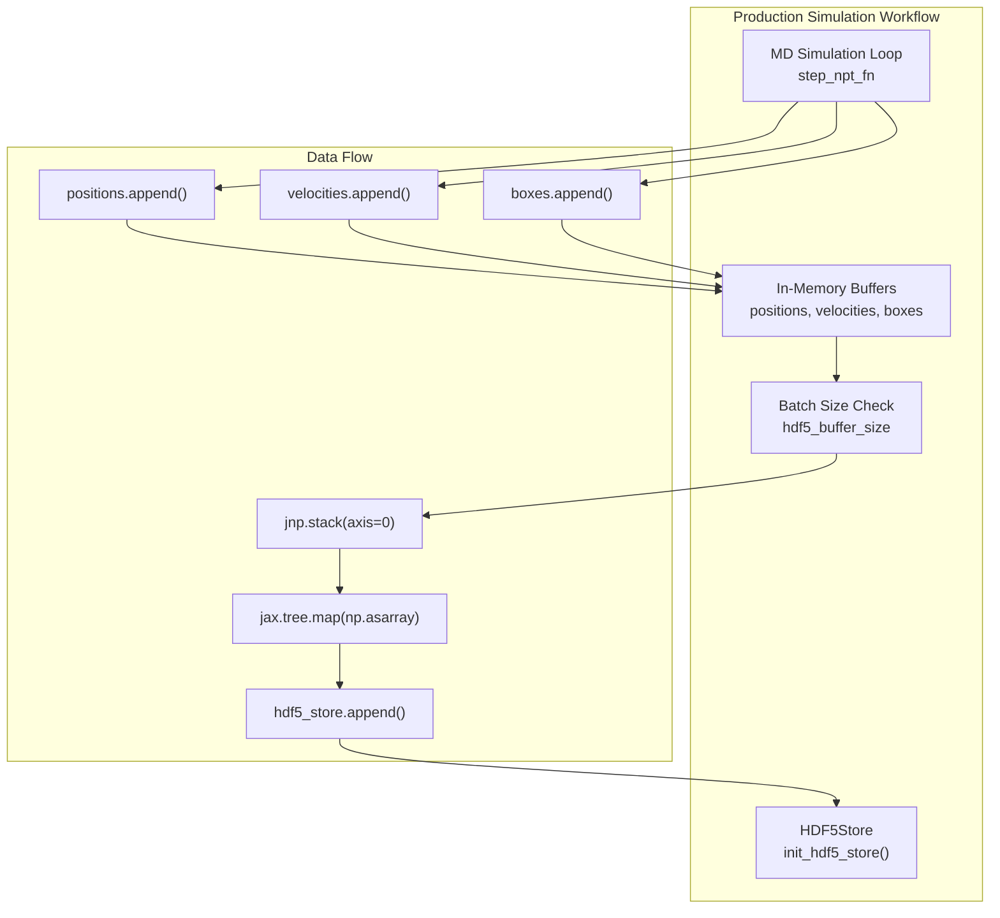
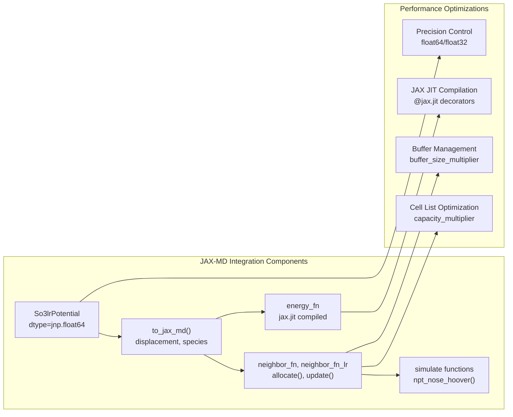

# Production Simulations

<details>
<summary>Relevant source files</summary>

The following files were used as context for generating this wiki page:

- [examples/production_run.ipynb](examples/production_run.ipynb)
- [examples/so3lr_colab_example.ipynb](examples/so3lr_colab_example.ipynb)

</details>


This document covers production-scale molecular dynamics simulations using SO3LR, focusing on efficient data handling, performance optimization, and large-scale simulation workflows. For basic molecular dynamics concepts and CLI usage, see [Basic Molecular Dynamics](#4.1). For model evaluation on datasets, see [Model Evaluation Examples](#4.3).

## Purpose and Scope

Production simulations involve running long-duration molecular dynamics simulations with thousands of atoms, requiring specialized approaches for data storage, memory management, and computational efficiency. The primary challenges addressed include:

- Efficient trajectory data storage using HDF5 format
- Batched I/O operations to minimize disk access overhead  
- JAX-MD integration for high-performance computation
- Neighbor list management for extended simulations
- Memory-efficient buffer strategies

Sources: [examples/production_run.ipynb:360-364]()

## HDF5-Based Trajectory Storage

### Storage Architecture

Production simulations use HDF5 format instead of traditional XYZ files to achieve efficient I/O performance. The storage system is built around `DataSetEntry` and `HDF5Store` classes from the MLFF package.



Sources: [examples/production_run.ipynb:373-414](), [examples/production_run.ipynb:519-561]()

### Buffer Management Strategy

The system implements a batching strategy where multiple simulation frames are collected in memory before writing to disk. This reduces I/O overhead significantly compared to writing each frame individually.

| Component | Purpose | Configuration |
|-----------|---------|---------------|
| `hdf5_buffer_size` | Frames per flush operation | Typically 100 for long runs |
| `batch_size` | DataSetEntry chunk size | Same as buffer size |
| `chunk_length` | HDF5 chunking parameter | Set to 1 for time series |

```python
# Buffer accumulation pattern
velocities.append(jnp.divide(state.momentum, state.mass))
positions.append(jax_md.space.transform(box=box, R=state.position))
boxes.append(box)

# Flush when buffer is full
if (len(positions) % hdf5_buffer_size == 0) and (len(positions) > 0):
    step_data = dict(
        velocities=jnp.stack(velocities, axis=0),
        positions=jnp.stack(positions, axis=0), 
        box=jnp.stack(boxes, axis=0)
    )
    hdf5_store.append(step_data)
    velocities, positions, boxes = [], [], []
```

Sources: [examples/production_run.ipynb:422-436](), [examples/production_run.ipynb:544-559]()

## JAX-MD Integration for Performance

### High-Performance Simulation Loop

Production simulations leverage JAX-MD's optimized simulation functions with JIT compilation for maximum performance. The integration provides both short-range and long-range neighbor list management.



Sources: [examples/production_run.ipynb:179-192](), [examples/production_run.ipynb:302-325]()

### Neighbor List Management

Production simulations require robust neighbor list overflow detection and reallocation to handle structural changes during long runs.

```python
# Neighbor list overflow handling
if nbrs.did_buffer_overflow:
    print('Neighbor list overflowed, reallocating.')
    nbrs = neighbor_fn.allocate(state.position, box=box)
    if nbrs_lr.did_buffer_overflow:
        print('Long-range neighbor list also overflowed, reallocating.')
        nbrs_lr = neighbor_fn_lr.allocate(state.position, box=box)
elif nbrs_lr.did_buffer_overflow:
    print('Long-range neighbor list overflowed, reallocating.')
    nbrs_lr = neighbor_fn_lr.allocate(state.position, box=box)
```

Sources: [examples/production_run.ipynb:504-515]()

## Performance Optimization Strategies

### Computational Efficiency

| Optimization | Implementation | Impact |
|--------------|----------------|---------|
| Precision Control | `jax.config.update('jax_enable_x64', True)` | Memory vs accuracy trade-off |
| JIT Compilation | `@jax.jit` decorators on step functions | Significant speedup |
| Cell List Tuning | `capacity_multiplier=1.25` | Neighbor search efficiency |
| Buffer Sizing | `buffer_size_multiplier_sr/lr=1.25` | Memory allocation optimization |

### Memory Management

The production workflow implements several memory management strategies:

- **Batch Processing**: Accumulate multiple frames before I/O operations
- **Buffer Reallocation**: Dynamic neighbor list resizing based on overflow detection  
- **JAX Array Conversion**: Convert JAX arrays to NumPy before HDF5 storage
- **Cache Clearing**: `jax.clear_caches()` to prevent memory accumulation

Sources: [examples/production_run.ipynb:33-35](), [examples/production_run.ipynb:587-589]()

## Data Postprocessing

### HDF5 Trajectory Analysis

Production simulations generate HDF5 files with hierarchical data structure that can be efficiently accessed for analysis:

```python
import h5py
file = h5py.File('hdf5/trajectory.hdf5', mode='r')

# Load and reshape trajectory data
velocities = np.array(file['velocities'])
# Shape: (num_flushes, hdf5_buffer_size, num_atoms, 3)

# Reshape for analysis
velocities = velocities.reshape(-1, *file['velocities'].shape[-2:])
# Shape: (total_frames, num_atoms, 3)
```

The HDF5 format provides:
- **Efficient Random Access**: Direct frame access without loading entire trajectory
- **Compressed Storage**: Automatic compression for large datasets  
- **Metadata Preservation**: Simulation parameters stored as attributes
- **Cross-Platform Compatibility**: Standard HDF5 format readable by multiple tools

Sources: [examples/production_run.ipynb:615-629]()

### Performance Monitoring

Production simulations include timing and performance monitoring:

```python
# Per-cycle timing
old_time = time.time()
new_state, nbrs, nbrs_lr, new_box = jax.block_until_ready(
    jax.lax.fori_loop(0, npt_steps, step_npt_fn, (state, nbrs, nbrs_lr, box))
)
new_time = time.time()

print(f'{(new_time - old_time) / npt_steps:.2f}')  # seconds per step
```

This enables optimization of simulation parameters and identification of performance bottlenecks during long production runs.

Sources: [examples/production_run.ipynb:488-502](), [examples/production_run.ipynb:582-583]()

---