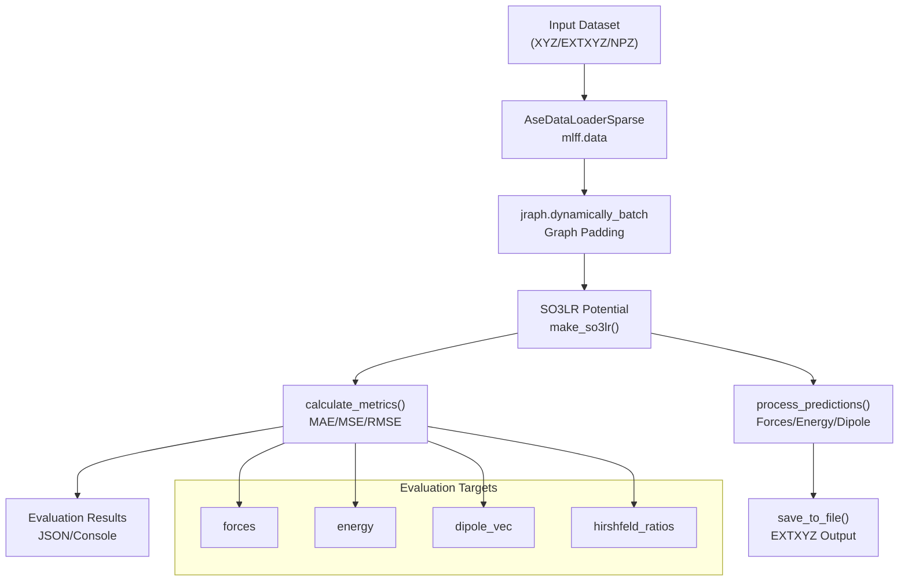
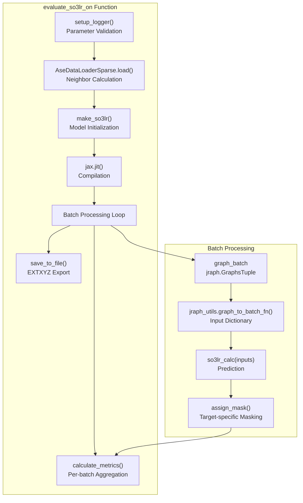
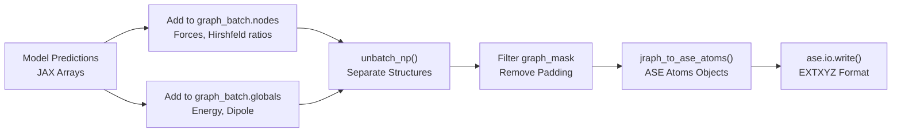

# Model Evaluation Examples

<details>
<summary>Relevant source files</summary>

The following files were used as context for generating this wiki page:

- [examples/evaluate_so3lr_on_dataset.ipynb](examples/evaluate_so3lr_on_dataset.ipynb)
- [so3lr/cli/so3lr_eval.py](so3lr/cli/so3lr_eval.py)

</details>


This page provides practical examples of evaluating SO3LR model performance on molecular datasets. It demonstrates how to use both the command-line interface and Python API to assess model accuracy and computational performance. For documentation of the CLI `eval` command parameters, see [Model Evaluation](#2.2). For technical details about SO3LR's internal potential functions, see [Potential Functions](#5.2).

## Evaluation Workflow Overview

The SO3LR evaluation system processes molecular datasets to compute error metrics and optionally save predictions. The workflow involves data loading, batching for efficient computation, model inference, and metrics calculation.

### Evaluation Architecture



Sources: [so3lr/cli/so3lr_eval.py:141-414](), [examples/evaluate_so3lr_on_dataset.ipynb:58-68]()

### Core Evaluation Function Architecture



Sources: [so3lr/cli/so3lr_eval.py:141-414](), [so3lr/cli/so3lr_eval.py:68-108](), [so3lr/cli/so3lr_eval.py:417-449]()

## Command Line Evaluation Examples

### Basic Evaluation

Evaluate the default SO3LR model on a dataset:

```bash
so3lr eval data/ethanol.xyz --save-to predictions.extxyz
```

This command loads `data/ethanol.xyz`, evaluates the default SO3LR potential, and saves predictions to `predictions.extxyz`. The evaluation targets default to `forces,dipole_vec,hirshfeld_ratios`.

### Custom Model Evaluation

Evaluate a custom trained model:

```bash
so3lr eval dataset.xyz \
    --model-path /path/to/model/workdir \
    --lr-cutoff 15.0 \
    --dispersion-damping 3.0 \
    --batch-size 4 \
    --targets forces,energy,dipole_vec
```

### Performance Evaluation

For performance benchmarking without saving predictions:

```bash
so3lr eval large_dataset.xyz \
    --batch-size 8 \
    --jit-compile \
    --log-file evaluation.log
```

Sources: [so3lr/cli/so3lr_eval.py:141-184]()

## Python API Evaluation Examples

### Basic Evaluation with Default Model

```python
from so3lr.cli.so3lr_eval import evaluate_so3lr_on

# Evaluate using default SO3LR potential
metrics = evaluate_so3lr_on(
    datafile="data/ethanol.xyz",
    batch_size=1,
    lr_cutoff=12.0,
    save_to="predictions.extxyz"
)

print(f"Forces MAE: {metrics['forces_mae']:.3e} eV/Å")
print(f"Energy MAE: {metrics['energy_mae']:.3e} eV")
```

### Custom Model Evaluation

```python
# Evaluate custom trained model
metrics = evaluate_so3lr_on(
    datafile="validation_set.xyz",
    model_path="/path/to/trained/model",
    batch_size=4,
    lr_cutoff=15.0,
    dispersion_damping=2.5,
    targets="forces,energy,dipole_vec,hirshfeld_ratios",
    jit_compile=True
)
```

### Low-level API Usage

For more control over the evaluation process:

```python
import jax
import jraph
import numpy as np
from mlff.data import AseDataLoaderSparse
from mlff.utils import jraph_utils
from so3lr.base_calculator import make_so3lr

# Load data
loader = AseDataLoaderSparse("dataset.xyz")
data, stats = loader.load(cutoff=4.5, cutoff_lr=12.0)

# Initialize model
so3lr_calc = make_so3lr(lr_cutoff=12.0, calculate_forces=True)
so3lr_calc = jax.jit(so3lr_calc)

# Batch and evaluate
batch_size = 2
batched_graphs = jraph.dynamically_batch(
    data,
    n_node=stats['max_num_of_nodes'] * batch_size + 1,
    n_edge=stats['max_num_of_edges'] * batch_size + 1,
    n_graph=batch_size + 1,
    n_pairs=stats['max_num_of_nodes'] * (stats['max_num_of_nodes'] - 1) * batch_size + 1
)

for graph_batch in batched_graphs:
    inputs = jraph_utils.graph_to_batch_fn(graph_batch)
    predictions = so3lr_calc(inputs)
    # Process predictions...
```

Sources: [examples/evaluate_so3lr_on_dataset.ipynb:134-164](), [examples/evaluate_so3lr_on_dataset.ipynb:185-234]()

## Metrics and Output Interpretation

### Available Evaluation Targets

| Target | Description | Units | Mask Type |
|--------|-------------|-------|-----------|
| `forces` | Atomic forces | eV/Å | `node_mask` |
| `energy` | Total energy | eV | `graph_mask` |
| `dipole_vec` | Dipole moment vector | e·Å | `graph_mask` |
| `hirshfeld_ratios` | Hirshfeld charge ratios | dimensionless | `node_mask` |

### Computed Metrics

For each target, the evaluation system computes:

- **MAE (Mean Absolute Error)**: `sum(|pred - true|) / count`
- **MSE (Mean Squared Error)**: `sum((pred - true)²) / count`  
- **RMSE (Root Mean Squared Error)**: `sqrt(MSE)`

### Sample Output

```json
{
  "forces_mae": 2.456e-02,
  "forces_mse": 1.234e-03,
  "forces_rmse": 3.512e-02,
  "energy_mae": 1.789e-03,
  "energy_mse": 5.432e-06,
  "energy_rmse": 2.331e-03,
  "time_per_structure": 0.125,
  "time_compile": 2.341,
  "datafile": "file:///path/to/dataset.xyz"
}
```

Sources: [so3lr/cli/so3lr_eval.py:68-108](), [so3lr/cli/so3lr_eval.py:384-410](), [so3lr/cli/so3lr_eval.py:417-449]()

## Batch Processing and Performance

### JIT Compilation Benefits

The evaluation system supports JIT compilation for significant performance improvements:

```python
# Without JIT: ~33 seconds for 50 structures
# With JIT: ~0.1 seconds after compilation (2 seconds compile time)
```

### Optimal Batch Sizing

Batch size affects memory usage and computational efficiency:

```python
# Memory-efficient for large datasets
batch_size = 1

# Better throughput for medium datasets  
batch_size = 4

# Maximum efficiency for small datasets
batch_size = 8
```

### Graph Padding Strategy

The system uses `jraph.dynamically_batch()` to pad graphs to consistent sizes, enabling JIT compilation:

```python
# Padding parameters based on dataset statistics
n_node = stats['max_num_of_nodes'] * batch_size + 1
n_edge = stats['max_num_of_edges'] * batch_size + 1  
n_graph = batch_size + 1
n_pairs = stats['max_num_of_nodes'] * (stats['max_num_of_nodes'] - 1) * batch_size + 1
```

The `+1` accounts for a padding graph used to collect outputs from padded nodes/edges.

Sources: [examples/evaluate_so3lr_on_dataset.ipynb:134-164](), [examples/evaluate_so3lr_on_dataset.ipynb:185-234](), [examples/evaluate_so3lr_on_dataset.ipynb:275-295](), [so3lr/cli/so3lr_eval.py:264-278]()

## Prediction Output Handling

### EXTXYZ Format Output

When `save_to` is specified, predictions are saved in extended XYZ format with additional properties:

```
9
Lattice="10.0 0.0 0.0 0.0 10.0 0.0 0.0 0.0 10.0" Properties=species:S:1:pos:R:3:forces_so3lr:R:3:hirshfeld_ratios_so3lr:R:1 energy_so3lr=-14.779261 dipole_vec_so3lr="-0.154 -0.287 -0.022"
C  -0.371  -0.453  -0.199  -3.286  -2.342   2.047   0.795
C  -0.730   0.684   0.796   2.517   1.576  -0.607   0.768
...
```

### Prediction Processing Flow



Sources: [so3lr/cli/so3lr_eval.py:27-66](), [so3lr/cli/so3lr_eval.py:111-138]()

---