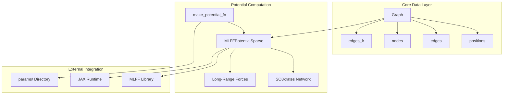
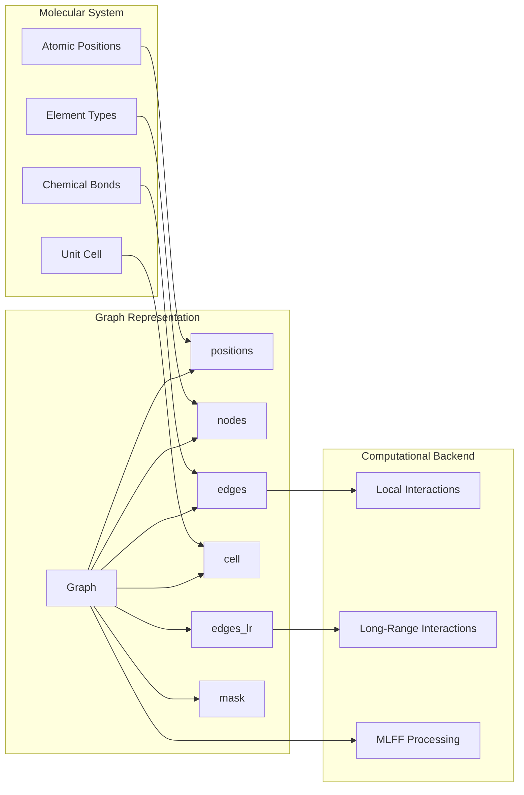
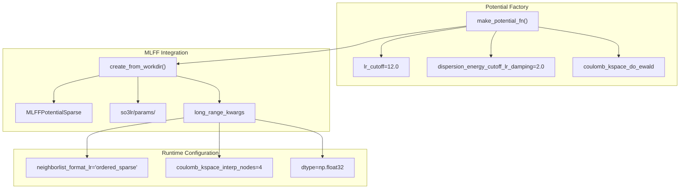
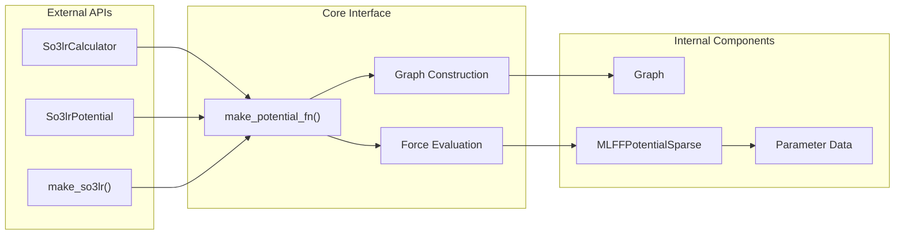

# Core Components

Relevant source files

The following files were used as context for generating this wiki page:

- [so3lr/graph.py](so3lr/graph.py)
- [so3lr/potential.py](so3lr/potential.py)

This document provides technical documentation of SO3LR's internal architecture, focusing on the core data structures and computational components that enable molecular simulation. It covers the fundamental building blocks that interface with external libraries and enable the CLI and API functionality.

For detailed usage patterns with external frameworks, see [Python API](#3). For practical implementation examples, see [Examples and Tutorials](#4).

## Architecture Overview

SO3LR's core architecture combines two primary computational approaches: semi-local interactions through the SO3krates neural network and long-range interactions via universal pairwise force fields. The system is built around a central graph data structure that represents molecular systems and a potential evaluation framework that computes energies and forces.

Sources: [so3lr/graph.py:1-36](), [so3lr/potential.py:1-30]()

## Core Data Structures

The SO3LR system centers around the `Graph` class, which provides a structured representation of molecular systems optimized for both local and long-range interactions. This data structure serves as the primary interface between molecular configurations and the computational backend.

| Component | Type | Purpose |
|-----------|------|---------|
| `positions` | Array | Atomic coordinates in 3D space |
| `edges` | Array | Local neighbor connectivity |
| `nodes` | Array | Atomic species and properties |
| `edges_lr` | Array | Long-range interaction pairs |
| `idx_i_lr`, `idx_j_lr` | Arrays | Long-range edge indices |
| `cell` | Array | Periodic boundary conditions |
| `mask` | Array | Valid atom indicators |

Sources: [so3lr/graph.py:3-36]()

## Potential System Architecture

The potential evaluation system is built around the `MLFFPotentialSparse` class from the MLFF library, configured specifically for SO3LR's hybrid local/long-range approach. The `make_potential_fn` function serves as the primary factory for creating configured potential instances.

Sources: [so3lr/potential.py:7-29]()

## Data Flow and Processing

The core components work together to transform molecular configurations into energy and force predictions through a structured computational pipeline. The Graph data structure provides the molecular representation, while the potential system handles the actual computation.

| Stage | Input | Processing | Output |
|-------|--------|------------|---------|
| Graph Construction | Atomic positions, species | Neighbor list generation | `Graph` object |
| Local Interactions | Graph edges | SO3krates neural network | Local energy/forces |
| Long-Range Interactions | Graph edges_lr | Universal pairwise forces | Long-range energy/forces |
| Aggregation | Component energies/forces | Sum and combine | Total energy/forces |

## Integration Points

The core components provide well-defined interfaces for integration with external frameworks and user applications:

Sources: [so3lr/potential.py:7-29](), [so3lr/graph.py:26-36]()

## Component Relationships

The core components maintain specific dependencies and data flow patterns that ensure efficient computation while supporting the hybrid local/long-range interaction model:

- The `Graph` class provides structured molecular data with separate representations for local and long-range interactions
- The `make_potential_fn` function configures `MLFFPotentialSparse` instances with SO3LR-specific parameters
- Long-range cutoffs and computational parameters are centralized in the potential factory function
- Parameter data is loaded from the `so3lr/params/` directory during potential initialization

For detailed technical specifications of the Graph data structure, see [Graph Data Structure](#5.1). For comprehensive documentation of potential function implementation, see [Potential Functions](#5.2).

---