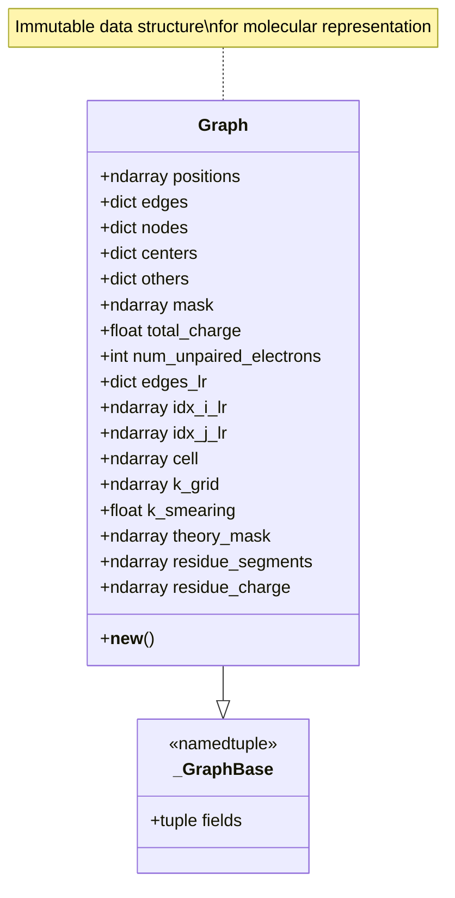
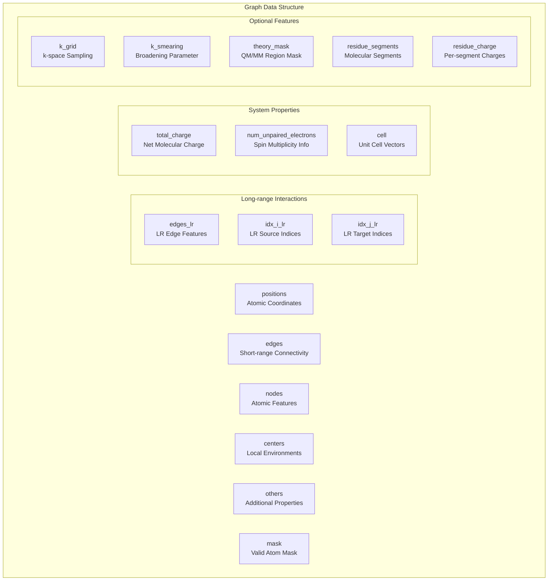
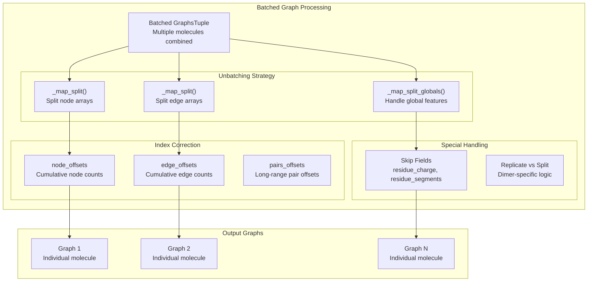

# Graph Data Structure

<details>
<summary>Relevant source files</summary>

The following files were used as context for generating this wiki page:

- [so3lr/graph.py](so3lr/graph.py)
- [so3lr/jraph_utils.py](so3lr/jraph_utils.py)
- [so3lr/prepare_dimer_xyz.py](so3lr/prepare_dimer_xyz.py)

</details>


This document covers the Graph data structure used in SO3LR to represent molecular systems internally. The Graph class serves as the primary data container for atomic positions, connectivity, and molecular properties required for energy and force calculations. For information about the potential functions that operate on graphs, see [Potential Functions](#5.2).

## Purpose and Core Structure

The SO3LR Graph class is a namedtuple-based data structure that encapsulates all molecular information needed for ML force field evaluation. It bridges the gap between external molecular representations (ASE Atoms, XYZ files) and the internal format required by SO3krates neural networks and universal pairwise force fields.



The Graph class inherits from a namedtuple base class defined in [so3lr/graph.py:3-24](), making it immutable and memory-efficient. The core constructor accepts both required and optional parameters, with several fields supporting specialized calculations like QM/MM hybrid methods and dimer binding energy evaluation.

Sources: [so3lr/graph.py:1-36]()

## Graph Fields and Data Organization

The Graph structure organizes molecular data into several categories of fields:

| Field Category | Fields | Purpose |
|---|---|---|
| **Geometric** | `positions`, `cell` | Atomic coordinates and periodic boundary conditions |
| **Connectivity** | `edges`, `edges_lr`, `idx_i_lr`, `idx_j_lr` | Short-range and long-range interaction definitions |
| **Atomic Properties** | `nodes`, `centers`, `others` | Per-atom features and embeddings |
| **System Properties** | `total_charge`, `num_unpaired_electrons` | Global molecular properties |
| **Computational** | `mask`, `k_grid`, `k_smearing` | Masking and k-space sampling parameters |
| **Specialized** | `theory_mask`, `residue_segments`, `residue_charge` | QM/MM and dimer calculation support |



Sources: [so3lr/graph.py:26-36]()

## Graph Construction and Conversion

The SO3LR system provides utilities for converting between different molecular representations through the `jraph_utils` module. The primary conversion pathway transforms ASE Atoms objects into jraph GraphsTuple format, which is then used to construct SO3LR Graph instances.

```mermaid
flowchart LR
    subgraph "External Formats"
        ase["ASE Atoms<br/>Standard Chemistry Format"]
        xyz["XYZ/EXTXYZ Files<br/>Coordinate Files"]
        jraph_in["jraph.GraphsTuple<br/>Input Format"]
    end
    
    subgraph "Conversion Functions"
        jraph_to_ase["jraph_to_ase_atoms()<br/>Extract molecular data"]
        unbatch_fn["unbatch()<br/>Separate batched graphs"]
        unbatch_np["unbatch_np()<br/>NumPy implementation"]
    end
    
    subgraph "SO3LR Core"
        graph["Graph<br/>SO3LR Data Structure"]
        potential["Potential Functions<br/>Energy/Force Calculation"]
    end
    
    xyz --> ase
    jraph_in --> jraph_to_ase
    jraph_in --> unbatch_fn
    jraph_in --> unbatch_np
    
    jraph_to_ase --> ase
    unbatch_fn --> graph
    unbatch_np --> graph
    ase --> graph
    
    graph --> potential
```

The `jraph_to_ase_atoms` function demonstrates the rich information preserved during conversion, extracting not only basic molecular properties but also SO3LR-specific computed quantities like forces, energies, and Hirshfeld ratios from the graph structure back to ASE format.

Sources: [so3lr/jraph_utils.py:14-40](), [so3lr/jraph_utils.py:43-57]()

## Batching and Unbatching Operations

SO3LR implements sophisticated batching operations to handle multiple molecular systems efficiently. The unbatching functionality separates batched graphs while preserving the integrity of specialized fields used in dimer binding energy calculations.



The unbatching process includes special logic for handling dimer binding energy calculations, where certain global fields like `residue_charge` and `residue_segments` are replicated rather than split across individual graphs. This ensures that molecular fragment information is preserved correctly when separating dimers into individual components.

Sources: [so3lr/jraph_utils.py:60-133](), [so3lr/jraph_utils.py:78-102](), [so3lr/jraph_utils.py:112-114]()

## Integration with Molecular Data Pipelines

The Graph data structure integrates seamlessly with SO3LR's molecular data processing pipelines, particularly for specialized calculations like dimer binding energies. The system maintains molecular segment information through dedicated fields that support multi-fragment calculations.

```mermaid
graph TB
    subgraph "Dimer Processing Pipeline"
        dimer_xyz["Dimer XYZ Input<br/>selection_a, selection_b"]
        monomer_info["get_monomer_info()<br/>Extract fragment data"]
        translate["create_translated_dimer()<br/>10000 Å separation"]
        properties["add_dimer_properties()<br/>Charge and segment info"]
    end
    
    subgraph "Graph Construction"
        atoms_orig["Original Atoms<br/>structure_type: dimer_original"]
        atoms_trans["Translated Atoms<br/>structure_type: dimer_translated"]
        graph_batch["Batched Graph<br/>Both configurations"]
    end
    
    subgraph "Graph Fields for Dimers"
        res_seg["residue_segments<br/>Fragment membership"]
        res_charge["residue_charge<br/>Per-fragment charges"]
        theory_mask_field["theory_mask<br/>Optional QM/MM regions"]
    end
    
    dimer_xyz --> monomer_info
    monomer_info --> translate
    translate --> properties
    properties --> atoms_orig
    properties --> atoms_trans
    
    atoms_orig --> graph_batch
    atoms_trans --> graph_batch
    
    graph_batch --> res_seg
    graph_batch --> res_charge
    graph_batch --> theory_mask_field
```



This integration supports SO3LR's ability to calculate dimer binding energies by maintaining fragment identity and charge information throughout the computational pipeline, enabling accurate interaction energy evaluation between molecular components.

Sources: [so3lr/prepare_dimer_xyz.py:107-137](), [so3lr/prepare_dimer_xyz.py:49-81](), [so3lr/graph.py:29-36]()

---