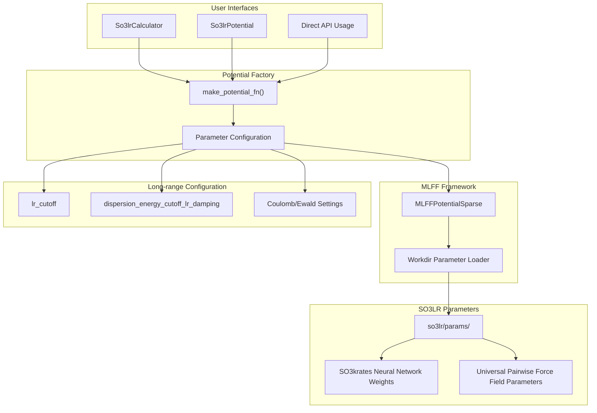
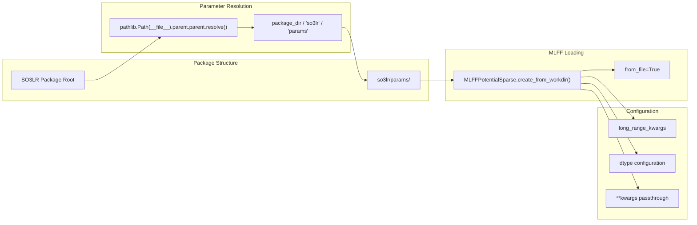
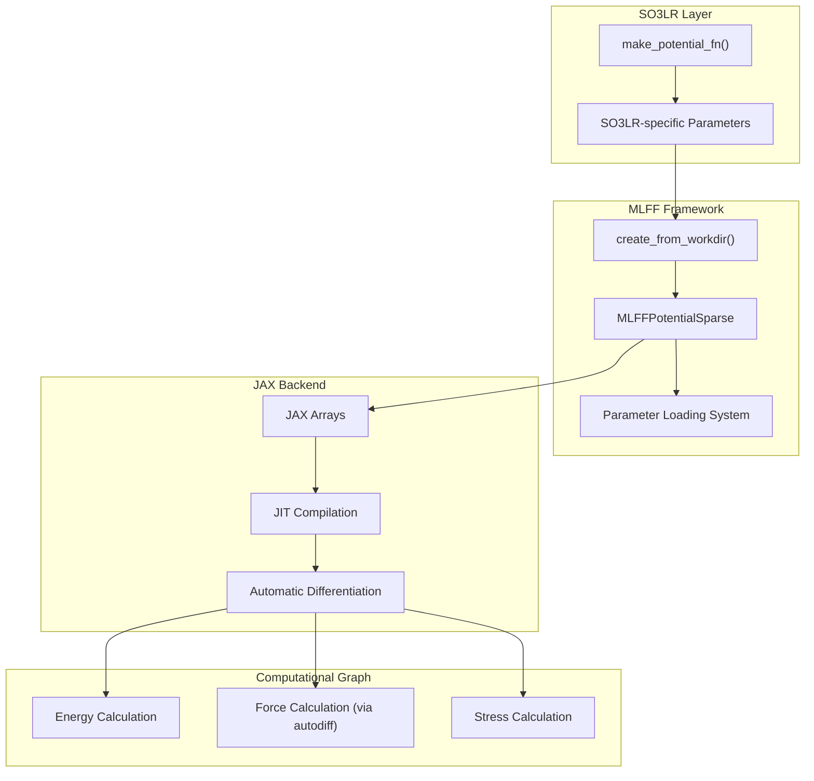

# Potential Functions

<details>
<summary>Relevant source files</summary>

The following files were used as context for generating this wiki page:

- [so3lr/potential.py](so3lr/potential.py)
- [tests/test_potential.py](tests/test_potential.py)

</details>


This page documents the SO3LR potential function system, which provides the core interface for creating and configuring molecular potentials. The potential functions combine SO3krates neural networks with universal pairwise force fields to enable energy and force calculations for molecular systems.

For information about how potentials are used in molecular dynamics simulations, see [Command Line Interface](#2). For integration with external frameworks, see [Python API](#3).

## Architecture Overview

The SO3LR potential system is built around a factory function that creates `MLFFPotentialSparse` instances configured with SO3LR-specific parameters. This design allows for consistent potential creation across different usage contexts.

### Potential Function Architecture



Sources: [so3lr/potential.py:1-30]()

## Potential Function Factory

The `make_potential_fn` function serves as the primary entry point for creating SO3LR potentials. It abstracts the complexity of parameter loading and configuration from end users.

### Function Signature and Parameters

The function accepts several key parameters for customizing potential behavior:

| Parameter | Default | Purpose |
|-----------|---------|---------|
| `lr_cutoff` | 12.0 | Long-range interaction cutoff distance |
| `dispersion_energy_cutoff_lr_damping` | 2.0 | Damping factor for dispersion energy cutoff |
| `dtype` | `np.float32` | Numerical precision for calculations |
| `coulomb_kspace_do_ewald` | `False` | Enable Ewald summation for Coulomb interactions |
| `coulomb_kspace_interp_nodes` | 4 | Interpolation nodes for k-space Coulomb calculations |

### Implementation Details

The function implementation follows a straightforward pattern:

1. **Parameter Directory Resolution**: Locates the SO3LR parameter directory relative to the package installation
2. **MLFF Potential Creation**: Delegates to `MLFFPotentialSparse.create_from_workdir()` with SO3LR-specific configuration
3. **Long-range Parameter Configuration**: Sets up long-range interaction parameters through the `long_range_kwargs` dictionary

Sources: [so3lr/potential.py:7-29]()

## Parameter Loading Mechanism

The potential function relies on pre-trained parameters stored in the package directory structure. This design ensures that SO3LR potentials are immediately usable after installation without requiring separate parameter downloads.

### Parameter Loading Flow



Sources: [so3lr/potential.py:15-18]()

## Long-range Interaction Configuration

The potential function configures several aspects of long-range interactions through the `long_range_kwargs` dictionary. This configuration is critical for proper handling of electrostatic and dispersion interactions beyond the neural network's local scope.

### Long-range Parameter Mapping

The function maps input parameters to the MLFF framework's expected configuration:

- **`cutoff_lr`**: Maps from `lr_cutoff` parameter, controls the distance at which long-range interactions are truncated
- **`dispersion_energy_cutoff_lr_damping`**: Direct passthrough for dispersion energy damping
- **`neighborlist_format_lr`**: Fixed to `'ordered_sparse'` for efficient sparse matrix operations
- **`coulomb_kspace_do_ewald`**: Controls whether Ewald summation is used for Coulomb interactions
- **`coulomb_kspace_interp_nodes`**: Sets interpolation grid density for k-space calculations

Sources: [so3lr/potential.py:20-26]()

## Integration with MLFF Framework

The SO3LR potential system builds upon the MLFF (Machine Learning Force Fields) framework, specifically using the `MLFFPotentialSparse` class for sparse matrix-based potential evaluation.

### MLFF Integration Architecture



Sources: [so3lr/potential.py:4](), [so3lr/potential.py:17-29]()

## Usage Patterns

The potential function is designed to be used across different computational contexts, from interactive ASE calculations to large-scale JAX-MD simulations. The consistent interface allows for seamless integration regardless of the specific use case.

### Common Usage Pattern

```python
# Basic potential creation
potential = make_potential_fn()

# Custom long-range cutoff
potential = make_potential_fn(lr_cutoff=15.0)

# High-precision calculations
potential = make_potential_fn(dtype=np.float64)

# Ewald summation enabled
potential = make_potential_fn(coulomb_kspace_do_ewald=True)
```

The returned potential object provides the standard MLFF interface for energy and force evaluation, making it compatible with various molecular simulation frameworks.

Sources: [so3lr/potential.py:7-29](), [tests/test_potential.py:4-5]()

---