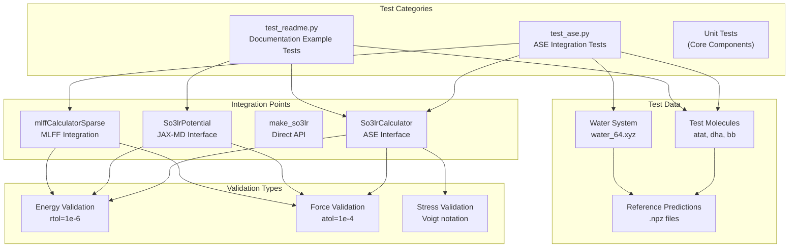
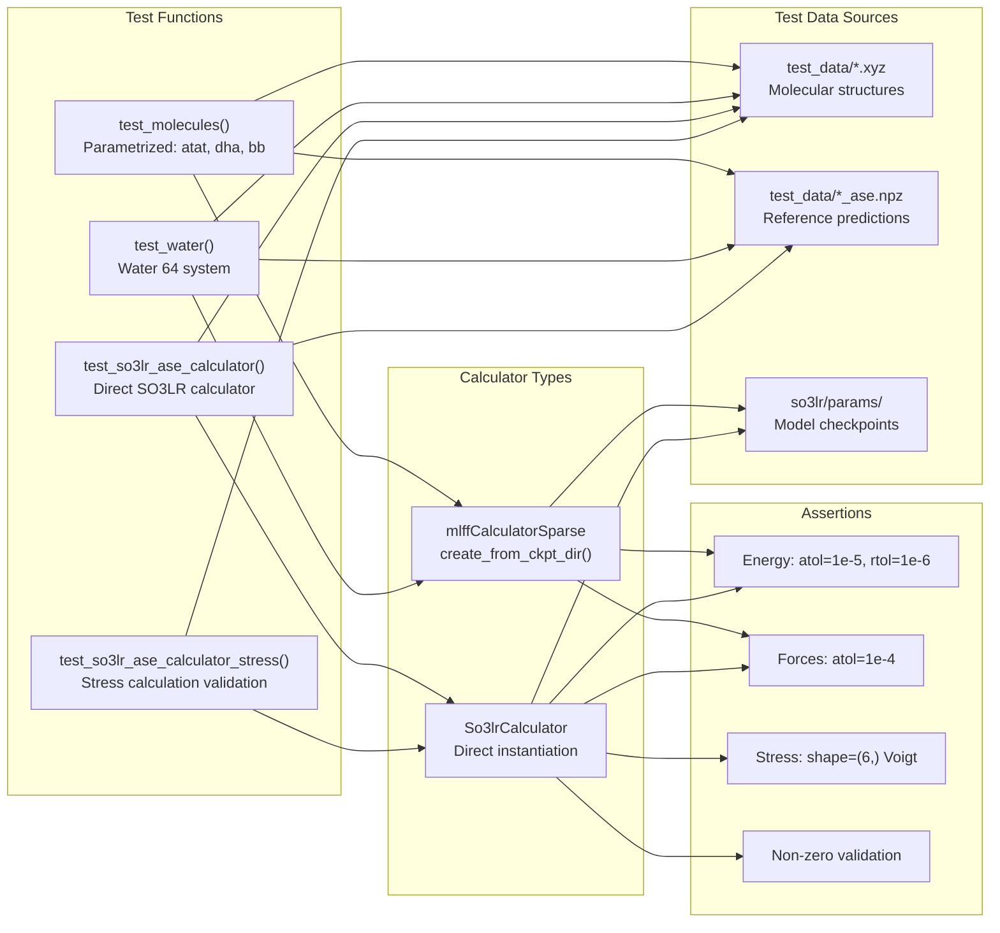
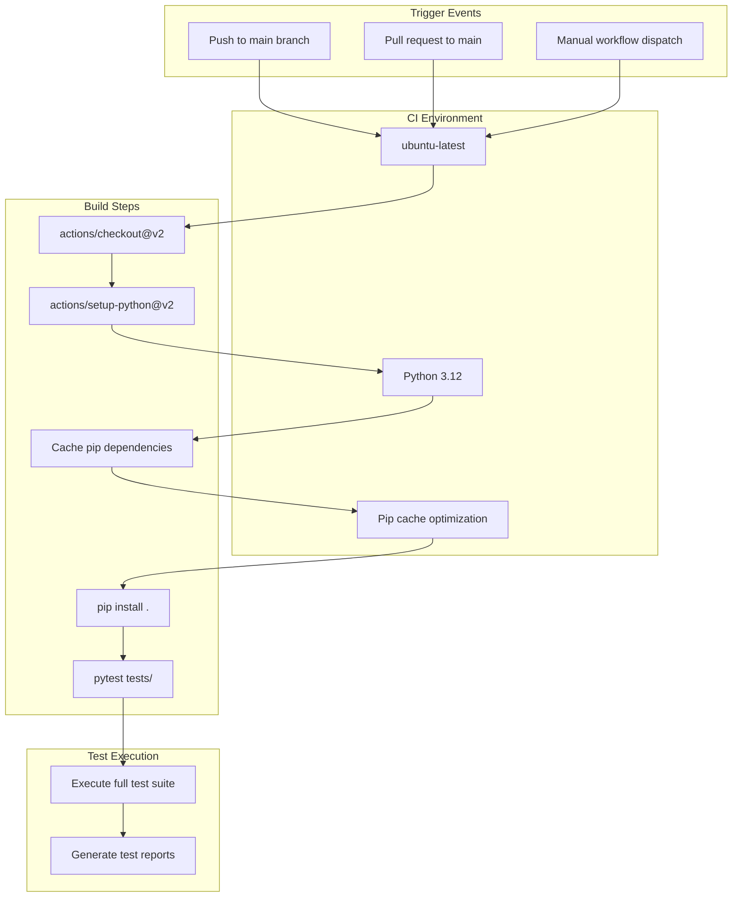
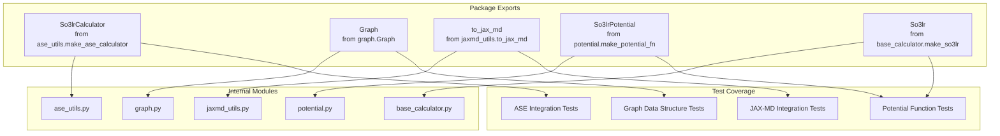

# Development and Testing

<details>
<summary>Relevant source files</summary>

The following files were used as context for generating this wiki page:

- [.github/workflows/CI.yml](.github/workflows/CI.yml)
- [so3lr/__init__.py](so3lr/__init__.py)
- [tests/test_ase.py](tests/test_ase.py)
- [tests/test_readme.py](tests/test_readme.py)

</details>


This page covers the testing infrastructure, continuous integration pipeline, and development workflows for the SO3LR codebase. It provides guidance for contributors on running tests, understanding the test suite structure, and following development best practices.

For information about the core SO3LR components being tested, see [Core Components](#5). For details about the API interfaces that tests validate, see [Python API](#3).

## Testing Framework Overview

SO3LR uses pytest as its primary testing framework, with tests organized to validate different integration points and core functionality. The test suite ensures correctness across ASE integration, JAX-MD compatibility, and direct API usage.

### Test Suite Architecture



**Sources:** [tests/test_ase.py:1-173](), [tests/test_readme.py:1-103](), [so3lr/__init__.py:1-8]()

## Test Suite Components

### ASE Integration Tests

The ASE integration tests validate the `So3lrCalculator` class against reference data and ensure compatibility with the Atomic Simulation Environment.



**Sources:** [tests/test_ase.py:9-173]()

#### Key Test Parameters

| Test Function | Molecules | Tolerances | Special Features |
|---------------|-----------|------------|------------------|
| `test_molecules` | atat, dha, bb | Energy: rtol=1e-6, Forces: atol=1e-4 | Parametrized across molecules |
| `test_water` | water_64 replicated 2x2x2 | Energy: rtol=1e-6, Forces: atol=5e-4 | Large system validation |
| `test_so3lr_ase_calculator` | atat, dha, bb | Energy: atol=2e-5, Forces: atol=1e-4 | Direct SO3LR calculator |
| `test_so3lr_ase_calculator_stress` | water_64 replicated | Stress shape: (6,) | Stress tensor validation |

### Documentation Example Tests

The README tests ensure that code examples in documentation remain functional and produce expected results.

| Test Function | Purpose | Integration Point |
|---------------|---------|-------------------|
| `test_ase_example` | Validate ASE usage examples | `So3lrCalculator` |
| `test_jax_md_example` | Validate JAX-MD usage examples | `So3lrPotential`, `to_jax_md` |

**Sources:** [tests/test_readme.py:15-103]()

## Continuous Integration Pipeline

The CI pipeline runs on GitHub Actions and validates the codebase across different scenarios.



**Sources:** [.github/workflows/CI.yml:1-39]()

### CI Configuration Details

| Component | Configuration | Purpose |
|-----------|---------------|---------|
| Operating System | `ubuntu-latest` | Standard Linux environment |
| Python Version | `3.12` | Latest supported Python |
| Strategy | `fail-fast: false` | Continue testing other configurations on failure |
| Cache | Pip cache with `setup.py` hash key | Accelerate dependency installation |
| Test Command | `pytest tests/` | Execute full test suite |

## Package Structure and Exports

The main package initialization defines the public API surface that tests validate.



**Sources:** [so3lr/__init__.py:1-8]()

## Test Data Management

### Reference Data Structure

The test suite uses pre-computed reference data to validate model predictions:

| Data Type | File Pattern | Contents | Usage |
|-----------|--------------|----------|-------|
| Molecular Structures | `test_data/{name}.xyz` | Atomic coordinates | Input for calculations |
| Reference Predictions | `test_data/{name}_ase.npz` | Energy and force arrays | Validation targets |
| Model Parameters | `so3lr/params/` | Trained model checkpoints | Calculator initialization |

### Test Molecules

| Molecule | Description | Test Coverage |
|----------|-------------|---------------|
| `atat` | Small organic molecule | ASE and JAX-MD integration |
| `dha` | Molecular system | ASE and JAX-MD integration |
| `bb` | Test structure | ASE and JAX-MD integration |
| `water_64` | Water cluster (64 molecules) | Large system validation, stress testing |

**Sources:** [tests/test_ase.py:13-15](), [tests/test_ase.py:58-62](), [tests/test_readme.py:21-22]()

## Development Workflow

### Running Tests Locally

```bash
# Install package in development mode
pip install -e .

# Run full test suite
pytest tests/

# Run specific test categories
pytest tests/test_ase.py
pytest tests/test_readme.py

# Run with verbose output
pytest tests/ -v

# Run specific test function
pytest tests/test_ase.py::test_molecules -v
```

### Test Validation Tolerances

The test suite uses carefully chosen tolerances to balance numerical precision with practical robustness:

| Property | Absolute Tolerance | Relative Tolerance | Context |
|----------|-------------------|-------------------|---------|
| Energy | 1e-5 to 2e-5 | 1e-6 | Single precision calculations |
| Forces | 1e-4 to 5e-4 | - | Force accuracy requirements |
| Stress | - | - | Shape validation (6,) Voigt notation |

### Adding New Tests

When contributing new functionality:

1. **Add test data**: Place molecular structures in `tests/test_data/`
2. **Generate references**: Create corresponding `.npz` files with expected outputs
3. **Write test functions**: Follow existing patterns in `test_ase.py` or `test_readme.py`
4. **Validate tolerances**: Use appropriate numerical tolerances for the test case
5. **Update CI**: Ensure new tests are covered by the CI pipeline

**Sources:** [tests/test_ase.py:34-45](), [tests/test_ase.py:119-130](), [.github/workflows/CI.yml:34-37]()