# HOOMD-blue Overview

Relevant source files

The following files were used as context for generating this wiki page:

- [.github/ISSUE_TEMPLATE/config.yml](.github/ISSUE_TEMPLATE/config.yml)
- [.mailmap](.mailmap)
- [CHANGELOG.rst](CHANGELOG.rst)
- [README.md](README.md)
- [hoomd/Analyzer.cc](hoomd/Analyzer.cc)
- [hoomd/Analyzer.h](hoomd/Analyzer.h)
- [hoomd/Compute.cc](hoomd/Compute.cc)
- [hoomd/Compute.h](hoomd/Compute.h)
- [hoomd/System.cc](hoomd/System.cc)
- [hoomd/System.h](hoomd/System.h)
- [hoomd/Updater.cc](hoomd/Updater.cc)
- [hoomd/Updater.h](hoomd/Updater.h)
- [hoomd/box.py](hoomd/box.py)
- [hoomd/conftest.py](hoomd/conftest.py)
- [hoomd/hpmc/.gitignore](hoomd/hpmc/.gitignore)
- [hoomd/pytest/test_box.py](hoomd/pytest/test_box.py)
- [hoomd/simulation.py](hoomd/simulation.py)
- [hoomd/snapshot.py](hoomd/snapshot.py)
- [hoomd/state.py](hoomd/state.py)
- [sphinx-doc/credits.rst](sphinx-doc/credits.rst)
- [sphinx-doc/deprecated.rst](sphinx-doc/deprecated.rst)
- [sphinx-doc/index.rst](sphinx-doc/index.rst)
- [sphinx-doc/migrating.rst](sphinx-doc/migrating.rst)

This document provides an overview of the HOOMD-blue simulation framework architecture, its core components, and how they interact to enable particle-based simulations. For detailed information about specific features like Hard Particle Monte Carlo (HPMC), Molecular Dynamics (MD), or Multi-Particle Collision Dynamics (MPCD), see their respective documentation pages.

## Core Architecture

HOOMD-blue is a particle simulation package that performs both hard particle Monte Carlo simulations and molecular dynamics simulations on CPUs and GPUs. The framework follows a layered architecture with Python interfaces built on top of high-performance C++ implementations.

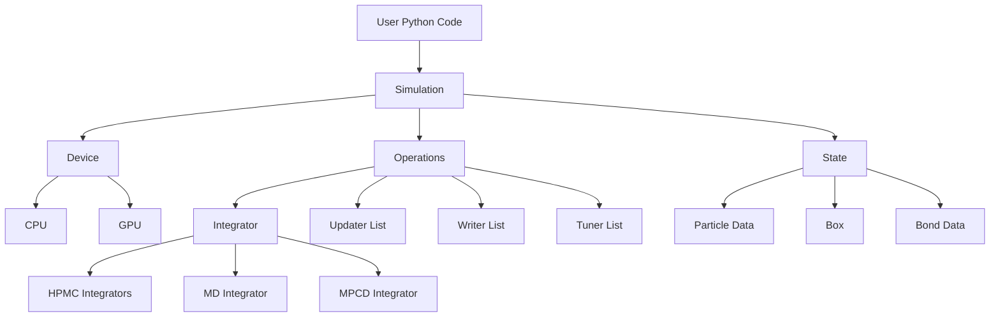

Sources: [hoomd/simulation.py:34-130](), [hoomd/state.py:80-140](), [hoomd/System.cc:37-52]()

## Simulation Workflow

A typical HOOMD-blue simulation follows this sequence:

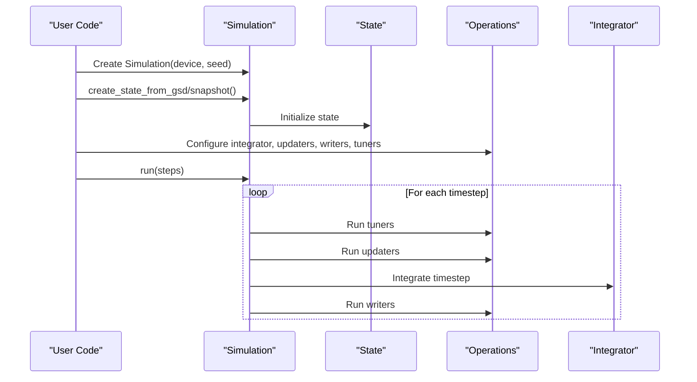

Sources: [hoomd/simulation.py:484-524](), [hoomd/System.cc:128-180]()

## Key Components

### Simulation Class

The `Simulation` class is the central controller that orchestrates the entire simulation process. It manages the device, state, and operations, coordinating their interactions during the simulation run.

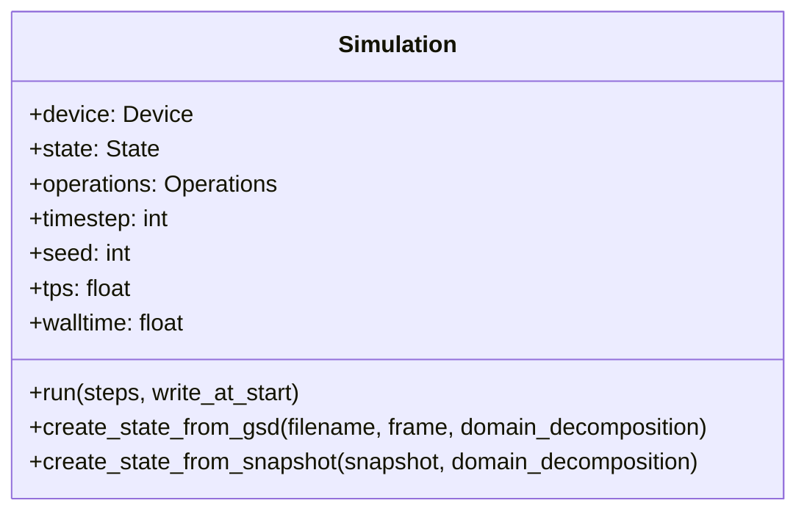

The `Simulation` class provides methods to initialize the simulation state from various sources and to run the simulation for a specified number of steps. It also exposes properties like the current timestep, random seed, and performance metrics.

Sources: [hoomd/simulation.py:34-95](), [hoomd/simulation.py:484-546]()

### State

The `State` class stores and manages the current state of the simulation, including particles, bonds, angles, dihedrals, and the simulation box.

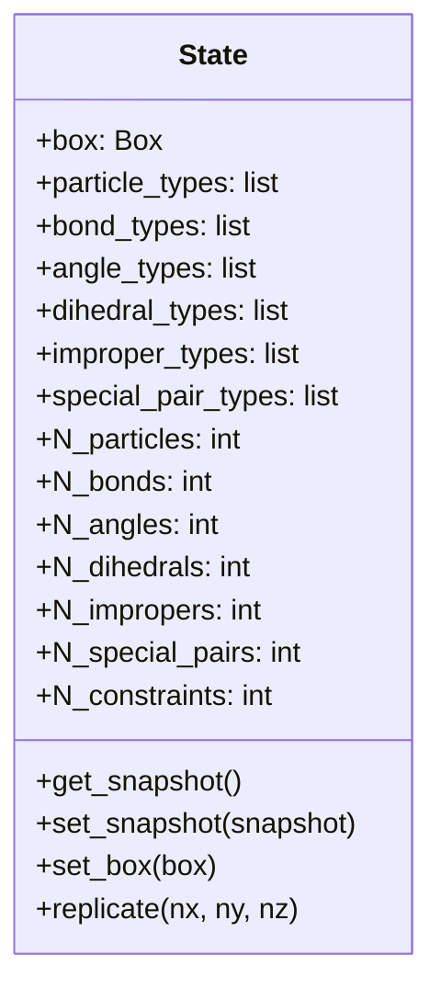

The `State` provides methods to access and modify data, and to save and restore the system state through snapshots.

Sources: [hoomd/state.py:80-258](), [hoomd/state.py:280-316]()

### Operations

The `Operations` class manages all the operations that apply to the state during a simulation run, which include:

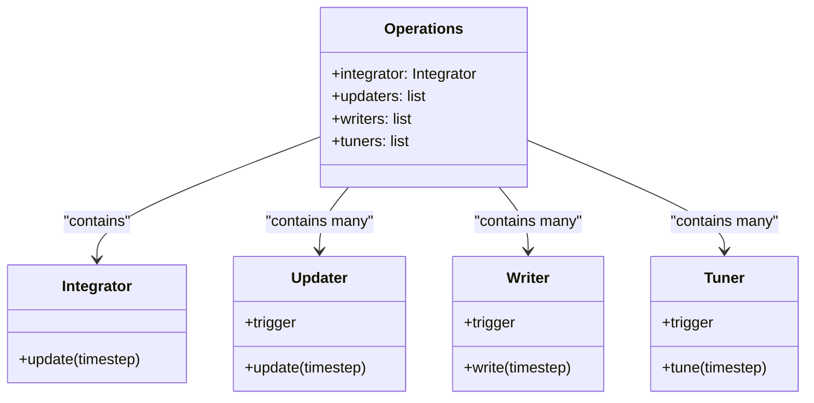

During each simulation timestep, operations are executed in this order:
1. Tuners optimize performance parameters
2. Updaters modify the simulation state
3. The integrator advances the system
4. Writers output data

Sources: [hoomd/System.cc:131-174](), [hoomd/Updater.h:56-67](), [hoomd/Analyzer.h:57-68](), [hoomd/Compute.h:58-69]()

### Device

The `Device` class represents the computational hardware where the simulation runs (CPU or GPU) and manages related resources.

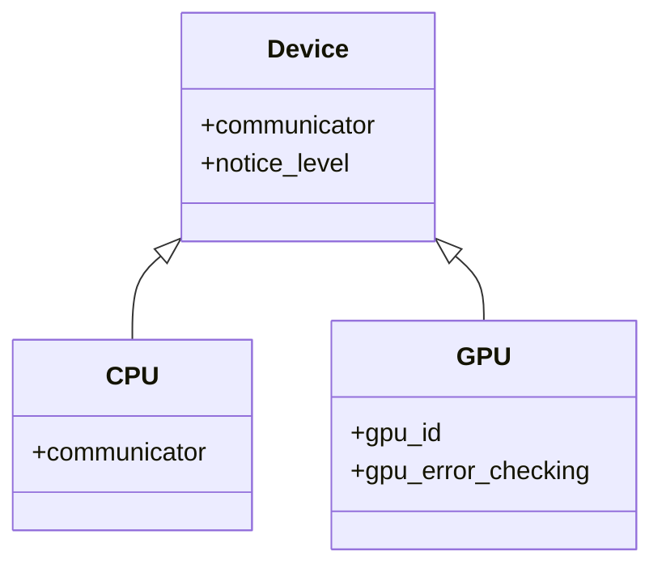

HOOMD-blue supports both CPU and GPU execution with optional MPI parallelization for distributed computing.

Sources: [hoomd/simulation.py:147-186](), [hoomd/conftest.py:74-88]()

## Simulation Engines

HOOMD-blue provides three major simulation engines:

### Hard Particle Monte Carlo (HPMC)

The HPMC engine simulates hard particles using Monte Carlo methods. It handles various particle shapes and rejection-free trial moves.

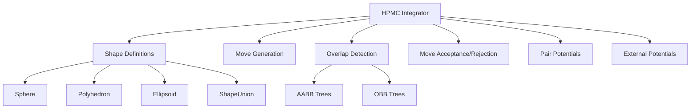

Sources: (Based on diagrams provided)

### Molecular Dynamics (MD)

The MD engine simulates particles interacting through continuous potentials by integrating Newton's equations of motion.

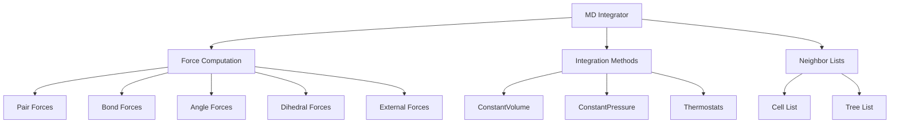

Sources: (Based on diagrams provided)

### Multi-Particle Collision Dynamics (MPCD)

The MPCD engine simulates fluid dynamics and hydrodynamic interactions for soft matter systems.

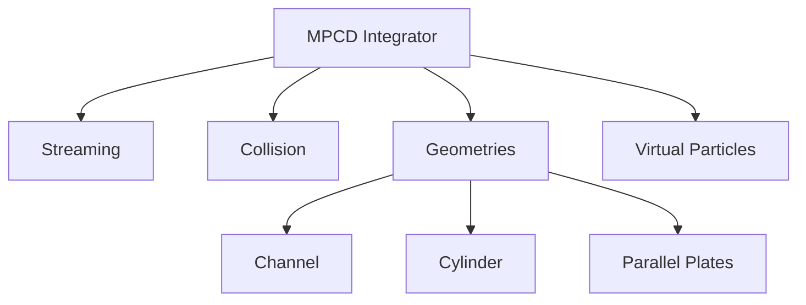

Sources: (Based on diagrams provided)

## System Implementation

The Python interface is backed by a C++ implementation with these core classes:

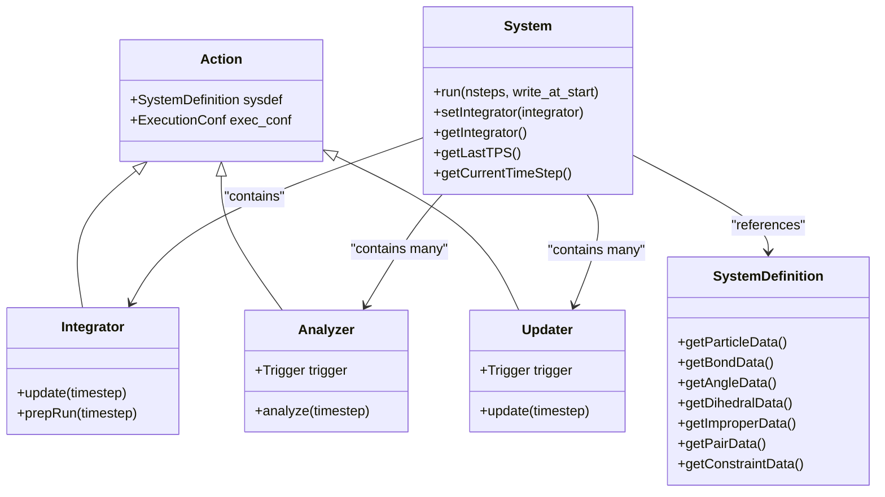

This diagram shows the relationship between the key C++ classes that implement the simulation framework. The `System` class orchestrates the execution of operations during a simulation run.

Sources: [hoomd/System.h:61-146](), [hoomd/System.cc:37-188](), [hoomd/Compute.h:58-69](), [hoomd/Analyzer.h:57-68](), [hoomd/Updater.h:56-67]()

## Box and Boundary Conditions

HOOMD-blue simulations occur in a triclinic box with periodic boundary conditions:

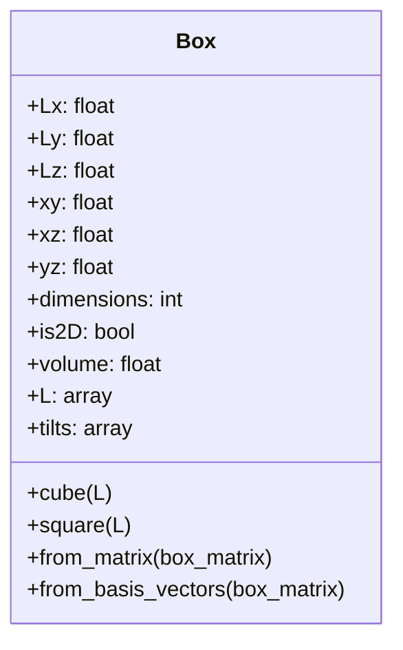

The `Box` class defines the simulation domain with its dimensions and tilt factors, supporting both 2D and 3D simulations.

Sources: [hoomd/box.py:58-183](), [hoomd/state.py:537-593]()

## Snapshot System

The `Snapshot` class provides a mechanism to capture and manipulate the complete state of a simulation:

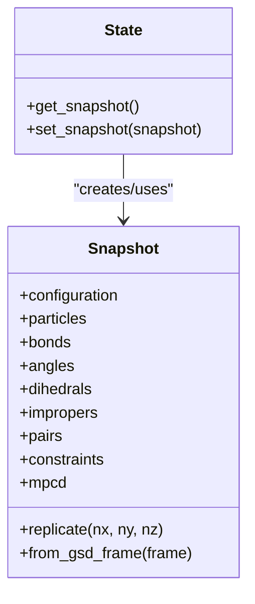

`Snapshot` is a self-contained copy of the simulation state that can be used to save, restore, or initialize simulations. It is also compatible with the GSD file format for persistent storage.

Sources: [hoomd/snapshot.py:52-92](), [hoomd/state.py:280-316]()

## Conclusion

HOOMD-blue provides a flexible, high-performance framework for particle simulations across diverse hardware platforms. Its modular architecture allows researchers to:

1. Choose between different simulation methods (HPMC, MD, MPCD)
2. Run on various computing platforms (CPU, GPU, distributed systems)
3. Configure detailed simulation parameters
4. Capture and analyze simulation data efficiently

This overview document covers the main architectural components and their interactions. For detailed usage of specific features, refer to the respective documentation sections.

---