# Core Architecture

<details>
<summary>Relevant source files</summary>

The following files were used as context for generating this wiki page:

- [CMake/hoomd/hoomd-macros.cmake](CMake/hoomd/hoomd-macros.cmake)
- [hoomd/Analyzer.cc](hoomd/Analyzer.cc)
- [hoomd/Analyzer.h](hoomd/Analyzer.h)
- [hoomd/CachedAllocator.h](hoomd/CachedAllocator.h)
- [hoomd/Compute.cc](hoomd/Compute.cc)
- [hoomd/Compute.h](hoomd/Compute.h)
- [hoomd/ExecutionConfiguration.cc](hoomd/ExecutionConfiguration.cc)
- [hoomd/ExecutionConfiguration.h](hoomd/ExecutionConfiguration.h)
- [hoomd/GPUArray.h](hoomd/GPUArray.h)
- [hoomd/GPUFlags.h](hoomd/GPUFlags.h)
- [hoomd/GPUVector.h](hoomd/GPUVector.h)
- [hoomd/ManagedArray.h](hoomd/ManagedArray.h)
- [hoomd/System.cc](hoomd/System.cc)
- [hoomd/System.h](hoomd/System.h)
- [hoomd/Updater.cc](hoomd/Updater.cc)
- [hoomd/Updater.h](hoomd/Updater.h)
- [hoomd/box.py](hoomd/box.py)
- [hoomd/conftest.py](hoomd/conftest.py)
- [hoomd/data/array.py](hoomd/data/array.py)
- [hoomd/data/collections.py](hoomd/data/collections.py)
- [hoomd/data/parameterdicts.py](hoomd/data/parameterdicts.py)
- [hoomd/data/syncedlist.py](hoomd/data/syncedlist.py)
- [hoomd/data/typeconverter.py](hoomd/data/typeconverter.py)
- [hoomd/data/typeparam.py](hoomd/data/typeparam.py)
- [hoomd/device.py](hoomd/device.py)
- [hoomd/error.py](hoomd/error.py)
- [hoomd/managed_allocator.h](hoomd/managed_allocator.h)
- [hoomd/module.cc](hoomd/module.cc)
- [hoomd/operation.py](hoomd/operation.py)
- [hoomd/operations.py](hoomd/operations.py)
- [hoomd/pytest/CMakeLists.txt](hoomd/pytest/CMakeLists.txt)
- [hoomd/pytest/dummy.py](hoomd/pytest/dummy.py)
- [hoomd/pytest/test_box.py](hoomd/pytest/test_box.py)
- [hoomd/pytest/test_collections.py](hoomd/pytest/test_collections.py)
- [hoomd/pytest/test_device.py](hoomd/pytest/test_device.py)
- [hoomd/pytest/test_operation.py](hoomd/pytest/test_operation.py)
- [hoomd/pytest/test_parameter_dict.py](hoomd/pytest/test_parameter_dict.py)
- [hoomd/pytest/test_syncedlist.py](hoomd/pytest/test_syncedlist.py)
- [hoomd/pytest/test_type_parameter_dict.py](hoomd/pytest/test_type_parameter_dict.py)
- [hoomd/pytest/test_typeparam.py](hoomd/pytest/test_typeparam.py)
- [hoomd/simulation.py](hoomd/simulation.py)
- [hoomd/snapshot.py](hoomd/snapshot.py)
- [hoomd/state.py](hoomd/state.py)
- [hoomd/util.py](hoomd/util.py)

</details>


The core architecture of HOOMD-blue defines the fundamental structure, components, and execution model that enables particle simulations. This document explains the central design elements of HOOMD-blue's architecture, including the simulation loop, operations system, state management, and how the various components interact with each other.

## Execution Model Overview

HOOMD-blue's execution model is designed to support simulations on both CPU and GPU hardware with flexibility for parallel execution using MPI.

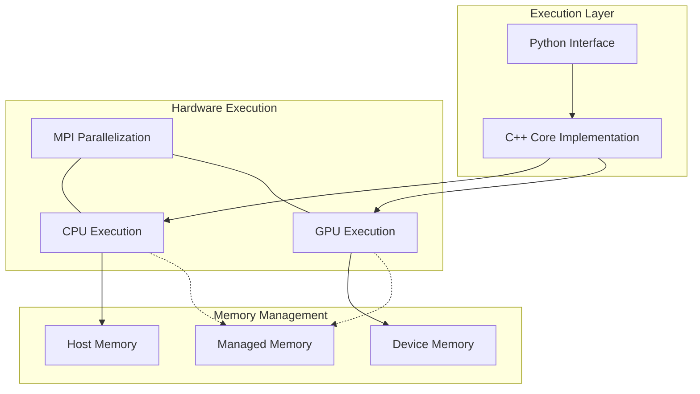

Sources: [hoomd/device.py:283-425](hoomd/device.py:283-425), [hoomd/ExecutionConfiguration.cc:52-176](hoomd/ExecutionConfiguration.cc:52-176)

### Device Abstraction

HOOMD-blue uses a `Device` base class that abstracts the underlying hardware execution. Two concrete implementations are provided:

1. `CPU` - Executes simulations on the CPU
2. `GPU` - Executes simulations on CUDA/HIP capable GPUs

The device selection is made at simulation creation time and cannot be changed after a simulation is created:

```python
# CPU execution
device = hoomd.device.CPU()

# GPU execution
device = hoomd.device.GPU(gpu_id=0)

# Auto-select based on availability
device = hoomd.device.auto_select()

simulation = hoomd.Simulation(device=device)
```

Sources: [hoomd/device.py:98-494](hoomd/device.py:98-494), [hoomd/simulation.py:58-69](hoomd/simulation.py:58-69)

### Device Implementation

The `ExecutionConfiguration` class in C++ manages the execution hardware details:

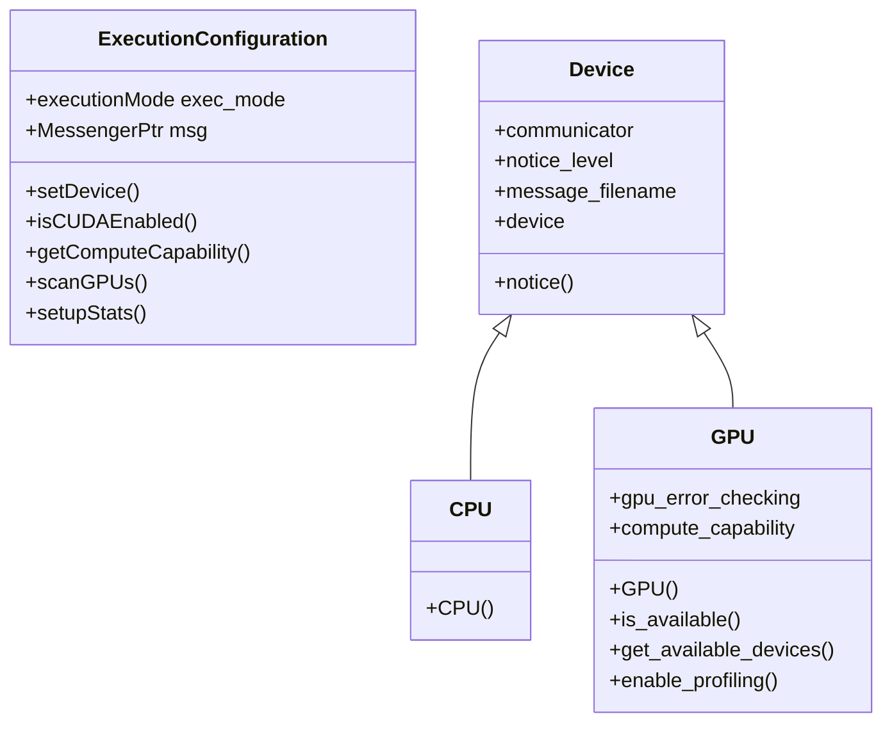

Sources: [hoomd/device.py:98-148](hoomd/device.py:98-148), [hoomd/ExecutionConfiguration.h:67-444](hoomd/ExecutionConfiguration.h:67-444)

## Core Components

HOOMD-blue's architecture centers around several key components that work together to execute simulations.

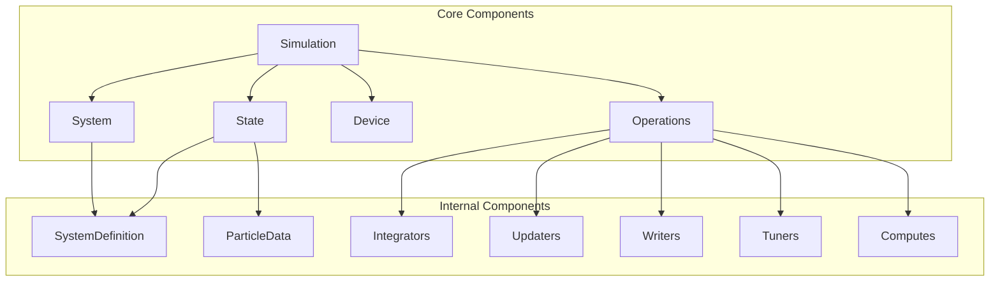

Sources: [hoomd/simulation.py:34-426](hoomd/simulation.py:34-426), [hoomd/state.py:80-671](hoomd/state.py:80-671), [hoomd/operations.py:32-419](hoomd/operations.py:32-419)

### Simulation Class

The `Simulation` class is the central organizing structure that brings together all components. It manages:

1. The simulation state
2. The operations that act on the state
3. The device that executes the simulation
4. The execution of the simulation run loop

```python
simulation = hoomd.Simulation(device)
simulation.create_state_from_snapshot(snapshot)  # Initialize state
simulation.operations.integrator = integrator     # Set an integrator
simulation.run(1000)                             # Run the simulation
```

Sources: [hoomd/simulation.py:34-143](hoomd/simulation.py:34-143), [hoomd/simulation.py:484-527](hoomd/simulation.py:484-527)

### State Management

The `State` class manages the complete thermodynamic microstate of the simulation, including:

1. Particles and their properties (position, velocity, mass, etc.)
2. Bonds, angles, dihedrals, impropers, and constraints
3. The simulation box
4. Domain decomposition for MPI parallel execution

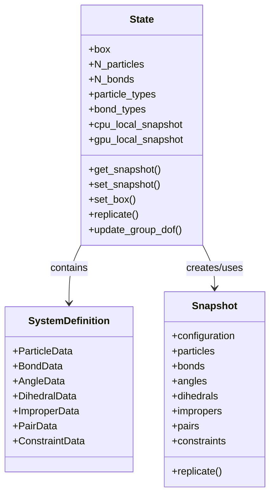

Sources: [hoomd/state.py:80-440](hoomd/state.py:80-440), [hoomd/snapshot.py:52-124](hoomd/snapshot.py:52-124)

## Operations System

The operations system defines the various components that act on the simulation state during the run loop.

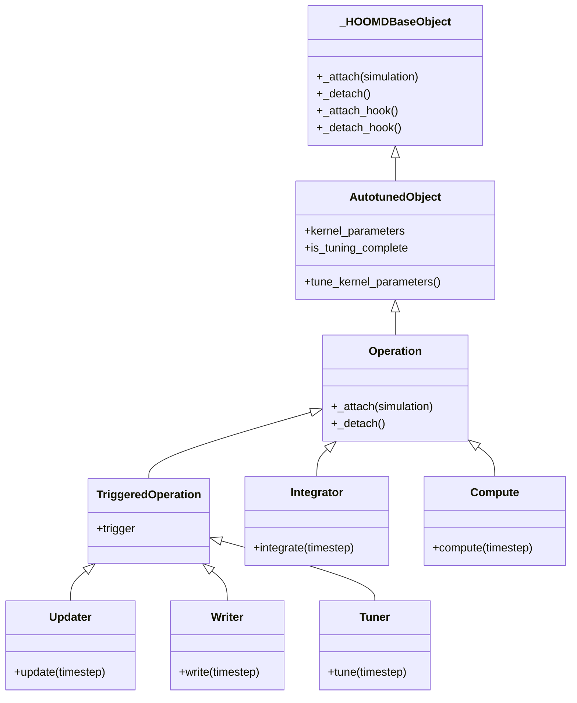

Sources: [hoomd/operation.py:31-183](hoomd/operation.py:31-183), [hoomd/operation.py:394-531](hoomd/operation.py:394-531), [hoomd/operation.py:552-688](hoomd/operation.py:552-688)

### Operations Container

The `Operations` class serves as a container and manager for all operation objects:

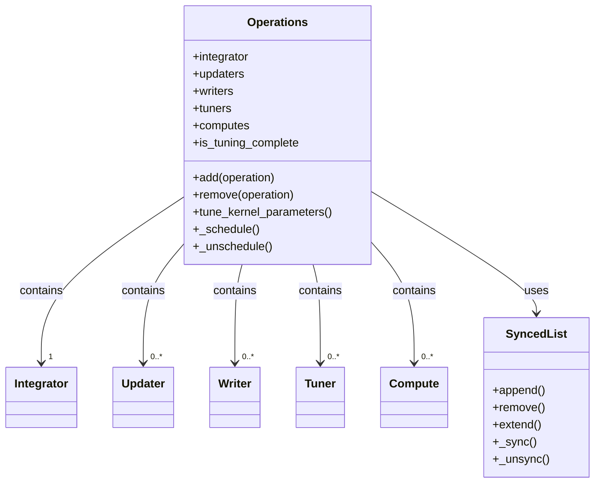

Sources: [hoomd/operations.py:32-143](hoomd/operations.py:32-143), [hoomd/operations.py:235-343](hoomd/operations.py:235-343)

## Simulation Run Loop

The simulation run loop is the core execution path that advances the simulation through time steps:

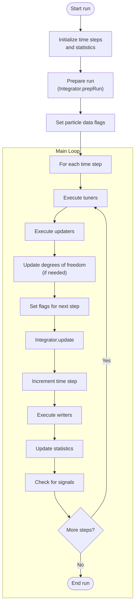

Sources: [hoomd/System.cc:80-180](hoomd/System.cc:80-180), [hoomd/simulation.py:484-517](hoomd/simulation.py:484-517)

The run loop follows these key steps:

1. Initialize time steps and reset statistics
2. Prepare the run by calling the integrator's prepare method
3. For each time step:
   - Execute tuners that trigger on this step
   - Execute updaters that trigger on this step
   - Update degrees of freedom if needed
   - Set particle data flags for the next step
   - Execute the integrator to advance the system
   - Increment the time step counter
   - Execute writers that trigger on this step
   - Update performance statistics
   - Check for Python signals (e.g., keyboard interrupt)

Sources: [hoomd/simulation.py:484-527](hoomd/simulation.py:484-527), [hoomd/System.cc:80-180](hoomd/System.cc:80-180)

## Python-C++ Integration

HOOMD-blue uses a hybrid architecture with a Python interface and C++ core implementation:

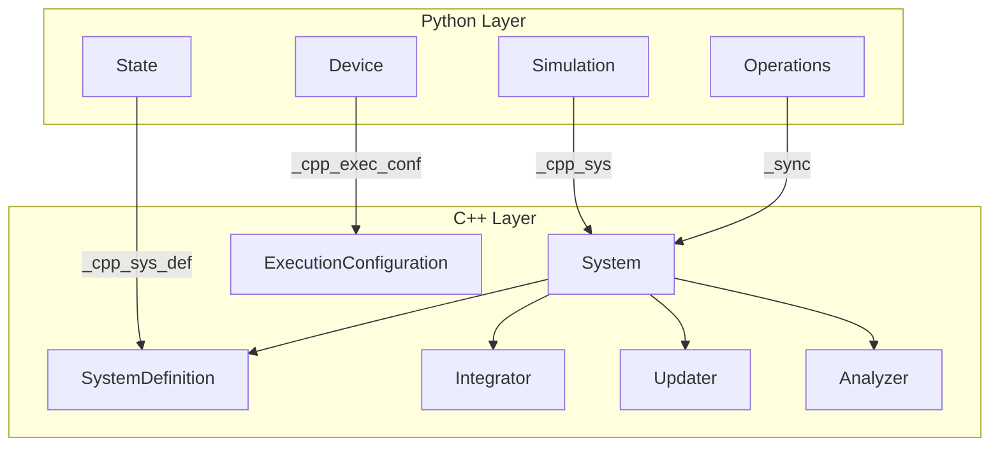

Sources: [hoomd/simulation.py:148-175](hoomd/simulation.py:148-175), [hoomd/operations.py:201-233](hoomd/operations.py:201-233)

### Memory Management

HOOMD-blue employs sophisticated memory management to handle data efficiently between Python and C++, and between CPU and GPU:

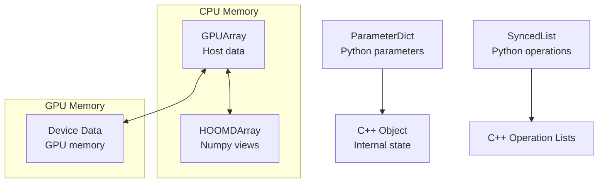

Sources: [hoomd/data/parameterdicts.py:439-669](hoomd/data/parameterdicts.py:439-669), [hoomd/GPUArray.h:73-325](hoomd/GPUArray.h:73-325), [hoomd/ManagedArray.h:29-87](hoomd/ManagedArray.h:29-87)

## Dependency Management and Object Lifecycle

HOOMD-blue implements a comprehensive system for managing dependencies between objects and their lifecycle:

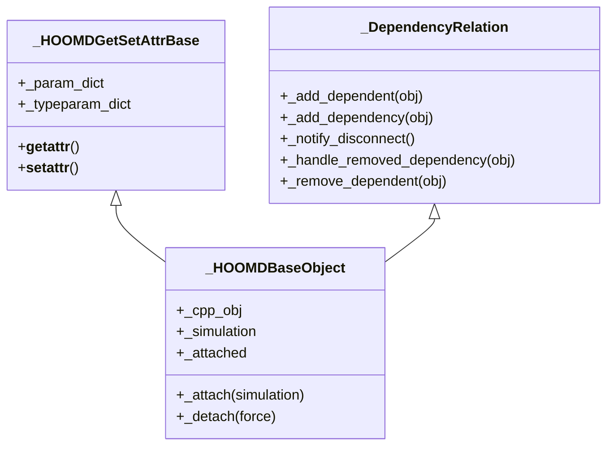

Sources: [hoomd/operation.py:31-183](hoomd/operation.py:31-183), [hoomd/operation.py:210-270](hoomd/operation.py:210-270)

Key features of this system include:

1. Attribute access and parameter storage through `_param_dict` and `_typeparam_dict`
2. Dependency tracking between objects
3. Lifecycle management with `_attach` and `_detach` methods
4. Automatic C++ object creation and destruction

## Data Storage and Parameter Handling

HOOMD-blue uses a sophisticated system for storing and validating parameters:

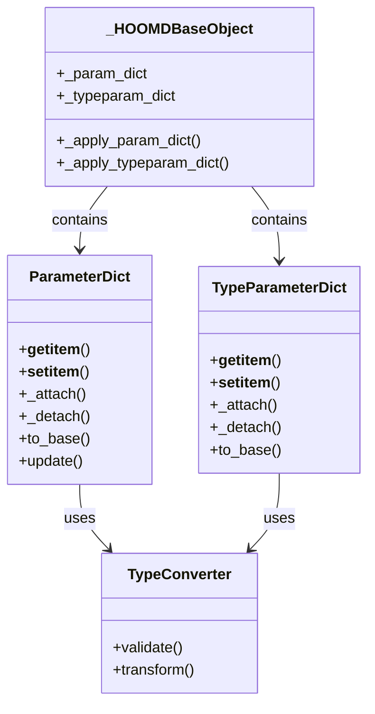

Sources: [hoomd/data/parameterdicts.py:439-669](hoomd/data/parameterdicts.py:439-669), [hoomd/operation.py:334-377](hoomd/operation.py:334-377)

## Summary

The core architecture of HOOMD-blue provides:

1. A flexible execution model supporting CPU, GPU, and MPI parallel execution
2. A comprehensive set of operations that act on the simulation state
3. Efficient state management for particles, bonds, and other elements
4. A well-defined simulation loop that executes operations in a controlled manner
5. Seamless integration between Python and C++ with automatic memory management
6. Sophisticated parameter handling and validation

This architecture allows HOOMD-blue to be both user-friendly through its Python interface while achieving high performance through its optimized C++ core and GPU acceleration capabilities.

---