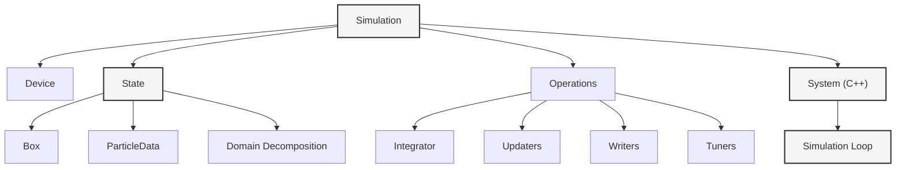
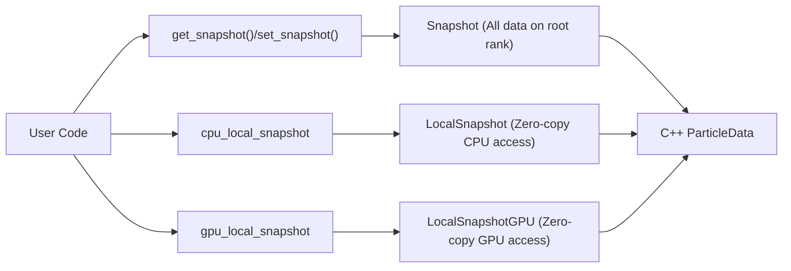
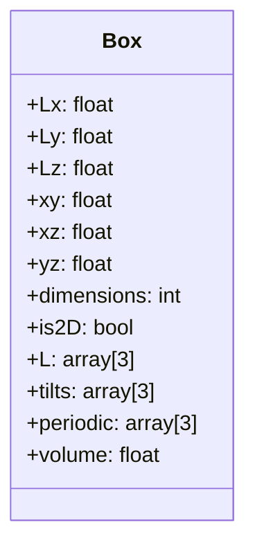
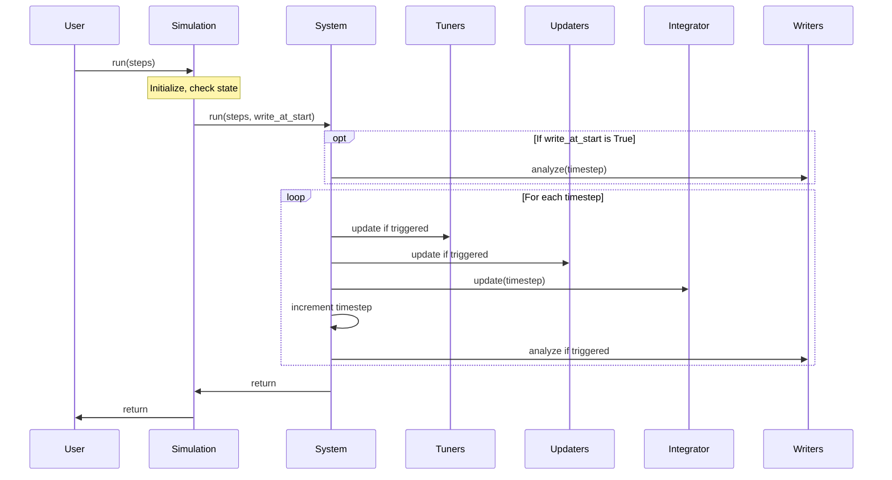
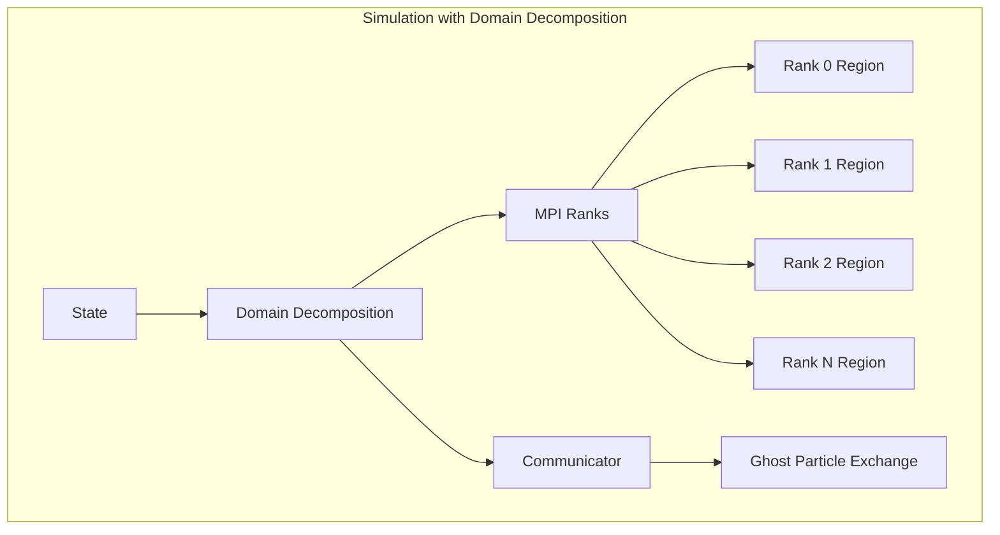
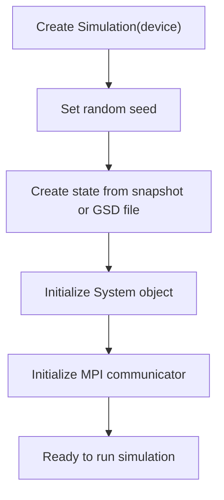

# Simulation Infrastructure

<details>
<summary>Relevant source files</summary>

The following files were used as context for generating this wiki page:

- [hoomd/Analyzer.cc](hoomd/Analyzer.cc)
- [hoomd/Analyzer.h](hoomd/Analyzer.h)
- [hoomd/BoxResizeUpdater.cc](hoomd/BoxResizeUpdater.cc)
- [hoomd/BoxResizeUpdater.h](hoomd/BoxResizeUpdater.h)
- [hoomd/BoxResizeUpdaterGPU.cc](hoomd/BoxResizeUpdaterGPU.cc)
- [hoomd/BoxResizeUpdaterGPU.cu](hoomd/BoxResizeUpdaterGPU.cu)
- [hoomd/BoxResizeUpdaterGPU.cuh](hoomd/BoxResizeUpdaterGPU.cuh)
- [hoomd/BoxResizeUpdaterGPU.h](hoomd/BoxResizeUpdaterGPU.h)
- [hoomd/Compute.cc](hoomd/Compute.cc)
- [hoomd/Compute.h](hoomd/Compute.h)
- [hoomd/System.cc](hoomd/System.cc)
- [hoomd/System.h](hoomd/System.h)
- [hoomd/Updater.cc](hoomd/Updater.cc)
- [hoomd/Updater.h](hoomd/Updater.h)
- [hoomd/box.py](hoomd/box.py)
- [hoomd/conftest.py](hoomd/conftest.py)
- [hoomd/md/pytest/test_constrain_distance.py](hoomd/md/pytest/test_constrain_distance.py)
- [hoomd/md/pytest/test_pppm_coulomb.py](hoomd/md/pytest/test_pppm_coulomb.py)
- [hoomd/md/pytest/test_zero_momentum.py](hoomd/md/pytest/test_zero_momentum.py)
- [hoomd/pytest/test_box.py](hoomd/pytest/test_box.py)
- [hoomd/pytest/test_box_resize.py](hoomd/pytest/test_box_resize.py)
- [hoomd/pytest/test_dcd.py](hoomd/pytest/test_dcd.py)
- [hoomd/pytest/test_simulation.py](hoomd/pytest/test_simulation.py)
- [hoomd/simulation.py](hoomd/simulation.py)
- [hoomd/snapshot.py](hoomd/snapshot.py)
- [hoomd/state.py](hoomd/state.py)
- [hoomd/tune/balance.py](hoomd/tune/balance.py)
- [hoomd/tune/sorter.py](hoomd/tune/sorter.py)
- [hoomd/update/box_resize.py](hoomd/update/box_resize.py)
- [hoomd/update/particle_filter.py](hoomd/update/particle_filter.py)
- [hoomd/update/remove_drift.py](hoomd/update/remove_drift.py)

</details>


The Simulation Infrastructure in HOOMD-blue provides the foundation for particle-based simulations. It defines how simulation states are created, managed, and advanced over time. This page explains the core classes that make up the simulation infrastructure, their relationships, and how the simulation loop progresses through time steps.

For information about the Operations system that works within this infrastructure, see [Operations System](#2.2). For device management details, see [Device Management](#2.3).

## Overview

The simulation infrastructure consists of several key components that work together to enable particle-based simulations:



Sources: [hoomd/simulation.py](), [hoomd/state.py](), [hoomd/System.cc](), [hoomd/System.h]()

## Simulation Class

The `Simulation` class serves as the central coordinator for HOOMD-blue simulations. It manages the simulation state, operations, device selection, and timestep tracking. When you create a simulation in HOOMD-blue, you start by instantiating a `Simulation` object.

```mermaid
classDiagram
    class Simulation {
        +device: Device
        +state: State
        +operations: Operations
        +timestep: int
        +seed: int
        +tps: float
        +walltime: float
        +always_compute_pressure: bool
        +run(steps, write_at_start)
        +create_state_from_snapshot(snapshot, domain_decomposition)
        +create_state_from_gsd(filename, frame, domain_decomposition)
    }
    
    Simulation --> Device: uses
    Simulation --> State: manages
    Simulation --> Operations: coordinates
    Simulation --> "System(C++)" : runs simulation through
```

Sources: [hoomd/simulation.py:34-574]()

### Key Properties and Methods

- **device**: The computational device (CPU or GPU) used for executing the simulation
- **state**: The current simulation state, containing particle data and the simulation box
- **operations**: The collection of operations to apply during simulation: integrator, updaters, writers, and tuners
- **timestep**: The current simulation time step
- **seed**: Random number seed for reproducible simulations
- **run()**: Advances the simulation a specified number of time steps
- **create_state_from_snapshot()**: Initializes the simulation state from a snapshot
- **create_state_from_gsd()**: Initializes the simulation state from a GSD file

Sources: [hoomd/simulation.py:69-146](), [hoomd/simulation.py:193-311](), [hoomd/simulation.py:484-562]()

## State Management

The `State` class stores and provides access to the simulation data - the thermodynamic microstate of the system. It maintains information about particles, bonds, angles, dihedrals, impropers, special pairs, constraints, and the simulation box.

```mermaid
classDiagram
    class State {
        +box: Box
        +particle_types: list[str]
        +bond_types: list[str]
        +angle_types: list[str]
        +dihedral_types: list[str]
        +improper_types: list[str]
        +special_pair_types: list[str]
        +N_particles: int
        +N_bonds: int
        +N_angles: int
        +N_dihedrals: int
        +N_impropers: int
        +N_special_pairs: int
        +N_constraints: int
        +get_snapshot()
        +set_snapshot(snapshot)
        +set_box(box)
        +replicate(nx, ny, nz)
        +update_group_dof()
        +cpu_local_snapshot
        +gpu_local_snapshot
    }
    
    State --> Box: contains
    State --> "CPP SystemDefinition": wraps
    State --> "ParticleData": manages
```

Sources: [hoomd/state.py:80-713]()

### Data Access Patterns

The `State` class provides two complementary APIs for accessing simulation data:

1. **Global Snapshots**: `get_snapshot()` and `set_snapshot()` methods collect the entire state on the root MPI rank
2. **Local Snapshots**: `cpu_local_snapshot` and `gpu_local_snapshot` properties provide direct access to data on the local MPI rank



Sources: [hoomd/state.py:280-315](), [hoomd/state.py:674-742](), [hoomd/snapshot.py:52-192]()

### Box and Domain

The simulation box defines the space that contains the particles. The `Box` class in HOOMD-blue handles both 2D and 3D simulation boxes with support for triclinic (non-orthogonal) boxes.



Sources: [hoomd/box.py:58-627](), [hoomd/state.py:536-592]()

## Simulation Loop

The simulation loop is the core of HOOMD-blue's execution model. When `Simulation.run()` is called, it advances the simulation through a specified number of time steps.



Sources: [hoomd/simulation.py:484-562](), [hoomd/System.cc:80-180]()

The execution order within each time step is:

1. **Tuners**: Performance optimization operations
2. **Updaters**: Operations that modify the simulation state
3. **Integrator**: Advances particle positions and velocities
4. **Writers**: Output data for analysis

This ordering ensures that any analysis or data output captures the final state after all updates and integrations are complete.

Sources: [hoomd/System.cc:131-173]()

## Domain Decomposition for MPI Parallelization

When running on multiple MPI ranks, HOOMD-blue employs domain decomposition to distribute particles across processors. Each rank handles a specific region of the simulation box.



Key aspects of domain decomposition:

- Each MPI rank stores only local particles and "ghost" particles near boundaries
- Communication between ranks exchanges updated particle data
- The simulation domain can be split along x, y, and z directions
- Domain boundaries can be adjusted for load balancing

Sources: [hoomd/state.py:26-77](), [hoomd/simulation.py:161-185]()

## Initialization Process

The initialization of a HOOMD-blue simulation follows a specific sequence:



The simulation state must be created before running a simulation. This can be done either from a snapshot object or by loading a GSD file:

1. `create_state_from_snapshot()`: Creates state from a `Snapshot` object
2. `create_state_from_gsd()`: Creates state from a frame in a GSD file

Sources: [hoomd/simulation.py:193-310](), [hoomd/simulation.py:148-185]()

## Practical Example

Here's how these components work together in a typical simulation workflow:

```python
# Create device and simulation
device = hoomd.device.CPU()  # or GPU()
simulation = hoomd.Simulation(device, seed=42)

# Create initial state
simulation.create_state_from_snapshot(snapshot)  # or from GSD file

# Configure operations
integrator = hoomd.md.Integrator(dt=0.005, methods=[...])
box_resize = hoomd.update.BoxResize(...)
writer = hoomd.write.GSD(...)

# Add operations
simulation.operations.integrator = integrator
simulation.operations.updaters.append(box_resize)
simulation.operations.writers.append(writer)

# Run simulation
simulation.run(1000)
```

This workflow creates a simulation with the specified device, initializes the state, configures the necessary operations, and runs the simulation for 1000 steps.

Sources: [hoomd/simulation.py:34-58](), [hoomd/simulation.py:484-562]()

## Summary

The Simulation Infrastructure in HOOMD-blue provides a powerful and flexible framework for particle-based simulations. The `Simulation` class coordinates the simulation state and operations, the `State` class manages the particle data and simulation box, and the simulation loop advances the system through time in a well-defined sequence of operations. This infrastructure supports a wide range of simulation methods, from molecular dynamics to Monte Carlo, all built on the same core foundation.

---