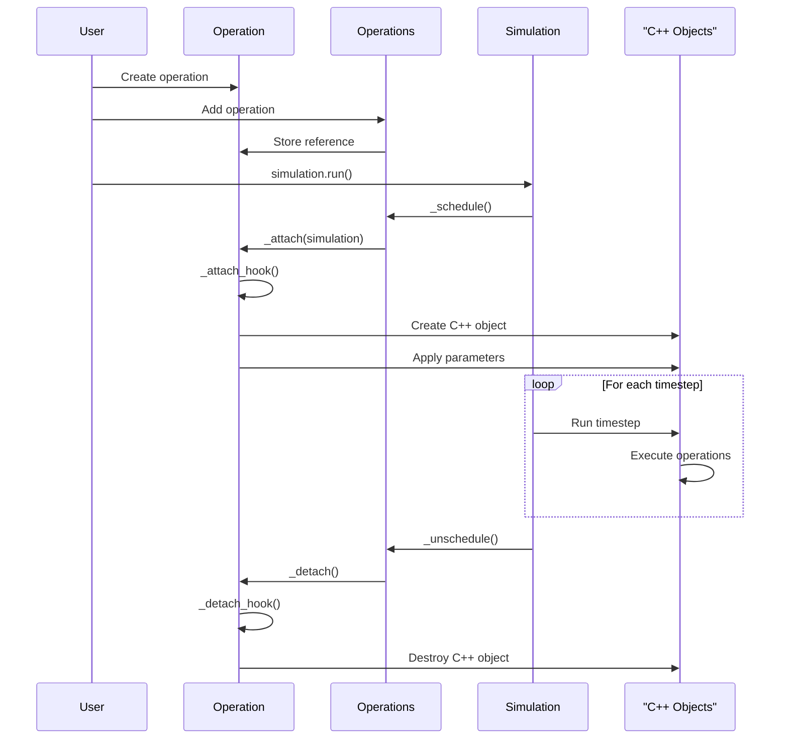

# Operations System

<details>
<summary>Relevant source files</summary>

The following files were used as context for generating this wiki page:

- [CMake/hoomd/hoomd-macros.cmake](CMake/hoomd/hoomd-macros.cmake)
- [hoomd/data/array.py](hoomd/data/array.py)
- [hoomd/data/collections.py](hoomd/data/collections.py)
- [hoomd/data/parameterdicts.py](hoomd/data/parameterdicts.py)
- [hoomd/data/syncedlist.py](hoomd/data/syncedlist.py)
- [hoomd/data/typeconverter.py](hoomd/data/typeconverter.py)
- [hoomd/data/typeparam.py](hoomd/data/typeparam.py)
- [hoomd/error.py](hoomd/error.py)
- [hoomd/operation.py](hoomd/operation.py)
- [hoomd/operations.py](hoomd/operations.py)
- [hoomd/pytest/CMakeLists.txt](hoomd/pytest/CMakeLists.txt)
- [hoomd/pytest/dummy.py](hoomd/pytest/dummy.py)
- [hoomd/pytest/test_collections.py](hoomd/pytest/test_collections.py)
- [hoomd/pytest/test_operation.py](hoomd/pytest/test_operation.py)
- [hoomd/pytest/test_parameter_dict.py](hoomd/pytest/test_parameter_dict.py)
- [hoomd/pytest/test_syncedlist.py](hoomd/pytest/test_syncedlist.py)
- [hoomd/pytest/test_type_parameter_dict.py](hoomd/pytest/test_type_parameter_dict.py)
- [hoomd/pytest/test_typeparam.py](hoomd/pytest/test_typeparam.py)
- [hoomd/util.py](hoomd/util.py)

</details>


The Operations System provides the framework for defining and executing various actions during a HOOMD-blue simulation. Operations are objects that act on the simulation state at specific points during the simulation's run loop. These actions include modifying particle positions, writing output data, calculating physical properties, optimizing performance, and advancing time.

The Operations System is a key part of HOOMD-blue's architecture that connects the Simulation infrastructure (see [Simulation Infrastructure](#2.1)) with the underlying computational devices (see [Device Management](#2.3)).

## Operation Classes Hierarchy

Operations in HOOMD-blue follow a clear inheritance hierarchy, which defines both their capabilities and their role in a simulation.

```mermaid
classDiagram
    class "_HOOMDBaseObject" {
        +_attach(simulation)
        +_detach()
        +_dependencies[]
        +_dependents[]
    }
    
    class "AutotunedObject" {
        +kernel_parameters
        +is_tuning_complete
        +tune_kernel_parameters()
    }
    
    class "Operation" {
        <<abstract>>
    }
    
    class "TriggeredOperation" {
        +trigger: Trigger
    }
    
    class "Integrator" {
        <<advances time>>
    }
    
    class "Updater" {
        <<modifies state>>
    }
    
    class "Writer" {
        <<outputs data>>
    }
    
    class "Compute" {
        <<calculates properties>>
    }
    
    class "Tuner" {
        <<optimizes parameters>>
    }
    
    _HOOMDBaseObject <|-- AutotunedObject
    AutotunedObject <|-- Operation
    Operation <|-- TriggeredOperation
    Operation <|-- Integrator
    TriggeredOperation <|-- Updater
    TriggeredOperation <|-- Writer
    TriggeredOperation <|-- Tuner
    Operation <|-- Compute
```

Sources: [hoomd/operation.py:29-706]()

### Base Classes

The hierarchy starts with fundamental base classes that provide common functionality:

- **`_HOOMDBaseObject`**: The foundation class that handles attaching to and detaching from a simulation. It manages creating C++ objects, applying parameters, and managing dependencies between objects.

- **`AutotunedObject`**: Extends `_HOOMDBaseObject` with functionality for autotuning GPU kernel parameters. This enables operations to optimize their performance on GPU hardware by finding the best execution parameters.

- **`Operation`**: The abstract base class for all operational components in HOOMD-blue. All operations that can be added to a simulation's operation list inherit from this class.

- **`TriggeredOperation`**: Adds trigger functionality to operations. Triggers determine when an operation should execute during a simulation (e.g., every N timesteps or after a specific timestep).

Sources: [hoomd/operation.py:184-227](), [hoomd/operation.py:394-528](), [hoomd/operation.py:530-548](), [hoomd/operation.py:551-596]()

## Operation Types

HOOMD-blue defines five core types of operations, each serving a distinct purpose in the simulation workflow:

| Operation Type | Purpose | Trigger? | Description |
|---------------|---------|----------|-------------|
| `Integrator` | Advance simulation | No | Evolves the simulation state forward in time, typically by numerically integrating equations of motion |
| `Updater` | Modify state | Yes | Changes the simulation state (e.g., particle positions, box size) |
| `Writer` | Output data | Yes | Writes output data (e.g., trajectory files, log files) to disk |
| `Compute` | Calculate properties | No | Computes properties of the simulation state (e.g., energy, pressure) |
| `Tuner` | Optimize performance | Yes | Adjusts parameters for performance optimization without changing the physics |

Sources: [hoomd/operation.py:599-694]()

### Integrator

```python
class Integrator(Operation):
    """Advance the simulation state forward one time step.

    An integrator is the operation which evolves a simulation's state in time.
    In `hoomd.hpmc`, integrators perform particle based Monte Carlo moves. In
    `hoomd.md`, the `hoomd.md.Integrator` class organizes the forces, equations
    of motion, and other factors of the given simulation.
    """
```

The `Integrator` is the core operation that advances the simulation in time. Only one integrator can be active in a simulation at a time. Integrators handle the evolution of the system state, whether through molecular dynamics (MD) or Monte Carlo (MC) methods.

Sources: [hoomd/operation.py:673-695]()

### Updater

```python
class Updater(TriggeredOperation):
    """Change the simulation's state.

    An updater is an operation which modifies a simulation's state.
    """
```

`Updater` operations modify the simulation state, such as changing particle positions, resizing the simulation box, or adding/removing particles. Updaters are triggered operations, meaning they execute based on specific triggers during the simulation.

Sources: [hoomd/operation.py:599-615]()

### Writer

```python
class Writer(TriggeredOperation):
    """Write output that depends on the simulation's state.

    A writer is an operation which writes out a simulation's state.
    """
```

`Writer` operations produce output based on the simulation state. This includes writing trajectory files, log files, or other data for analysis. Like updaters, writers are triggered operations.

Sources: [hoomd/operation.py:618-634]()

### Compute

```python
class Compute(Operation):
    """Compute properties of the simulation's state.

    A compute is an operation which computes some property for another operation
    or use by a user.
    """
```

`Compute` operations calculate properties of the simulation state, such as energy, pressure, or custom metrics. Unlike updaters and writers, computes are not triggered operations but are rather called by other operations or accessed directly by users.

Sources: [hoomd/operation.py:637-650]()

### Tuner

```python
class Tuner(TriggeredOperation):
    """Adjust the parameters of other operations to improve performance.

    A tuner is an operation which tunes the parameters of another operation for
    performance or other reasons. A tuner does not modify the current microstate
    of the simulation. That is a tuner does not change quantities like
    temperature, particle position, or the number of bonds in a simulation.
    """
```

`Tuner` operations optimize parameters of other operations for better performance without changing the physics of the simulation. Tuners are triggered operations, executing at specific points during the simulation.

Sources: [hoomd/operation.py:653-670]()

## Operations Container

The `Operations` class serves as a container for all operations in a simulation. It provides methods for adding, removing, and accessing operations, as well as scheduling them for execution during a simulation run.

```mermaid
classDiagram
    class "Operations" {
        +add(operation)
        +remove(operation)
        +integrator: Integrator
        +updaters: list[Updater]
        +writers: list[Writer]
        +computes: list[Compute]
        +tuners: list[Tuner]
        +is_tuning_complete: bool
        +tune_kernel_parameters()
        -_schedule()
        -_unschedule()
    }
    
    class "SyncedList" {
        +append(item)
        +remove(item)
        +_sync(simulation, cpp_list)
        +_unsync()
    }
    
    class "Operation" {
        <<abstract>>
    }
    
    Operations o-- "0..1" "Integrator"
    Operations o-- "*" "SyncedList~Updater~"
    Operations o-- "*" "SyncedList~Writer~"
    Operations o-- "*" "SyncedList~Compute~"
    Operations o-- "*" "SyncedList~Tuner~"
    SyncedList~Updater~ o-- "*" "Updater"
    SyncedList~Writer~ o-- "*" "Writer"
    SyncedList~Compute~ o-- "*" "Compute"
    SyncedList~Tuner~ o-- "*" "Tuner"
    Operation <|-- "Integrator"
    Operation <|-- "Updater"
    Operation <|-- "Writer"
    Operation <|-- "Compute"
    Operation <|-- "Tuner"
```

Sources: [hoomd/operations.py:32-421]()

### Managing Operations

The `Operations` class provides several methods for managing operations:

- **Adding operations**: Use `add()` or `+=` to add an operation to the appropriate container.
- **Removing operations**: Use `remove()` or `-=` to remove an operation from its container.
- **Accessing operations**: Access operations through the `integrator`, `updaters`, `writers`, `computes`, and `tuners` properties.

Example:
```python
simulation.operations.add(writer)           # Add a writer
simulation.operations += updater            # Add an updater
simulation.operations.remove(writer)        # Remove a writer
simulation.operations -= updater            # Remove an updater
simulation.operations.integrator = integrator  # Set the integrator
```

Sources: [hoomd/operations.py:89-192]()

### Specialized Containers

The `Operations` class maintains separate containers for each type of operation:

- `integrator`: A single `Integrator` instance or `None`. Only one integrator can be active at a time.
- `updaters`: A list of `Updater` instances.
- `writers`: A list of `Writer` instances.
- `computes`: A list of `Compute` instances.
- `tuners`: A list of `Tuner` instances. By default, contains a `ParticleSorter` for optimizing performance.

These containers are implemented using `SyncedList`, which ensures synchronization between Python operations and C++ objects.

Sources: [hoomd/operations.py:277-349](), [hoomd/data/syncedlist.py:32-272]()

## Operation Lifecycle

Operations in HOOMD-blue follow a well-defined lifecycle that includes creation, attachment, execution, and detachment.



Sources: [hoomd/operation.py:234-269](), [hoomd/operation.py:302-330](), [hoomd/operations.py:201-233]()

### Creation and Addition

Operations are created by instantiating specific operation classes (like `hoomd.md.Integrator` or `hoomd.write.GSD`) and setting their parameters. They are then added to the `operations` attribute of a `Simulation` object.

```python
# Create an operation
writer = hoomd.write.GSD(trigger=hoomd.trigger.Periodic(1000), 
                         filename='trajectory.gsd', 
                         filter=hoomd.filter.All())

# Add it to the simulation
simulation.operations.add(writer)
```

Sources: [hoomd/operations.py:89-127]()

### Attachment and Detachment

When a simulation runs, operations are attached to the simulation, which creates the corresponding C++ objects. After the simulation finishes or is paused, operations can be detached, destroying the C++ objects.

The attachment process involves:
1. Setting the operation's `_simulation` reference
2. Creating the C++ object via `_attach_hook()`
3. Applying parameters to the C++ object
4. Executing a post-attach hook

The detachment process involves:
1. Decrementing the operation's use count
2. If use count is zero, executing the detach logic
3. Destroying the C++ object
4. Removing the simulation reference

Sources: [hoomd/operation.py:234-269](), [hoomd/operation.py:302-330](), [hoomd/operations.py:201-233]()

## Execution During Simulation

During a simulation, operations are executed according to their type and trigger (if applicable). The sequence of execution in a timestep is:

```mermaid
flowchart TD
    start["Begin Timestep"] --> tuners["Run Tuners"]
    tuners --> updaters["Run Updaters"]
    updaters --> integrator["Run Integrator"]
    integrator --> computes["Update Computes"]
    computes --> writers["Run Writers"]
    writers --> end["End Timestep"]
```

For triggered operations (Updaters, Writers, and Tuners), execution only occurs when their trigger condition is met. For example, a writer with `trigger=hoomd.trigger.Periodic(1000)` will only execute every 1000 timesteps.

Sources: [hoomd/operations.py:201-233]()

## Parameter Management and Autotuning

Operations in HOOMD-blue use two key mechanisms for parameter management:

1. **Parameter Dictionaries**: Operations store their parameters in `ParameterDict` objects, which handle validation, synchronization between Python and C++, and type conversion.

2. **Type Parameter Dictionaries**: Type-specific parameters (e.g., per-particle-type parameters) are stored in `TypeParameterDict` objects, which manage parameters for different types of particles or interactions.

Additionally, operations that derive from `AutotunedObject` include autotuning capabilities for GPU kernel parameters:

```python
# Check if autotuning is complete
if simulation.operations.is_tuning_complete:
    print("Autotuning completed")

# Manually restart autotuning (e.g., after significant system changes)
simulation.operations.tune_kernel_parameters()
```

During autotuning, operations explore different kernel parameters to find the optimal values for performance on the current hardware. After tuning is complete, operations use the optimal parameters for maximum performance.

Sources: [hoomd/operation.py:394-528](), [hoomd/operations.py:352-399](), [hoomd/data/parameterdicts.py:579-725](), [hoomd/data/typeparam.py:20-315]()

## Example Usage

Here's a complete example showing how operations are used in a typical HOOMD-blue simulation:

```python
import hoomd

# Create a simulation
device = hoomd.device.CPU()
simulation = hoomd.Simulation(device)

# Create a simulation state from a snapshot
snapshot = hoomd.Snapshot()
# ... set up snapshot ...
simulation.create_state_from_snapshot(snapshot)

# Create an integrator
integrator = hoomd.md.Integrator(dt=0.005)
# ... add forces and methods to integrator ...
simulation.operations.integrator = integrator

# Add an updater to resize the box
box_resize = hoomd.update.BoxResize(
    trigger=hoomd.trigger.Periodic(100),
    box=hoomd.variant.box.Interpolate(
        hoomd.Box.cube(10),
        hoomd.Box.cube(20),
        hoomd.variant.Ramp(0, 1, 0, 10000)
    )
)
simulation.operations.add(box_resize)

# Add a writer to output trajectories
gsd_writer = hoomd.write.GSD(
    trigger=hoomd.trigger.Periodic(1000),
    filename='trajectory.gsd',
    filter=hoomd.filter.All()
)
simulation.operations.add(gsd_writer)

# Run the simulation
simulation.run(10000)
```

In this example:
1. An `Integrator` advances the simulation in time
2. A `BoxResize` updater modifies the simulation box every 100 steps
3. A `GSD` writer outputs the trajectory every 1000 steps

Sources: [hoomd/operations.py:32-421](), [hoomd/operation.py:530-694]()

## Internal Implementation Details

The Operations System relies on several key mechanisms for its functionality:

### Synced Lists

Operations are stored in `SyncedList` objects, which synchronize between Python operations and their C++ counterparts. This ensures that changes to the Python objects are reflected in the C++ objects and vice versa.

Sources: [hoomd/data/syncedlist.py:32-272]()

### Parameter Dictionaries

Operations use `ParameterDict` objects to store and validate parameters. These dictionaries handle type conversion, validation, and synchronization between Python and C++.

Sources: [hoomd/data/parameterdicts.py:579-725]()

### Type Parameter Dictionaries

For type-specific parameters (e.g., per-particle-type parameters), operations use `TypeParameterDict` objects, which are wrapped in `TypeParameter` objects for a more user-friendly interface.

Sources: [hoomd/data/parameterdicts.py:387-577](), [hoomd/data/typeparam.py:20-315]()

### C++ Integration

Operations create and manage C++ objects that perform the actual computation. The Python operations act as interfaces to these C++ objects, handling parameter validation, conversion, and synchronization.

Sources: [hoomd/operation.py:234-330]()

## Summary

The Operations System is a core component of HOOMD-blue that provides a flexible framework for defining and executing various actions during a simulation. Through its different operation types (Integrators, Updaters, Writers, Computes, and Tuners), users can control how a simulation evolves, what outputs it produces, and how its performance is optimized.

The system's key strengths include:
- Clear separation of concerns through different operation types
- Flexible scheduling through triggers
- Automatic parameter validation and synchronization
- GPU kernel autotuning for optimal performance

Understanding the Operations System is essential for effectively using HOOMD-blue to create, control, and analyze simulations.

---