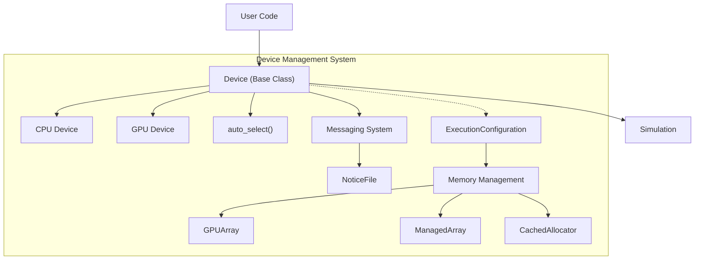
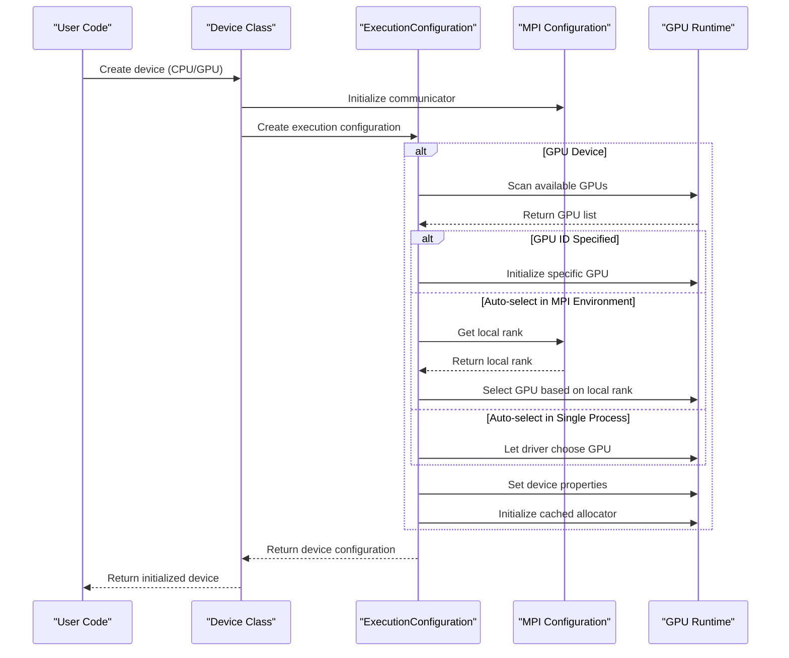
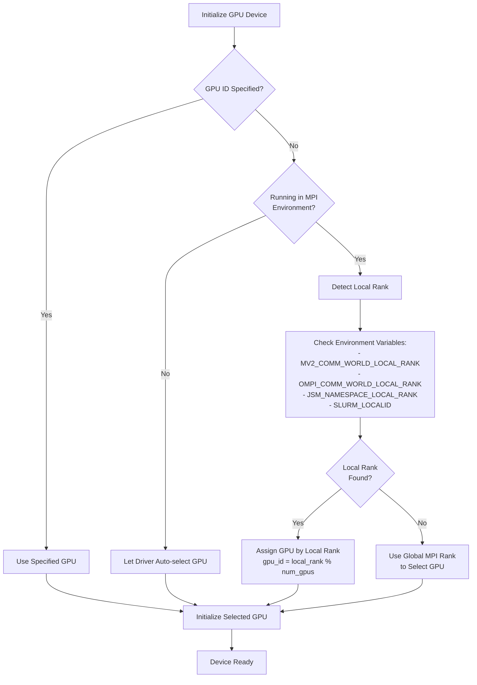
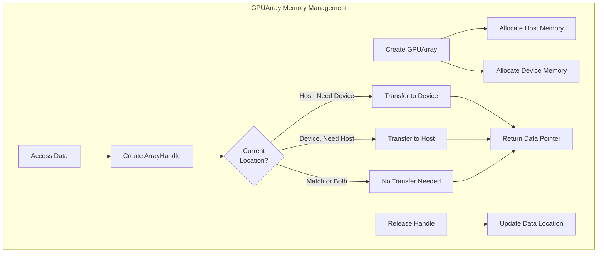
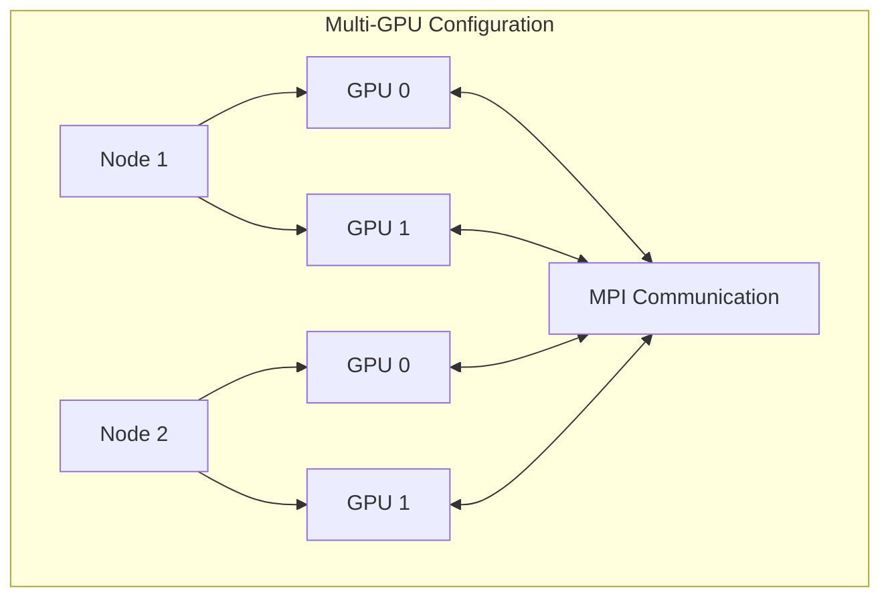

# Device Management

<details>
<summary>Relevant source files</summary>

The following files were used as context for generating this wiki page:

- [hoomd/CachedAllocator.h](hoomd/CachedAllocator.h)
- [hoomd/ExecutionConfiguration.cc](hoomd/ExecutionConfiguration.cc)
- [hoomd/ExecutionConfiguration.h](hoomd/ExecutionConfiguration.h)
- [hoomd/GPUArray.h](hoomd/GPUArray.h)
- [hoomd/GPUFlags.h](hoomd/GPUFlags.h)
- [hoomd/GPUVector.h](hoomd/GPUVector.h)
- [hoomd/ManagedArray.h](hoomd/ManagedArray.h)
- [hoomd/device.py](hoomd/device.py)
- [hoomd/managed_allocator.h](hoomd/managed_allocator.h)
- [hoomd/module.cc](hoomd/module.cc)
- [hoomd/pytest/test_device.py](hoomd/pytest/test_device.py)

</details>


Device management in HOOMD-blue provides a framework for selecting and configuring the hardware devices (CPU or GPU) that execute simulations. This page documents how HOOMD-blue handles device selection, memory management, and parallelization across multiple devices. For information about how operations and simulations are structured, see [Core Architecture](#2) and [Simulation Infrastructure](#2.1).

## Overview of Device Management

HOOMD-blue's device management system allows users to explicitly choose which hardware to run simulations on, configure device properties, and control how messages are logged during simulation. The system abstracts hardware differences, providing a consistent interface whether running on CPUs or GPUs.



Sources: [hoomd/device.py:98-142](), [hoomd/ExecutionConfiguration.h:49-68]()

## Device Classes

HOOMD-blue implements device management through a hierarchy of device classes. At the Python level, users interact with the `Device` base class and its concrete implementations (`CPU` and `GPU`), while the C++ level handles the execution configuration details.

### Device Base Class

The `Device` class is the abstract base class that defines the common interface for all device types. It provides methods for accessing the MPI communicator, controlling message verbosity, and handling status messages.

Key properties of the `Device` class:
- `communicator`: The MPI communicator used for parallel execution
- `notice_level`: Controls the verbosity of messages (higher = more verbose)
- `message_filename`: File to redirect status messages to (None = stdout/stderr)
- `device`: Description of the active hardware device

Key methods:
- `notice()`: Prints status messages with a specified verbosity level

Sources: [hoomd/device.py:98-142](), [hoomd/device.py:240-262]()

### CPU Device

The `CPU` device class configures HOOMD-blue to run simulations on CPUs. It's a simple concrete implementation of the `Device` class without additional specific properties.

```python
# Creating a CPU device
device = hoomd.device.CPU()
```

Sources: [hoomd/device.py:452-494]()

### GPU Device

The `GPU` device class configures HOOMD-blue to run simulations on GPUs. It extends the `Device` class with GPU-specific properties and methods.

Additional properties of the `GPU` class:
- `gpu_error_checking`: Controls whether to check for GPU errors after each call
- `compute_capability`: Tuple containing the CUDA compute capability (major, minor)

Additional methods:
- `enable_profiling()`: Context manager to enable GPU profiling
- `get_available_devices()`: Static method that returns a list of available GPU devices
- `get_unavailable_device_reasons()`: Static method that returns reasons why some devices are unavailable

```python
# Creating a GPU device
device = hoomd.device.GPU()

# Selecting a specific GPU
device = hoomd.device.GPU(gpu_id=0)

# Enabling GPU profiling
with device.enable_profiling():
    # Run simulation with profiling enabled
    simulation.run(1000)
```

Sources: [hoomd/device.py:284-449]()

## Device Initialization Process

When a device is initialized, HOOMD-blue performs several steps to configure the hardware resources:



Sources: [hoomd/device.py:141-154](), [hoomd/ExecutionConfiguration.cc:52-176]()

### Auto Device Selection

HOOMD-blue provides an `auto_select()` function that automatically chooses between CPU and GPU execution based on hardware availability. It returns a `GPU` device if GPUs are available, otherwise a `CPU` device.

```python
# Let HOOMD-blue choose the best available device
device = hoomd.device.auto_select()
```

Sources: [hoomd/device.py:496-526]()

## GPU Device Selection and Management

### GPU Capability Detection

The `ExecutionConfiguration` class scans the system for available GPUs and determines their capabilities. This includes:
1. Checking the compute capability of each GPU
2. Verifying that GPUs support required features (managed memory)
3. Excluding GPUs in compute-prohibited mode

Sources: [hoomd/ExecutionConfiguration.cc:295-411]()

### GPU Selection in MPI Environments

In MPI environments with multiple ranks, HOOMD-blue attempts to intelligently assign GPUs to ranks:



Sources: [hoomd/ExecutionConfiguration.cc:104-125](), [hoomd/ExecutionConfiguration.cc:438-469]()

## Memory Management

HOOMD-blue employs several memory management classes to efficiently handle data transfer between the host (CPU) and device (GPU). This is crucial for optimal performance in particle-based simulations.

### GPUArray

The `GPUArray` class is the primary container for data that may need to be accessed on both the CPU and GPU. It maintains mirrored copies of the data on both the host and device, automatically handling data transfers as needed.

Key features:
- Manages data location tracking (host, device, or both)
- Provides controlled access through ArrayHandle objects
- Supports different access modes (read, readwrite, overwrite)
- Handles 1D and 2D data structures
- Automatically handles memory transfers between host and device



Sources: [hoomd/GPUArray.h:74-522]()

### ManagedArray

The `ManagedArray` class provides an alternative to `GPUArray` using CUDA managed memory for simpler, unified memory management. It's particularly useful for small, frequently accessed data structures.

Key features:
- Uses CUDA managed memory when available
- Automatically handles memory transfer between host and device
- Provides direct access to memory from both host and device code

Sources: [hoomd/ManagedArray.h:29-320]()

### CachedAllocator

The `CachedAllocator` class optimizes temporary memory allocations, which are common in simulation algorithms. It caches previously allocated memory blocks to reduce the overhead of frequent allocations and deallocations.

Key features:
- Caches memory blocks for reuse
- Provides temporary memory allocations of various sizes
- Handles memory allocation for both regular and managed memory

Sources: [hoomd/CachedAllocator.h:40-245]()

## Messaging System

HOOMD-blue includes a messaging system for logging information during simulations. This system allows controlling the verbosity of messages and redirecting output to files.

### Notice Levels

The `notice_level` property controls the verbosity of messages:
- Level 1: Minimal output
- Level 2 (default): Standard output that most users need
- Level 3-10: Increasingly verbose debugging information

### Message Redirection

Messages can be redirected to files using the `message_filename` property:
- When set to `None`, messages are sent to stdout/stderr
- When set to a filename, messages are written to that file
- In MPI environments, rank 0 typically handles message output

### NoticeFile

The `NoticeFile` class provides a file-like object for writing to the device's messaging system, allowing code that expects file objects to send output to HOOMD-blue's notice stream.

Sources: [hoomd/device.py:44-95](), [hoomd/device.py:165-208]()

## Multi-Device Support

HOOMD-blue supports running simulations across multiple devices using MPI for inter-process communication.



### MPI Integration

For multi-device execution, HOOMD-blue uses MPI to coordinate between processes:
- Each MPI rank creates its own `Device` instance
- GPU devices are assigned to ranks based on local rank detection
- Communication between devices happens through MPI

### GPU Flags

The `GPUFlags` class provides an efficient mechanism for flags that are set on the GPU and read on the host, optimized for multi-device coordination.

Key features:
- Uses host-mapped memory when available for optimal performance
- Handles synchronization between host and device
- Provides efficient flag setting and checking between devices

Sources: [hoomd/GPUFlags.h:46-393](), [hoomd/ExecutionConfiguration.cc:438-469]()

## Best Practices

### Device Creation and Reuse
- Reuse `Device` objects when possible to avoid overhead of repeated device initialization
- Create a single `Device` object and pass it to multiple `Simulation` objects when needed

### Device Selection
- Use `auto_select()` for automatic hardware detection
- Specify a GPU ID only when necessary to override automatic selection
- In MPI environments, let HOOMD-blue handle GPU distribution based on local ranks

### Performance Optimization
- Enable GPU profiling only when needed for performance analysis
- GPU error checking should be disabled in production runs for maximum performance
- Set an appropriate notice level to balance information and performance

Sources: [hoomd/device.py:23-36]()

---