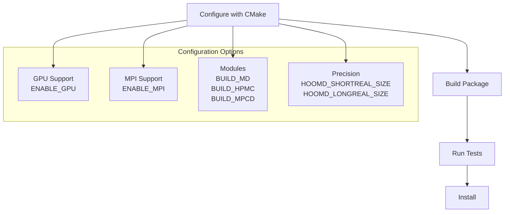
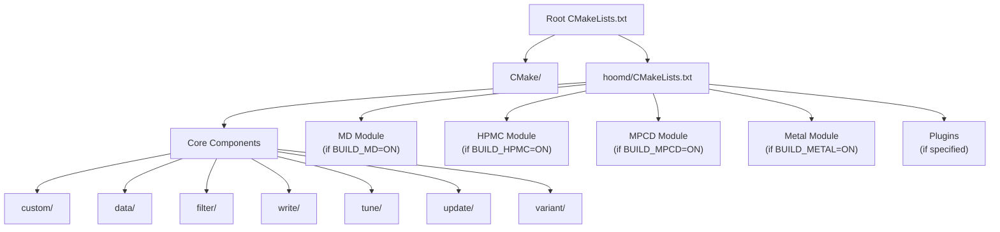
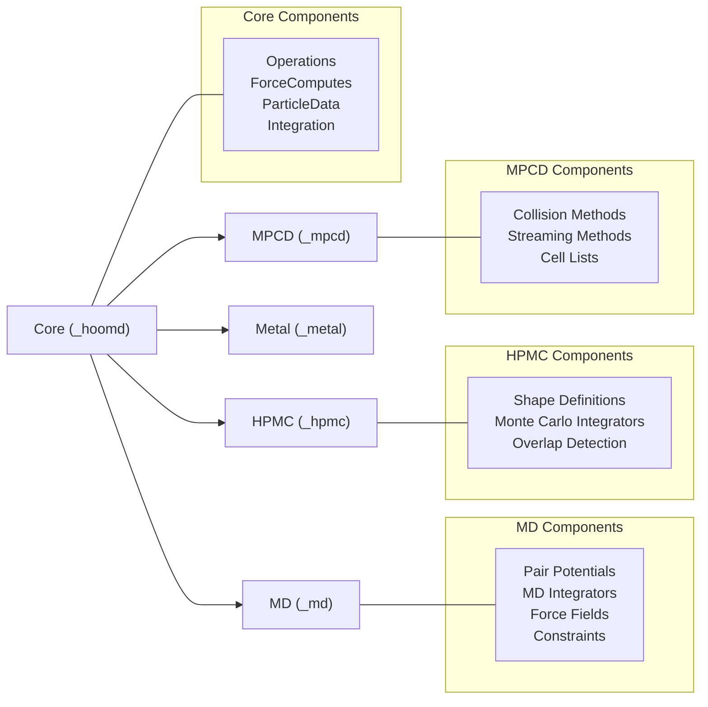
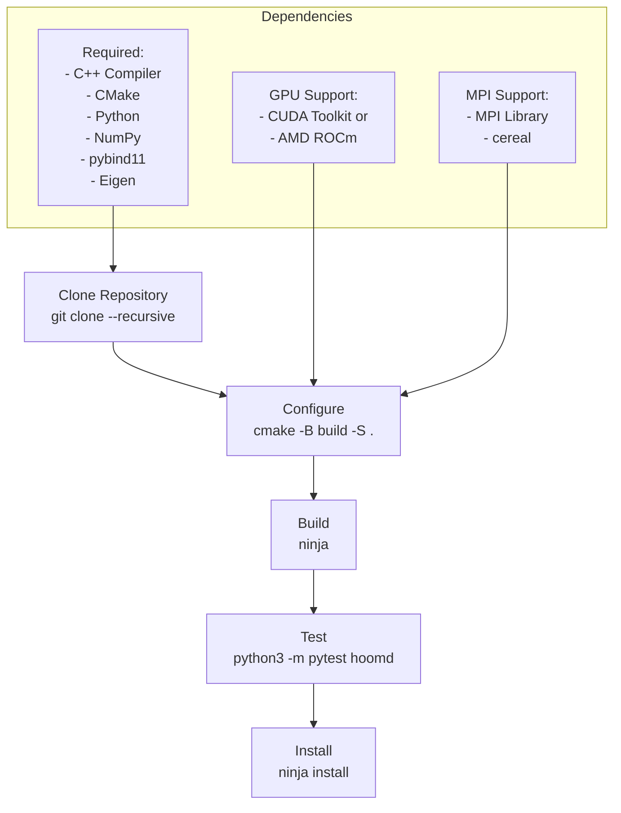
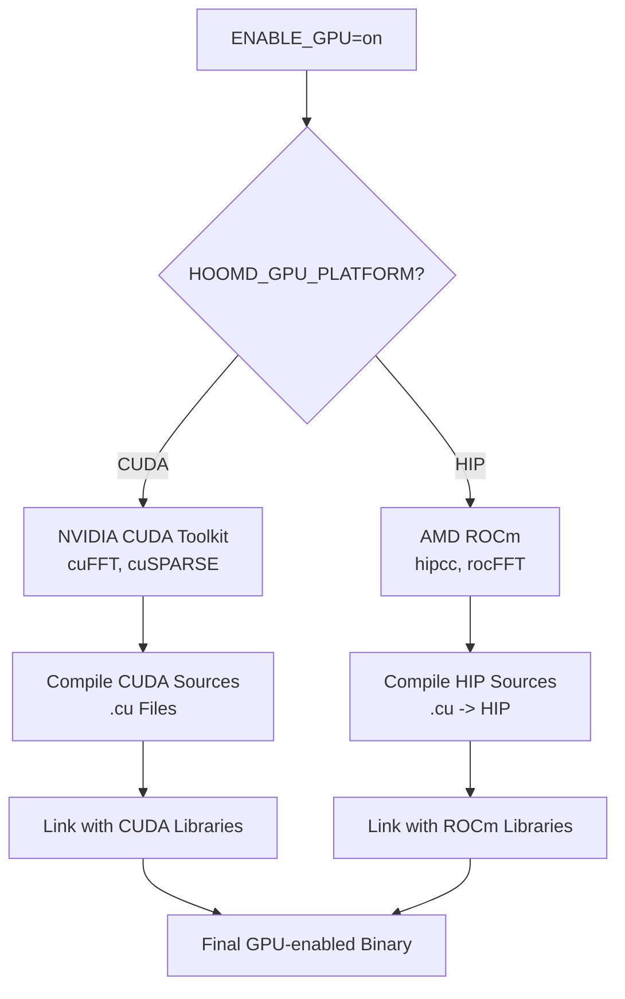
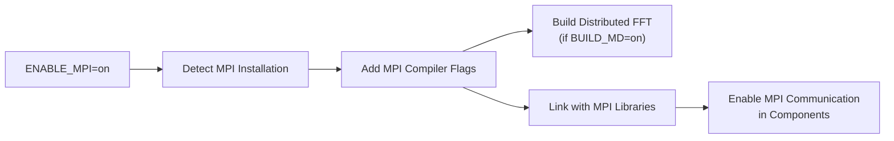
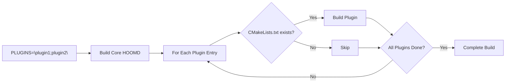
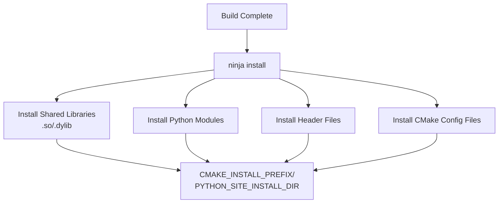

# Build System

<details>
<summary>Relevant source files</summary>

The following files were used as context for generating this wiki page:

- [.bumpversion.cfg](.bumpversion.cfg)
- [.github/ISSUE_TEMPLATE/bug_report.yml](.github/ISSUE_TEMPLATE/bug_report.yml)
- [.github/ISSUE_TEMPLATE/release.md](.github/ISSUE_TEMPLATE/release.md)
- [BUILDING.rst](BUILDING.rst)
- [CMakeLists.txt](CMakeLists.txt)
- [INSTALLING.rst](INSTALLING.rst)
- [hoomd/CMakeLists.txt](hoomd/CMakeLists.txt)
- [hoomd/hpmc/CMakeLists.txt](hoomd/hpmc/CMakeLists.txt)
- [hoomd/hpmc/module.cc](hoomd/hpmc/module.cc)
- [hoomd/hpmc/modules.h](hoomd/hpmc/modules.h)
- [hoomd/md/CMakeLists.txt](hoomd/md/CMakeLists.txt)
- [hoomd/mpcd/CMakeLists.txt](hoomd/mpcd/CMakeLists.txt)
- [hoomd/mpcd/module.cc](hoomd/mpcd/module.cc)
- [sphinx-doc/conf.py](sphinx-doc/conf.py)

</details>


This page documents the build system of HOOMD-blue, including how it is organized, its module structure, and how to compile it from source. The build system uses CMake to configure builds with various options, generate platform-specific build files, and manage dependencies.

## Overview

HOOMD-blue employs a CMake-based build system to provide a cross-platform build process. The system allows for configuring various simulation components and hardware acceleration options.



Sources: [CMakeLists.txt:97-123](), [BUILDING.rst:77-150]()

## Project Structure

The build system is organized hierarchically, with the main CMakeLists.txt file in the root directory and subdirectory CMakeLists.txt files for each component.



Sources: [CMakeLists.txt:184](), [hoomd/CMakeLists.txt:341-348](), [hoomd/CMakeLists.txt:358-373]()

## Core Build Configuration

The main CMakeLists.txt file establishes the fundamental configuration for the build process. It sets up project metadata, compiler options, and makes primary build decisions.

Key features include:

- Project version management (both release version and Git-based versioning)
- Compiler flags and C++ standard settings (C++17)
- Build type selection (Debug, Release, RelWithDebInfo)
- Option definitions for components and features

Sources: [CMakeLists.txt:1-67](), [CMakeLists.txt:97-123](), [CMakeLists.txt:227-229]()

### Version Configuration

The build system automatically configures version information based on:

1. Hard-coded version from CMakeLists.txt
2. Git information using GetGitRevisionDescription module

This ensures each build is properly tagged with version information, supporting both development and release builds.

Sources: [CMakeLists.txt:17-48]()

## Build Options

HOOMD-blue supports multiple configuration options to customize the build:

| Option | Default | Description |
|--------|---------|-------------|
| `CMAKE_BUILD_TYPE` | `Release` | Build type: Debug, Release, RelWithDebInfo |
| `ENABLE_GPU` | `OFF` | Enable GPU acceleration |
| `HOOMD_GPU_PLATFORM` | `CUDA` | Choose GPU backend: CUDA or HIP |
| `ENABLE_MPI` | `OFF` | Enable multi-processor/GPU simulations using MPI |
| `BUILD_MD` | `ON` | Build Molecular Dynamics module |
| `BUILD_HPMC` | `ON` | Build Hard Particle Monte Carlo module |
| `BUILD_MPCD` | `ON` | Build Multi-Particle Collision Dynamics module |
| `BUILD_METAL` | `ON` | Build Metal module |
| `HOOMD_SHORTREAL_SIZE` | `32` | Size of ShortReal type in bits (32 or 64) |
| `HOOMD_LONGREAL_SIZE` | `64` | Size of LongReal type in bits (32 or 64) |
| `BUILD_TESTING` | `ON` | Build unit tests |

Sources: [CMakeLists.txt:97-123](), [BUILDING.rst:77-150](), [BUILDING.rst:219-252]()

## Module System

HOOMD-blue is organized into modules, each with its own CMakeLists.txt file.



Sources: [hoomd/CMakeLists.txt:217-222](), [hoomd/md/CMakeLists.txt:627-646](), [hoomd/hpmc/CMakeLists.txt:152-168](), [hoomd/mpcd/CMakeLists.txt:247-258]()

### Core Module

The core module is built as `_hoomd` and contains the fundamental structures needed for all simulations:

- Simulation infrastructure
- Particle data management
- System state tracking
- Operations framework
- Device management

It's implemented in [hoomd/CMakeLists.txt:217-222]() and creates a shared library that all other modules depend on.

### MD Module

The Molecular Dynamics module is built as `_md` and implements:

- Force computation
- MD integrators
- Pair potentials
- Bond/angle forces
- Neighbor lists

Sources: [hoomd/md/CMakeLists.txt:3-653](), [hoomd/md/CMakeLists.txt:627-646]()

### HPMC Module

The Hard Particle Monte Carlo module is built as `_hpmc` and implements:

- Shape definitions
- Overlap detection
- Monte Carlo moves
- Shape unions

Sources: [hoomd/hpmc/CMakeLists.txt:3-207](), [hoomd/hpmc/CMakeLists.txt:152-168](), [hoomd/hpmc/module.cc:4-166]()

### MPCD Module

The Multi-Particle Collision Dynamics module is built as `_mpcd` and implements:

- Collision methods
- Streaming methods
- Cell lists
- Geometry definitions
- Virtual particle fillers

Sources: [hoomd/mpcd/CMakeLists.txt:2-283](), [hoomd/mpcd/CMakeLists.txt:247-258](), [hoomd/mpcd/module.cc:1-336]()

## Build Process

The build process follows these steps:



Sources: [BUILDING.rst:7-68](), [BUILDING.rst:182-269]()

### Building from Source

To build HOOMD-blue from source:

1. Install prerequisites:
   ```bash
   micromamba install cmake eigen git python numpy pybind11
   ```

2. Clone the repository with submodules:
   ```bash
   git clone --recursive git@github.com:glotzerlab/hoomd-blue.git
   ```

3. Configure the build:
   ```bash
   cmake -B build -S . -GNinja
   ```

4. Build the package:
   ```bash
   cd build
   ninja
   ```

5. Run tests:
   ```bash
   python3 -m pytest hoomd
   ```

6. Install:
   ```bash
   ninja install
   ```

Sources: [BUILDING.rst:7-68](), [BUILDING.rst:72-108](), [BUILDING.rst:151-178](), [BUILDING.rst:273-323]()

## GPU Acceleration Configuration

GPU support is a critical feature of HOOMD-blue. The build system manages this in a platform-independent way:



The build system handles:
- Detection of GPU toolkit
- Setting up appropriate compiler flags
- Linking with GPU libraries
- Conditional compilation of GPU code

Sources: [CMakeLists.txt:101-103](), [hoomd/CMakeLists.txt:180-187](), [hoomd/CMakeLists.txt:267-285]()

## Parallel Computing with MPI

MPI support is configured through the `ENABLE_MPI` option:



When MPI is enabled, the build system:
- Links against MPI libraries
- Adds MPI-specific compilation flags
- Enables MPI-specific code paths in HOOMD-blue components

Sources: [CMakeLists.txt:133](), [hoomd/CMakeLists.txt:289-292](), [hoomd/CMakeLists.txt:358-362]()

## Plugin System

HOOMD-blue allows for building external plugins as part of the build process:



Plugins are specified through the `PLUGINS` variable as a semicolon-separated list of directories.

Sources: [CMakeLists.txt:122](), [hoomd/CMakeLists.txt:375-380]()

## Installation Process

Once built, HOOMD-blue can be installed with the generated build system:



Key installation targets include:
- Shared libraries for each module
- Python modules
- Header files for C++ development
- CMake configuration files for downstream projects

Sources: [hoomd/CMakeLists.txt:300-304](), [hoomd/CMakeLists.txt:328-331](), [hoomd/CMakeLists.txt:336-338](), [CMakeLists.txt:202-220]()

## Conclusion

HOOMD-blue's build system provides a flexible, modular approach to building a high-performance simulation framework. It accommodates different hardware configurations, simulation methods, and deployment scenarios through a comprehensive set of build options.

The CMake-based build process ensures cross-platform compatibility while managing the complexities of GPU acceleration, parallel computing, and Python integration.

---