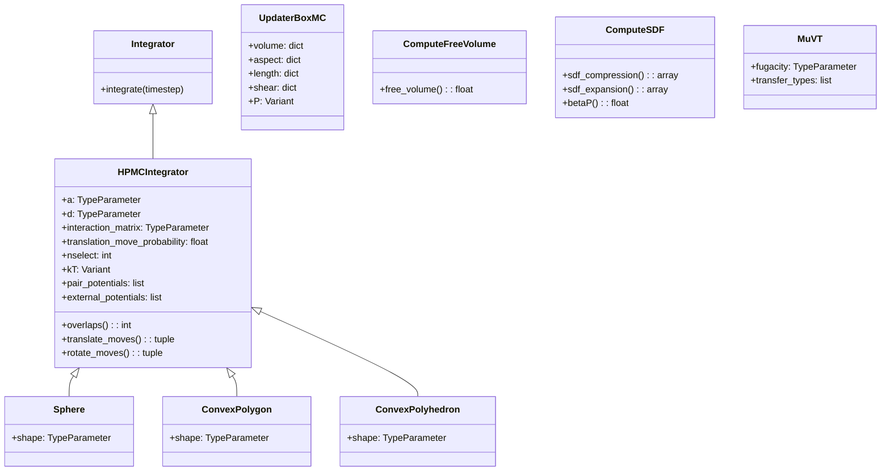
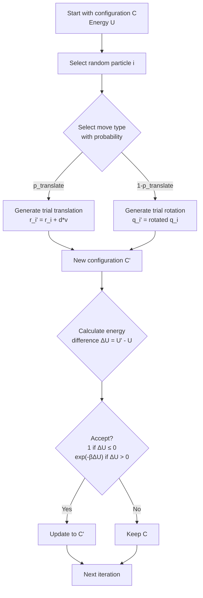
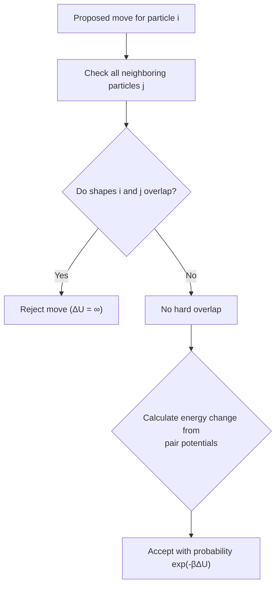
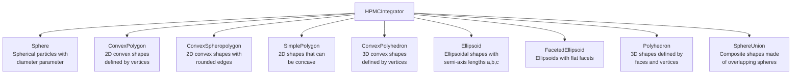
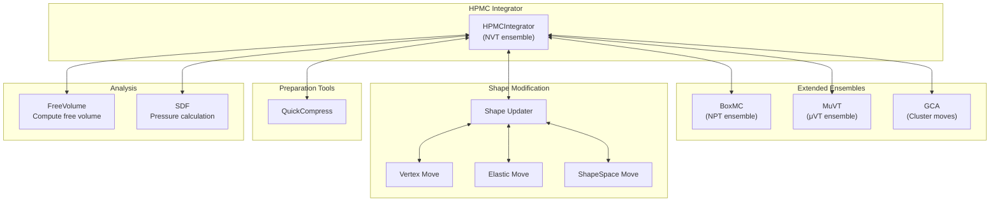
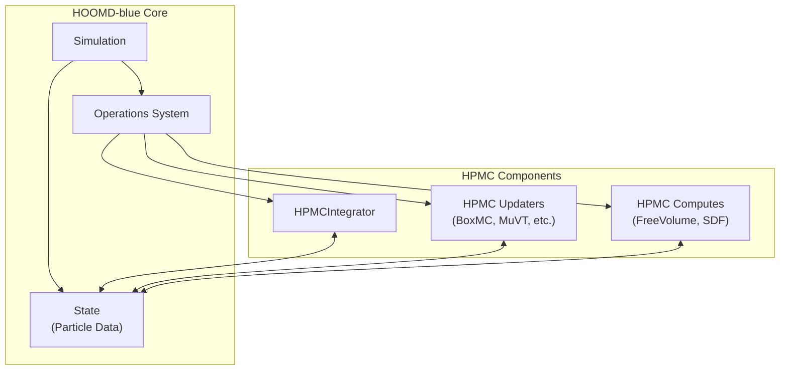

# Hard Particle Monte Carlo (HPMC)

<details>
<summary>Relevant source files</summary>

The following files were used as context for generating this wiki page:

- [hoomd/BoxDim.h](hoomd/BoxDim.h)
- [hoomd/hpmc/ComputeSDF.h](hoomd/hpmc/ComputeSDF.h)
- [hoomd/hpmc/IntegratorHPMC.cc](hoomd/hpmc/IntegratorHPMC.cc)
- [hoomd/hpmc/IntegratorHPMC.h](hoomd/hpmc/IntegratorHPMC.h)
- [hoomd/hpmc/IntegratorHPMCMono.h](hoomd/hpmc/IntegratorHPMCMono.h)
- [hoomd/hpmc/ShapeMoves.h](hoomd/hpmc/ShapeMoves.h)
- [hoomd/hpmc/ShapeUtils.cc](hoomd/hpmc/ShapeUtils.cc)
- [hoomd/hpmc/ShapeUtils.h](hoomd/hpmc/ShapeUtils.h)
- [hoomd/hpmc/UpdaterBoxMC.cc](hoomd/hpmc/UpdaterBoxMC.cc)
- [hoomd/hpmc/UpdaterBoxMC.h](hoomd/hpmc/UpdaterBoxMC.h)
- [hoomd/hpmc/UpdaterMuVT.h](hoomd/hpmc/UpdaterMuVT.h)
- [hoomd/hpmc/UpdaterQuickCompress.cc](hoomd/hpmc/UpdaterQuickCompress.cc)
- [hoomd/hpmc/UpdaterQuickCompress.h](hoomd/hpmc/UpdaterQuickCompress.h)
- [hoomd/hpmc/UpdaterShape.h](hoomd/hpmc/UpdaterShape.h)
- [hoomd/hpmc/compute.py](hoomd/hpmc/compute.py)
- [hoomd/hpmc/integrate.py](hoomd/hpmc/integrate.py)
- [hoomd/hpmc/pytest/conftest.py](hoomd/hpmc/pytest/conftest.py)
- [hoomd/hpmc/pytest/test_boxmc.py](hoomd/hpmc/pytest/test_boxmc.py)
- [hoomd/hpmc/pytest/test_compute_free_volume.py](hoomd/hpmc/pytest/test_compute_free_volume.py)
- [hoomd/hpmc/pytest/test_compute_sdf.py](hoomd/hpmc/pytest/test_compute_sdf.py)
- [hoomd/hpmc/pytest/test_muvt.py](hoomd/hpmc/pytest/test_muvt.py)
- [hoomd/hpmc/pytest/test_quick_compress.py](hoomd/hpmc/pytest/test_quick_compress.py)
- [hoomd/hpmc/pytest/test_shape.py](hoomd/hpmc/pytest/test_shape.py)
- [hoomd/hpmc/pytest/test_shape_updater.py](hoomd/hpmc/pytest/test_shape_updater.py)
- [hoomd/hpmc/pytest/test_shape_utils.py](hoomd/hpmc/pytest/test_shape_utils.py)
- [hoomd/hpmc/shape_move.py](hoomd/hpmc/shape_move.py)
- [hoomd/hpmc/update.py](hoomd/hpmc/update.py)

</details>


The Hard Particle Monte Carlo (HPMC) module in HOOMD-blue implements a general-purpose simulation engine for hard particle systems and discrete potential systems. HPMC samples the equilibrium thermodynamic states of systems using the Metropolis Monte Carlo method, making it particularly useful for studying the phase behavior, self-assembly, and structural properties of systems where particles cannot overlap.

For information about Molecular Dynamics simulations, see [Molecular Dynamics (MD)](#4). For information about Multi-Particle Collision Dynamics, refer to [MPCD](#5).

## Core Concepts and Architecture

HPMC is built around a base `HPMCIntegrator` class that implements the Metropolis Monte Carlo algorithm. The integrator handles trial translations and rotations of particles, shape overlap testing, and interaction energy calculations. HPMC supports a variety of particle shapes through specialized integrator classes and provides complementary updaters for different statistical ensembles.



Sources: [hoomd/hpmc/integrate.py:1-1026](hoomd/hpmc/integrate.py:1-1026), [hoomd/hpmc/IntegratorHPMC.h:1-230](hoomd/hpmc/IntegratorHPMC.h:1-230)

## Metropolis Monte Carlo Algorithm

The HPMC integrator implements the Metropolis Monte Carlo algorithm to sample configurations from the equilibrium distribution. The algorithm proceeds as follows:

1. Start with a valid configuration C with potential energy U
2. Propose a trial move to a new configuration C' with energy U'
3. Calculate the energy difference ΔU = U' - U
4. Accept the trial move with probability:
   - 1 if ΔU ≤ 0
   - exp(-βΔU) if ΔU > 0 (where β = 1/kT)



Sources: [hoomd/hpmc/integrate.py:4-104](hoomd/hpmc/integrate.py:4-104), [hoomd/hpmc/IntegratorHPMC.h:107-124](hoomd/hpmc/IntegratorHPMC.h:107-124)

## Trial Moves

HPMC performs two types of trial moves:

1. **Translation moves**: With probability `translation_move_probability`, the integrator attempts to move a particle by a random displacement vector within a sphere of radius `d[type]`.

2. **Rotation moves**: With probability `1-translation_move_probability`, the integrator attempts to rotate a particle, with the maximum rotation angle determined by `a[type]`.

In 3D, the trial moves take the form:

**Translation:**
```
r_i^t = r_i + d_i * v
```
where `v` is a random vector uniformly distributed within a unit sphere.

**Rotation:**
```
q_i^t = (q_i + a_i * w) / |q_i + a_i * w|
```
where `w` is a random unit quaternion and `q_i` is the particle's orientation quaternion.

In 2D, rotations are performed around the z-axis.

Sources: [hoomd/hpmc/integrate.py:35-87](hoomd/hpmc/integrate.py:35-87), [hoomd/hpmc/IntegratorHPMCMono.h:421-571](hoomd/hpmc/IntegratorHPMCMono.h:421-571)

## Shape Overlap Testing

HPMC performs shape overlap tests to evaluate the hard-core interaction energy. For each pair of particles, the integrator checks if their shapes overlap. The overlap test depends on the specific shape class being used.



The shape of each particle is determined by the specific `HPMCIntegrator` subclass and the parameters stored in the `shape` property. HPMC uses spatial data structures (cell lists and AABB trees) to efficiently perform overlap checks only with nearby particles.

Sources: [hoomd/hpmc/integrate.py:173-245](hoomd/hpmc/integrate.py:173-245), [hoomd/hpmc/IntegratorHPMCMono.h:572-659](hoomd/hpmc/IntegratorHPMCMono.h:572-659)

## Available Shape Types

HPMC supports a variety of particle shapes through dedicated integrator classes:



Each shape class has specific parameters that define the geometry of the particles. For example:

- **Sphere**: Defined by `diameter`
- **ConvexPolygon**: Defined by a list of `vertices` in counter-clockwise order
- **ConvexPolyhedron**: Defined by a list of `vertices` that form a convex hull
- **Ellipsoid**: Defined by semi-axes `a`, `b`, and `c`

Sources: [hoomd/hpmc/integrate.py:667-1026](hoomd/hpmc/integrate.py:667-1026)

## Extended Ensembles and Updaters

While the base `HPMCIntegrator` samples the canonical (NVT) ensemble, HPMC provides several updaters to extend simulations to other ensembles:

1. **BoxMC**: Samples the isobaric (NPT) ensemble by performing trial volume/shape changes of the simulation box.

2. **MuVT**: Samples the grand canonical (μVT) ensemble by inserting and removing particles.

3. **GCA**: Implements the Geometric Cluster Algorithm for accelerated sampling of dense systems.

4. **QuickCompress**: Helps prepare non-overlapping configurations by gradually compressing the system.

5. **Shape**: Allows for changes to particle shape parameters during simulation.



Sources: [hoomd/hpmc/update.py:23-864](hoomd/hpmc/update.py:23-864), [hoomd/hpmc/compute.py:21-440](hoomd/hpmc/compute.py:21-440)

### Box Monte Carlo (BoxMC)

The `BoxMC` updater performs box shape and volume changes to sample the isothermal-isobaric (NPT) ensemble at a specified pressure. The updater supports several types of box moves:

1. **Volume moves**: Change the volume of the box while maintaining aspect ratios.
2. **Aspect ratio moves**: Change the aspect ratio while preserving volume.
3. **Shear moves**: Change the box shear parameters.
4. **Length moves**: Change individual box lengths.

Each move type has an associated weight that determines its selection probability. The trial box changes are accepted according to the Metropolis criterion with an appropriate enthalpy change.

Sources: [hoomd/hpmc/update.py:23-398](hoomd/hpmc/update.py:23-398), [hoomd/hpmc/UpdaterBoxMC.h:28-67](hoomd/hpmc/UpdaterBoxMC.h:28-67), [hoomd/hpmc/UpdaterBoxMC.cc:17-89](hoomd/hpmc/UpdaterBoxMC.cc:17-89)

### Grand Canonical Monte Carlo (MuVT)

The `MuVT` updater samples the grand canonical ensemble by inserting and removing particles with specified fugacities. It also supports Gibbs ensemble simulations where particles and volume are exchanged between multiple simulation boxes.

Sources: [hoomd/hpmc/update.py:400-549](hoomd/hpmc/update.py:400-549), [hoomd/hpmc/UpdaterMuVT.h:24-225](hoomd/hpmc/UpdaterMuVT.h:24-225)

### Shape Modification

The `Shape` updater, combined with shape move classes (`Vertex`, `Elastic`, `ShapeSpace`), allows for dynamic modification of particle shapes during simulation. This enables the exploration of shape-dependent phase behavior and self-assembly.

Sources: [hoomd/hpmc/update.py:552-697](hoomd/hpmc/update.py:552-697), [hoomd/hpmc/shape_move.py:22-344](hoomd/hpmc/shape_move.py:22-344), [hoomd/hpmc/ShapeMoves.h:22-150](hoomd/hpmc/ShapeMoves.h:22-150), [hoomd/hpmc/UpdaterShape.h:23-171](hoomd/hpmc/UpdaterShape.h:23-171)

## Analysis Tools

HPMC provides specialized compute classes for analyzing hard particle systems:

1. **FreeVolume**: Computes the free volume available to a test particle using Monte Carlo integration.

2. **SDF**: Computes the scale distribution function to estimate the pressure in hard particle systems.

Sources: [hoomd/hpmc/compute.py:21-145](hoomd/hpmc/compute.py:21-145), [hoomd/hpmc/compute.py:147-440](hoomd/hpmc/compute.py:147-440), [hoomd/hpmc/ComputeSDF.h:58-104](hoomd/hpmc/ComputeSDF.h:58-104)

## Integration with HOOMD-blue

HPMC integrates with the HOOMD-blue framework as a specialized integrator and operation system. It follows the core HOOMD-blue design patterns:

1. **Operation System**: HPMC components are implemented as operations (Integrator, Updater, Compute) that can be added to a simulation.

2. **Logging System**: HPMC operations expose properties and methods that can be logged during simulation.

3. **Parameter Management**: HPMC uses TypeParameter and ParameterDict to manage simulation parameters.

4. **Variant System**: Many HPMC parameters can be time-dependent through the Variant interface.



Sources: [hoomd/hpmc/integrate.py:275-437](hoomd/hpmc/integrate.py:275-437), [hoomd/hpmc/IntegratorHPMC.cc:23-48](hoomd/hpmc/IntegratorHPMC.cc:23-48)

## Performance Considerations

HPMC uses several strategies to achieve good performance:

1. **Spatial Decomposition**: Cell lists and AABB trees are used to efficiently identify potential overlapping particles.

2. **MPI Parallelization**: Domain decomposition is used for parallel simulations, with special handling of particle moves near domain boundaries.

3. **GPU Acceleration**: Many HPMC operations can be executed on GPUs for improved performance.

4. **Mixed Precision**: HPMC uses reduced precision floating point arithmetic for overlap checks in local reference frames.

Sources: [hoomd/hpmc/IntegratorHPMCMono.h:435-445](hoomd/hpmc/IntegratorHPMCMono.h:435-445), [hoomd/hpmc/integrate.py:89-103](hoomd/hpmc/integrate.py:89-103)

## Summary

The HPMC module in HOOMD-blue provides a flexible and powerful framework for simulating hard particle systems and systems with discrete potentials. It supports a wide range of particle shapes, multiple statistical ensembles, and specialized analysis tools. The integrator can be combined with other HOOMD-blue components to create complex simulation workflows.

For more detailed information on specific shapes and ensembles, refer to the respective documentation pages:
- [HPMC Integrators](#3.1)
- [HPMC Shapes and Overlap Detection](#3.2)
- [HPMC Compute Operations](#3.3)
- [HPMC GPU Acceleration](#3.4)

---