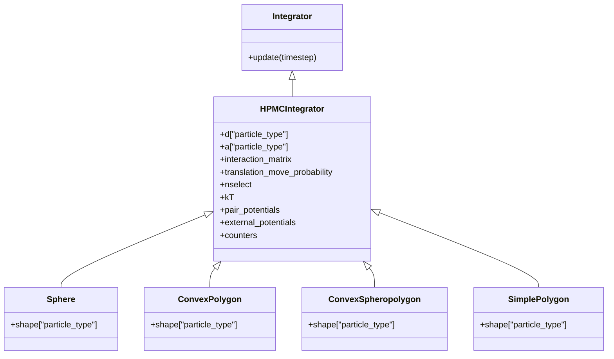
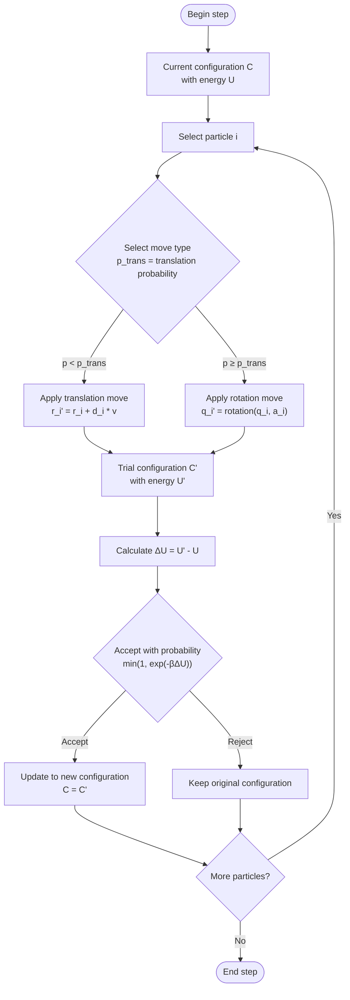
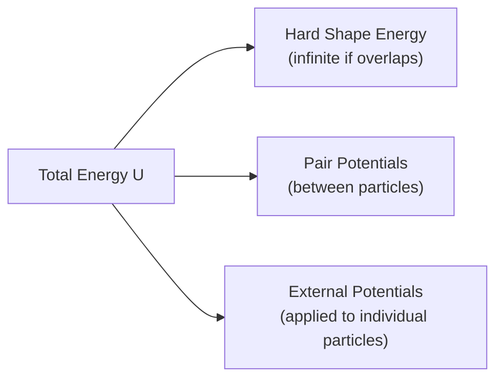
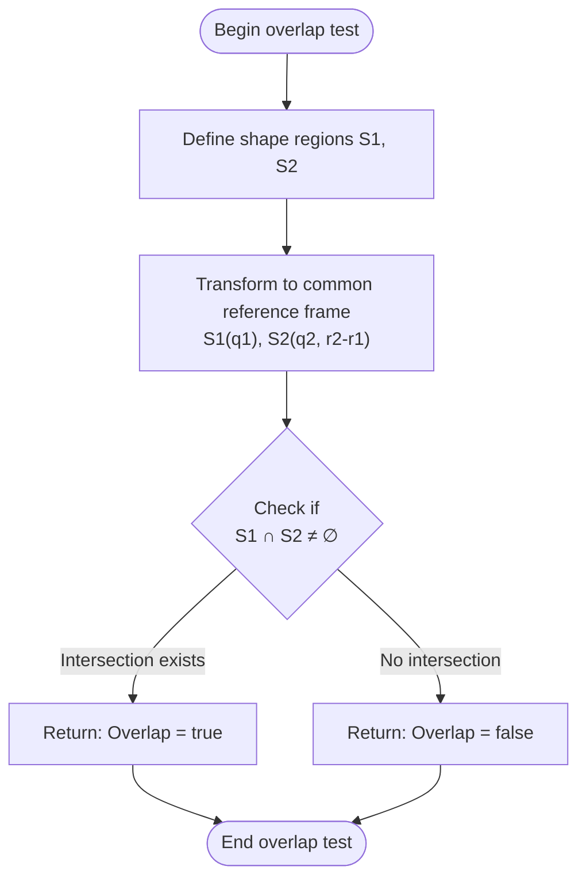
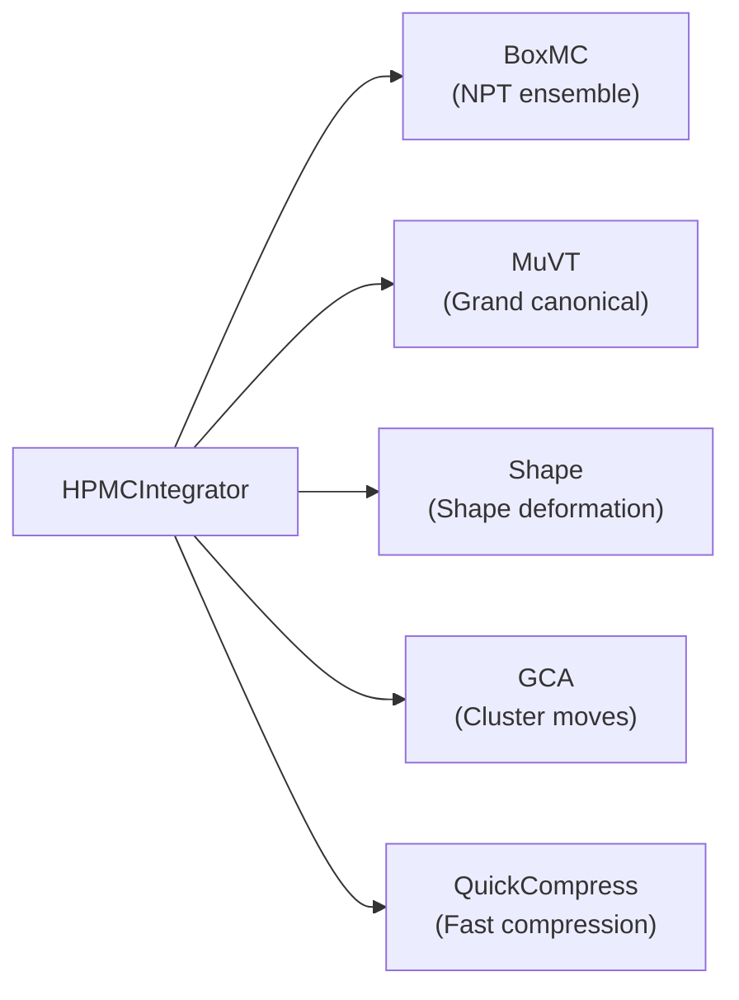

# HPMC Integrators

<details>
<summary>Relevant source files</summary>

The following files were used as context for generating this wiki page:

- [hoomd/hpmc/IntegratorHPMC.cc](hoomd/hpmc/IntegratorHPMC.cc)
- [hoomd/hpmc/IntegratorHPMC.h](hoomd/hpmc/IntegratorHPMC.h)
- [hoomd/hpmc/IntegratorHPMCMono.h](hoomd/hpmc/IntegratorHPMCMono.h)
- [hoomd/hpmc/ShapeMoves.h](hoomd/hpmc/ShapeMoves.h)
- [hoomd/hpmc/ShapeUtils.cc](hoomd/hpmc/ShapeUtils.cc)
- [hoomd/hpmc/ShapeUtils.h](hoomd/hpmc/ShapeUtils.h)
- [hoomd/hpmc/UpdaterBoxMC.cc](hoomd/hpmc/UpdaterBoxMC.cc)
- [hoomd/hpmc/UpdaterBoxMC.h](hoomd/hpmc/UpdaterBoxMC.h)
- [hoomd/hpmc/UpdaterMuVT.h](hoomd/hpmc/UpdaterMuVT.h)
- [hoomd/hpmc/UpdaterShape.h](hoomd/hpmc/UpdaterShape.h)
- [hoomd/hpmc/integrate.py](hoomd/hpmc/integrate.py)
- [hoomd/hpmc/pytest/test_shape_updater.py](hoomd/hpmc/pytest/test_shape_updater.py)
- [hoomd/hpmc/pytest/test_shape_utils.py](hoomd/hpmc/pytest/test_shape_utils.py)
- [hoomd/hpmc/shape_move.py](hoomd/hpmc/shape_move.py)
- [hoomd/hpmc/update.py](hoomd/hpmc/update.py)

</details>


The Hard Particle Monte Carlo (HPMC) integrators in HOOMD-blue implement the Metropolis Monte Carlo method for sampling equilibrium states in systems of particles with hard-core interactions and optional soft potentials. HPMC integrators enable simulations of diverse particle shapes ranging from simple spheres to complex polyhedra.

For other ensemble-related integrators like molecular dynamics (MD), see [Molecular Dynamics (MD)](#4).

Sources: [hoomd/hpmc/integrate.py:4-14](). 

## Integrator Hierarchy and Architecture

HPMC integrators use a well-structured class hierarchy that extends HOOMD-blue's base `Integrator` class.



The architecture consists of:

- **Base class**: `HPMCIntegrator` provides common Monte Carlo integration functionality
- **Shape-specific integrators**: Subclasses like `Sphere`, `ConvexPolygon` that implement specific shape overlap tests
- **Additional functionality**: Pair potentials, external potentials, and other features build on this foundation

Sources: [hoomd/hpmc/integrate.py:275-666](), [hoomd/hpmc/IntegratorHPMCMono.h:30-383]()

## Metropolis Monte Carlo Method

HPMC implements the Metropolis Monte Carlo algorithm to sample equilibrium configurations:



Key elements of the Monte Carlo algorithm in HPMC:

1. **Trial moves**: Random translations and rotations with maximum size controlled by `d` and `a` parameters
2. **Energy evaluation**: Hard-core overlaps (infinite energy) and optional pair/external potentials
3. **Acceptance criterion**: Accept with probability min(1, exp(-βΔU)), where β = 1/kT
4. **Detailed balance**: Ensures correct equilibrium sampling through move selection and acceptance rules

Sources: [hoomd/hpmc/integrate.py:5-43](), [hoomd/hpmc/IntegratorHPMCMono.h:421-570]()

## Trial Moves

HPMC performs two types of trial moves, which are selected randomly according to the `translation_move_probability`:

### Translation Moves

For a randomly selected particle `i`:
- A random vector `v` uniformly distributed in a sphere/circle of radius 1 is generated
- The particle position is updated: `r_i' = r_i + d_i * v`
- Where `d_i` is the maximum displacement for particles of type `i`

### Rotation Moves

For orientable particles:
- In 3D: A quaternion-based rotation is applied using a random rotation of magnitude up to `a_i`
- In 2D: A rotation around the z-axis by a random angle in the range [-a_i, a_i]
- Where `a_i` is the maximum rotation for particles of type `i`

The maximum move sizes `d` and `a` can be set per particle type and should be adjusted to achieve reasonable acceptance rates (typically 20-40%).

Sources: [hoomd/hpmc/integrate.py:44-87](), [hoomd/hpmc/IntegratorHPMCMono.h:530-571]()

## Energy Evaluation

The total energy in HPMC consists of three components:



### Hard Shape Interactions

HPMC's primary feature is its ability to handle hard particle interactions through overlap detection:

- Each shape defines its own overlap test function
- If any overlap is detected, the energy is infinite and the move is rejected
- Precise overlap tests are implemented for each shape type

### Pair and External Potentials

In addition to hard-core interactions, HPMC can include:

- **Pair potentials**: Interactions between pairs of particles defined by classes in `hoomd.hpmc.pair`
- **External potentials**: Applied to individual particles defined by classes in `hoomd.hpmc.external`

The energy from these potentials affects the acceptance probability according to the Metropolis criterion.

Sources: [hoomd/hpmc/integrate.py:119-161](), [hoomd/hpmc/IntegratorHPMCMono.h:204-310]()

## Overlap Tests

The heart of HPMC is its ability to detect overlaps between particles of various shapes. The test is defined mathematically as:



Overlap detection is shape-specific:
- **Spheres**: Simple distance check between centers
- **Convex Polygons/Polyhedra**: Separating axis theorem or GJK algorithm
- **Spheropolygons/Spheropolyhedra**: Convex polygon/polyhedron tests with expanded distance

HPMC uses spatial data structures (cell lists, AABB trees) to efficiently identify potential overlaps without checking all particle pairs.

Sources: [hoomd/hpmc/integrate.py:217-262]()

## Timesteps and Update Order

In HPMC, a timestep consists of multiple trial moves:

1. `nselect` trial moves are attempted per particle (default: 4)
2. Particles are processed in a randomized order to maintain detailed balance
3. In parallel implementations (GPU/MPI), particles may receive different numbers of trial moves

HPMC uses pseudo-random number generation for reproducible simulations when the same seed is used. The seed can be set via `hoomd.Simulation.seed`.

Sources: [hoomd/hpmc/integrate.py:89-116](), [hoomd/hpmc/IntegratorHPMCMono.h:421-449]()

## Supported Shapes

HPMC supports a variety of shapes through specialized integrator classes:

| Shape Class | Dimension | Description | Properties |
|-------------|-----------|-------------|------------|
| `Sphere` | 2D/3D | Spheres in 3D, disks in 2D | `diameter` |
| `ConvexPolygon` | 2D | Convex polygons | `vertices` |
| `ConvexSpheropolygon` | 2D | Convex polygons with rounded edges | `vertices`, `sweep_radius` |
| `SimplePolygon` | 2D | Arbitrary polygons (convex or non-convex) | `vertices` |
| `ConvexPolyhedron` | 3D | Convex polyhedra | `vertices` |
| `ConvexSpheropolyhedron` | 3D | Convex polyhedra with rounded edges | `vertices`, `sweep_radius` |
| `Ellipsoid` | 3D | Ellipsoids | `a`, `b`, `c` |

Each shape class has its own parameters defined in the `shape` property, which is a type parameter dictionary mapping particle types to shape definitions.

Sources: [hoomd/hpmc/integrate.py:667-1026]()

## Related Updaters

Several updater classes extend HPMC functionality for specialized simulations:



### BoxMC

Enables isobaric ensemble (NPT) simulations by performing volume and shape changes to the simulation box.

### MuVT

Implements grand-canonical ensemble simulations by inserting and removing particles with specified chemical potentials.

### Shape

Allows particle shapes to evolve during simulation through controlled deformations.

### GCA (Geometric Cluster Algorithm)

Performs cluster moves that can accelerate equilibration in systems with complex interactions.

### QuickCompress

Rapidly compresses a dilute system to reach target densities efficiently.

Sources: [hoomd/hpmc/update.py:22-806](), [hoomd/hpmc/shape_move.py:4-370]()

## Example Usage

Basic usage of an HPMC integrator for a simulation of hard spheres:

```python
import hoomd
import hoomd.hpmc

# Initialize simulation
sim = hoomd.Simulation(device=hoomd.device.CPU())
sim.create_state_from_gsd('initial_config.gsd')

# Create HPMC integrator
mc = hoomd.hpmc.integrate.Sphere()
mc.shape['A'] = dict(diameter=1.0)
mc.d['A'] = 0.1  # Maximum translation move size
mc.a['A'] = 0.1  # Maximum rotation move size (not used for non-orientable spheres)

# Set the number of trial moves per particle per timestep
mc.nselect = 4

# Add the integrator to the simulation
sim.operations.integrator = mc

# Run the simulation
sim.run(1000)
```

For systems with multiple shape types or more complex simulation requirements, additional parameters and operations can be configured.

Sources: [hoomd/hpmc/integrate.py:706-714]()

---