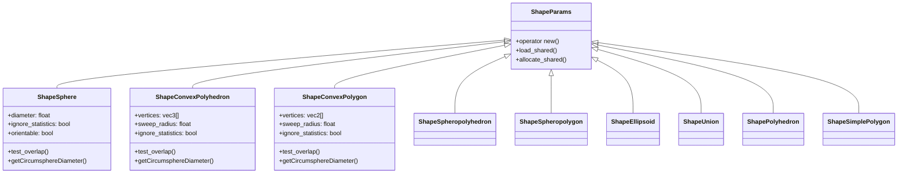
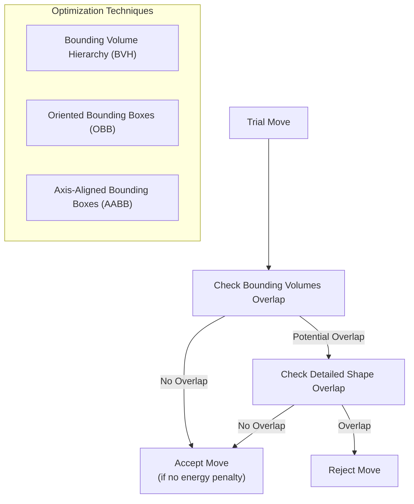
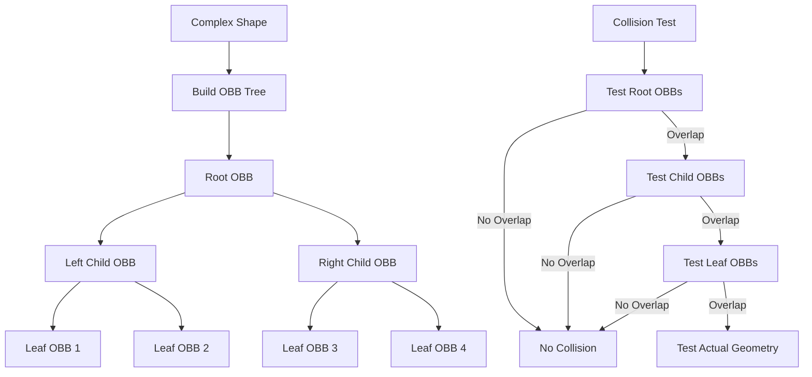
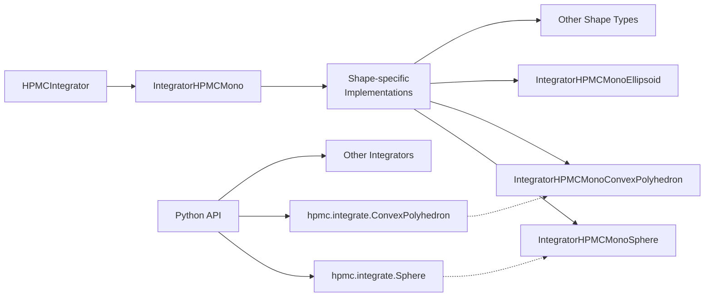
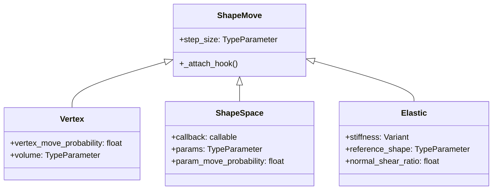

# HPMC Shapes and Overlap Detection

<details>
<summary>Relevant source files</summary>

The following files were used as context for generating this wiki page:

- [hoomd/VectorMath.h](hoomd/VectorMath.h)
- [hoomd/hpmc/GPUTree.h](hoomd/hpmc/GPUTree.h)
- [hoomd/hpmc/IntegratorHPMC.cc](hoomd/hpmc/IntegratorHPMC.cc)
- [hoomd/hpmc/IntegratorHPMC.h](hoomd/hpmc/IntegratorHPMC.h)
- [hoomd/hpmc/IntegratorHPMCMono.h](hoomd/hpmc/IntegratorHPMCMono.h)
- [hoomd/hpmc/MinkowskiMath.h](hoomd/hpmc/MinkowskiMath.h)
- [hoomd/hpmc/OBB.h](hoomd/hpmc/OBB.h)
- [hoomd/hpmc/OBBTree.h](hoomd/hpmc/OBBTree.h)
- [hoomd/hpmc/ShapeConvexPolygon.h](hoomd/hpmc/ShapeConvexPolygon.h)
- [hoomd/hpmc/ShapeConvexPolyhedron.h](hoomd/hpmc/ShapeConvexPolyhedron.h)
- [hoomd/hpmc/ShapeEllipsoid.h](hoomd/hpmc/ShapeEllipsoid.h)
- [hoomd/hpmc/ShapeFacetedEllipsoid.h](hoomd/hpmc/ShapeFacetedEllipsoid.h)
- [hoomd/hpmc/ShapeMoves.h](hoomd/hpmc/ShapeMoves.h)
- [hoomd/hpmc/ShapePolyhedron.h](hoomd/hpmc/ShapePolyhedron.h)
- [hoomd/hpmc/ShapeSimplePolygon.h](hoomd/hpmc/ShapeSimplePolygon.h)
- [hoomd/hpmc/ShapeSphere.h](hoomd/hpmc/ShapeSphere.h)
- [hoomd/hpmc/ShapeSpheropolygon.h](hoomd/hpmc/ShapeSpheropolygon.h)
- [hoomd/hpmc/ShapeSpheropolyhedron.h](hoomd/hpmc/ShapeSpheropolyhedron.h)
- [hoomd/hpmc/ShapeSphinx.h](hoomd/hpmc/ShapeSphinx.h)
- [hoomd/hpmc/ShapeUnion.h](hoomd/hpmc/ShapeUnion.h)
- [hoomd/hpmc/ShapeUtils.cc](hoomd/hpmc/ShapeUtils.cc)
- [hoomd/hpmc/ShapeUtils.h](hoomd/hpmc/ShapeUtils.h)
- [hoomd/hpmc/UpdaterBoxMC.cc](hoomd/hpmc/UpdaterBoxMC.cc)
- [hoomd/hpmc/UpdaterBoxMC.h](hoomd/hpmc/UpdaterBoxMC.h)
- [hoomd/hpmc/UpdaterMuVT.h](hoomd/hpmc/UpdaterMuVT.h)
- [hoomd/hpmc/UpdaterShape.h](hoomd/hpmc/UpdaterShape.h)
- [hoomd/hpmc/XenoCollide2D.h](hoomd/hpmc/XenoCollide2D.h)
- [hoomd/hpmc/XenoCollide3D.h](hoomd/hpmc/XenoCollide3D.h)
- [hoomd/hpmc/integrate.py](hoomd/hpmc/integrate.py)
- [hoomd/hpmc/pytest/test_scale.py](hoomd/hpmc/pytest/test_scale.py)
- [hoomd/hpmc/pytest/test_shape_updater.py](hoomd/hpmc/pytest/test_shape_updater.py)
- [hoomd/hpmc/pytest/test_shape_utils.py](hoomd/hpmc/pytest/test_shape_utils.py)
- [hoomd/hpmc/shape_move.py](hoomd/hpmc/shape_move.py)
- [hoomd/hpmc/update.py](hoomd/hpmc/update.py)

</details>


This page describes the shape definitions and overlap detection algorithms used in HOOMD-blue's Hard Particle Monte Carlo (HPMC) module. It covers the various shape types available, their parameterizations, and the algorithms used to detect overlaps between shapes. For information about HPMC integrators and how they use these shapes, see [HPMC Integrators](#3.1).

## Shape Class Hierarchy

HPMC simulations use a variety of shape types to model different particle geometries. All shapes in HPMC inherit from a base `ShapeParams` class which provides memory management and common functionality.



Sources: [hoomd/hpmc/ShapeSphere.h:33-43](), [hoomd/hpmc/ShapeConvexPolyhedron.h:42-67](), [hoomd/hpmc/ShapeConvexPolygon.h]()

Each shape type implements:
- A `param_type` structure containing shape-specific parameters
- A `test_overlap()` method to detect overlaps with other shapes
- Methods to compute properties such as circumsphere diameter, mass, and inertia tensor

## Supported Shape Types

HPMC supports the following shape types, each corresponding to an HPMC integrator class:

| Shape Type | Dimensions | Description | Python Class |
|------------|------------|-------------|--------------|
| Sphere | 2D/3D | Spheres/disks | `hpmc.integrate.Sphere` |
| Convex Polygon | 2D | Convex polygons | `hpmc.integrate.ConvexPolygon` |
| Convex Spheropolygon | 2D | Convex polygons with rounded edges | `hpmc.integrate.ConvexSpheropolygon` |
| Simple Polygon | 2D | Simple (potentially non-convex) polygons | `hpmc.integrate.SimplePolygon` |
| Convex Polyhedron | 3D | Convex polyhedra | `hpmc.integrate.ConvexPolyhedron` |
| Convex Spheropolyhedron | 3D | Convex polyhedra with rounded edges/vertices | `hpmc.integrate.ConvexSpheropolyhedron` |
| Ellipsoid | 3D | Ellipsoids | `hpmc.integrate.Ellipsoid` |
| Faceted Ellipsoid | 3D | Ellipsoids with flat facets | `hpmc.integrate.FacetedEllipsoid` |
| Union | 2D/3D | Unions of other shapes | `hpmc.integrate.ShapeUnion` |
| Polyhedron | 3D | General (potentially non-convex) polyhedra | `hpmc.integrate.Polyhedron` |

Sources: [hoomd/hpmc/integrate.py:667-772](), [hoomd/hpmc/integrate.py:774-894](), [hoomd/hpmc/ShapeSpheropolyhedron.h](), [hoomd/hpmc/ShapeUnion.h:36-309]()

## Shape Parameters

Each shape type has its own set of parameters that define its geometry. These are specified through a Python dictionary when setting up the simulation.

### Example: Sphere Parameters

```python
mc = hoomd.hpmc.integrate.Sphere()
mc.shape["A"] = dict(diameter=1.0)
mc.shape["B"] = dict(diameter=2.0, orientable=True)
```

The `Sphere` shape takes parameters:
- `diameter`: The sphere diameter
- `orientable`: Whether the sphere participates in rotation moves (default: False)
- `ignore_statistics`: Whether to ignore the particle in statistical measurements (default: False)

### Example: Convex Polyhedron Parameters

```python
mc = hoomd.hpmc.integrate.ConvexPolyhedron()
mc.shape["A"] = dict(vertices=[
    (-0.5, -0.5, -0.5),
    (0.5, -0.5, -0.5),
    (0.5, 0.5, -0.5),
    (-0.5, 0.5, -0.5),
    (-0.5, -0.5, 0.5),
    (0.5, -0.5, 0.5),
    (0.5, 0.5, 0.5),
    (-0.5, 0.5, 0.5)
])
```

Sources: [hoomd/hpmc/integrate.py:686-731](), [hoomd/hpmc/integrate.py:798-849]()

## Overlap Detection

HPMC uses a hierarchical approach to detect overlaps between particles. This is a critical part of the Monte Carlo algorithm, as it determines whether trial moves are accepted or rejected.



Sources: [hoomd/hpmc/IntegratorHPMCMono.h:649-659]()

### Bounding Volume Hierarchies

For complex shapes, HPMC uses bounding volume hierarchies to accelerate overlap detection:

1. Oriented Bounding Boxes (OBBs): Tight-fitting boxes that align with shape features
2. OBB Trees: Hierarchical structures of OBBs for complex shapes
3. GPU-optimized implementations for parallel processing



Sources: [hoomd/hpmc/OBB.h:65-87](), [hoomd/hpmc/GPUTree.h:37-79](), [hoomd/hpmc/OBBTree.h]()

### Overlap Detection Algorithms

Different algorithms are used for overlap detection depending on the shape types:

1. **Sphere-Sphere**: Simple distance check
2. **Convex Polyhedra**: GJK (Gilbert-Johnson-Keerthi) algorithm or XenoCollide
3. **Convex Polygon**: GJK in 2D
4. **Spheropolyhedra**: XenoSweep algorithm (extension of XenoCollide)
5. **Complex Non-convex**: Tree-based hierarchical testing

The core of the overlap detection happens in the `test_overlap()` method implemented by each shape class. This takes two shapes, their relative positions, and determines if they overlap.

Sources: [hoomd/hpmc/IntegratorHPMCMono.h:655-658](), [hoomd/hpmc/ShapeConvexPolyhedron.h:634-637]()

## Implementation Details

### OBB Implementation

OBBs (Oriented Bounding Boxes) are fundamental to the acceleration of overlap detection. An OBB is defined by:

1. A center position
2. Three half-length vectors along principal axes 
3. An orientation quaternion

```cpp
// Simplified representation of OBB
struct OBB {
    vec3<float> center;       // Center position
    vec3<float> lengths;      // Box half-lengths
    quat<float> orientation;  // Orientation quaternion
    unsigned int mask;        // Bit mask for overlap checks
};
```

OBBs can be created from vertex sets, and provide fast overlap tests between boxes.

Sources: [hoomd/hpmc/OBB.h:91-115]()

### Mass Properties Calculation

HPMC computes various shape properties including:
- Volume
- Surface area
- Center of mass
- Inertia tensor

These are calculated by the `MassProperties` class, which is specialized for each shape type.

Sources: [hoomd/hpmc/ShapeUtils.h:32-73](), [hoomd/hpmc/ShapeUtils.h:86-106]()

## Integration with HPMC Integrators

Each HPMC integrator is templated on a specific shape type. For example, `IntegratorHPMCMono<ShapeSphere>` handles simulations of spherical particles.



The overlap detection is an integral part of the Monte Carlo algorithm. When a trial move is proposed, the integrator checks if the new position would cause an overlap with any other particles:

```python
# Python example showing how overlap detection is used
mc = hoomd.hpmc.integrate.Sphere()
mc.shape["A"] = dict(diameter=1.0)
# During simulation:
# 1. Trial move proposed
# 2. Check for overlaps using test_overlap()
# 3. Accept/reject move based on result
overlaps = mc.count_overlaps()  # Count current overlaps in system
```

Sources: [hoomd/hpmc/IntegratorHPMCMono.h:110-383](), [hoomd/hpmc/integrate.py:275-435]()

## Shape-Changing Operations

HPMC supports operations to modify shapes during simulation through the `update.Shape` class and various `shape_move` implementations:



These shape moves allow for:
1. **Vertex Moves**: Moving individual vertices while maintaining volume
2. **Elastic Deformations**: Applying strain to shapes with energy penalties
3. **Parametric Shape Changes**: Modifying shapes based on parameter changes

Sources: [hoomd/hpmc/shape_move.py:22-96](), [hoomd/hpmc/shape_move.py:290-363](), [hoomd/hpmc/UpdaterShape.h:23-171]()

## Summary

HPMC's shape and overlap detection systems provide a robust framework for simulating hard particle systems with a wide variety of particle geometries. The hierarchical approach to overlap detection, combined with specialized algorithms for different shape types, enables efficient simulation of complex systems.

---