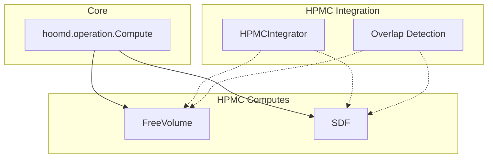
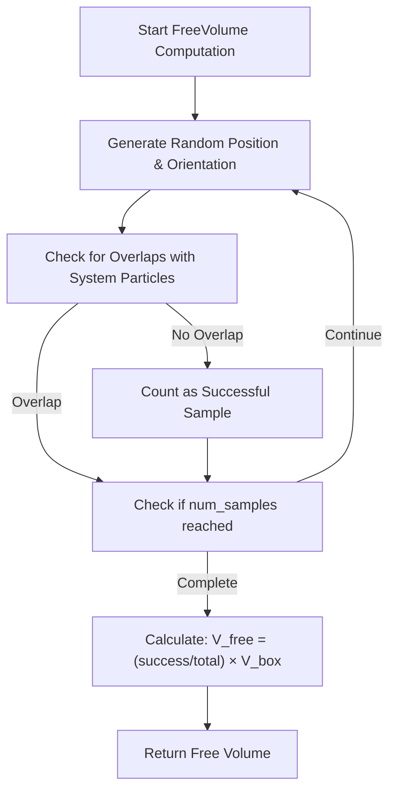
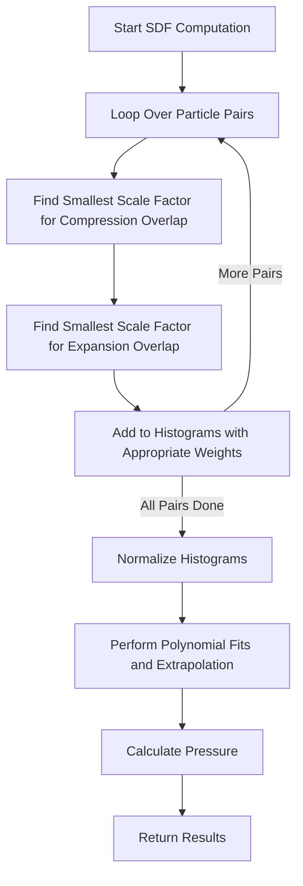

# HPMC Compute Operations

<details>
<summary>Relevant source files</summary>

The following files were used as context for generating this wiki page:

- [hoomd/BoxDim.h](hoomd/BoxDim.h)
- [hoomd/hpmc/ComputeSDF.h](hoomd/hpmc/ComputeSDF.h)
- [hoomd/hpmc/UpdaterQuickCompress.cc](hoomd/hpmc/UpdaterQuickCompress.cc)
- [hoomd/hpmc/UpdaterQuickCompress.h](hoomd/hpmc/UpdaterQuickCompress.h)
- [hoomd/hpmc/compute.py](hoomd/hpmc/compute.py)
- [hoomd/hpmc/pytest/conftest.py](hoomd/hpmc/pytest/conftest.py)
- [hoomd/hpmc/pytest/test_boxmc.py](hoomd/hpmc/pytest/test_boxmc.py)
- [hoomd/hpmc/pytest/test_compute_free_volume.py](hoomd/hpmc/pytest/test_compute_free_volume.py)
- [hoomd/hpmc/pytest/test_compute_sdf.py](hoomd/hpmc/pytest/test_compute_sdf.py)
- [hoomd/hpmc/pytest/test_muvt.py](hoomd/hpmc/pytest/test_muvt.py)
- [hoomd/hpmc/pytest/test_quick_compress.py](hoomd/hpmc/pytest/test_quick_compress.py)
- [hoomd/hpmc/pytest/test_shape.py](hoomd/hpmc/pytest/test_shape.py)

</details>


The HPMC (Hard Particle Monte Carlo) Compute Operations analyze system configurations during HPMC simulations without modifying them. These operations provide valuable metrics such as free volume available to test particles and pressure estimation through scale distribution functions. They are specifically designed to work with HPMC integrators and utilize the shape definitions and overlap detection algorithms built into the HPMC module.

This page covers the two main compute operations in the HPMC module: `FreeVolume` and `SDF`. For information about the integration methods used in HPMC simulations, see [HPMC Integrators](#3.1). For details on shape specifications and overlap detection algorithms, see [HPMC Shapes and Overlap Detection](#3.2).

## Architecture



Sources: [hoomd/hpmc/compute.py:1-20]()

The HPMC compute operations extend the base `Compute` class from the HOOMD-blue operations system and interact closely with HPMC integrators to access particle shapes and overlap detection functionality.

## FreeVolume

The `FreeVolume` compute operation estimates the free volume available to a test particle in the simulation system using Monte Carlo integration. This is useful for calculating chemical potentials and analyzing available space in packed systems.

### Theory and Implementation

`FreeVolume` uses Monte Carlo integration to estimate the free volume:

1. Generate `num_samples` random test particle positions uniformly distributed in the simulation box, with orientations uniformly distributed among rotations matching the box dimensionality
2. Check for overlaps between the test particle and particles in the system
3. Count successful (non-overlapping) placements
4. Calculate free volume as: (successful samples / total samples) × (box volume)

The mathematical expression for free volume is:

$$V_{\mathrm{free}} = \frac{n_\mathrm{success}}{n_\mathrm{samples}} V_\mathrm{box}$$

Where:
- $n_\mathrm{success}$ is the number of successful (non-overlapping) test particle placements
- $n_\mathrm{samples}$ is the total number of samples tried
- $V_\mathrm{box}$ is the volume of the simulation box



Sources: [hoomd/hpmc/compute.py:21-146]()

### Parameters

- `test_particle_type` (str): The particle type to use for the test particle
- `num_samples` (int): Number of random samples to evaluate

### Usage

```python
# Create a free volume compute object
fv = hoomd.hpmc.compute.FreeVolume(test_particle_type="B", num_samples=10000)

# Add to simulation
simulation.operations.add(fv)

# Access the computed free volume
volume = fv.free_volume
```

### Implementation Details

- On CPU devices, `FreeVolume` does not apply the minimum image convention and supports small boxes where particles may overlap with non-primary images, including self-overlap.
- On GPU devices, it applies the minimum image convention.
- The operation respects the HPMC integrator's `interaction_matrix` for overlap checks.
- It uses reduced precision floating point arithmetic when checking for particle overlaps in the local particle reference frame.

Sources: [hoomd/hpmc/compute.py:74-84](), [hoomd/hpmc/compute.py:109-144]()

## SDF (Scale Distribution Function)

The `SDF` compute operation calculates the scale distribution function via volume perturbations. This function measures the probability distributions of particles overlapping as a function of separation for both compressive and expansive perturbations, which can be used to estimate the pressure in hard particle systems.

### Theory and Implementation

The SDF operation constructs two histograms:

1. **Compressive perturbations**: Scale the particle separation vector by (1-x) and find the smallest positive x value that causes an overlap
2. **Expansive perturbations**: Scale the particle separation vector by (1+x) and find the smallest negative x value that causes an overlap

For each pair of particles i and j, the operation finds the scale factor x_ij that causes the first overlap or a discontinuous change in pair energy. It then constructs probability distributions s_comp(x) and s_exp(x) by adding weighted counts to histograms with bin width dx.

The pressure P is related to these distributions by:

$$\beta P = \rho \left(1 + \frac{s_{\mathrm{comp}}(0+) - s_{\mathrm{exp}}(0-)}{2d} \right)$$

Where:
- β = 1/kT (inverse temperature)
- ρ is the number density
- d is the dimensionality of the system
- s_comp(0+) and s_exp(0-) are the extrapolated values of the SDFs at x=0

The implementation uses polynomial curve fitting of degree 5 to estimate these values at x=0.



Sources: [hoomd/hpmc/compute.py:147-505](), [hoomd/hpmc/ComputeSDF.h:58-309]()

### Parameters

- `xmax` (float): Maximum x value at the right-hand side of the rightmost bin
- `dx` (float): Bin width

### Usage

```python
# Create an SDF compute object with appropriate parameters
sdf = hoomd.hpmc.compute.SDF(xmax=0.02, dx=1e-4)

# Add to simulation
simulation.operations.add(sdf)

# Access the computed pressure
pressure = sdf.P

# Access the SDF data for analysis
compression_sdf = sdf.sdf_compression
expansion_sdf = sdf.sdf_expansion
x_values_compression = sdf.x_compression
x_values_expansion = sdf.x_expansion
```

### Implementation Details

- SDF always runs on the CPU, regardless of the simulation device.
- It uses two different search methods:
  - Binary search for simple cases (hard particle overlaps only)
  - Linear search for cases with pair potentials or when expansion moves are required
- Not all shape types support expansion moves (e.g., spheres, convex polygons/polyhedra, ellipsoids support compression-only analysis).
- The operation doesn't apply the minimum image convention, supporting small boxes with overlaps across periodic boundaries.
- In MPI parallel execution, the SDF arrays and pressure values are only available on rank 0 (they are `None` on other ranks).

Sources: [hoomd/hpmc/ComputeSDF.h:245-309](), [hoomd/hpmc/compute.py:316](), [hoomd/hpmc/ComputeSDF.h:351-704]()

### Recommended Parameters

For accurate pressure estimation:
- Use small values of `xmax` (typically around 0.02)
- Use small values of `dx` (around 1e-4)
- For densely packed systems, `dx=1e-5` may be needed
- Check that the sum of s_comp(x)·dx is approximately 0.5
- Average `P` over many timesteps to reduce statistical noise

Sources: [hoomd/hpmc/compute.py:300-308]()

## Usage Examples

### Basic Usage of Both Computes

```python
import hoomd
import hoomd.hpmc

# Initialize simulation
sim = hoomd.Simulation(device=hoomd.device.CPU())
sim.create_state_from_gsd('init.gsd')

# Set up the HPMC integrator
mc = hoomd.hpmc.integrate.Sphere()
mc.shape['A'] = dict(diameter=1.0)
sim.operations.integrator = mc

# Add FreeVolume compute
fv = hoomd.hpmc.compute.FreeVolume(test_particle_type='A', num_samples=10000)
sim.operations.add(fv)

# Add SDF compute
sdf = hoomd.hpmc.compute.SDF(xmax=0.02, dx=1e-4)
sim.operations.add(sdf)

# Set up logging
logger = hoomd.logging.Logger()
logger.add(fv, quantities=['free_volume'])
logger.add(sdf, quantities=['betaP', 'P'])
file_logger = hoomd.logging.FileLogger(filename='compute_data.log', 
                                      logger=logger, 
                                      trigger=hoomd.trigger.Periodic(100))
sim.operations.writers.append(file_logger)

# Run the simulation
sim.run(10000)

# Access the computed values
print(f"Free Volume: {fv.free_volume}")
print(f"Pressure: {sdf.P}")
```

### Analyzing Free Volume for a Test Particle

```python
# Create a system with two particle types
sim = hoomd.Simulation(device=hoomd.device.CPU())
sim.create_state_from_gsd('system.gsd')

# Set up the HPMC integrator with different particle types
mc = hoomd.hpmc.integrate.Sphere()
mc.shape['A'] = dict(diameter=1.0)  # System particles
mc.shape['B'] = dict(diameter=0.5)  # Smaller test particle
sim.operations.integrator = mc

# Add FreeVolume compute with the smaller particle type
fv = hoomd.hpmc.compute.FreeVolume(test_particle_type='B', num_samples=100000)
sim.operations.add(fv)

# Run and analyze
sim.run(1000)
print(f"Free volume available to particle type B: {fv.free_volume}")
```

### Pressure Calculation with SDF

```python
# Set up simulation with hard polyhedra
sim = hoomd.Simulation(device=hoomd.device.CPU())
sim.create_state_from_gsd('polyhedra.gsd')

# Set up the HPMC integrator
mc = hoomd.hpmc.integrate.ConvexPolyhedron()
mc.shape['A'] = dict(vertices=[(0.5,0.5,0.5), (-0.5,0.5,0.5), 
                               (-0.5,-0.5,0.5), (0.5,-0.5,0.5),
                               (0.5,0.5,-0.5), (-0.5,0.5,-0.5), 
                               (-0.5,-0.5,-0.5), (0.5,-0.5,-0.5)])
sim.operations.integrator = mc

# Add SDF compute
sdf = hoomd.hpmc.compute.SDF(xmax=0.02, dx=1e-4)
sim.operations.add(sdf)

# Run equilibration
sim.run(10000)

# Run production with pressure measurements
pressures = []
for i in range(50):
    sim.run(1000)
    pressures.append(sdf.P)

# Calculate average pressure and standard error
import numpy as np
avg_pressure = np.mean(pressures)
pressure_error = np.std(pressures) / np.sqrt(len(pressures))
print(f"Pressure: {avg_pressure} ± {pressure_error}")
```

Sources: [hoomd/hpmc/pytest/test_compute_sdf.py:36-117](), [hoomd/hpmc/pytest/test_compute_free_volume.py:22-42]()

## Performance and Technical Considerations

### Performance

Both compute operations are computationally intensive:
- `FreeVolume` requires checking many random test positions against all particles
- `SDF` examines all particle pairs and performs detailed searches for overlap points

For large systems:
- Use appropriate triggers to reduce the frequency of these computations
- Adjust `num_samples` in `FreeVolume` based on required precision
- Set `xmax` and `dx` in `SDF` based on system density and required accuracy

### Technical Limitations

- `SDF` pressure measurements are only correct for potentials with constant values and step discontinuities.
- Both operations use reduced precision floating point arithmetic for overlap checks.
- The SDF calculation can be quite noisy, requiring averaging over many timesteps.
- In MPI parallel execution, results are gathered to rank 0, and values like `betaP`, `P`, and the SDF arrays will be `None` on other ranks.

Sources: [hoomd/hpmc/compute.py:313-316](), [hoomd/hpmc/ComputeSDF.h:290-296](), [hoomd/hpmc/compute.py:451-483]()

---