# HPMC GPU Acceleration

<details>
<summary>Relevant source files</summary>

The following files were used as context for generating this wiki page:

- [hoomd/RNGIdentifiers.h](hoomd/RNGIdentifiers.h)
- [hoomd/hpmc/ComputeFreeVolume.h](hoomd/hpmc/ComputeFreeVolume.h)
- [hoomd/hpmc/ComputeFreeVolumeGPU.cuh](hoomd/hpmc/ComputeFreeVolumeGPU.cuh)
- [hoomd/hpmc/ComputeFreeVolumeGPU.h](hoomd/hpmc/ComputeFreeVolumeGPU.h)
- [hoomd/hpmc/HPMCCounters.h](hoomd/hpmc/HPMCCounters.h)
- [hoomd/hpmc/IntegratorHPMCMonoGPU.cu](hoomd/hpmc/IntegratorHPMCMonoGPU.cu)
- [hoomd/hpmc/IntegratorHPMCMonoGPU.cuh](hoomd/hpmc/IntegratorHPMCMonoGPU.cuh)
- [hoomd/hpmc/IntegratorHPMCMonoGPU.h](hoomd/hpmc/IntegratorHPMCMonoGPU.h)
- [hoomd/hpmc/IntegratorHPMCMonoGPUMoves.cuh](hoomd/hpmc/IntegratorHPMCMonoGPUMoves.cuh)
- [hoomd/hpmc/IntegratorHPMCMonoGPUTypes.cuh](hoomd/hpmc/IntegratorHPMCMonoGPUTypes.cuh)
- [hoomd/hpmc/UpdaterGCAGPU.cu](hoomd/hpmc/UpdaterGCAGPU.cu)
- [hoomd/hpmc/UpdaterGCAGPU.cuh](hoomd/hpmc/UpdaterGCAGPU.cuh)
- [hoomd/hpmc/UpdaterGCAGPU.h](hoomd/hpmc/UpdaterGCAGPU.h)

</details>


This page documents the GPU acceleration implementation for the Hard Particle Monte Carlo (HPMC) simulation engine in HOOMD-blue. It explains how HPMC simulations leverage GPU hardware for significant performance gains, including architectural choices, kernel optimization strategies, and execution patterns specific to the GPU implementation. For information about the HPMC simulation engine in general, see [Hard Particle Monte Carlo (HPMC)](#3), and for CPU-specific implementations, see [HPMC Integrators](#3.1).

## Overview of HPMC GPU Implementation

The HPMC GPU implementation uses NVIDIA CUDA or AMD HIP through a unified interface to execute Monte Carlo moves and overlap checks in parallel on the GPU. The implementation enables efficient simulation of hard particle systems with various shape types on GPU hardware.

### Core Architecture

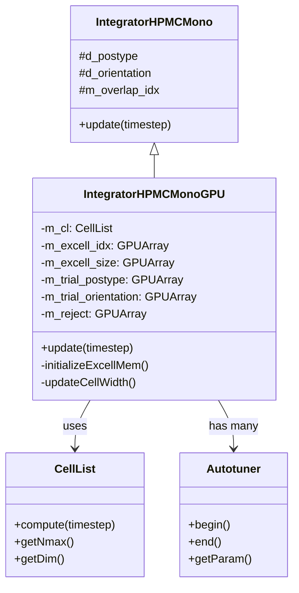

Sources: [hoomd/hpmc/IntegratorHPMCMonoGPU.h:137-210](), [hoomd/hpmc/IntegratorHPMCMonoGPU.h:213-316]()

### GPU Kernels and Execution Model

The HPMC GPU implementation uses several specialized kernels to execute the Monte Carlo algorithm:

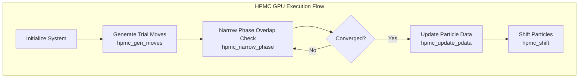

Sources: [hoomd/hpmc/IntegratorHPMCMonoGPU.h:317-407](), [hoomd/hpmc/IntegratorHPMCMonoGPU.cuh:44-366](), [hoomd/hpmc/IntegratorHPMCMonoGPUMoves.cuh:30-167]()

## Key Components

### Cell List and Expanded Cell List

The GPU implementation relies heavily on cell lists for efficient overlap detection. Unlike CPU implementations that can use callbacks for neighbor queries, the GPU uses an expanded cell list approach that caches all potential neighbors in memory for efficient parallel access.

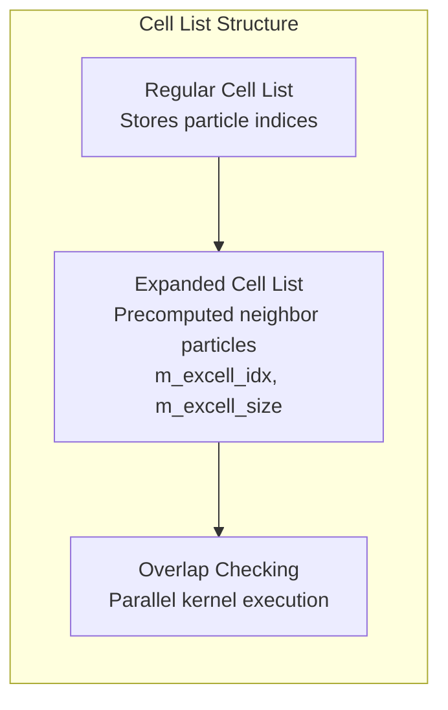

Sources: [hoomd/hpmc/IntegratorHPMCMonoGPU.h:158-164](), [hoomd/hpmc/IntegratorHPMCMonoGPU.h:206-210](), [hoomd/hpmc/IntegratorHPMCMonoGPU.cu:14-65]()

### Trial Move Generation

The trial move generation phase creates potential new positions and orientations for particles:

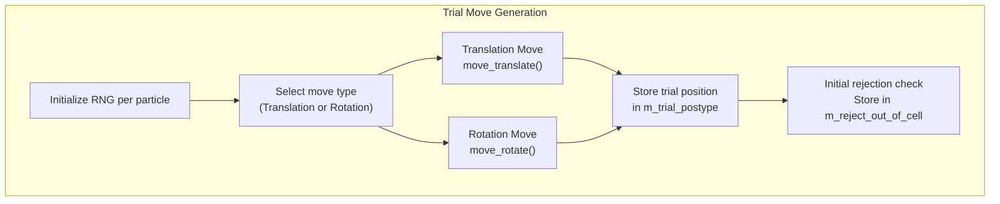

Sources: [hoomd/hpmc/IntegratorHPMCMonoGPUMoves.cuh:30-167](), [hoomd/hpmc/Moves.h]()

### Narrow Phase Overlap Detection

The overlap detection is the most computationally intensive part of the algorithm. It's implemented as a custom kernel that efficiently utilizes shared memory and threads:

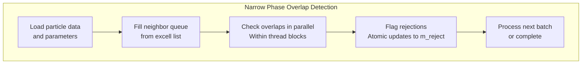

Sources: [hoomd/hpmc/IntegratorHPMCMonoGPU.cuh:44-366]()

### Auto-tuning for GPU Performance

The implementation uses several autotuners to optimize kernel launch parameters for different hardware:

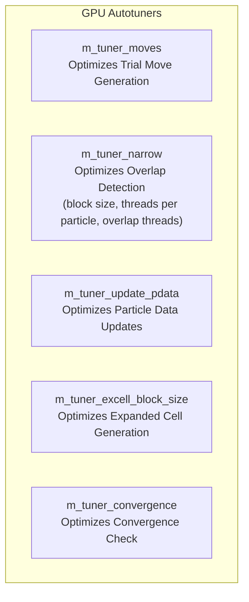

Sources: [hoomd/hpmc/IntegratorHPMCMonoGPU.h:166-179](), [hoomd/hpmc/IntegratorHPMCMonoGPU.h:226-279]()

## Memory Management and Data Flow

The GPU implementation manages several arrays to track the simulation state:

| GPU Array | Purpose |
|-----------|---------|
| `m_trial_postype` | Candidate new positions and types |
| `m_trial_orientation` | Candidate new orientations |
| `m_trial_vel` | Additional auxiliary variables |
| `m_reject_out_of_cell` | Flags particles that leave their cell |
| `m_reject` | Flags particles that have overlaps |
| `m_excell_idx` | Expanded cell list particles |
| `m_excell_size` | Number of particles in each expanded cell |
| `m_condition` | Convergence condition flag |

Sources: [hoomd/hpmc/IntegratorHPMCMonoGPU.h:181-196]()

### Data Flow in Update Method

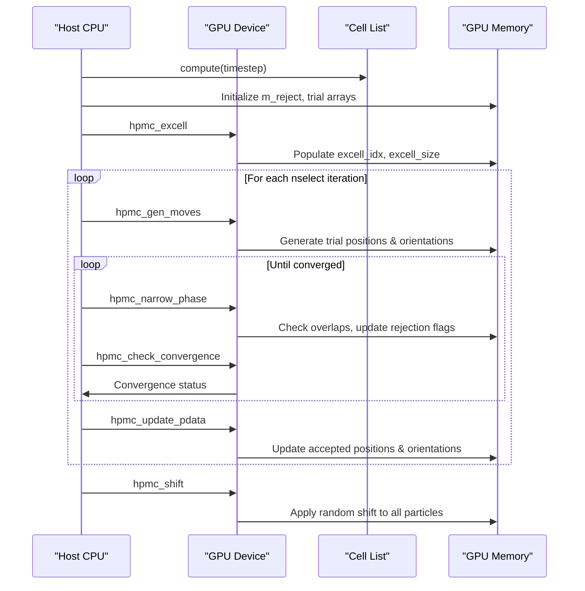

Sources: [hoomd/hpmc/IntegratorHPMCMonoGPU.h:317-811]()

## Parallel Overlap Detection Strategy

The HPMC GPU implementation uses a sophisticated parallel overlap detection strategy that balances work across thread blocks:

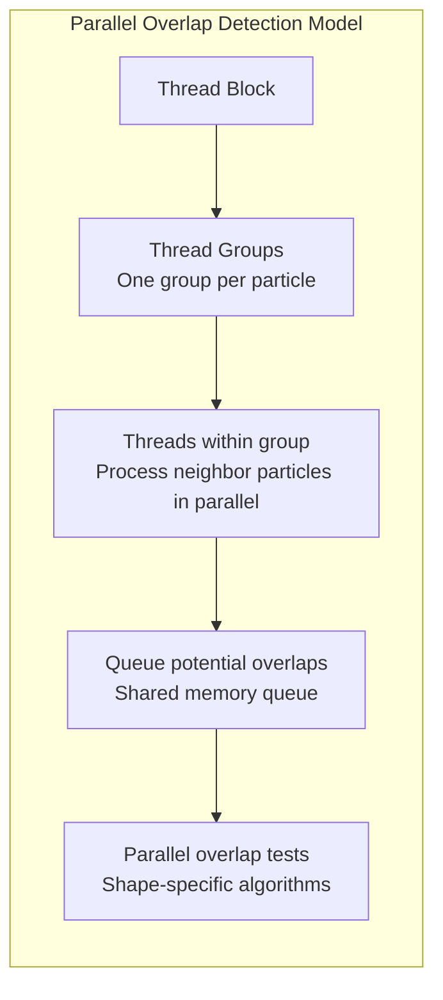

The overlap detection uses tunable parameters:
- **Block size**: Total number of threads in a block
- **Threads per particle (tpp)**: Number of threads working on each particle's neighbors
- **Overlap threads**: For shapes supporting parallel overlap computations

Sources: [hoomd/hpmc/IntegratorHPMCMonoGPU.cuh:44-366](), [hoomd/hpmc/IntegratorHPMCMonoGPU.h:245-267]()

## Random Number Generation

The implementation uses a consistent random number generation approach:

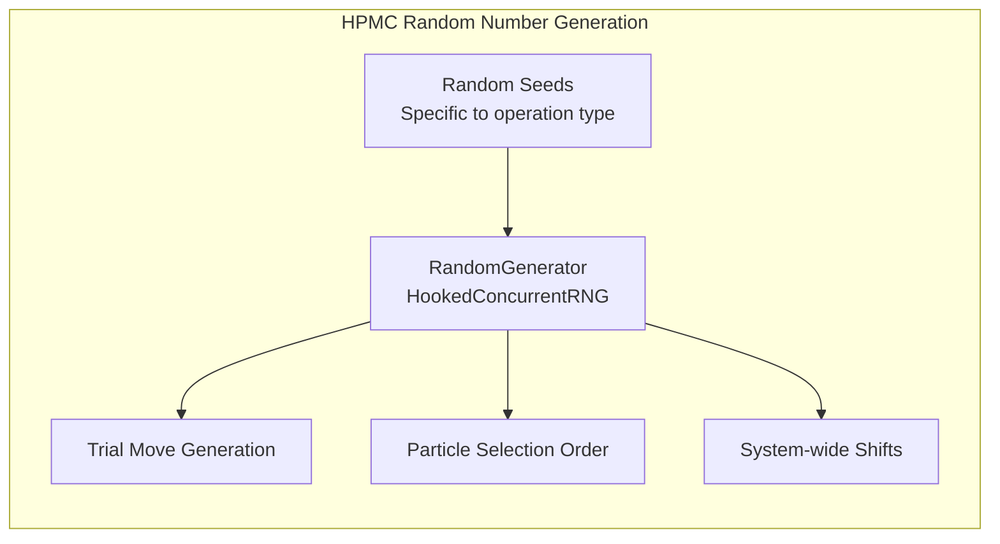

Sources: [hoomd/hpmc/IntegratorHPMCMonoGPU.h:322-324](), [hoomd/RNGIdentifiers.h:26-30](), [hoomd/hpmc/IntegratorHPMCMonoGPUMoves.cuh:123-125]()

## Convergence Handling for Move Acceptance

A unique aspect of the GPU implementation is handling convergence of acceptance/rejection decisions:

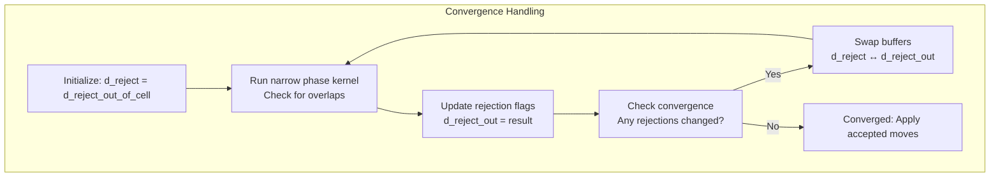

Sources: [hoomd/hpmc/IntegratorHPMCMonoGPU.h:543-713](), [hoomd/hpmc/IntegratorHPMCMonoGPU.cu:107-140]()

## Related GPU-Accelerated Functionality

### Free Volume Computation

The HPMC GPU implementation also provides GPU-accelerated methods for computing free volume:

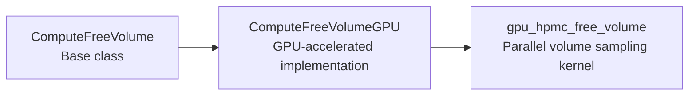

Sources: [hoomd/hpmc/ComputeFreeVolumeGPU.h:37-301](), [hoomd/hpmc/ComputeFreeVolumeGPU.cuh:156-354]()

### Cluster Moves

Cluster moves are also GPU-accelerated through the `UpdaterGCAGPU` class:

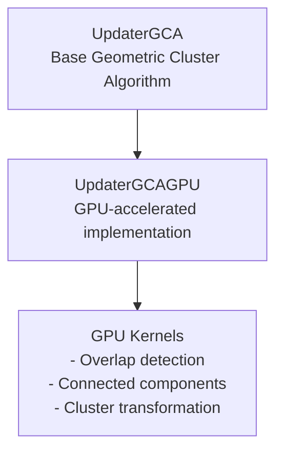

Sources: [hoomd/hpmc/UpdaterGCAGPU.h:21-225](), [hoomd/hpmc/UpdaterGCAGPU.cuh:38-725]()

## Performance Considerations

Several factors affect performance of the GPU-accelerated HPMC implementation:

1. **Shape Complexity**: More complex shapes require more computational resources for overlap checks
2. **System Size**: Larger systems can better utilize GPU parallelism but may require more memory
3. **Cell List Dimensions**: The cell list dimensions affect memory usage and neighbor-finding efficiency
4. **Auto-tuning**: Performance depends heavily on finding optimal kernel launch parameters

The implementation uses auto-tuning to optimize:
- Block sizes for various kernels
- Threads per particle for overlap checks
- Parallel threads for shape-specific overlap algorithms

Sources: [hoomd/hpmc/IntegratorHPMCMonoGPU.h:166-179](), [hoomd/hpmc/IntegratorHPMCMonoGPU.h:266-279]()

## Implementation Limitations

The GPU implementation has some limitations compared to the CPU version:

1. **Box Size Requirements**: The simulation box must be large enough to apply the minimum image convention
   ```
   if ((global_box.getPeriodic().x && nearest_plane_distance.x <= this->m_nominal_width * 2)
       || (global_box.getPeriodic().y && nearest_plane_distance.y <= this->m_nominal_width * 2)
       || (this->m_sysdef->getNDimensions() == 3 && global_box.getPeriodic().z
           && nearest_plane_distance.z <= this->m_nominal_width * 2))
   ```
   Sources: [hoomd/hpmc/IntegratorHPMCMonoGPU.h:337-356]()

2. **Memory Constraints**: GPU memory limits the maximum system size and shape complexity
   ```
   if (min_shared_bytes >= args.devprop.sharedMemPerBlock)
       throw std::runtime_error("Insufficient shared memory for HPMC kernel: reduce number of particle types or size of shape parameters");
   ```
   Sources: [hoomd/hpmc/IntegratorHPMCMonoGPU.cuh:415-417]()

3. **Shape Support**: Not all shapes may have the same level of optimization on GPU

---