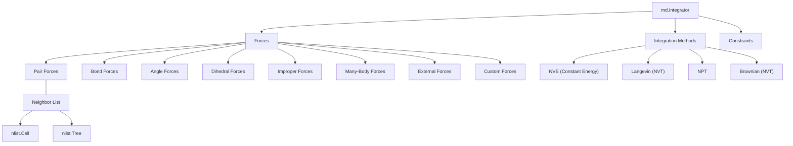
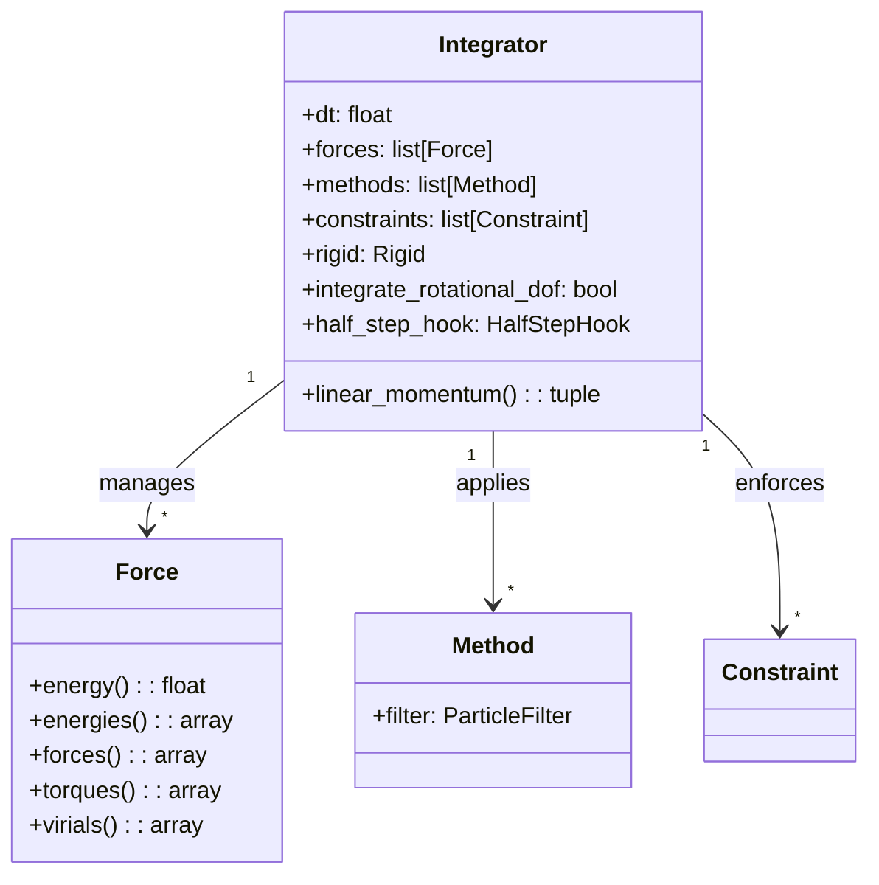
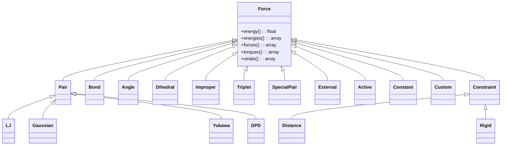
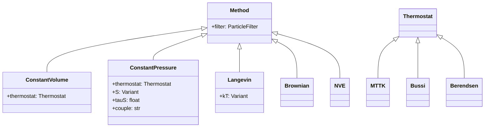
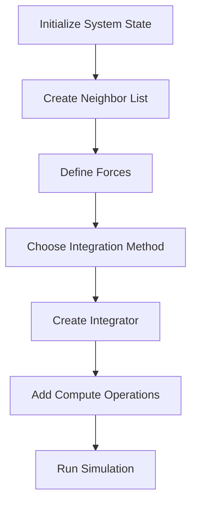

# Molecular Dynamics (MD)

<details>
<summary>Relevant source files</summary>

The following files were used as context for generating this wiki page:

- [hoomd/md/EvaluatorPairExpandedGaussian.h](hoomd/md/EvaluatorPairExpandedGaussian.h)
- [hoomd/md/angle.py](hoomd/md/angle.py)
- [hoomd/md/bond.py](hoomd/md/bond.py)
- [hoomd/md/compute.py](hoomd/md/compute.py)
- [hoomd/md/constrain.py](hoomd/md/constrain.py)
- [hoomd/md/dihedral.py](hoomd/md/dihedral.py)
- [hoomd/md/force.py](hoomd/md/force.py)
- [hoomd/md/improper.py](hoomd/md/improper.py)
- [hoomd/md/integrate.py](hoomd/md/integrate.py)
- [hoomd/md/manifold.py](hoomd/md/manifold.py)
- [hoomd/md/many_body.py](hoomd/md/many_body.py)
- [hoomd/md/module-md.cc](hoomd/md/module-md.cc)
- [hoomd/md/pair/__init__.py](hoomd/md/pair/__init__.py)
- [hoomd/md/pair/aniso.py](hoomd/md/pair/aniso.py)
- [hoomd/md/pair/pair.py](hoomd/md/pair/pair.py)
- [hoomd/md/pytest/CMakeLists.txt](hoomd/md/pytest/CMakeLists.txt)
- [hoomd/md/pytest/aniso_forces_and_energies.json](hoomd/md/pytest/aniso_forces_and_energies.json)
- [hoomd/md/pytest/forces_and_energies.json](hoomd/md/pytest/forces_and_energies.json)
- [hoomd/md/pytest/test_active.py](hoomd/md/pytest/test_active.py)
- [hoomd/md/pytest/test_aniso_pair.py](hoomd/md/pytest/test_aniso_pair.py)
- [hoomd/md/pytest/test_manifolds.py](hoomd/md/pytest/test_manifolds.py)
- [hoomd/md/pytest/test_methods.py](hoomd/md/pytest/test_methods.py)
- [hoomd/md/pytest/test_nlist_tuner.py](hoomd/md/pytest/test_nlist_tuner.py)
- [hoomd/md/pytest/test_potential.py](hoomd/md/pytest/test_potential.py)
- [hoomd/md/special_pair.py](hoomd/md/special_pair.py)

</details>


Molecular Dynamics (MD) in HOOMD-blue is a simulation engine that integrates equations of motion to evolve particle systems over time. The MD module provides a framework for simulating a wide range of systems by calculating forces between particles, updating positions and velocities according to various integration schemes, and computing thermodynamic properties.

For Monte Carlo simulations, see [Hard Particle Monte Carlo (HPMC)](#3).

## Core Architecture

The MD module is organized around several key components that work together to simulate particle dynamics:



Sources: [hoomd/md/integrate.py:131-201](), [hoomd/md/force.py:21-141]()

## Integrator

The `md.Integrator` class orchestrates the time evolution of particles by:

1. Computing forces from force objects
2. Applying integration methods to update positions and velocities
3. Enforcing constraints
4. Computing thermodynamic quantities



The integrator computes the net force, torque, energy, and virial on each particle as a sum from all forces:

```
F_net,i = ∑(f ∈ forces) F_i^f
τ_net,i = ∑(f ∈ forces) τ_i^f
U_net,i = ∑(f ∈ forces) U_i^f
W_net,i = ∑(f ∈ forces) W_i^f
```

Example:
```python
integrator = md.Integrator(dt=0.005, integrate_rotational_dof=True)
integrator.forces = [lj, harmonic_bonds]
integrator.methods = [nvt]
```

Sources: [hoomd/md/integrate.py:131-333]()

## Forces

The `md.force.Force` class is the base class for all force computations, providing methods to calculate forces, torques, energies, and virials.



Sources: [hoomd/md/force.py:21-141]()

### Pair Forces

Pair forces calculate interactions between pairs of particles based on their separation distance:

| Force | Description | Parameters |
|-------|-------------|------------|
| `LJ` | Lennard-Jones potential | epsilon, sigma |
| `Gaussian` | Gaussian potential | epsilon, sigma |
| `Yukawa` | Screened Coulomb potential | epsilon, kappa |
| `DPD` | Dissipative Particle Dynamics | A, gamma |
| `Ewald` | Electrostatic interactions | kappa, alpha |
| `Morse` | Morse potential | D0, alpha, r0 |
| `Table` | User-defined tabulated potential | r_min, U, F |

Example:
```python
nl = md.nlist.Cell()
lj = md.pair.LJ(nlist=nl, default_r_cut=2.5)
lj.params[('A', 'A')] = dict(epsilon=1.0, sigma=1.0)
```

Sources: [hoomd/md/pair/pair.py:24-1114]()

### Anisotropic Pair Forces

Anisotropic pair forces depend on both particle distance and orientation:

| Force | Description | Parameters |
|-------|-------------|------------|
| `GayBerne` | Gay-Berne potential for ellipsoids | epsilon, lperp, lpar |
| `Dipole` | Dipole interaction potential | A, kappa |
| `ALJ` | Anisotropic Lennard-Jones | epsilon, sigma_i, sigma_j, alpha |

Example:
```python
gay_berne = md.pair.aniso.GayBerne(nlist=nl, default_r_cut=2.5)
gay_berne.params[('A', 'A')] = dict(epsilon=1.0, lperp=0.45, lpar=0.5)
```

Sources: [hoomd/md/pair/aniso.py:40-617]()

### Bond Forces

Bond forces maintain connections between specific particle pairs:

| Force | Description | Parameters |
|-------|-------------|------------|
| `Harmonic` | Harmonic spring potential | k, r0 |
| `FENE` | Finite Extensible Nonlinear Elastic | k, r0, epsilon, sigma |

Example:
```python
harmonic = md.bond.Harmonic()
harmonic.params['A-A'] = dict(k=3.0, r0=1.0)
```

Sources: [hoomd/md/bond.py:44-120]()

### Constraint Forces

Constraint forces enforce geometric restrictions on particles:

| Force | Description |
|-------|-------------|
| `Distance` | Maintains fixed distances between particles |
| `Rigid` | Treats groups of particles as rigid bodies |

Example:
```python
rigid = md.constrain.Rigid()
rigid.body['A'] = {
    "constituent_types": ['A_const', 'A_const'],
    "positions": [(0,0,1),(0,0,-1)],
    "orientations": [(1.0, 0.0, 0.0, 0.0), (1.0, 0.0, 0.0, 0.0)],
}
```

Sources: [hoomd/md/constrain.py:29-383]()

## Integration Methods

Integration methods implement specific equations of motion for different statistical ensembles:



| Method | Ensemble | Description |
|--------|----------|-------------|
| `NVE` | Microcanonical | Constant energy, volume, particle number |
| `Langevin` | Canonical | Constant temperature with stochastic forces |
| `Brownian` | Canonical | Overdamped dynamics with stochastic forces |
| `ConstantPressure` | Isothermal-isobaric | Constant pressure and temperature |

Example:
```python
nvt = md.methods.Langevin(filter=hoomd.filter.All(), kT=1.0)
```

Sources: [hoomd/md/pytest/test_methods.py:55-106]()

### Thermostats

Thermostats control system temperature:

| Thermostat | Description |
|------------|-------------|
| `Bussi` | Bussi-Donadio-Parrinello thermostat |
| `MTTK` | Martyna-Tobias-Tuckerman-Klein thermostat |
| `Berendsen` | Berendsen thermostat (weak coupling) |

Example:
```python
thermostat = md.methods.thermostats.Bussi(kT=1.0)
nvt = md.methods.ConstantVolume(filter=hoomd.filter.All(), thermostat=thermostat)
```

## Neighbor Lists

Neighbor lists optimize force calculations by tracking nearby particle pairs:

| Type | Description |
|------|-------------|
| `Cell` | Cell-list based neighbor list |
| `Tree` | Hierarchical tree-based neighbor list |

Example:
```python
nl = md.nlist.Cell(buffer=0.4)
```

Sources: [hoomd/md/module-md.cc:34-38](), [hoomd/md/module-md.cc:196-199]()

## Thermodynamic Calculations

The `md.compute.ThermodynamicQuantities` class computes various thermodynamic properties:

| Property | Description |
|----------|-------------|
| `kinetic_temperature` | Instantaneous thermal energy |
| `pressure` | Instantaneous pressure |
| `kinetic_energy` | Total kinetic energy |
| `potential_energy` | Total potential energy |
| `degrees_of_freedom` | Number of degrees of freedom |

Example:
```python
thermo = md.compute.ThermodynamicQuantities(filter=hoomd.filter.All())
logger = hoomd.logging.Logger()
logger.add(thermo, quantities=['kinetic_temperature', 'pressure'])
```

Sources: [hoomd/md/compute.py:17-214]()

## Simulation Workflow

The typical workflow for an MD simulation in HOOMD-blue is:



Example:
```python
# Create neighbor list
nl = hoomd.md.nlist.Cell()

# Create force objects
lj = hoomd.md.pair.LJ(nlist=nl, default_r_cut=2.5)
lj.params[('A', 'A')] = dict(epsilon=1.0, sigma=1.0)

# Create integration method
nvt = hoomd.md.methods.Langevin(filter=hoomd.filter.All(), kT=1.0)

# Set up integrator
integrator = hoomd.md.Integrator(
    dt=0.005,
    methods=[nvt],
    forces=[lj],
    integrate_rotational_dof=True
)

# Add integrator to simulation
sim.operations.integrator = integrator

# Add thermodynamic computations
thermo = hoomd.md.compute.ThermodynamicQuantities(filter=hoomd.filter.All())
sim.operations.computes.append(thermo)

# Run simulation
sim.run(10000)
```

Sources: [hoomd/md/integrate.py:332-385](), [hoomd/md/compute.py:64-214]()

---