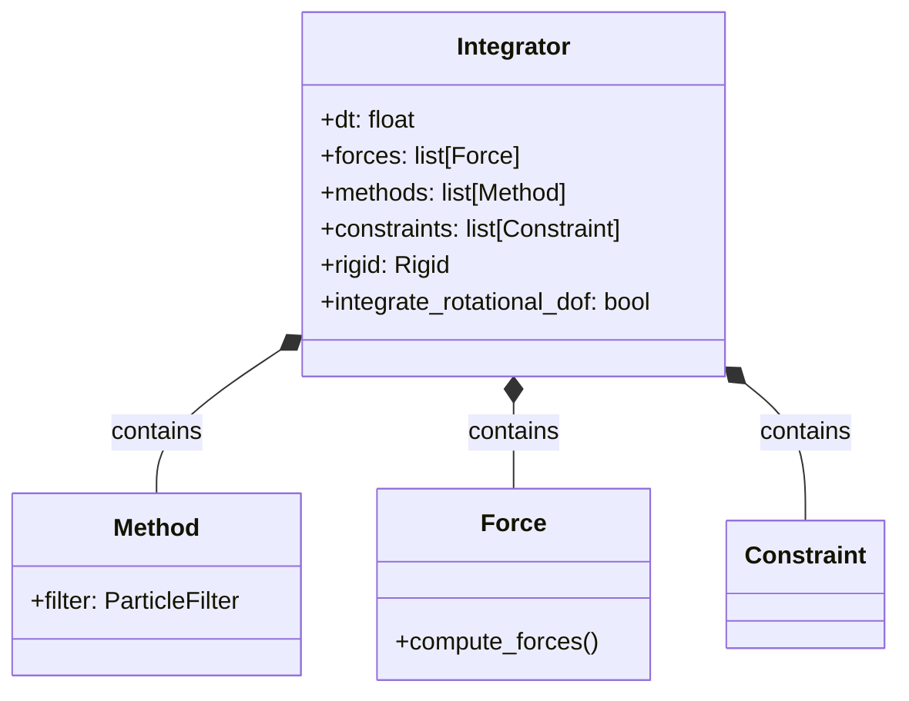
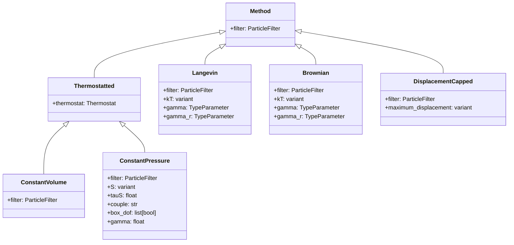
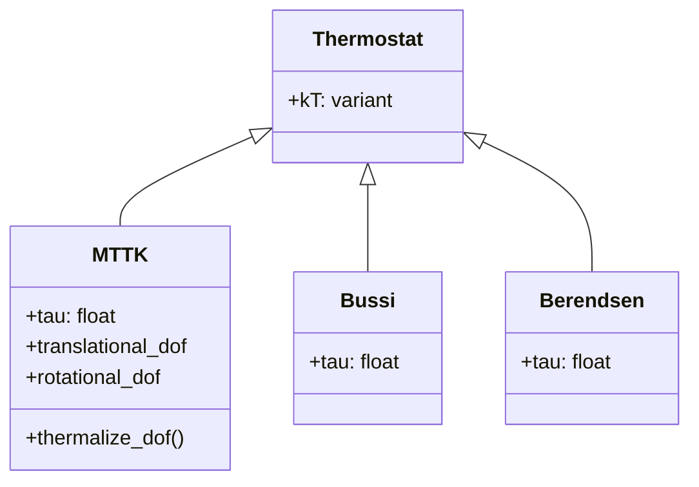
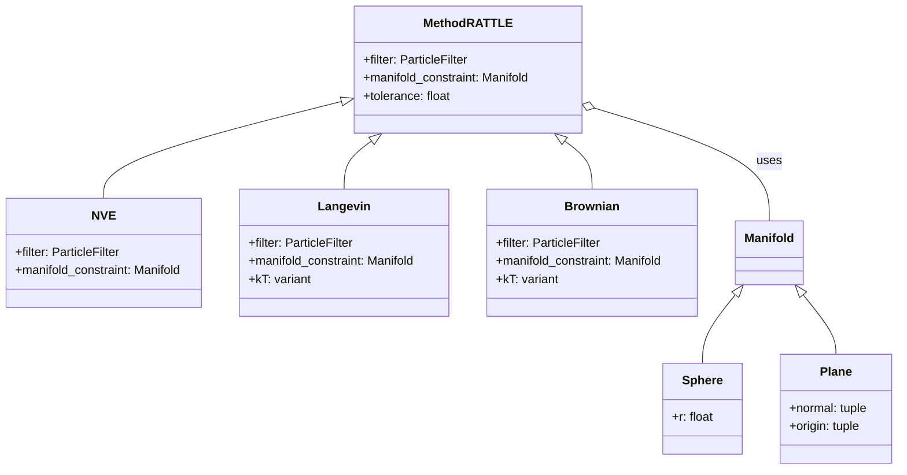

# MD Integration Methods

<details>
<summary>Relevant source files</summary>

The following files were used as context for generating this wiki page:

- [hoomd/logging.py](hoomd/logging.py)
- [hoomd/md/angle.py](hoomd/md/angle.py)
- [hoomd/md/bond.py](hoomd/md/bond.py)
- [hoomd/md/compute.py](hoomd/md/compute.py)
- [hoomd/md/constrain.py](hoomd/md/constrain.py)
- [hoomd/md/dihedral.py](hoomd/md/dihedral.py)
- [hoomd/md/force.py](hoomd/md/force.py)
- [hoomd/md/improper.py](hoomd/md/improper.py)
- [hoomd/md/integrate.py](hoomd/md/integrate.py)
- [hoomd/md/manifold.py](hoomd/md/manifold.py)
- [hoomd/md/many_body.py](hoomd/md/many_body.py)
- [hoomd/md/methods/CMakeLists.txt](hoomd/md/methods/CMakeLists.txt)
- [hoomd/md/methods/__init__.py](hoomd/md/methods/__init__.py)
- [hoomd/md/methods/methods.py](hoomd/md/methods/methods.py)
- [hoomd/md/methods/rattle.py](hoomd/md/methods/rattle.py)
- [hoomd/md/methods/thermostats.py](hoomd/md/methods/thermostats.py)
- [hoomd/md/pair/aniso.py](hoomd/md/pair/aniso.py)
- [hoomd/md/pytest/test_active.py](hoomd/md/pytest/test_active.py)
- [hoomd/md/pytest/test_manifolds.py](hoomd/md/pytest/test_manifolds.py)
- [hoomd/md/pytest/test_methods.py](hoomd/md/pytest/test_methods.py)
- [hoomd/md/special_pair.py](hoomd/md/special_pair.py)
- [hoomd/pytest/test_custom_writer.py](hoomd/pytest/test_custom_writer.py)
- [hoomd/pytest/test_logging.py](hoomd/pytest/test_logging.py)

</details>


This wiki page documents the molecular dynamics (MD) integration methods in HOOMD-blue. These methods define how particle positions, velocities, and orientations evolve over time according to physical equations of motion. HOOMD-blue provides a range of integration methods that enable simulating different statistical ensembles and specialized dynamics.

For information about forces that can be used with these integration methods, see [MD Forces](#4.3).

## Integration Architecture Overview

The `md.Integrator` class orchestrates the time integration process by coordinating forces, integration methods, and constraints. It computes net forces on particles and advances their positions and velocities through time steps.



Sources: [hoomd/md/integrate.py:132-385](hoomd/md/integrate.py:132-385), [hoomd/md/methods/methods.py:29-50](hoomd/md/methods/methods.py:29-50)

During each timestep, the integrator follows this sequence:

```mermaid
flowchart TD
    start["Start Timestep"] --> forces["Compute Net Forces/Torques"]
    forces --> half_step["First Half-Step Integration"]
    half_step --> hook{"Half-Step Hook?"}
    hook -->|"Yes"| custom["Run Custom Half-Step Code"]
    hook -->|"No"| skip["Skip"]
    custom --> constraints["Apply Constraints"]
    skip --> constraints
    constraints --> second_half["Second Half-Step Integration"]
    second_half --> end["End Timestep"]
```

Sources: [hoomd/md/integrate.py:132-258](hoomd/md/integrate.py:132-258)

## Integration Method Hierarchy

HOOMD-blue implements several integration methods that derive from a common base class hierarchy:



Sources: [hoomd/md/methods/methods.py:29-400](hoomd/md/methods/methods.py:29-400), [hoomd/md/methods/__init__.py:18-40](hoomd/md/methods/__init__.py:18-40)

## Basic Integration Methods

### ConstantVolume (NVE/NVT)

The `ConstantVolume` method integrates equations of motion while maintaining a constant simulation volume. It can operate in two modes:

1. **NVE ensemble** (microcanonical): When `thermostat=None`
   - Conserves energy, volume, and particle number
   - Uses Velocity-Verlet algorithm for translational motion
   - Uses a scheme based on Kamberaj 2005 for rotational motion

2. **NVT ensemble** (canonical): When a thermostat is specified
   - Maintains a constant temperature using the chosen thermostat
   - Common choice for equilibrium simulations

Example usage:
```python
# NVE integration
nve = hoomd.md.methods.ConstantVolume(filter=hoomd.filter.All())

# NVT integration with Bussi thermostat
nvt = hoomd.md.methods.ConstantVolume(
    filter=hoomd.filter.All(),
    thermostat=hoomd.md.methods.thermostats.Bussi(kT=1.5)
)
```

Sources: [hoomd/md/methods/methods.py:137-239](hoomd/md/methods/methods.py:137-239)

### ConstantPressure (NPH/NPT)

The `ConstantPressure` method allows the simulation box to change size to maintain a target pressure or stress tensor. It can operate in two modes:

1. **NPH ensemble** (isoenthalpic-isobaric): When `thermostat=None`
   - Conserves enthalpy, pressure, and particle number

2. **NPT ensemble** (isothermal-isobaric): When a thermostat is specified
   - Maintains constant temperature and pressure
   - Common choice for simulations at standard conditions

Key parameters include:
- `S`: Target stress tensor or pressure
- `tauS`: Barostat coupling constant (recommended: ~1000 × timestep)
- `couple`: How to couple box dimensions ("none", "xy", "xz", "yz", or "xyz")
- `box_dof`: Boolean flags for which box dimensions can change
- `gamma`: Friction for barostat degrees of freedom

Example usage:
```python
# NPT integration with cubic symmetry
npt = hoomd.md.methods.ConstantPressure(
    filter=hoomd.filter.All(),
    thermostat=hoomd.md.methods.thermostats.Bussi(kT=1.5),
    S=2.0,
    tauS=1.0,
    couple="xyz"
)
```

Sources: [hoomd/md/methods/methods.py:242-675](hoomd/md/methods/methods.py:242-675)

### DisplacementCapped

The `DisplacementCapped` method limits the maximum displacement of particles per timestep, which can be useful for high-energy systems or during equilibration to prevent numerical instabilities.

Example usage:
```python
capped = hoomd.md.methods.DisplacementCapped(
    filter=hoomd.filter.All(),
    maximum_displacement=0.001
)
```

Sources: [hoomd/md/methods/methods.py:677-739](hoomd/md/methods/methods.py:677-739)

## Stochastic Integration Methods

### Langevin Dynamics

The `Langevin` method implements Langevin dynamics by adding both friction and random forces to particles, appropriate for simulating particles in an implicit solvent:

$m\frac{d\vec{v}}{dt} = \vec{F} - \gamma \vec{v} + \vec{R}(t)$

where $\vec{F}$ is the conservative force, $\gamma$ is the friction coefficient, and $\vec{R}(t)$ is a random force with variance related to temperature and $\gamma$.

Key parameters:
- `kT`: Temperature setting
- `gamma`: Translational friction coefficients (per particle type)
- `gamma_r`: Rotational friction coefficients (per particle type)

Sources: [hoomd/md/methods/methods.py:742-840](hoomd/md/methods/methods.py:742-840)

### Brownian Dynamics

The `Brownian` method implements Brownian dynamics, which is the high-friction limit of Langevin dynamics. It treats particle motion as completely overdamped, ignoring inertial effects. This is appropriate for systems like colloidal suspensions.

Parameters are the same as for Langevin dynamics.

Sources: [hoomd/md/methods/methods.py:843-931](hoomd/md/methods/methods.py:843-931)

### OverdampedViscous

The `OverdampedViscous` method is similar to Brownian dynamics but without the random thermal forces. Particles move proportionally to the applied forces (overdamped). This is useful for energy minimization or when thermal fluctuations are not desired.

Sources: [hoomd/md/methods/methods.py:934-1010](hoomd/md/methods/methods.py:934-1010)

## Thermostats

Thermostats control the temperature in MD simulations and are used with the `ConstantVolume` and `ConstantPressure` methods. HOOMD-blue provides several thermostat implementations:



### Available Thermostats

1. **MTTK (Nosé-Hoover)**
   - Deterministic thermostat based on extended system approach
   - Generates correct canonical ensemble for sufficiently large systems
   - Parameters: `kT` (temperature), `tau` (coupling constant)

2. **Bussi**
   - Stochastic velocity rescaling thermostat
   - Correctly samples the canonical ensemble even for small systems
   - Parameters: `kT` (temperature), `tau` (coupling constant)

3. **Berendsen**
   - Simple velocity rescaling approach
   - Note: Does not sample the correct canonical ensemble
   - Parameters: `kT` (temperature), `tau` (coupling constant)

Sources: [hoomd/md/methods/thermostats.py:45-419](hoomd/md/methods/thermostats.py:45-419)

## Constrained Integration (RATTLE)

HOOMD-blue implements the RATTLE algorithm to constrain particles to move on manifold surfaces. This allows simulation of systems constrained to non-flat geometries.



### Available RATTLE Methods

The RATTLE-constrained methods are in the `hoomd.md.methods.rattle` module:

1. **NVE with RATTLE**: Constant energy dynamics on a manifold
2. **Langevin with RATTLE**: Langevin dynamics on a manifold
3. **Brownian with RATTLE**: Brownian dynamics on a manifold
4. **OverdampedViscous with RATTLE**: Overdamped dynamics on a manifold

Each method requires a `manifold_constraint` parameter specifying the manifold geometry.

Example usage:
```python
# NVE integration on a sphere
sphere = hoomd.md.manifold.Sphere(r=10)
nve_rattle = hoomd.md.methods.rattle.NVE(
    filter=hoomd.filter.All(),
    manifold_constraint=sphere
)
```

Sources: [hoomd/md/methods/rattle.py:29-109](hoomd/md/methods/rattle.py:29-109), [hoomd/md/manifold.py:23-44](hoomd/md/manifold.py:23-44)

## Using Multiple Integration Methods

HOOMD-blue allows using multiple integration methods simultaneously, each operating on different particle subsets (which must not overlap). The integrator validates that the particle groups don't overlap.

This is useful for:
- Thermostating different regions at different temperatures
- Applying different dynamics to different parts of the system
- Implementing advanced schemes like parallel tempering

Example with two temperature regions:
```python
# Create two disjoint filters
hot_filter = hoomd.filter.Type(["A"])
cold_filter = hoomd.filter.Type(["B"])

# Create two integration methods with different temperatures
hot_region = hoomd.md.methods.Langevin(filter=hot_filter, kT=2.0)
cold_region = hoomd.md.methods.Langevin(filter=cold_filter, kT=1.0)

# Combine in the integrator
integrator = hoomd.md.Integrator(
    dt=0.005,
    methods=[hot_region, cold_region]
)
```

Sources: [hoomd/md/integrate.py:22-127](hoomd/md/integrate.py:22-127)

## Degrees of Freedom Handling

The integrator tracks degrees of freedom for computing properties like temperature. For each particle:

- Translational DoF: Usually 3 (2 in 2D simulations)
- Rotational DoF: 0-3 depending on:
  - Whether `integrate_rotational_dof` is `True`
  - Whether the particle's moment of inertia components are non-zero
  - The dimensionality of the system

Constraints like rigid bodies and distance constraints reduce the total degrees of freedom. These calculations are important for correctly computing thermodynamic properties like temperature and pressure.

Sources: [hoomd/md/compute.py:197-302](hoomd/md/compute.py:197-302)

## Choosing an Integration Method

The choice of integration method depends on the physical system and properties of interest:

| Physical System | Recommended Method |
| --------------- | ------------------ |
| Equilibrium sampling with fixed volume | `ConstantVolume` with thermostat (NVT) |
| Equilibrium sampling with fixed pressure | `ConstantPressure` with thermostat (NPT) |
| Energy conservation studies | `ConstantVolume` without thermostat (NVE) |
| Systems with implicit solvent | `Langevin` or `Brownian` |
| Initial equilibration of challenging systems | `DisplacementCapped` |
| Particles constrained to surfaces | RATTLE methods |

For thermostat choice, MTTK and Bussi are recommended for most applications, with Bussi generally preferred for smaller systems.

Sources: [hoomd/md/methods/methods.py:137-675](hoomd/md/methods/methods.py:137-675), [hoomd/md/methods/thermostats.py:70-419](hoomd/md/methods/thermostats.py:70-419)

---