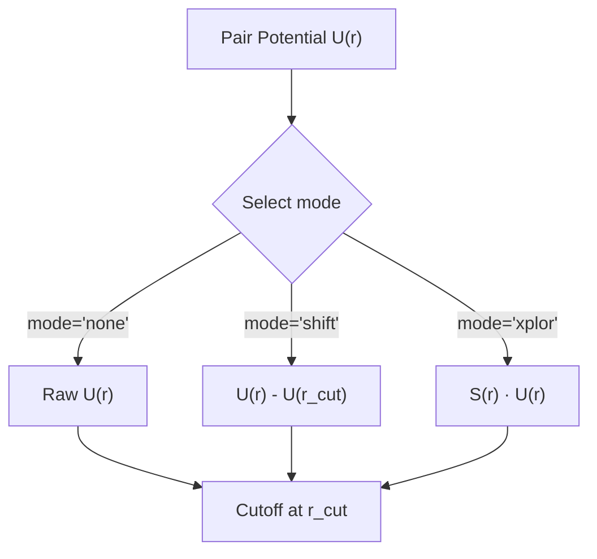
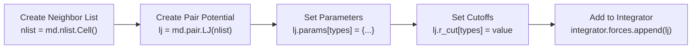
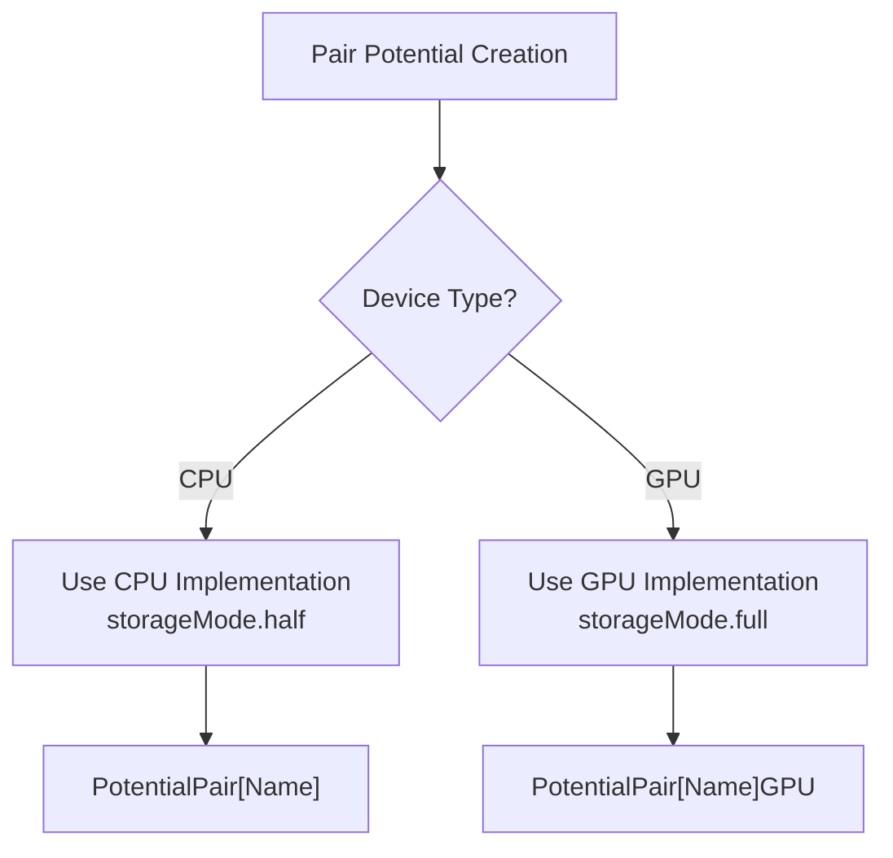

# MD Pair Potentials

<details>
<summary>Relevant source files</summary>

The following files were used as context for generating this wiki page:

- [hoomd/md/EvaluatorPairExpandedGaussian.h](hoomd/md/EvaluatorPairExpandedGaussian.h)
- [hoomd/md/module-md.cc](hoomd/md/module-md.cc)
- [hoomd/md/pair/__init__.py](hoomd/md/pair/__init__.py)
- [hoomd/md/pair/pair.py](hoomd/md/pair/pair.py)
- [hoomd/md/pytest/CMakeLists.txt](hoomd/md/pytest/CMakeLists.txt)
- [hoomd/md/pytest/aniso_forces_and_energies.json](hoomd/md/pytest/aniso_forces_and_energies.json)
- [hoomd/md/pytest/forces_and_energies.json](hoomd/md/pytest/forces_and_energies.json)
- [hoomd/md/pytest/test_aniso_pair.py](hoomd/md/pytest/test_aniso_pair.py)
- [hoomd/md/pytest/test_nlist_tuner.py](hoomd/md/pytest/test_nlist_tuner.py)
- [hoomd/md/pytest/test_potential.py](hoomd/md/pytest/test_potential.py)

</details>


## Purpose and Scope

This page documents the pair potentials available in HOOMD-blue's Molecular Dynamics (MD) module. Pair potentials model interactions between pairs of particles and are a fundamental component of molecular dynamics simulations. They compute forces and energies based on the distance between particles, following specific mathematical forms to represent various physical phenomena like van der Waals forces, electrostatic interactions, and more.

For information about MD integration methods used with these potentials, see [MD Integration Methods](#4.1). For details on neighbor lists used to accelerate pair potential calculations, see [Neighbor Lists](#4.4).

Sources: [hoomd/md/pair/pair.py:1-193](), [hoomd/md/pair/__init__.py:1-193]()

## Overview of Pair Potentials

Pair potentials in HOOMD-blue compute pairwise interactions between particles using the general form:

```math
U_{\mathrm{pair,total}} = \frac{1}{2} \sum_{i=0}^{\mathrm{N_particles-1}} \sum_{j \ne i, (i,j) \notin \mathrm{exclusions}} U_{\mathrm{pair}}(r_{ij})
```

where $r_{ij}$ is the distance between particles $i$ and $j$, and exclusions are particle pairs that should be ignored (typically bonded particles).

The HOOMD-blue implementation applies cutoffs using neighbor lists, expecting that both the potential and its derivatives are zero when $r_{ij} \geq r_{\mathrm{cut}}$.

### Key Concepts: Cutoffs, Shifting, and Smoothing

All pair potentials in HOOMD-blue support various methods of handling the potential cutoff:

1. **No modification** (`mode="none"`): Use the potential function as defined
2. **Energy shifting** (`mode="shift"`): Shift the potential so it's zero at the cutoff
3. **XPLOR smoothing** (`mode="xplor"`): Apply a smoothing function to ensure forces and energies go smoothly to zero at the cutoff



Sources: [hoomd/md/pair/pair.py:31-86](), [hoomd/md/pair/__init__.py:46-86]()

## Pair Potential Architecture

All pair potentials in HOOMD-blue inherit from the `Pair` base class, which provides common functionality:

```mermaid
classDiagram
    class Pair {
        +nlist: NeighborList
        +mode: str
        +r_cut: TypeParameter
        +r_on: TypeParameter
        +compute_energy(tags1, tags2)
    }
    
    Pair <|-- LJ
    Pair <|-- Gaussian
    Pair <|-- Yukawa
    Pair <|-- Morse
    Pair <|-- DPD
    Pair <|-- Table
    Pair <|-- OtherPotentials["..."]
```

Sources: [hoomd/md/pair/pair.py:24-107](), [hoomd/md/pair/pair.py:215-1052]()

### Common Parameters and Methods

All pair potentials share these key attributes and methods:

- `nlist`: Neighbor list used to compute the pair force
- `mode`: Energy shifting/smoothing mode (`"none"`, `"shift"`, or `"xplor"`)
- `r_cut`: Cutoff radius beyond which the energy and force are 0
- `r_on`: Radius at which the smoothing function starts (for `mode="xplor"`)
- `params`: Potential-specific parameters (varies by potential)
- `compute_energy()`: Compute the energy between two sets of particles

Sources: [hoomd/md/pair/pair.py:39-103]()

## Available Pair Potentials

HOOMD-blue provides numerous pair potentials to model different physical interactions. Here are the most commonly used ones:

### Lennard-Jones (LJ)

The Lennard-Jones potential models van der Waals forces with both repulsive and attractive components:

```math
U(r) = 4 \varepsilon \left[ \left( \frac{\sigma}{r} \right)^{12} - \left( \frac{\sigma}{r} \right)^{6} \right]
```

**Parameters**:
- `epsilon`: Energy parameter $\varepsilon$ [energy]
- `sigma`: Particle size $\sigma$ [length]

**Example**:
```python
nl = nlist.Cell()
lj = pair.LJ(nl, default_r_cut=3.0)
lj.params[("A", "A")] = {"sigma": 1.0, "epsilon": 1.0}
lj.r_cut[("A", "B")] = 3.0
```

Sources: [hoomd/md/pair/pair.py:216-288]()

### Gaussian

The Gaussian potential provides a soft repulsive interaction:

```math
U(r) = \varepsilon \exp \left( -\frac{1}{2} \left( \frac{r}{\sigma} \right)^2 \right)
```

**Parameters**:
- `epsilon`: Energy parameter $\varepsilon$ [energy]
- `sigma`: Width parameter $\sigma > 0$ [length]

Sources: [hoomd/md/pair/pair.py:290-346]()

### Expanded Gaussian

A radially-shifted Gaussian potential:

```math
U(r) = \varepsilon \exp \left( -\frac{1}{2} \left( \frac{r-\Delta}{\sigma} \right)^2 \right)
```

**Parameters**:
- `epsilon`: Energy parameter $\varepsilon$ [energy]
- `sigma`: Width parameter $\sigma > 0$ [length]
- `delta`: Shift distance $\Delta$ [length]

Sources: [hoomd/md/pair/pair.py:348-410](), [hoomd/md/EvaluatorPairExpandedGaussian.h:1-186]()

### Yukawa

The Yukawa potential models screened electrostatic interactions:

```math
U(r) = \varepsilon \frac{ \exp \left( -\kappa r \right) }{r}
```

**Parameters**:
- `epsilon`: Energy parameter $\varepsilon$ [energy][length]
- `kappa`: Screening parameter $\kappa$ [length^-1]

Sources: [hoomd/md/pair/pair.py:478-535]()

### Morse

The Morse potential models anharmonic bonds:

```math
U(r) = D_0 \left[ \exp \left(-2\alpha\left( r-r_0\right)\right) -2\exp \left(-\alpha\left(r-r_0\right) \right) \right]
```

**Parameters**:
- `D0`: Depth of the potential at its minimum [energy]
- `alpha`: Width of the potential well [length^-1]
- `r0`: Position of the minimum [length]

Sources: [hoomd/md/pair/pair.py:716-774]()

### Table

The tabulated pair potential allows defining arbitrary potentials through discrete values:

```math
U(r) = 
\begin{cases}
0 & r < r_{\mathrm{min}} \\
U_\mathrm{table}(r) & r_{\mathrm{min}} \le r < r_{\mathrm{cut}} \\
0 & r \ge r_{\mathrm{cut}} \\
\end{cases}
```

**Parameters**:
- `r_min`: Minimum distance to apply the tabulated potential
- `U`: Array of tabulated energy values
- `F`: Array of tabulated force values

Sources: [hoomd/md/pair/pair.py:606-714]()

### Dissipative Particle Dynamics (DPD)

The DPD potential includes conservative, dissipative, and random forces for coarse-grained simulations:

```math
F = F_{\mathrm{C}}(r) + F_{\mathrm{R,ij}}(r_{ij}) + F_{\mathrm{D,ij}}(v_{ij})
```

**Parameters**:
- `A`: Conservative force magnitude [force]
- `gamma`: Dissipation coefficient [mass·time^-1]
- `kT`: Temperature [energy]

Sources: [hoomd/md/pair/pair.py:776-888]()

## Other Specialized Potentials

HOOMD-blue includes many additional pair potentials for specialized applications:

| Potential | Description | Key Parameters |
|-----------|-------------|----------------|
| `ExpandedLJ` | Radially-shifted Lennard-Jones | `sigma`, `epsilon`, `delta` |
| `Ewald` | Ewald pair component for electrostatics | `kappa`, `alpha` |
| `ForceShiftedLJ` | Force-shifted Lennard-Jones | `sigma`, `epsilon` |
| `DPDLJ` | DPD with LJ conservative force | `sigma`, `epsilon`, `gamma`, `kT` |
| `Mie` | Generalized Lennard-Jones | `epsilon`, `sigma`, `n`, `m` |
| `Buckingham` | Exponential-6 potential | `A`, `rho`, `C` |
| `LJGauss` | LJ combined with Gaussian | `r0`, `epsilon`, `sigma` |

Sources: [hoomd/md/pair/pair.py:412-1052](), [hoomd/md/pair/__init__.py:134-193]()

## Usage Patterns

### Basic Usage Flow



Sources: [hoomd/md/pair/pair.py:236-241](), [hoomd/md/pytest/test_potential.py:74-78]()

### Setting Parameters for Multiple Type Pairs

To set parameters efficiently for multiple particle type pairs, you can use HOOMD-blue's flexible key syntax:

```python
# For a specific type pair
lj.params[("A", "A")] = {"sigma": 1.0, "epsilon": 1.0}

# For a type with multiple other types
lj.params[(["A", "B"], ["C", "D"])] = {"sigma": 1.2, "epsilon": 0.5}

# Set different cutoffs
lj.r_cut[("A", "B")] = 2.5
```

Sources: [hoomd/md/pytest/test_potential.py:997-1003]()

## Performance Optimization

### GPU Acceleration

All pair potentials in HOOMD-blue automatically utilize GPU acceleration when run on a GPU-enabled build. The code detects the device type and selects the appropriate implementation:



Sources: [hoomd/md/pair/pair.py:191-197](), [hoomd/md/module-md.cc:445-467]()

### Optimizing Cutoff Radius

- Setting appropriate cutoff radii is crucial for performance
- Larger cutoffs increase accuracy but slow down simulations
- You can disable interactions between specific particle types by setting `r_cut` to 0

Sources: [hoomd/md/pair/__init__.py:30-34]()

## Example: Complete Simulation Setup

This example demonstrates setting up a simulation with Lennard-Jones potential:

```python
# Create system
system = hoomd.Simulation(device)
system.create_state_from_gsd('initial.gsd')

# Create neighbor list
nlist = hoomd.md.nlist.Cell(buffer=0.4)

# Create pair potential
lj = hoomd.md.pair.LJ(nlist=nlist, default_r_cut=2.5, mode="shift")
lj.params[('A', 'A')] = dict(epsilon=1.0, sigma=1.0)
lj.params[('A', 'B')] = dict(epsilon=1.5, sigma=0.8)
lj.params[('B', 'B')] = dict(epsilon=0.5, sigma=1.0)

# Create integrator and add forces
integrator = hoomd.md.Integrator(dt=0.005)
integrator.forces.append(lj)
integrator.methods.append(hoomd.md.methods.Langevin(hoomd.filter.All(), kT=1.0))

# Add integrator to simulation
system.operations.integrator = integrator

# Run simulation
system.run(1000)
```

Sources: [hoomd/md/pytest/test_potential.py:94-104](), [hoomd/md/pytest/test_nlist_tuner.py:17-30]()

---