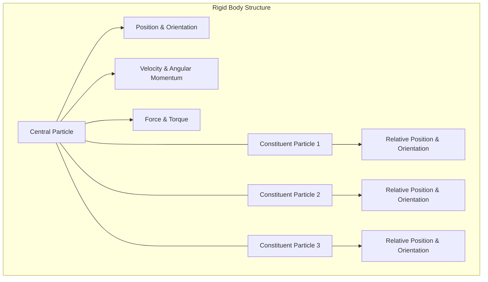
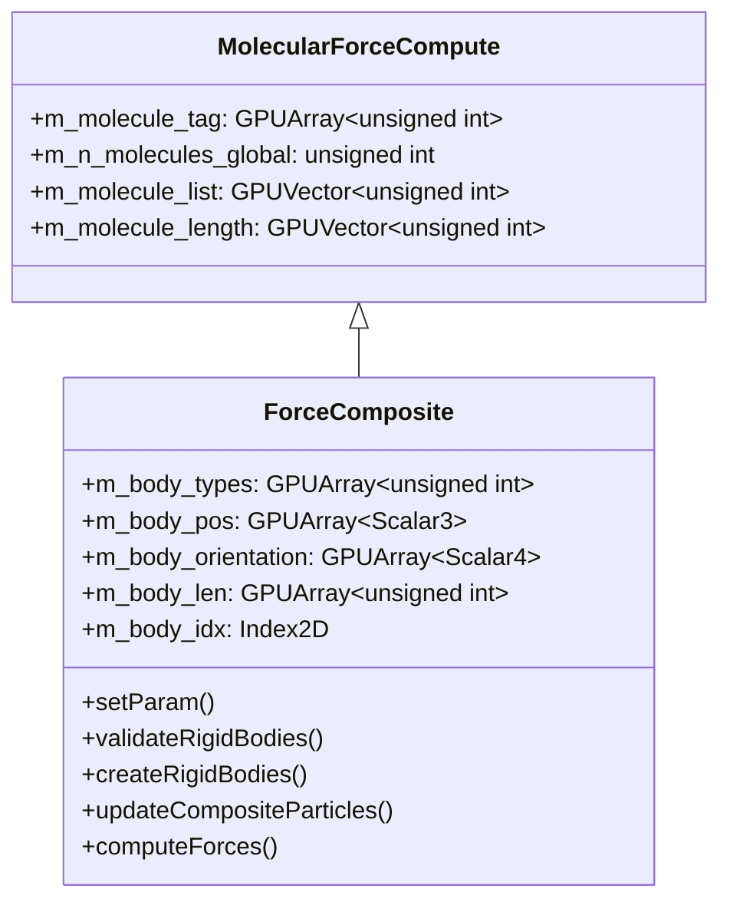
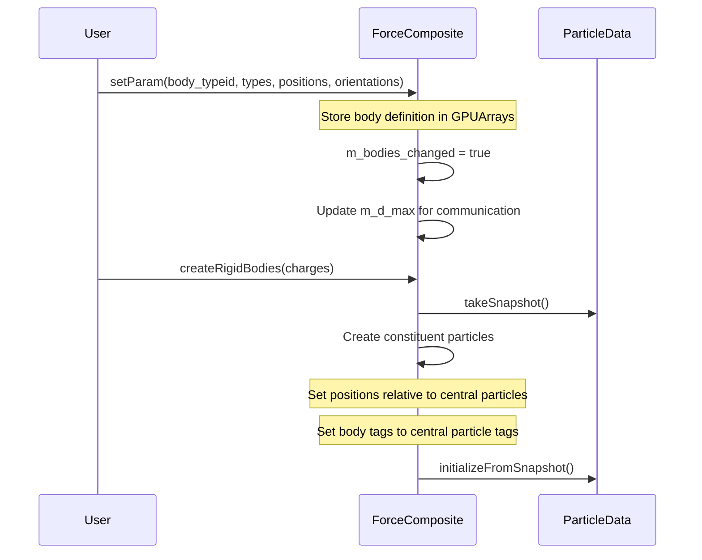
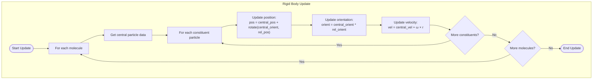
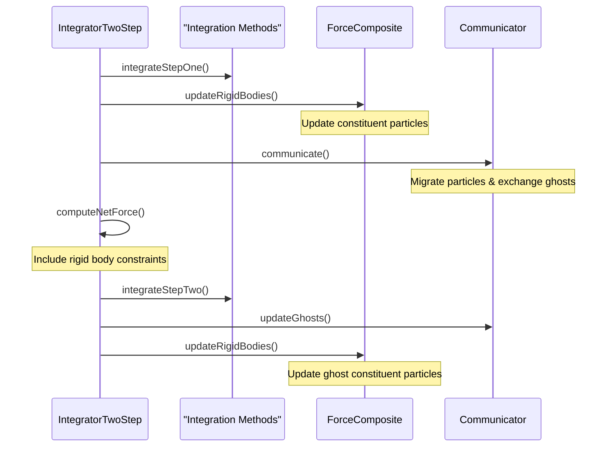
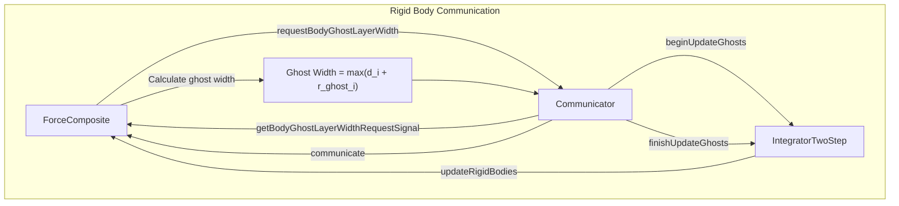
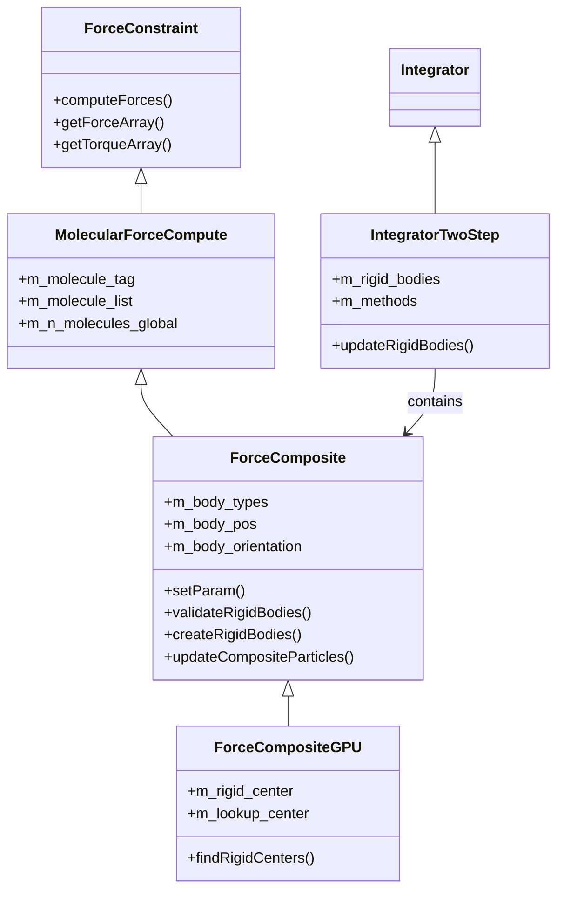
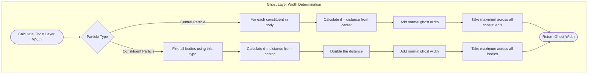

# MD Forces and Rigid Bodies

<details>
<summary>Relevant source files</summary>

The following files were used as context for generating this wiki page:

- [hoomd/Communicator.cc](hoomd/Communicator.cc)
- [hoomd/Communicator.h](hoomd/Communicator.h)
- [hoomd/CommunicatorGPU.cc](hoomd/CommunicatorGPU.cc)
- [hoomd/CommunicatorGPU.cu](hoomd/CommunicatorGPU.cu)
- [hoomd/CommunicatorGPU.cuh](hoomd/CommunicatorGPU.cuh)
- [hoomd/CommunicatorGPU.h](hoomd/CommunicatorGPU.h)
- [hoomd/Integrator.cc](hoomd/Integrator.cc)
- [hoomd/Integrator.h](hoomd/Integrator.h)
- [hoomd/md/ForceComposite.cc](hoomd/md/ForceComposite.cc)
- [hoomd/md/ForceComposite.h](hoomd/md/ForceComposite.h)
- [hoomd/md/ForceCompositeGPU.cc](hoomd/md/ForceCompositeGPU.cc)
- [hoomd/md/ForceCompositeGPU.cu](hoomd/md/ForceCompositeGPU.cu)
- [hoomd/md/ForceCompositeGPU.cuh](hoomd/md/ForceCompositeGPU.cuh)
- [hoomd/md/ForceCompositeGPU.h](hoomd/md/ForceCompositeGPU.h)
- [hoomd/md/IntegratorTwoStep.cc](hoomd/md/IntegratorTwoStep.cc)
- [hoomd/md/IntegratorTwoStep.h](hoomd/md/IntegratorTwoStep.h)
- [hoomd/md/MolecularForceCompute.cc](hoomd/md/MolecularForceCompute.cc)
- [hoomd/md/MolecularForceCompute.cu](hoomd/md/MolecularForceCompute.cu)
- [hoomd/md/MolecularForceCompute.cuh](hoomd/md/MolecularForceCompute.cuh)
- [hoomd/md/MolecularForceCompute.h](hoomd/md/MolecularForceCompute.h)
- [hoomd/md/test/test_MolecularForceCompute.cc](hoomd/md/test/test_MolecularForceCompute.cc)

</details>


This document provides a comprehensive explanation of how rigid bodies are handled in HOOMD-blue's molecular dynamics framework, focusing specifically on force computation and rigid body management. It covers the internal architecture, data structures, force calculation, and communication mechanisms that enable rigid body simulations. For information about MD integration methods, please see [MD Integration Methods](#4.1), and for pair potentials, refer to [MD Pair Potentials](#4.2).

## Overview of Rigid Bodies in HOOMD-blue

HOOMD-blue implements rigid bodies using a central particle approach. Each rigid body consists of a central particle that describes the overall position, orientation, and motion of the body, plus a set of constituent particles at fixed relative positions to the central particle. The forces on the constituent particles are accumulated to compute the net force and torque on the central particle, which is then used to update the rigid body's motion during integration.



Sources: [hoomd/md/ForceComposite.h:8-53](), [hoomd/md/ForceComposite.cc:23-47]()

## Data Model and Identification

Rigid bodies are defined by type, where each central particle type corresponds to a specific rigid body template. The constituent particles are identified by their `body` tag, which equals the tag of their central particle. This design allows efficient lookup of central particles and ensures each constituent particle belongs to exactly one rigid body.

The `ForceComposite` class stores the rigid body definitions and manages the interrelationships between bodies and particles:



Sources: [hoomd/md/ForceComposite.h:69-235](), [hoomd/md/MolecularForceCompute.h:47-114]()

## Rigid Body Definition and Creation

Rigid bodies are defined by specifying:
1. The central particle type
2. Types of constituent particles
3. Relative positions of constituent particles
4. Relative orientations of constituent particles

The `setParam` method configures a rigid body type:



Sources: [hoomd/md/ForceComposite.cc:82-105](), [hoomd/md/ForceComposite.cc:466-621]()

## Force Computation

The core functionality of `ForceComposite` is computing forces and torques on rigid bodies. This process involves:

1. Summing forces on constituent particles to get net force on the central particle
2. Computing torques from forces on constituent particles using cross products
3. Zeroing forces on constituent particles to avoid double counting
4. Accumulating virial contributions for pressure calculation

```mermaid
flowchart TD
    start([Start Force Computation]) --> loop[For each molecule]
    loop --> central[Get central particle]
    central --> check{Is particle\nin bounds?}
    check -->|No| nextMol[Next molecule]
    check -->|Yes| loopConstituent[For each constituent particle]
    loopConstituent --> getForce[Get force on constituent]
    getForce --> zeroForce[Zero constituent force]
    getForce --> addForce[Add to central force]
    getForce --> computeTorque[Compute r × f for torque]
    computeTorque --> addTorque[Add to central torque]
    addTorque --> nextConst{More constituents?}
    nextConst -->|Yes| loopConstituent
    nextConst -->|No| nextMol
    nextMol --> checkMore{More molecules?}
    checkMore -->|Yes| loop
    checkMore -->|No| end([End Force Computation])
```

The CPU implementation sums these forces directly, while the GPU implementation (`ForceCompositeGPU`) uses parallel reduction techniques to efficiently compute the net forces and torques.

Sources: [hoomd/md/ForceComposite.cc:658-842](), [hoomd/md/ForceCompositeGPU.cc:55-242](), [hoomd/md/ForceCompositeGPU.cu:62-252]()

## Rigid Body Update

After forces are computed and the integrator updates the positions, velocities, and orientations of central particles, the constituent particles must be updated to maintain rigid body integrity. This occurs in the `updateCompositeParticles` method:



This update happens at two points during integration:
1. After the first integration step to ensure proper particle migration
2. After communication to update ghost constituent particles

Sources: [hoomd/md/ForceComposite.cc:849-944](), [hoomd/md/ForceCompositeGPU.cc:244-377](), [hoomd/md/IntegratorTwoStep.cc:87-90](), [hoomd/md/IntegratorTwoStep.cc:125-126]()

## Integration with IntegratorTwoStep

The `IntegratorTwoStep` class handles the integration process for rigid bodies by calling `ForceComposite` at appropriate times in the integration cycle:



Sources: [hoomd/md/IntegratorTwoStep.cc:51-126](), [hoomd/md/IntegratorTwoStep.cc:292-298]()

## MPI Communication for Rigid Bodies

In distributed simulations, special care is needed to ensure proper communication of rigid bodies across domain boundaries. The key challenges are:

1. Ensuring all constituent particles of a rigid body can be properly placed based on their central particle
2. Maintaining correct ghost particle layers for proper force computation

The `Communicator` and `ForceComposite` classes work together to handle these challenges:



The ghost layer width for a constituent particle must be large enough to include its central particle and all other constituent particles of the same body. This is handled by the `requestBodyGhostLayerWidth` method.

Sources: [hoomd/md/ForceComposite.cc:192-266](), [hoomd/Communicator.cc:178-192](), [hoomd/Communicator.h:182-192]()

## Key Classes and Responsibilities

| Class | Responsibility |
|-------|---------------|
| `ForceComposite` | Defines rigid bodies, computes forces and torques, updates constituent particles |
| `ForceCompositeGPU` | GPU implementation of `ForceComposite` |
| `MolecularForceCompute` | Base class for force computes that work with molecules/bodies |
| `IntegratorTwoStep` | Integrates rigid bodies, manages rigid body updates during integration |
| `Communicator` | Handles MPI communication including ghost particles for rigid bodies |

Sources: [hoomd/md/ForceComposite.h:68-235](), [hoomd/md/ForceCompositeGPU.h:25-76](), [hoomd/md/IntegratorTwoStep.h:38-122]()

## Class Hierarchy and Relationships



Sources: [hoomd/md/ForceComposite.h:68-235](), [hoomd/md/ForceCompositeGPU.h:25-76](), [hoomd/md/IntegratorTwoStep.h:38-122](), [hoomd/Integrator.h:60-210]()

## Force Computation Implementation Details

The force computation for rigid bodies follows different patterns on CPU and GPU:

### CPU Implementation (ForceComposite):
- Iterates over each molecule and its constituents sequentially
- Directly accumulates forces and torques on the central particle
- Simple but less efficient for large systems

### GPU Implementation (ForceCompositeGPU):
- Uses a sliding window approach to parallelize computation
- Each thread block handles a small number of bodies (n_bodies_per_block)
- Threads within a block cooperate to process a body's constituents
- Partial sums are stored in shared memory and reduced efficiently
- Uses autotuning to optimize performance parameters


Sources: [hoomd/md/ForceCompositeGPU.cu:62-252](), [hoomd/md/ForceComposite.cc:658-842]()

## Communication and Ghost Layer Width

Proper communication of rigid bodies requires careful management of ghost layer widths. The ghost width must be large enough to ensure that:

1. For central particles, all constituent particles can be correctly positioned
2. For constituent particles, the central particle is available when needed for force computation

The calculation of these ghost layer widths is handled by the `requestBodyGhostLayerWidth` method:

### For Central Particles:
- Ghost width = max(d_i + r_ghost_i) where:
  - d_i is the distance of constituent i from the center
  - r_ghost_i is the usual ghost width for particle i's type

### For Constituent Particles:
- Ghost width = max(2*d_i + r_ghost_i) to ensure central particles are always accessible



Sources: [hoomd/md/ForceComposite.cc:192-266](), [hoomd/Communicator.h:182-192]()

## Validation and Error Checking

The `ForceComposite` class includes extensive validation to ensure rigid bodies are correctly defined and maintained:

1. **During Setup**:
   - Validates that rigid bodies do not contain nested rigid bodies
   - Checks that constituent lists have consistent lengths
   - Verifies that body types are valid

2. **During Simulation**:
   - Validates that central particles have body tags equal to their own tags
   - Checks that constituent particles point to valid central particles
   - Ensures rigid bodies are complete (have all required constituents)
   - Verifies that particle types are consistent with rigid body definitions

These validations help prevent common errors in rigid body simulations and ensure the integrity of the simulation results.

Sources: [hoomd/md/ForceComposite.cc:268-429]()

## Performance Considerations

Rigid body simulations introduce several performance considerations:

1. **Communication Overhead**: Rigid bodies may require larger ghost layers, increasing communication volume
2. **Force Computation**: The accumulation of forces on constituent particles adds computational overhead
3. **Memory Access Patterns**: GPU implementations must carefully manage memory access for efficient computation
4. **Load Balancing**: Domain decomposition must account for rigid bodies that cross domain boundaries

The GPU implementation includes autotuners to optimize performance parameters such as:
- Number of bodies handled per thread block
- Thread block size for force computation
- Thread block size for virial computation
- Thread block size for particle updates

Sources: [hoomd/md/ForceCompositeGPU.cc:23-36](), [hoomd/md/ForceCompositeGPU.cu:37-61]()

---