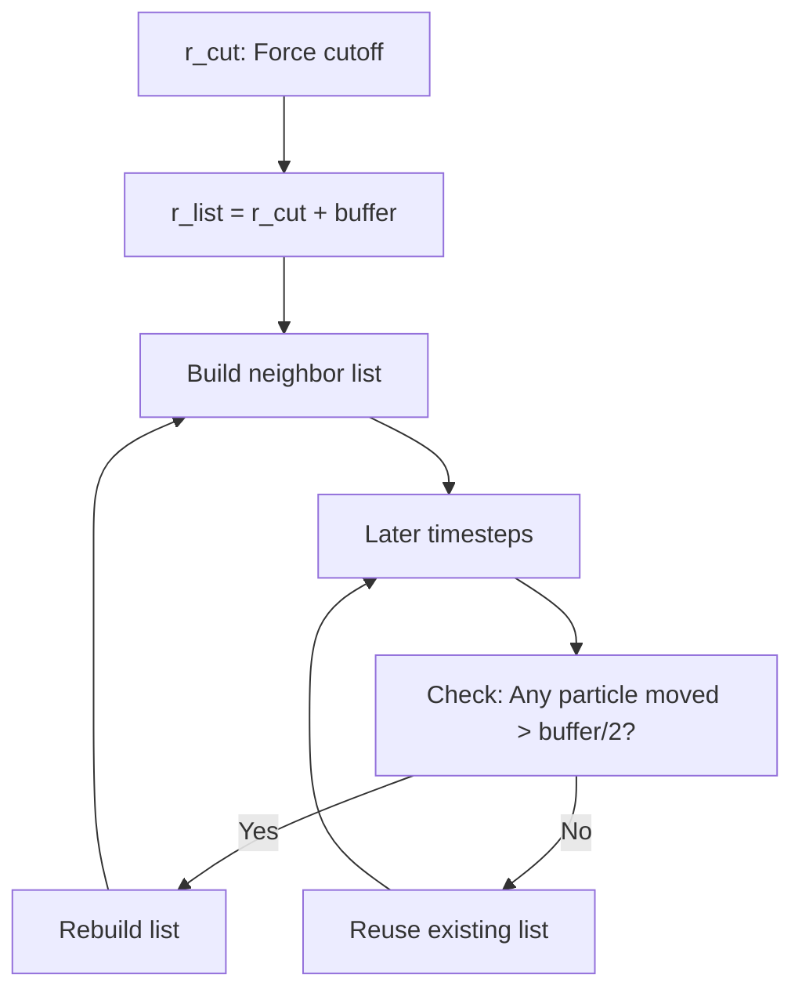
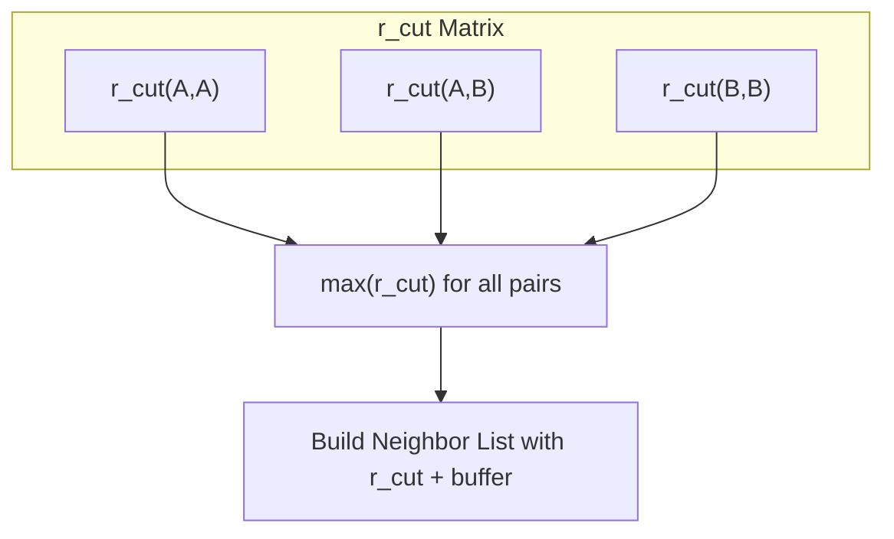
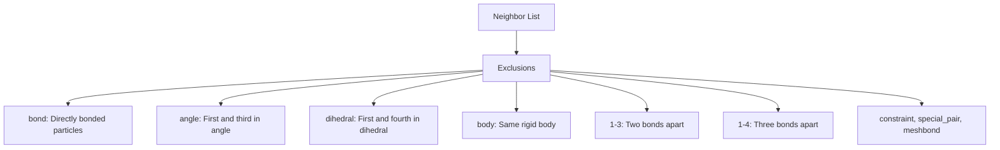
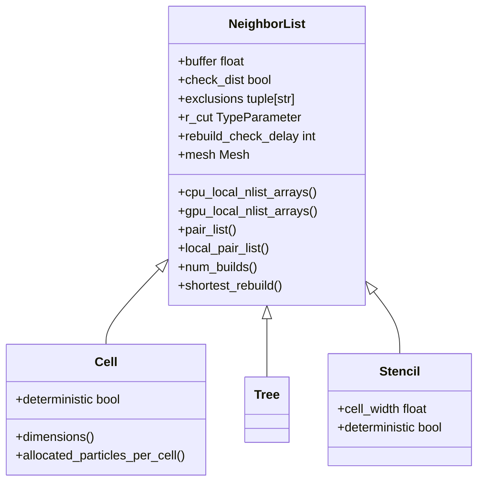
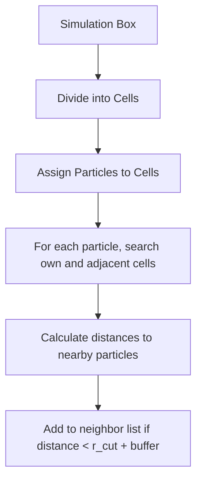
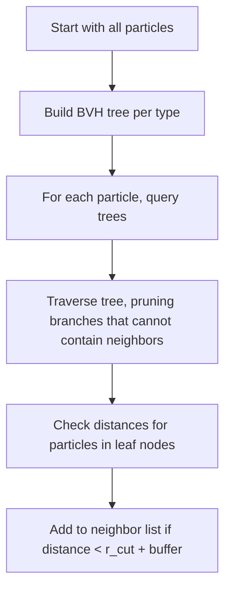
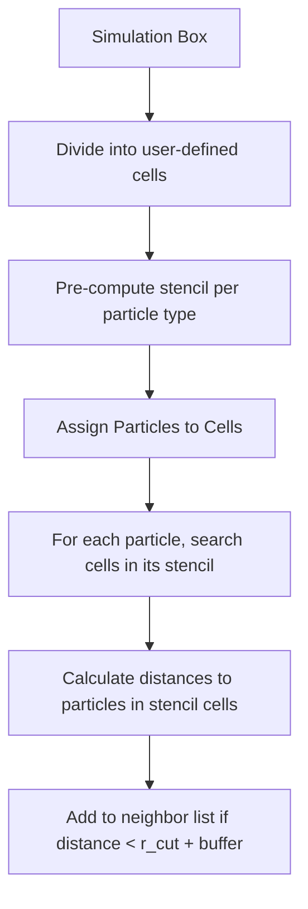
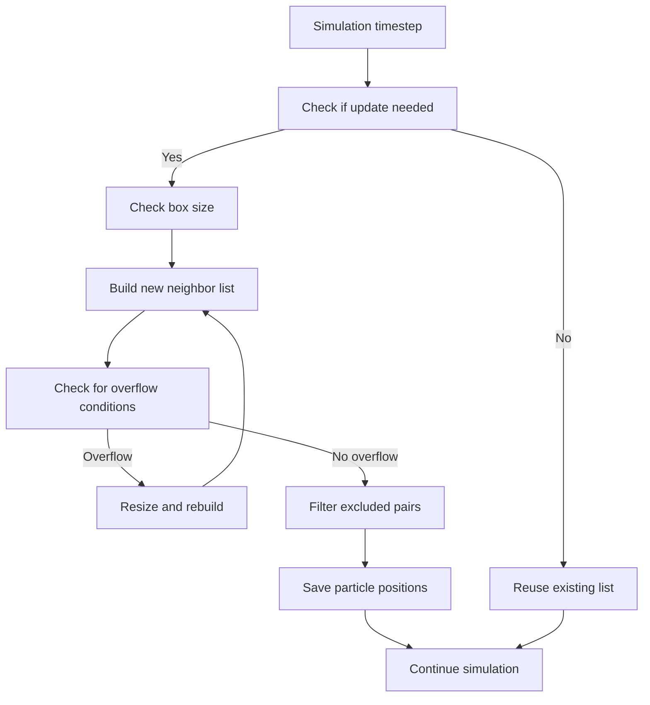

# Neighbor Lists

<details>
<summary>Relevant source files</summary>

The following files were used as context for generating this wiki page:

- [hoomd/md/NeighborList.cc](hoomd/md/NeighborList.cc)
- [hoomd/md/NeighborList.h](hoomd/md/NeighborList.h)
- [hoomd/md/minimize/__init__.py](hoomd/md/minimize/__init__.py)
- [hoomd/md/minimize/fire.py](hoomd/md/minimize/fire.py)
- [hoomd/md/nlist.py](hoomd/md/nlist.py)
- [hoomd/md/pytest/test_minimize_fire.py](hoomd/md/pytest/test_minimize_fire.py)
- [hoomd/md/pytest/test_nlist.py](hoomd/md/pytest/test_nlist.py)
- [hoomd/md/pytest/test_reverse_perturbation_flow.py](hoomd/md/pytest/test_reverse_perturbation_flow.py)
- [hoomd/md/pytest/test_thermo.py](hoomd/md/pytest/test_thermo.py)
- [hoomd/md/pytest/test_thermoHMA.py](hoomd/md/pytest/test_thermoHMA.py)
- [hoomd/md/pytest/true_pair_list.json](hoomd/md/pytest/true_pair_list.json)

</details>


Neighbor lists are fundamental data structures in particle-based simulations that efficiently identify pairs of particles within a specified cutoff distance. In HOOMD-blue, they primarily serve to accelerate force calculations in the Molecular Dynamics (MD) engine by allowing O(N) scaling instead of the naive O(N²) approach of checking all possible particle pairs. This page documents the available neighbor list algorithms, their usage, and performance characteristics.

This page focuses on the neighbor list implementations themselves. For information about pair potentials that use neighbor lists, see [MD Pair Potentials](#4.2).

## Core Concepts

### Buffer Distance

Neighbor lists use a buffer (or "skin") distance to amortize the cost of rebuilding the list:



When `buffer > 0`, a neighbor list computed at one step can be reused until a particle moves a distance of `buffer/2`. This optimization balances the computational cost of neighbor list construction with the overhead of checking additional pairs that don't interact.

The `check_dist` attribute controls whether HOOMD-blue checks particle movements:
- When `True` (default), rebuilds occur only when particles move more than `buffer/2`
- When `False`, rebuilds occur exactly every `rebuild_check_delay` steps

Sources: [hoomd/md/nlist.py:14-35]()

### Cutoff Radius and Types

The neighbor list tracks pairs of particles within a distance determined by the cutoff radius. Different particle type pairs can have different cutoff radii:



The `r_cut` attribute is a type parameter dictionary that holds cutoff values for each particle type pair. When used with pair potentials, the actual cutoff for the neighbor list automatically becomes the maximum of the base cutoff and the cutoffs specified by associated potentials.

Sources: [hoomd/md/nlist.py:37-52](), [hoomd/md/NeighborList.cc:362-437]()

### Exclusions

Neighbor lists can exclude specific pairs of particles from the list even if they're within the cutoff distance:



These exclusions are particularly useful for molecular simulations where certain interactions (like those between bonded atoms) are handled by specialized force terms rather than general non-bonded potentials.

Sources: [hoomd/md/nlist.py:54-73](), [hoomd/md/NeighborList.cc:475-619]()

## Neighbor List Implementations

HOOMD-blue provides three types of neighbor list algorithms, each optimized for different simulation scenarios.

### Class Hierarchy



Sources: [hoomd/md/nlist.py:88-195](), [hoomd/md/nlist.py:419-541](), [hoomd/md/nlist.py:625-697](), [hoomd/md/nlist.py:524-624]()

### Cell List

The `Cell` implementation divides the simulation box into a grid of cells, with each cell sized to the largest cutoff radius. This approach provides O(N) scaling for neighbor list construction by limiting comparisons to particles in adjacent cells.



Cell lists are very efficient for systems with nearly uniform cutoffs but performance degrades for large cutoff radius asymmetries due to increased particles per cell.

Cell lists can consume significant memory, especially:
- When density distributions are non-uniform (memory scales with maximum particles per cell)
- When box volumes are large but cutoffs small (creating many empty cells)

Cell lists include a `deterministic` attribute which, when `True`, sorts neighbors to provide deterministic simulation runs.

Sources: [hoomd/md/nlist.py:419-522]()

### Tree List

The `Tree` implementation uses a bounding volume hierarchy (BVH) tree traversal for O(N log N) neighbor list construction. A BVH tree of axis-aligned bounding boxes is constructed per particle type, and each particle queries these trees to find neighbors.



Tree lists offer:
- Better performance for systems with cutoff asymmetry
- Better scaling for large, sparse systems (memory scales with particle count, not box volume)
- Slower performance for systems with uniform cutoffs or many types with identical cutoffs

Sources: [hoomd/md/nlist.py:625-697]()

### Stencil List

The `Stencil` implementation combines aspects of cell lists with pre-computed stencils tailored to each particle type's cutoff. This approach allows the user to choose the cell width independently of the maximum cutoff.



Stencil lists provide best performance when:
- Cutoff radii are multiples of the cell_width
- The cell_width divides the simulation box into roughly integer number of cells
- Systems have significant cutoff asymmetry

Like Cell lists, Stencil lists include a `deterministic` attribute for reproducible simulations.

Sources: [hoomd/md/nlist.py:524-624]()

## Usage Examples

### Basic Usage

```python
import hoomd
import hoomd.md as md

# Create a simulation
sim = hoomd.Simulation(...)

# Create a cell-based neighbor list with buffer 0.4
nlist = md.nlist.Cell(buffer=0.4) 

# Create a Lennard-Jones pair potential using the neighbor list
lj = md.pair.LJ(nlist, default_r_cut=2.5)
lj.params[("A", "A")] = dict(epsilon=1.0, sigma=1.0)

# Add to integrator
integrator = md.Integrator(dt=0.005)
integrator.forces.append(lj)
```

This creates a cell-based neighbor list with a buffer distance of 0.4 and uses it with a Lennard-Jones pair potential.

### Setting Exclusions

```python
# Exclude bonded particles and particles separated by 2 bonds
nlist.exclusions = ("bond", "1-3")

# Exclude particles in the same rigid body
nlist.exclusions = ("body",)

# Multiple exclusion types
nlist.exclusions = ("bond", "angle", "dihedral", "1-4")
```

### Advanced Configuration

```python
# Cell list with deterministic ordering
cell_nlist = md.nlist.Cell(buffer=0.4, deterministic=True)

# Tree list with distance checking disabled
tree_nlist = md.nlist.Tree(buffer=0.4, check_dist=False)

# Stencil list with custom cell width
stencil_nlist = md.nlist.Stencil(buffer=0.4, cell_width=1.5)

# Set rebuild check delay (how many steps before checking for rebuilds)
nlist.rebuild_check_delay = 5
```

### Accessing Neighbor List Data

For advanced users, HOOMD-blue provides direct access to the neighbor list data:

```python
# Get global pair list (particle tags)
pair_list = nlist.pair_list

# Get local pair list (particle indices)
local_pairs = nlist.local_pair_list

# Access CPU neighbor list arrays directly
with nlist.cpu_local_nlist_arrays as arrays:
    for i, (head, nn) in enumerate(zip(arrays.head_list, arrays.n_neigh)):
        for j_idx in range(head, head + nn):
            j = arrays.nlist[j_idx]
            # i and j are neighbor particle indices
```

For GPU-accelerated simulations, similar access is provided via `gpu_local_nlist_arrays`.

Sources: [hoomd/md/nlist.py:244-372]()

## Performance Considerations

The choice of neighbor list implementation can significantly impact simulation performance:

| Implementation | Best For | Memory Usage | Considerations |
|----------------|----------|--------------|----------------|
| Cell | Systems with uniform cutoffs (ratio < 2:1) | Proportional to box volume and max particles per cell | Simple, fast for uniform systems |
| Tree | Systems with cutoff asymmetry; large, sparse systems | Proportional to particle count | Better for mixed cutoffs; higher overhead for uniform systems |
| Stencil | Systems where cutoffs are multiples of a base value | Can be lower than Cell for many small cells | Performance sensitive to cell_width choice |

### Monitoring Performance

```python
# Get the number of builds since last run
n_builds = nlist.num_builds

# Get the shortest rebuild interval (in timesteps)
min_rebuild = nlist.shortest_rebuild

# For Cell lists, get grid dimensions and memory usage
dimensions = cell_nlist.dimensions
particles_per_cell = cell_nlist.allocated_particles_per_cell
```

Sources: [hoomd/md/nlist.py:399-416](), [hoomd/md/nlist.py:502-521]()

## Implementation Details

### Neighbor List Construction and Updates

The neighbor list construction and update process follows this general flow:



The neighbor list is checked for updates based on the `rebuild_check_delay` and `check_dist` parameters. When an update is needed, the list is constructed using the algorithm specific to the implementation (Cell, Tree, or Stencil). After construction, exclusions are applied to filter out unwanted pairs.

Sources: [hoomd/md/NeighborList.cc:272-347]()

### Buffer Distance Logic

The neighbor list buffer mechanism works by:
1. Recording particle positions when the list is built
2. Checking how far each particle has moved since the last build
3. Rebuilding when any particle has moved more than buffer/2

This optimization balances the cost of neighbor list construction with the overhead of checking additional particles.

Sources: [hoomd/md/NeighborList.cc:522-526](), [hoomd/md/NeighborList.cc:447-474]()

## Selecting the Right Neighbor List

1. **For systems with uniform cutoffs**:
   - Use `Cell` for the best performance
   - Set `buffer` to balance rebuild frequency with extra computations

2. **For systems with varying cutoffs**:
   - Use `Tree` when maximum cutoff is more than twice the minimum cutoff
   - Use `Stencil` with carefully chosen `cell_width` as an alternative

3. **For large, sparse systems**:
   - `Tree` often performs better due to lower memory requirements
   - `Cell` and `Stencil` may use excessive memory for empty space

4. **For precise reproducibility**:
   - Set `deterministic=True` on `Cell` or `Stencil` lists
   - Set `check_dist=False` and fixed `rebuild_check_delay` for exact rebuild intervals

---