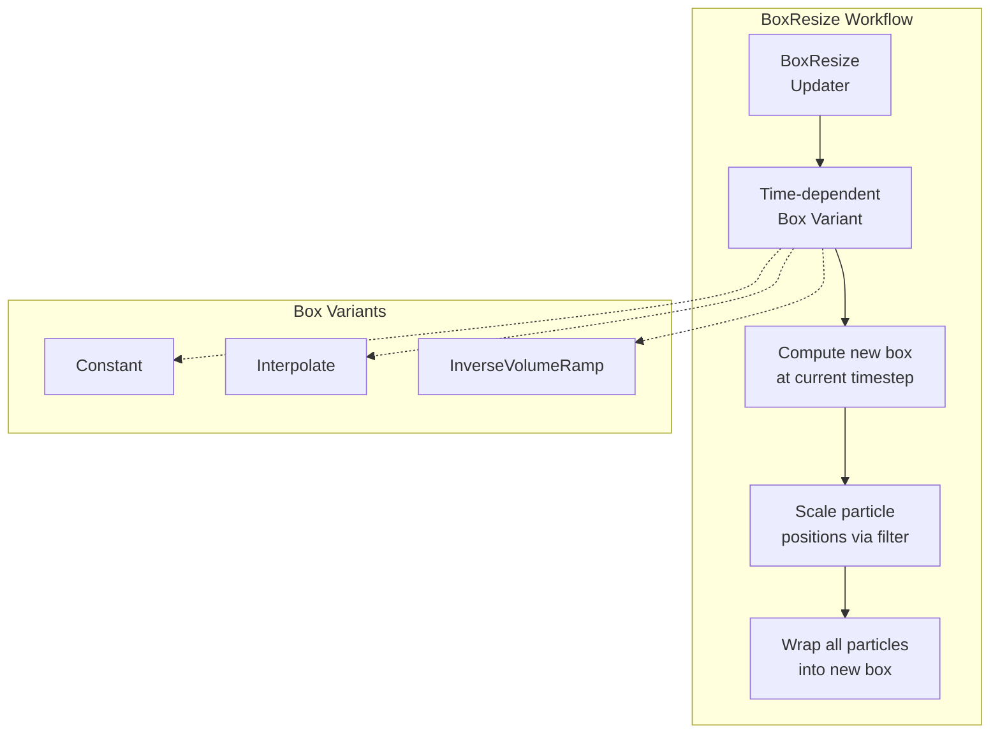
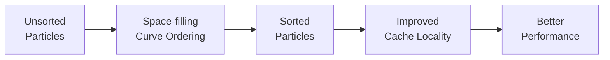
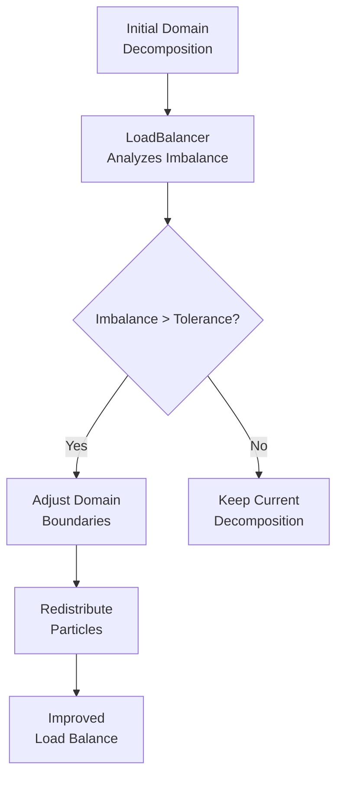
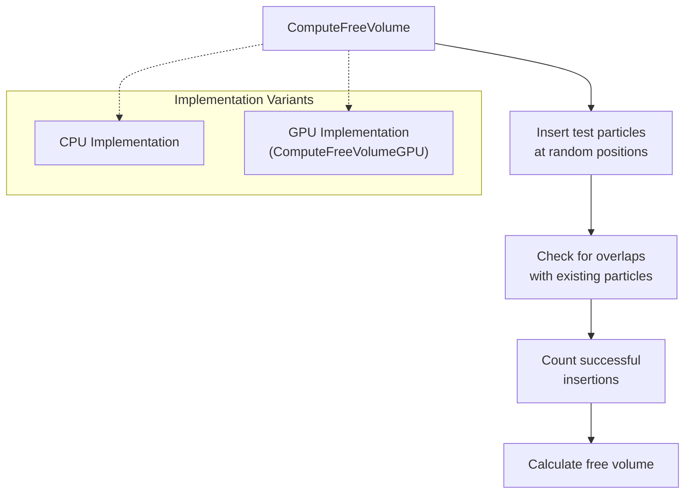
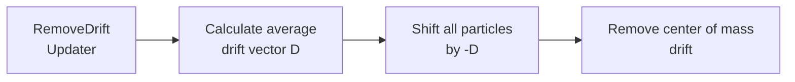
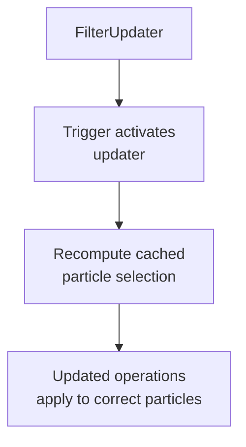
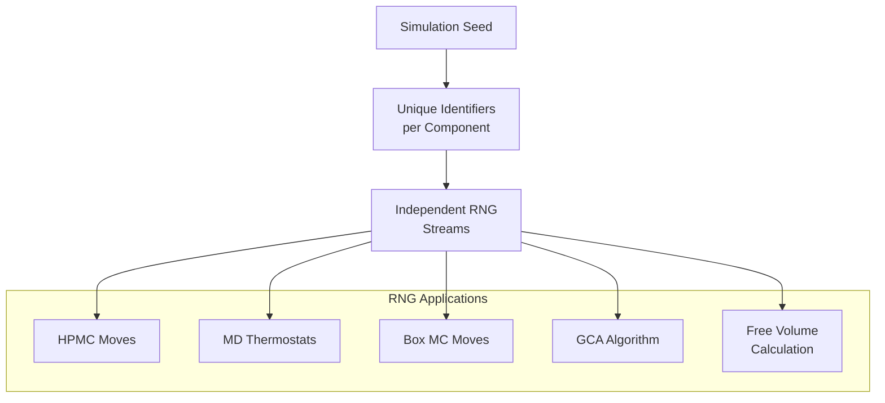
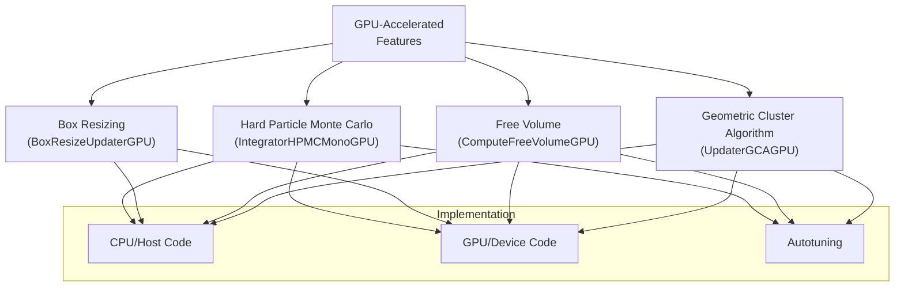
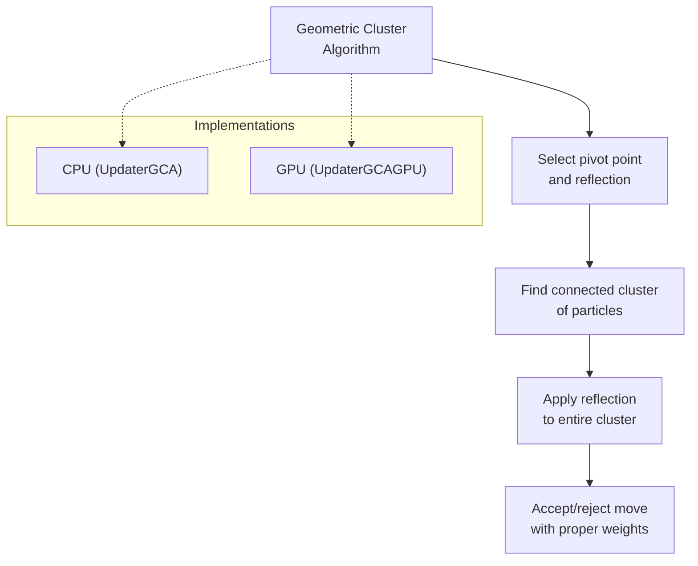

# Advanced Features

<details>
<summary>Relevant source files</summary>

The following files were used as context for generating this wiki page:

- [hoomd/BoxResizeUpdater.cc](hoomd/BoxResizeUpdater.cc)
- [hoomd/BoxResizeUpdater.h](hoomd/BoxResizeUpdater.h)
- [hoomd/BoxResizeUpdaterGPU.cc](hoomd/BoxResizeUpdaterGPU.cc)
- [hoomd/BoxResizeUpdaterGPU.cu](hoomd/BoxResizeUpdaterGPU.cu)
- [hoomd/BoxResizeUpdaterGPU.cuh](hoomd/BoxResizeUpdaterGPU.cuh)
- [hoomd/BoxResizeUpdaterGPU.h](hoomd/BoxResizeUpdaterGPU.h)
- [hoomd/RNGIdentifiers.h](hoomd/RNGIdentifiers.h)
- [hoomd/hpmc/ComputeFreeVolume.h](hoomd/hpmc/ComputeFreeVolume.h)
- [hoomd/hpmc/ComputeFreeVolumeGPU.cuh](hoomd/hpmc/ComputeFreeVolumeGPU.cuh)
- [hoomd/hpmc/ComputeFreeVolumeGPU.h](hoomd/hpmc/ComputeFreeVolumeGPU.h)
- [hoomd/hpmc/HPMCCounters.h](hoomd/hpmc/HPMCCounters.h)
- [hoomd/hpmc/IntegratorHPMCMonoGPU.cu](hoomd/hpmc/IntegratorHPMCMonoGPU.cu)
- [hoomd/hpmc/IntegratorHPMCMonoGPU.cuh](hoomd/hpmc/IntegratorHPMCMonoGPU.cuh)
- [hoomd/hpmc/IntegratorHPMCMonoGPU.h](hoomd/hpmc/IntegratorHPMCMonoGPU.h)
- [hoomd/hpmc/IntegratorHPMCMonoGPUMoves.cuh](hoomd/hpmc/IntegratorHPMCMonoGPUMoves.cuh)
- [hoomd/hpmc/IntegratorHPMCMonoGPUTypes.cuh](hoomd/hpmc/IntegratorHPMCMonoGPUTypes.cuh)
- [hoomd/hpmc/UpdaterGCAGPU.cu](hoomd/hpmc/UpdaterGCAGPU.cu)
- [hoomd/hpmc/UpdaterGCAGPU.cuh](hoomd/hpmc/UpdaterGCAGPU.cuh)
- [hoomd/hpmc/UpdaterGCAGPU.h](hoomd/hpmc/UpdaterGCAGPU.h)
- [hoomd/md/pytest/test_constrain_distance.py](hoomd/md/pytest/test_constrain_distance.py)
- [hoomd/md/pytest/test_pppm_coulomb.py](hoomd/md/pytest/test_pppm_coulomb.py)
- [hoomd/md/pytest/test_zero_momentum.py](hoomd/md/pytest/test_zero_momentum.py)
- [hoomd/pytest/test_box_resize.py](hoomd/pytest/test_box_resize.py)
- [hoomd/pytest/test_dcd.py](hoomd/pytest/test_dcd.py)
- [hoomd/pytest/test_simulation.py](hoomd/pytest/test_simulation.py)
- [hoomd/tune/balance.py](hoomd/tune/balance.py)
- [hoomd/tune/sorter.py](hoomd/tune/sorter.py)
- [hoomd/update/box_resize.py](hoomd/update/box_resize.py)
- [hoomd/update/particle_filter.py](hoomd/update/particle_filter.py)
- [hoomd/update/remove_drift.py](hoomd/update/remove_drift.py)

</details>


This page documents advanced features in HOOMD-blue that extend the core simulation capabilities. These features provide additional control, enhanced performance, and specialized analysis capabilities to the base simulation engines. This section covers specialized updaters, performance optimizers, and advanced analysis tools that are not part of the core architecture or the primary simulation engines.

For information about the core architecture, see [Core Architecture](#2). For specific details about the HPMC simulation engine, see [Hard Particle Monte Carlo (HPMC)](#3), and for the MD simulation engine, see [Molecular Dynamics (MD)](#4).

## Simulation Box Control

HOOMD-blue provides powerful tools for dynamic control of the simulation box during a simulation.

### Box Resizing

The `BoxResize` updater allows for dynamic changes to the simulation box size and shape as a function of time. This is particularly useful for:

- Compressing or expanding systems to target densities
- Applying deformation to study mechanical properties
- Implementing non-equilibrium protocols



The `BoxResize` updater works by:

1. Taking a `box` parameter that defines how the box changes with time
2. Optionally scaling a subset of particles defined by a `filter`
3. Wrapping all particles back into the simulation box

Example implementations:

```python
# Example 1: Simple box expansion
box_resize = hoomd.update.BoxResize(
    trigger=hoomd.trigger.Periodic(100),
    box=hoomd.variant.box.Interpolate(
        initial_box=hoomd.Box.cube(10),
        final_box=hoomd.Box.cube(20),
        variant=hoomd.variant.Ramp(0, 1, 0, 10000)
    )
)

# Example 2: Inverse volume ramping (useful for reaching target pressure)
inverse_volume_ramp = hoomd.variant.box.InverseVolumeRamp(
    initial_box=hoomd.Box.cube(10),
    final_volume=500,
    t_start=1000,
    t_ramp=10000
)
box_resize = hoomd.update.BoxResize(
    trigger=hoomd.trigger.Periodic(10),
    box=inverse_volume_ramp
)
```

Note that rapidly resizing the box with hard particles in HPMC simulations may introduce overlaps. For MD simulations with rigid bodies, the `BoxResize` updater should be the last updater in the operations list to ensure proper rigid body handling.

The box resize functionality is also available as a static method:

```python
# Immediately resize the box without creating an updater
hoomd.update.BoxResize.update(
    state=simulation.state, 
    box=hoomd.Box.cube(20)
)
```

GPU-accelerated box resizing is automatically used when running on GPU devices.

Sources: [hoomd/update/box_resize.py](). [hoomd/BoxResizeUpdater.h](). [hoomd/BoxResizeUpdaterGPU.h](). [hoomd/pytest/test_box_resize.py]().

## Performance Optimization

HOOMD-blue includes several advanced features for optimizing simulation performance.

### Particle Sorting

The `ParticleSorter` tuner improves simulation performance by reordering particles in memory along a space-filling curve:



By organizing particles that are close in physical space to be close in memory, `ParticleSorter` increases cache hits during force calculations and neighbor list building, which can substantially accelerate simulations.

Key properties:
- Automatically included in simulations with default parameters
- Configurable grid resolution (defaults to 4096 in 2D and 256 in 3D)
- Tunable sorting frequency via the trigger parameter

```python
# Custom particle sorter with higher trigger frequency
sorter = hoomd.tune.ParticleSorter(
    trigger=hoomd.trigger.Periodic(50),
    grid=1024  # Sets resolution of space-filling curve
)
simulation.operations.tuners.append(sorter)
```

Sources: [hoomd/tune/sorter.py]().

### Load Balancing

For MPI parallel simulations, the `LoadBalancer` tuner dynamically adjusts domain decomposition to evenly distribute particles across processors:



The `LoadBalancer` is particularly useful for:
- Systems with interfaces
- Systems with clustering behavior
- Any simulation with non-uniform particle distribution

It works by calculating the load imbalance factor (number of particles on a rank divided by the average) and then shifting domain boundaries to equalize the load. The potential speedup is approximately the imbalance factor minus 1.0.

```python
# Create a load balancer that only balances in z-direction
balancer = hoomd.tune.LoadBalancer(
    trigger=hoomd.trigger.Periodic(1000),
    x=False,
    y=False,
    z=True,
    tolerance=1.05,  # Rebalance when imbalance exceeds 5%
    max_iterations=2
)
simulation.operations.tuners.append(balancer)
```

Sources: [hoomd/tune/balance.py]().

## Advanced Analysis

HOOMD-blue provides specialized tools for advanced analysis of simulation systems.

### Free Volume Computation

For hard-particle Monte Carlo simulations, the `ComputeFreeVolume` analyzer estimates the unoccupied volume in the system using a Monte Carlo integration approach:



This computation works by:
1. Attempting to insert particles of a specified type at random positions
2. Checking for overlaps with existing particles
3. Calculating the fraction of successful insertions
4. Multiplying by the total box volume to get the free volume

The free volume calculation is useful for:
- Equation of state calculations
- Chemical potential estimates
- Nucleation studies

```python
# Example setup for free volume calculation
free_vol = hoomd.hpmc.compute.FreeVolume(
    mc=hpmc_integrator,    # HPMC integrator instance
    test_particle_type='A', # Type of particle to insert
    num_samples=10000       # Number of insertion attempts
)

# Run the simulation
simulation.run(100)

# Get the free volume result
v_free = free_vol.free_volume
```

The implementation has both CPU and GPU variants, with the GPU version automatically used when running on supported hardware.

Sources: [hoomd/hpmc/ComputeFreeVolume.h](), [hoomd/hpmc/ComputeFreeVolumeGPU.h](), [hoomd/hpmc/ComputeFreeVolumeGPU.cuh]().

### Remove Drift

The `RemoveDrift` updater is designed to remove the average drift from a restrained system:



This updater works by:
1. Computing the mean drift from reference positions
2. Shifting all particles to counteract this drift

It's particularly useful for:
- Frenkel-Ladd calculations in HPMC simulations
- Simulations with harmonic restraints

```python
# Create a RemoveDrift updater with reference positions
remove_drift = hoomd.update.RemoveDrift(
    reference_positions=[(0, 0, 0), (1, 0, 0)],
    trigger=hoomd.trigger.Periodic(100)
)
simulation.operations.updaters.append(remove_drift)
```

Sources: [hoomd/update/remove_drift.py]().

### Zero Momentum

For molecular dynamics simulations, the `ZeroMomentum` updater removes net momentum from the system:

```python
# Create a ZeroMomentum updater
zero_momentum = hoomd.md.update.ZeroMomentum(
    trigger=hoomd.trigger.Periodic(100)
)
simulation.operations.updaters.append(zero_momentum)
```

This is useful for:
- Preventing system drift in NVE simulations
- Maintaining a stationary center of mass
- Improving stability in long simulations

After application, the net momentum of the system will be zero while preserving the relative velocities of particles.

Sources: [hoomd/md/pytest/test_zero_momentum.py]().

## Dynamic Simulation Control

HOOMD-blue provides advanced mechanisms for controlling simulation behavior dynamically.

### Filter Updater

The `FilterUpdater` allows dynamic updates to the sets of particles associated with filters:



HOOMD-blue caches the results of particle filters for performance reasons. The `FilterUpdater` provides a mechanism to update these cached selections when particle properties change. This is useful when:

- Particles move in and out of spatial regions
- Particle properties change during simulation
- Operation targets need to change over time

```python
# Create a filter updater for two filters
filter_updater = hoomd.update.FilterUpdater(
    trigger=hoomd.trigger.Periodic(1000),
    filters=[region_filter, property_filter]
)
simulation.operations.updaters.append(filter_updater)
```

Sources: [hoomd/update/particle_filter.py]().

### Random Number Generation Control

HOOMD-blue uses carefully managed random number generators throughout the codebase to ensure reproducibility and statistical independence:



The `RNGIdentifiers` system ensures that different components of the simulation use statistically independent random number streams. This provides:

- Reproducible simulations with the same seed
- No correlations between different random processes
- Ability to vary individual components without affecting others

The global simulation seed can be set when creating a simulation:

```python
simulation = hoomd.Simulation(device, seed=42)
```

Sources: [hoomd/RNGIdentifiers.h](), [hoomd/pytest/test_simulation.py]().

## GPU Acceleration

Many of HOOMD-blue's advanced features are designed to run efficiently on modern GPUs:



The GPU implementations typically feature:

1. **Autotuning**: Automatically selecting optimal parameters for GPU kernels
2. **Kernel Launch Parameters**: Configurable block sizes and threading schemes
3. **Memory Management**: Efficient handling of host-device memory transfers
4. **Overlap Checking**: Highly parallelized overlap detection for HPMC simulations

GPU acceleration is automatically used when:
- A CUDA/HIP-capable GPU is available
- HOOMD-blue is compiled with GPU support
- A GPU device is selected for the simulation

```python
# Select GPU device for simulation
gpu = hoomd.device.GPU()
simulation = hoomd.Simulation(gpu)

# Advanced features will automatically use GPU acceleration
```

Sources: [hoomd/hpmc/IntegratorHPMCMonoGPU.h](), [hoomd/hpmc/IntegratorHPMCMonoGPU.cuh](), [hoomd/hpmc/IntegratorHPMCMonoGPU.cu](), [hoomd/BoxResizeUpdaterGPU.h](), [hoomd/BoxResizeUpdaterGPU.cu](), [hoomd/hpmc/UpdaterGCAGPU.h](), [hoomd/hpmc/UpdaterGCAGPU.cu](), [hoomd/hpmc/UpdaterGCAGPU.cuh]().

## Specialized Constraints and Interactions

HOOMD-blue supports specialized constraints and interaction models for advanced simulations.

### Distance Constraints

For molecular dynamics simulations, HOOMD-blue can enforce fixed distances between particle pairs:

```python
# Create a distance constraint
distance_constraint = hoomd.md.constrain.Distance(tolerance=1e-5)

# Add to integrator
integrator.constraints.append(distance_constraint)
```

Distance constraints are useful for:
- Rigid bond models in molecular simulations
- Maintaining molecular geometries
- Coarse-grained models

The implementation uses an efficient constraint solver that enforces distances to within the specified tolerance.

Sources: [hoomd/md/pytest/test_constrain_distance.py]().

### PPPM Coulomb Interactions

For systems with charged particles, HOOMD-blue provides the Particle-Particle Particle-Mesh (PPPM) method for efficient and accurate electrostatic calculations:

```python
# Create PPPM Coulomb forces
ewald, coulomb = hoomd.md.long_range.pppm.make_pppm_coulomb_forces(
    nlist=cell_list,
    resolution=(64, 64, 64),
    order=6,
    r_cut=3.0
)

# Add to integrator
integrator.forces.extend([ewald, coulomb])
```

The PPPM approach combines:
- Short-range direct summation (handled by Ewald)
- Long-range mesh-based summation (handled by Coulomb)

This results in O(N log N) scaling for electrostatic interactions, making it much more efficient than direct O(N²) methods for large systems.

Sources: [hoomd/md/pytest/test_pppm_coulomb.py]().

## Specialized Monte Carlo Techniques

HOOMD-blue implements advanced Monte Carlo techniques beyond basic HPMC.

### Geometric Cluster Algorithm

The Geometric Cluster Algorithm (GCA) is an advanced Monte Carlo technique that can dramatically accelerate equilibration in dense systems:



The GCA works by:
1. Selecting a geometric operation (reflection or rotation)
2. Identifying a cluster of particles connected by overlap interactions
3. Moving the entire cluster in a way that preserves detailed balance

This technique is particularly powerful for:
- Dense systems of hard particles
- Systems with strong directional interactions
- Equilibrating systems with slow dynamics

Both CPU and GPU implementations are available, with the GPU version providing significant speedups for large systems.

Sources: [hoomd/hpmc/UpdaterGCAGPU.h](), [hoomd/hpmc/UpdaterGCAGPU.cu](), [hoomd/hpmc/UpdaterGCAGPU.cuh]().

## Summary

HOOMD-blue's advanced features extend its core functionality with specialized tools for:

1. **Simulation Control**: Dynamic box resizing and adaptive filters
2. **Performance Optimization**: Particle sorting and load balancing
3. **Advanced Analysis**: Free volume computation and drift removal
4. **GPU Acceleration**: Efficient implementation of algorithms on GPU hardware
5. **Specialized Techniques**: Distance constraints, PPPM electrostatics, and the Geometric Cluster Algorithm

These features enable sophisticated simulations and analyses beyond what's possible with just the core simulation engines, making HOOMD-blue a powerful and flexible framework for particle-based simulations across many scientific domains.

---