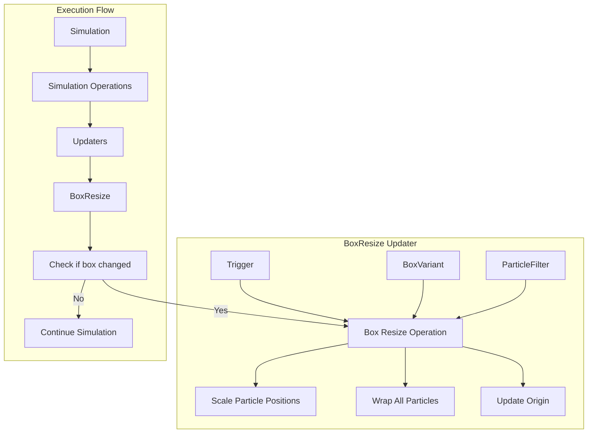
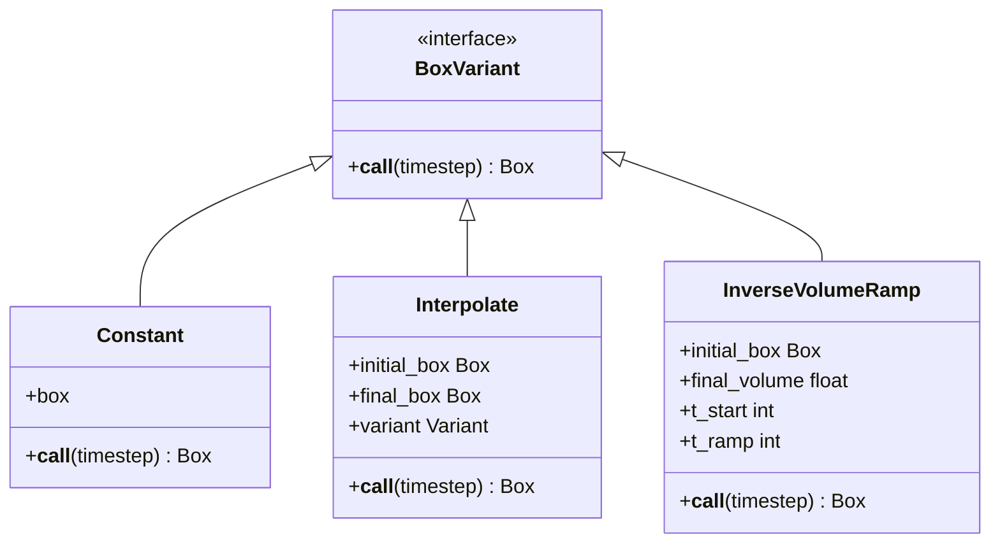
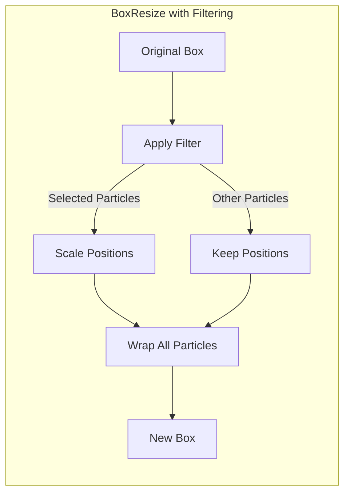
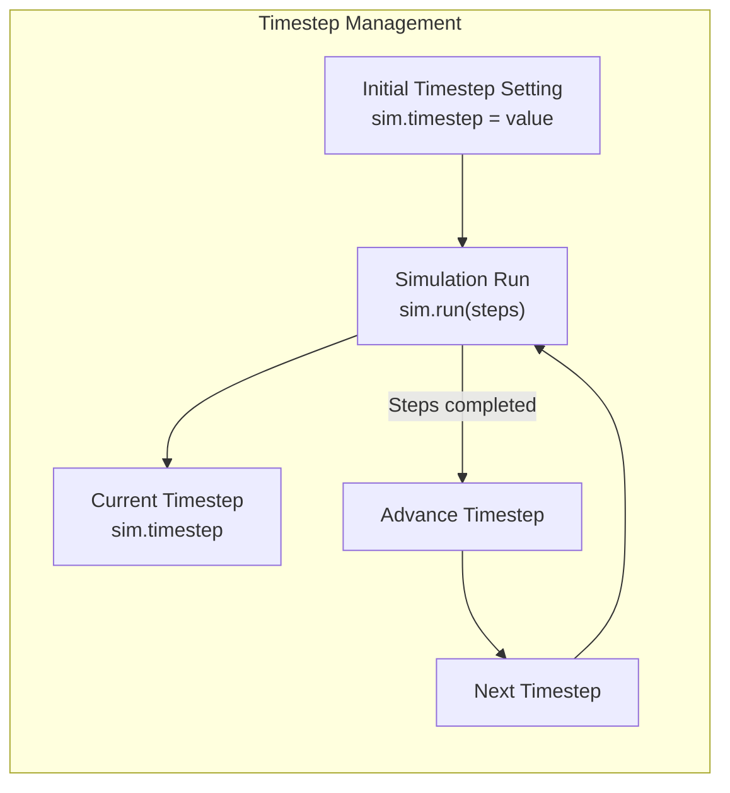
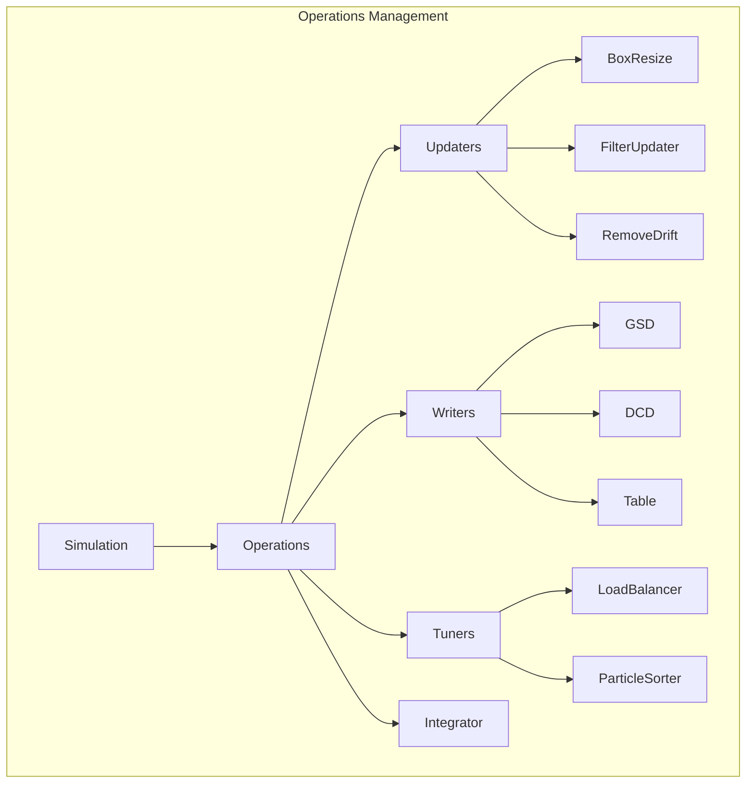

# Box Resizing and Simulation Control

<details>
<summary>Relevant source files</summary>

The following files were used as context for generating this wiki page:

- [hoomd/BoxResizeUpdater.cc](hoomd/BoxResizeUpdater.cc)
- [hoomd/BoxResizeUpdater.h](hoomd/BoxResizeUpdater.h)
- [hoomd/BoxResizeUpdaterGPU.cc](hoomd/BoxResizeUpdaterGPU.cc)
- [hoomd/BoxResizeUpdaterGPU.cu](hoomd/BoxResizeUpdaterGPU.cu)
- [hoomd/BoxResizeUpdaterGPU.cuh](hoomd/BoxResizeUpdaterGPU.cuh)
- [hoomd/BoxResizeUpdaterGPU.h](hoomd/BoxResizeUpdaterGPU.h)
- [hoomd/md/pytest/test_constrain_distance.py](hoomd/md/pytest/test_constrain_distance.py)
- [hoomd/md/pytest/test_pppm_coulomb.py](hoomd/md/pytest/test_pppm_coulomb.py)
- [hoomd/md/pytest/test_zero_momentum.py](hoomd/md/pytest/test_zero_momentum.py)
- [hoomd/pytest/test_box_resize.py](hoomd/pytest/test_box_resize.py)
- [hoomd/pytest/test_dcd.py](hoomd/pytest/test_dcd.py)
- [hoomd/pytest/test_simulation.py](hoomd/pytest/test_simulation.py)
- [hoomd/tune/balance.py](hoomd/tune/balance.py)
- [hoomd/tune/sorter.py](hoomd/tune/sorter.py)
- [hoomd/update/box_resize.py](hoomd/update/box_resize.py)
- [hoomd/update/particle_filter.py](hoomd/update/particle_filter.py)
- [hoomd/update/remove_drift.py](hoomd/update/remove_drift.py)

</details>


This page documents the mechanisms for dynamically changing the simulation box size and controlling various aspects of simulation execution in HOOMD-blue. It covers box resizing operations, time step management, and other simulation parameters that can be adjusted during a simulation.

Sources: [hoomd/update/box_resize.py:27-47](), [hoomd/BoxResizeUpdater.h:27-33]()

## Box Resizing

HOOMD-blue provides mechanisms to dynamically change the simulation box size during a simulation run, which is essential for simulations involving volume changes, stress relaxation, or non-equilibrium processes.

### BoxResize Updater

The primary tool for changing box dimensions is the `BoxResize` updater, which allows the simulation box to be modified as a function of time. When the box size changes, the updater scales the positions of selected particles to fit the new box and wraps all particles back into the box.



**Diagram: BoxResize Updater Flow**

Sources: [hoomd/update/box_resize.py:37-67](), [hoomd/BoxResizeUpdater.cc:45-72]()

The `BoxResize` updater works by:

1. Computing the new box dimensions for the current timestep
2. Checking if the new box is different from the current one
3. If changed, updating the global box dimensions
4. Scaling particles matched by the filter from their old fractional coordinates to new absolute coordinates
5. Wrapping all particles back into the new box
6. Updating the system origin if needed

```python
# Example: Creating a BoxResize updater
box_resize = hoomd.update.BoxResize(
    trigger=hoomd.trigger.Periodic(10),  # Resize every 10 steps
    box=box_variant,                     # Box variant defining how the box changes
    filter=hoomd.filter.All()            # Scale all particles
)
simulation.operations.updaters.append(box_resize)
```

Sources: [hoomd/update/box_resize.py:79-86](), [hoomd/BoxResizeUpdater.cc:42-72]()

### Immediate Box Resizing

In addition to the time-dependent box resizing, HOOMD-blue provides the ability to immediately resize the box using the static `update` method of `BoxResize`:

```python
# Example: Immediately resize the box
hoomd.update.BoxResize.update(state=simulation.state, box=new_box)
```

This is useful for one-time box adjustments that don't need to be part of the regular simulation loop.

Sources: [hoomd/update/box_resize.py:163-191]()

### Box Variants

Box resizing requires a `BoxVariant` object to define how the box changes over time. HOOMD-blue provides several box variant types:



**Diagram: Box Variant Hierarchy**

Sources: [hoomd/BoxResizeUpdater.h:46-56](), [hoomd/pytest/test_box_resize.py:107-113]()

#### Common Box Variants:

1. `hoomd.variant.box.Constant` - Maintains a fixed box
2. `hoomd.variant.box.Interpolate` - Interpolates between initial and final boxes based on a time-dependent variant
3. `hoomd.variant.box.InverseVolumeRamp` - Ramps the box volume inverse linearly, useful for pressure equilibration

Sources: [hoomd/pytest/test_box_resize.py:107-113](), [hoomd/pytest/test_box_resize.py:247-249]()

### Filtered Box Resizing

The `filter` parameter of `BoxResize` allows selective scaling of particles. This can be useful when certain particles should maintain their absolute positions while others scale with the box.



**Diagram: Filtered Box Resizing**

Sources: [hoomd/update/box_resize.py:100-108](), [hoomd/BoxResizeUpdater.cc:74-109]()

Available filter types include:
- `hoomd.filter.All()` - Select all particles (default)
- `hoomd.filter.Null()` - Select no particles (box changes without scaling)
- `hoomd.filter.Tags([0, 5])` - Select specific particles by tag
- `hoomd.filter.SetDifference()` - Select particles in one filter but not another

Sources: [hoomd/pytest/test_box_resize.py:168-174]()

## Simulation Control

Beyond box resizing, HOOMD-blue provides several mechanisms to control the execution and parameters of a simulation.

### Timestep Management

The timestep in HOOMD-blue represents the current simulation step and can be controlled in several ways:



**Diagram: Timestep Management**

Sources: [hoomd/pytest/test_simulation.py:170-195]()

Key aspects of timestep management:
- Initial timestep can be set before creating the state: `sim.timestep = 10`
- Cannot be changed after state is created
- Maximum value is 2^64 - 1, after which it wraps around to 0
- Simulation automatically increments the timestep during `run()`

Sources: [hoomd/pytest/test_simulation.py:375-416]()

### Simulation Seed Control

Random number generation in HOOMD-blue is controlled by a seed value:

```python
# Set the seed for random number generation
sim = hoomd.Simulation(device, seed=42)
# Or later
sim.seed = 42
```

Seed values are truncated to 16 bits (0xFFFF) if larger than this value.

Sources: [hoomd/pytest/test_simulation.py:419-441]()

### Performance Monitoring

HOOMD-blue provides several ways to monitor simulation performance:

1. **Timesteps Per Second (TPS)**: Available through `simulation.tps`
2. **Wall Time**: Total execution time through `simulation.walltime`

These metrics can be logged using `hoomd.write.CustomWriter` to track performance over time.

Sources: [hoomd/pytest/test_simulation.py:136-167]()

### Operations Management

Simulation behavior is controlled through operations, which can be added, removed, or replaced:



**Diagram: Operations Management**

Sources: [hoomd/pytest/test_simulation.py:444-485]()

Operations include:
- Updaters: Modify the simulation state (BoxResize, RemoveDrift, FilterUpdater)
- Writers: Output data (GSD, DCD, Table)
- Tuners: Optimize performance (LoadBalancer, ParticleSorter)
- Integrator: Core simulation method

Operations can be set all at once or manipulated individually:
```python
# Replace all operations
sim.operations = new_operations
# Add individual operations
sim.operations.updaters.append(box_resize)
```

Sources: [hoomd/pytest/test_simulation.py:444-485]()

## Additional Simulation Control Features

### Remove Drift

The `RemoveDrift` updater removes the average drift from a restrained system, which is particularly useful for improving the accuracy of Frenkel-Ladd calculations:

```python
remove_drift = hoomd.update.RemoveDrift(
    reference_positions=[(0, 0, 0), (1, 0, 0)],
    trigger=hoomd.trigger.Periodic(100)
)
simulation.operations.updaters.append(remove_drift)
```

This updater computes the mean drift from reference positions and shifts all particles to remove this drift.

Sources: [hoomd/update/remove_drift.py:20-67]()

### Filter Updater

The `FilterUpdater` provides a mechanism to update the cached list of particles selected by a filter:

```python
filter_updater = hoomd.update.FilterUpdater(
    trigger=hoomd.trigger.Periodic(1000),
    filters=[filter1, filter2]
)
simulation.operations.updaters.append(filter_updater)
```

This is useful when you want to periodically update which particles are selected by a filter, for example, to apply integration to particles in a specific region.

Sources: [hoomd/update/particle_filter.py:44-84]()

## Performance Optimization

### Load Balancer

The `LoadBalancer` tuner adjusts the boundaries of the MPI domain decomposition to evenly distribute particle load between processing units:

```python
load_balancer = hoomd.tune.LoadBalancer(
    trigger=hoomd.trigger.Periodic(100),
    x=True, y=True, z=True,
    tolerance=1.02,
    max_iterations=1
)
simulation.operations.tuners.append(load_balancer)
```

This is particularly useful for simulations with interfaces or clustering where particle density varies across the simulation box.

Sources: [hoomd/tune/balance.py:13-52]()

### Particle Sorter

The `ParticleSorter` improves simulation performance by sorting particles in memory along a space-filling curve:

```python
particle_sorter = hoomd.tune.ParticleSorter(
    trigger=hoomd.trigger.Periodic(200),
    grid=None  # Automatically uses 4096 for 2D and 256 for 3D
)
simulation.operations.tuners.append(particle_sorter)
```

This places particles that are close in space also close in memory, improving cache efficiency during force calculations.

Sources: [hoomd/tune/sorter.py:16-47]()

## Best Practices and Considerations

When using box resizing, consider these important points:

1. **HPMC Simulations**: Rescaling particles in hard particle Monte Carlo simulations may introduce overlaps, which should be addressed.

2. **Rigid Bodies**: When using rigid bodies, ensure the `BoxResize` updater is the last updater in the operations list. Rigid bodies may be temporarily deformed after resizing, but will be fixed when the integrator runs.

3. **Scaling Specific Particles**: Use the `filter` parameter to control which particles are scaled with the box. This is useful for maintaining reference structures or boundary conditions.

4. **Performance Impact**: Box resizing operations can be computationally expensive, especially with large systems. Consider the frequency of resizing operations.

Sources: [hoomd/update/box_resize.py:65-74]()