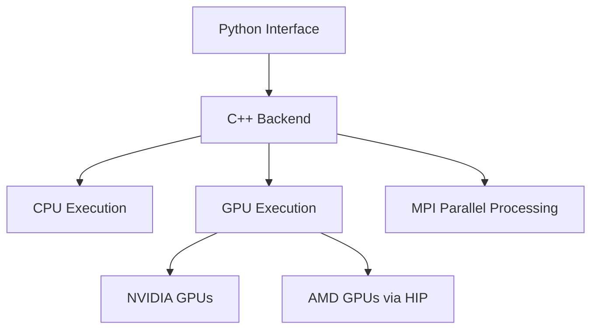
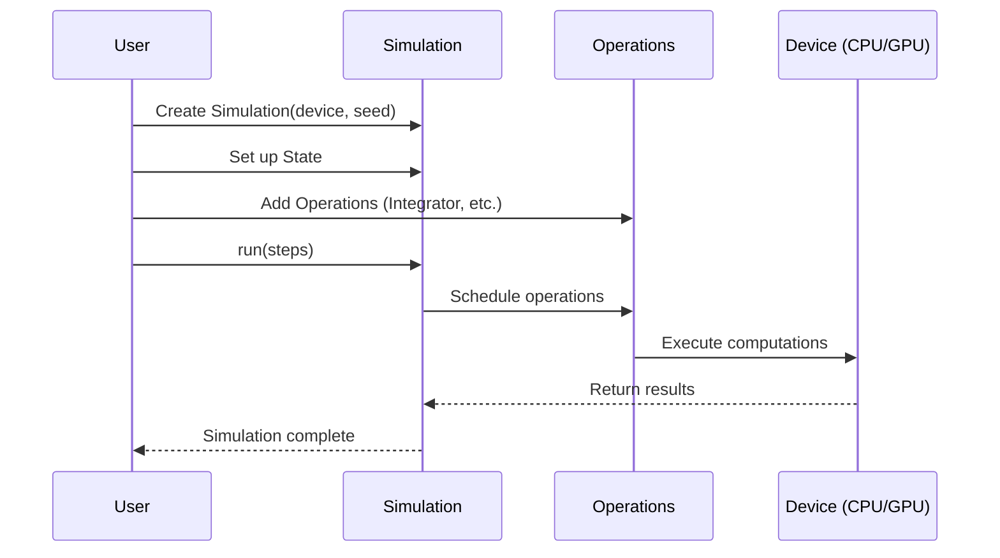

HOOMD-blue is a powerful Python package designed for performing high-performance particle simulations on both CPUs and GPUs. It's a versatile tool that supports multiple simulation methods including **Hard Particle Monte Carlo (HPMC)**, **Molecular Dynamics (MD)**, and **Multi-Particle Collision Dynamics (MPCD)**, making it particularly valuable for soft matter research while remaining general enough for various particle simulation types.

## Core Architecture

HOOMD-blue follows a sophisticated hybrid architecture that combines C++ performance with Python flexibility:



The C++ backend handles the computationally intensive simulation engine, while the Python frontend provides an intuitive, user-friendly API. This design ensures **high performance** without sacrificing **ease of use**.

### Key Components

At the heart of HOOMD-blue is the `Simulation` class, which serves as the central orchestrator for all simulation activities:

```python
import hoomd

# Create a simulation with device and seed
cpu = hoomd.device.CPU()
sim = hoomd.Simulation(device=cpu, seed=42)
```

The `Simulation` class manages three fundamental components:
- **Device**: Specifies whether to use CPU, GPU, or multiple GPUs for execution
- **State**: Contains the current state of the particle system
- **Operations**: Defines what actions to perform during the simulation

Sources: [simulation.py#L34-L57](hoomd/simulation.py#L34-L57), [ARCHITECTURE.md#L134-L151](ARCHITECTURE.md#L134-L151)

## Simulation Methods

HOOMD-blue supports three primary simulation methods, each optimized for different types of particle systems:

### 1. Hard Particle Monte Carlo (HPMC)

HPMC excels at simulating systems of hard particles with complex shapes. It's particularly useful for studying phase behavior, self-assembly, and entropy-driven phenomena.

```python
# Example: Convex polyhedron HPMC simulation
mc = hoomd.hpmc.integrate.ConvexPolyhedron()
mc.shape['octahedron'] = dict(vertices=[
    (-0.5, 0, 0), (0.5, 0, 0),
    (0, -0.5, 0), (0, 0.5, 0),
    (0, 0, -0.5), (0, 0, 0.5),
])
sim.operations.integrator = mc
```

Sources: [README.md#L47-L68](README.md#L47-L68), [ARCHITECTURE.md#L152-L156](ARCHITECTURE.md#L152-L156)

### 2. Molecular Dynamics (MD)

The MD module implements traditional molecular dynamics with a wide range of potentials including pair, bond, angle, and dihedral interactions.

```python
# Example: Lennard-Jones MD simulation
cell = hoomd.md.nlist.Cell(buffer=0.4)
lj = hoomd.md.pair.LJ(nlist=cell)
lj.params[('A', 'A')] = dict(epsilon=1, sigma=1)
lj.r_cut[('A', 'A')] = 2.5

integrator = hoomd.md.Integrator(dt=0.005)
integrator.forces.append(lj)
sim.operations.integrator = integrator
```

Sources: [README.md#L70-L93](README.md#L70-L93), [ARCHITECTURE.md#L158-L165](ARCHITECTURE.md#L158-L165)

### 3. Multi-Particle Collision Dynamics (MPCD)

MPCD is designed for simulating coarse-grained fluid dynamics and is particularly useful for studying hydrodynamic interactions in complex fluids.

Sources: [__init__.py#L97-L98](hoomd/__init__.py#L97-L98)

## Execution Model

HOOMD-blue's execution model is designed for maximum flexibility and performance:



The system automatically handles:
- **Device selection** (CPU, GPU, or multi-GPU)
- **Memory management** between CPU and GPU
- **Parallel execution** using MPI for distributed computing
- **Autotuning** of kernel parameters for optimal performance

Sources: [ARCHITECTURE.md#L67-L87](ARCHITECTURE.md#L67-L87), [simulation.py#L148-L185](hoomd/simulation.py#L148-L185)

## Data Model

HOOMD-blue employs a sophisticated data model optimized for both performance and flexibility:

### Core Data Types
- **ParticleData**: Stores particle positions, velocities, masses, and other properties
- **BondedGroupData**: Manages bonds, angles, and dihedrals
- **SystemDefinition**: Combines all system data into a unified structure
- **SnapshotSystemData**: Enables file I/O and system initialization

### Array Management
The system uses specialized array types for efficient data handling:
- **GPUArray<T>**: Maintains dual CPU/GPU copies with automatic synchronization
- **Managed arrays**: Utilize CUDA unified memory for seamless data access

Sources: [ARCHITECTURE.md#L89-L131](ARCHITECTURE.md#L89-L131)

## Operation System

HOOMD-blue uses a flexible operation-based architecture where simulations are built by combining different types of operations:

| Operation Type | Purpose | Examples |
|---------------|---------|----------|
| **Integrator** | Advances system state in time | MDIntegrator, HPMCIntegrator |
| **Compute** | Calculates system properties | NeighborList, ThermodynamicQuantities |
| **Updater** | Modifies system state | BoxResizeUpdater, ParticleFilterUpdater |
| **Writer** | Outputs data to files | GSDDumpWriter, TableWriter |
| **Tuner** | Optimizes performance parameters | Autotuner, SFCPackTuner |

Each operation can be scheduled to run at specific intervals using triggers, providing fine-grained control over simulation execution.

Sources: [ARCHITECTURE.md#L134-L151](ARCHITECTURE.md#L134-L151), [__init__.py#L16-L20](hoomd/__init__.py#L16-L20)

## Performance Features

HOOMD-blue incorporates several advanced performance optimization features:

### GPU Acceleration
- **Native GPU support** for both NVIDIA (CUDA) and AMD (HIP) GPUs
- **Zero-copy buffer access** through `__cuda_array_interface__` and `__array_interface__`
- **Optimized kernel implementations** for maximum throughput

### Autotuning
The system automatically optimizes kernel parameters:
```python
# Autotuner automatically finds optimal block sizes and configurations
# No user intervention required - it just works!
```

### Parallel Computing
- **MPI support** for multi-node simulations
- **Domain decomposition** for efficient parallel processing
- **Load balancing** to optimize resource utilization

Sources: [ARCHITECTURE.md#L201-L212](ARCHITECTURE.md#L201-L212), [ARCHITECTURE.md#L456-L462](ARCHITECTURE.md#L456-L462)

> [!TIP]
> HOOMD-blue's autotuning system automatically optimizes kernel parameters during simulation runs, ensuring optimal performance without manual tuning. This is particularly valuable when running on different GPU architectures or with varying system sizes.

## Getting Started

To begin using HOOMD-blue:

1. **Install** the package using conda or build from source
2. **Choose your simulation method** (HPMC, MD, or MPCD)
3. **Create a simulation** with appropriate device settings
4. **Set up your system** with initial particle configurations
5. **Define operations** (integrators, forces, etc.)
6. **Run the simulation** and analyze results

```python
# Complete minimal example
import hoomd

# Create simulation
device = hoomd.device.CPU()
sim = hoomd.Simulation(device=device, seed=1)

# Set up state (example with GSD file)
sim.create_state_from_gsd('initial_config.gsd')

# Add operations and run
sim.run(10000)  # Run for 10,000 steps
```

Sources: [README.md#L11-L15](README.md#L11-L15), [simulation.py#L56-L57](hoomd/simulation.py#L56-L57)

## Conclusion

HOOMD-blue represents a powerful, flexible, and high-performance simulation platform that bridges the gap between computational efficiency and user accessibility. Its hybrid Python/C++ architecture, combined with support for multiple simulation methods and automatic performance optimization, makes it an ideal choice for researchers studying complex particle systems across various scales and phenomena.

Whether you're simulating hard particle colloids, complex molecular systems, or coarse-grained fluids, HOOMD-blue provides the tools and performance needed to advance your research efficiently and effectively.
