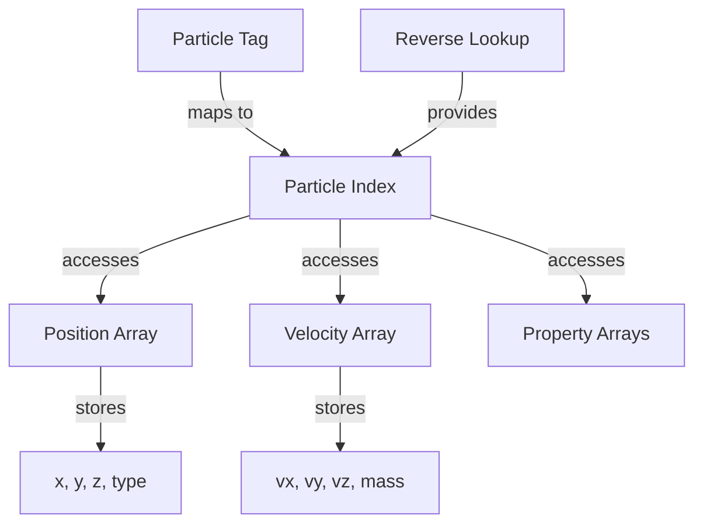
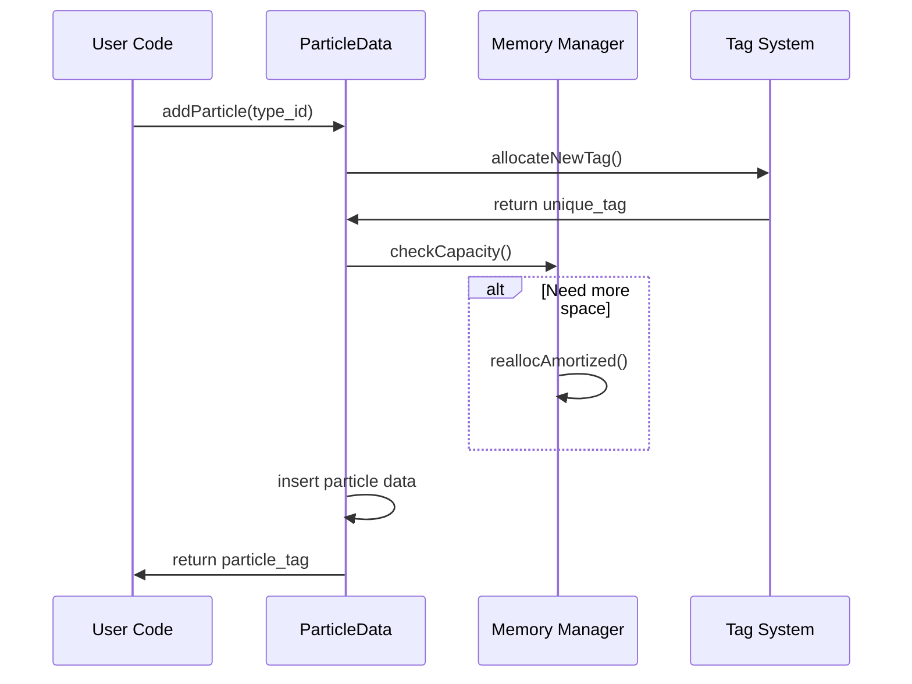
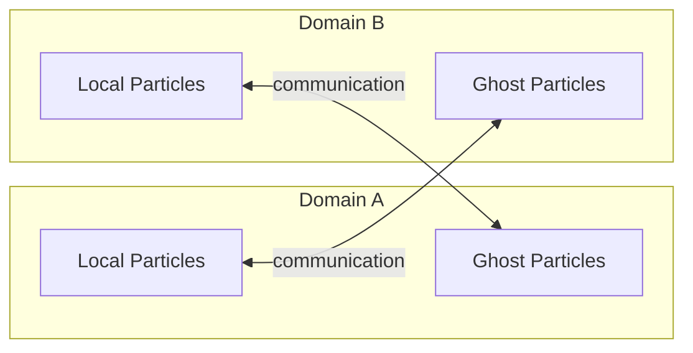

Particle data management is the backbone of any molecular simulation framework, and HOOMD-blue excels in this area with its comprehensive `ParticleData` class. This system handles everything from basic particle properties to complex data structures needed for parallel simulations, GPU acceleration, and anisotropic particles. **Understanding how particle data flows through this system** is crucial for developers who want to extend HOOMD-blue or optimize their simulations.

## Core Concepts and Architecture

At the heart of HOOMD-blue's particle management lies the `ParticleData` class, which serves as the central repository for all particle-related information. Think of it as a sophisticated database that tracks every aspect of your particles throughout the simulation. The class uses `GPUArray` containers that automatically handle data transfer between CPU and GPU memory, making the underlying acceleration transparent to users.

Particles in HOOMD-blue have two key identifiers:
- **Tag**: A unique global identifier that remains constant throughout the simulation
- **Index**: The current position in the particle data arrays, which can change during sorting or migration

This dual-identifier system is essential for performance optimization. While indices allow efficient memory access patterns, tags ensure particles can be reliably tracked even when the internal data structure is reorganized.



The beauty of this design lies in its flexibility. When particles need to be sorted for better memory locality or migrated between processors in parallel simulations, only the mapping between tags and indices changes, while the actual particle identifiers remain stable.

## Particle Properties Storage

HOOMD-blue stores particle properties in carefully designed data structures that balance memory efficiency with computational performance. The key insight is **combining related properties into single data structures** to optimize memory access patterns.

Here's how basic particle properties are organized:

| Property | Data Structure | Components | Purpose |
|----------|----------------|------------|---------|
| Position | `Scalar4` | x, y, z coordinates + type ID | Spatial location and particle classification |
| Velocity | `Scalar4` | vx, vy, vz components + mass | Motion dynamics and particle inertia |
| Acceleration | `Scalar3` | ax, ay, az components | Force-derived motion changes |
| Orientation | `Scalar4` | Quaternion (4 components) | Rotational state for anisotropic particles |

This design leverages the fact that GPUs and modern CPUs can read 4-byte data structures more efficiently than separate 3-byte vectors. By packing type information into the w-component of position and mass into velocity components, HOOMD-blue reduces memory bandwidth requirements and improves cache utilization.
Sources: [ParticleData.h#L223-234](hoomd/ParticleData.h#L223-234), [ParticleData.h#L1275-1279](hoomd/ParticleData.h#L1275-1279)

### Alternative Arrays for Efficient Operations

One of the most sophisticated features is the system of **alternate arrays** designed for high-performance particle reordering operations. Instead of writing to temporary buffers and copying back, HOOMD-blue provides shadow arrays that can be swapped in at effectively zero cost:

```cpp
// Example of efficient particle reordering
ArrayHandle<Scalar4> h_pos_alt(m_pdata->getAltPositions(), 
                              access_location::host, 
                              access_mode::overwrite);
ArrayHandle<Scalar4> h_pos(m_pdata->getPositions(), 
                          access_location::host, 
                          access_mode::read);

// Apply permutation to alternate array
for (int i = 0; i < getN(); ++i) 
    h_pos_alt.data[i] = h_pos.data[permutation[i]];

// Swap in reordered data instantly
m_pdata->swapPositions();
```

This approach is particularly valuable for operations like spatial sorting and neighbor list updates where particle order needs to be changed frequently. The system maintains alternate arrays for all major particle properties, enabling consistent and efficient reordering operations.
Sources: [ParticleData.h#L646-665](hoomd/ParticleData.h#L646-665), [ParticleData.h#L1305-1318](hoomd/ParticleData.h#L1305-1318)

## Snapshot System

The snapshot mechanism provides a powerful way to **capture and restore the complete state** of particle data. Snapshots serve two primary purposes:
1. Initializing particle systems from external data
2. Saving simulation states for analysis or restart

```cpp
// Taking a snapshot of current particle data
SnapshotParticleData<float> snapshot;
m_pdata->takeSnapshot(snapshot);

// Accessing particle positions from snapshot
for (unsigned int i = 0; i < snapshot.getSize(); i++) {
    printf("Particle %d: pos=(%f, %f, %f)\n", 
           i, snapshot.pos[i].x, 
           snapshot.pos[i].y, snapshot.pos[i].z);
}

// Modifying and restoring snapshot
snapshot.pos[0] = make_vec3<float>(0.0f, 0.0f, 0.0f);
m_pdata->initializeFromSnapshot(snapshot);
```

Snapshots store data in **global tag order**, ensuring consistent particle identification across different stages of simulation. They also handle special features like origin shifting and acceleration flags, making them comprehensive state representations rather than simple data copies.
Sources: [ParticleData.h#L118-129](hoomd/ParticleData.h#L118-129), [ParticleData.h#L1127-1132](hoomd/ParticleData.h#L1127-1132)

> [!TIP]
> Snapshots are the preferred method for modifying particle properties programmatically. Direct manipulation of particle data arrays should be avoided as it bypasses important consistency checks and can lead to undefined behavior in parallel simulations.

## Dynamic Particle Management

Modern simulations often require adding or removing particles during runtime. HOOMD-blue provides sophisticated support for **dynamic particle management** with automatic memory optimization and tag recycling.



The system employs several key strategies for efficient dynamic management:
- **Amortized resizing**: Arrays grow by a constant factor when space is exhausted
- **Tag recycling**: Removed particle tags are stored for reuse, preventing tag exhaustion
- **Compact storage**: Active particles are kept contiguous in memory for optimal access patterns

```cpp
// Adding particles to simulation
unsigned int tag1 = m_pdata->addParticle(0);  // Type 0
unsigned int tag2 = m_pdata->addParticle(1);  // Type 1

// Setting particle properties
m_pdata->setPosition(tag1, make_scalar3(1.0, 0.0, 0.0));
m_pdata->setVelocity(tag1, make_scalar3(0.1, 0.0, 0.0));

// Removing particles
m_pdata->removeParticle(tag2);
```

The system automatically handles all the complex bookkeeping involved in dynamic particle management, including updating reverse lookup tables and ensuring memory consistency across CPU and GPU arrays.
Sources: [ParticleData.h#L1208-1212](hoomd/ParticleData.h#L1208-1212), [ParticleData.h#L1290-1294](hoomd/ParticleData.h#L1290-1294)

## Parallel and GPU Considerations

For parallel simulations using MPI and GPU acceleration, HOOMD-blue extends particle data management with **domain decomposition** and **ghost particle** systems. These features enable efficient scaling to thousands of processors while maintaining data consistency.



Ghost particles are duplicates of particles from neighboring domains that are necessary for computing interactions near domain boundaries. The system automatically manages:
- **Particle migration**: Moving particles between domains as they move through space
- **Ghost particle communication**: Exchanging boundary particle data between neighboring processors
- **Load balancing**: Redistributing particles to maintain equal computational load

For GPU-accelerated simulations, the particle data system leverages **unified memory architecture** to provide seamless data access. The `GPUArray` containers automatically handle:
- Host-device memory transfers
- Asynchronous data movement
- Memory coherency maintenance

This design allows developers to write CPU-like code while benefiting from GPU acceleration without explicit memory management.
Sources: [ParticleData.h#L328-352](hoomd/ParticleData.h#L328-352), [ParticleData.h#L1175-1181](hoomd/ParticleData.h#L1175-1181)

## Python Integration and Data Access

HOOMD-blue provides sophisticated Python bindings through the `LocalParticleData` class, enabling **efficient data access** for analysis and custom operations. This system is designed with performance in mind, avoiding unnecessary data copies and supporting both CPU and GPU buffer access.

```python
# Accessing particle data from Python
import hoomd

# Get current simulation state
snapshot = simulation.state.take_snapshot()

# Access particle positions in numpy array
positions = snapshot.particles.position
velocities = snapshot.particles.velocity

# Modify particle properties
positions[0] = [0.0, 0.0, 0.0]
simulation.state.restore_snapshot(snapshot)

# Direct access for analysis
with simulation.state.cpu_local_snapshot as data:
    positions = data.particles.position
    # Perform analysis without data copy
    center_of_mass = positions.mean(axis=0)
```

The Python integration supports several key features:
- **Zero-copy access**: Direct memory access for large datasets
- **Context management**: Automatic resource cleanup using Python context managers
- **Flexible data access**: Support for different data types and array layouts
- **Ghost particle inclusion**: Optional access to ghost particle data for analysis

This integration makes HOOMD-blue not just a simulation engine but also a powerful platform for custom analysis and data processing workflows.
Sources: [ParticleData.h#L1366-1392](hoomd/ParticleData.h#L1366-1392), [ParticleData.h#L1460-1467](hoomd/ParticleData.h#L1460-1467)

## Extensibility and Customization

The particle data system is designed with **extensibility in mind**, providing hooks and signals that allow developers to extend functionality without modifying core code. The signal-based architecture enables loose coupling between components.

```cpp
class CustomForceCompute : public ForceCompute {
public:
    CustomForceCompute(std::shared_ptr<ParticleData> pdata) 
        : ForceCompute(pdata) {
        // Connect to particle sort signal
        m_pdata->getParticleSortSignal().connect(
            std::bind(&CustomForceCompute::rebuildStructure, this));
    }
    
private:
    void rebuildStructure() {
        // Update internal data structures when particles are sorted
    }
};
```

Key extensibility features include:
- **Sort signals**: Notifications when particle order changes
- **Box change signals**: Updates when simulation box dimensions change
- **Particle number signals**: Notifications when particle count changes
- **Memory management callbacks**: Custom actions during array reallocation

This event-driven architecture makes it easy to develop custom force computes, analyzers, and other simulation components that integrate seamlessly with the core particle data system.

> [!TIP]
> When developing custom components that interact with particle data, always connect to the appropriate signals rather than assuming data layout remains constant. This ensures your code works correctly with the dynamic nature of HOOMD-blue's particle management.
Sources: [ParticleData.h#L835-867](hoomd/ParticleData.h#L835-867), [ParticleData.h#L1253-1266](hoomd/ParticleData.h#L1253-1266)

## Performance Optimization Strategies

Understanding the particle data system architecture enables developers to write **high-performance simulation code** by leveraging HOOMD-blue's optimization features.

### Memory Access Patterns

The most critical factor for performance is maintaining **efficient memory access patterns**. Here are key strategies:

```cpp
// Good: Sequential access to particle arrays
ArrayHandle<Scalar4> h_pos(m_pdata->getPositions(), 
                          access_location::host, 
                          access_mode::read);
for (unsigned int i = 0; i < m_pdata->getN(); i++) {
    Scalar4 pos = h_pos.data[i];
    // Process particle i
}

// Avoid: Random access patterns that cause cache misses
for (unsigned int tag = 0; tag < max_tag; tag++) {
    if (m_pdata->isTagActive(tag)) {
        unsigned int i = m_pdata->getRTag(tag);
        Scalar4 pos = h_pos.data[i];  // Cache-unfriendly
        // Process particle
    }
}
```

### Array Handle Management

Proper management of `ArrayHandle` objects is crucial for performance:

```cpp
// Good: Minimize handle lifetime, use local scope
{
    ArrayHandle<Scalar4> h_pos(m_pdata->getPositions(), 
                              access_location::host, 
                              access_mode::read);
    // Perform computation using host data
}  // Handle automatically released

// Avoid: Holding handles unnecessarily
ArrayHandle<Scalar4> h_pos(m_pdata->getPositions(), 
                          access_location::host, 
                          access_mode::read);
// Long computation that doesn't need position data
// This blocks GPU operations unnecessarily
```

### GPU-CPU Data Transfer

Be mindful of **implicit data transfers** when working with GPU arrays:

```cpp
// Good: Batch operations on GPU
ArrayHandle<Scalar4> d_pos(m_pdata->getPositions(), 
                          access_location::device, 
                          access_mode::read);
my_gpu_kernel<<<grid, blocks>>>(d_pos.data, ...);

// Avoid: Frequent CPU-GPU synchronization
for (int i = 0; i < iterations; i++) {
    ArrayHandle<Scalar4> h_pos(m_pdata->getPositions(), 
                              access_location::host, 
                              access_mode::readwrite);  // Forces synchronization
    // Small modification
}  // Repeated synchronization kills performance
```

These optimization strategies can lead to **order-of-magnitude performance improvements** in custom code while maintaining compatibility with HOOMD-blue's core particle management system.