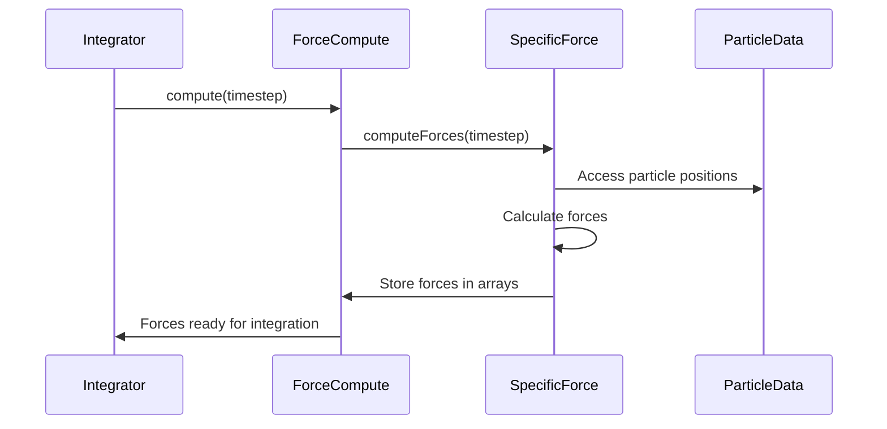

Forces and constraints are fundamental components in molecular dynamics simulations that govern particle behavior and interactions. In HOOMD-blue, these are implemented through a well-structured hierarchy that provides both flexibility and performance. Let's explore how forces and constraints work together to create realistic simulations.

## Understanding the Force Architecture

At the core of HOOMD-blue's force system is the `ForceCompute` base class, which serves as the foundation for all force calculations in the simulation. This class handles the storage and management of force-related data including forces, energies, virials, and torques for each particle in the system.

The `ForceCompute` class provides several key arrays for storing particle data:
- **Force array**: Stores the x, y, z components of force and potential energy for each particle
- **Virial array**: Stores the per-particle virial as a 6-component upper triangular matrix
- **Torque array**: Stores torque components for each particle (important for rotational degrees of freedom)

```cpp
// Key data structures in ForceCompute
GPUArray<Scalar4> m_force;  // Forces and potential energies
GPUArray<Scalar> m_virial;  // Virial components
GPUArray<Scalar4> m_torque; // Torques
```

The class provides a pure virtual method `computeForces(uint64_t timestep)` that all specific force implementations must override. This method is called when forces need to be recalculated during the simulation.

Sources: [ForceCompute.h#L207-L218](hoomd/ForceCompute.h#L207-L218), [ForceCompute.h#L237-L242](hoomd/ForceCompute.h#L237-L242)

## Force Types in HOOMD-blue

HOOMD-blue organizes forces into several categories based on their physical nature and implementation:

### 1. Pair Forces (Non-bonded Interactions)
Pair forces calculate interactions between all pairs of particles within a certain cutoff distance. These include Lennard-Jones potentials, Coulomb interactions, and other short-range forces. The system uses neighbor lists to efficiently compute these interactions without checking every possible particle pair.

### 2. Bonded Forces
Bonded forces act between particles that are explicitly connected through bonds, angles, or dihedrals:
- **Bonds**: Connect two particles (e.g., covalent bonds)
- **Angles**: Involve three particles in a bonded angle
- **Dihedrals**: Involve four particles in a torsional angle

### 3. External Forces
External forces apply fields or potentials to particles based on their position in space, such as gravity, electric fields, or wall potentials.

### 4. Constraint Forces
Constraint forces maintain specific geometric relationships between particles, such as fixed distances or angles. These are handled differently from regular forces because they reduce the degrees of freedom in the system.

Sources: [hoomd/md/__init__.py#L21-L42](hoomd/md/__init__.py#L21-L42)

## The Constraint System

Constraints in HOOMD-blue are implemented through the `ForceConstraint` base class, which extends `ForceCompute` with additional functionality specific to constraint handling. The key difference between regular forces and constraints is that constraints remove degrees of freedom from the system.

```cpp
class ForceConstraint : public ForceCompute
{
public:
    // Return the number of DOF removed by this constraint
    virtual Scalar getNDOFRemoved(std::shared_ptr<ParticleGroup> query)
    {
        return 0;
    }
    
protected:
    virtual void computeForces(uint64_t timestep);
};
```

The `getNDOFRemoved()` method is crucial for thermodynamic calculations, as it tells the system how many degrees of freedom have been removed by the constraint. This affects temperature calculations and other statistical mechanical properties.

Sources: [ForceConstraint.h#L27-L45](hoomd/ForceConstraint.h#L27-L45)

## Force Computation Workflow

The force computation process in HOOMD-blue follows a well-defined sequence that ensures all forces are calculated correctly and efficiently:



1. **Initialization**: The integrator calls the `compute()` method on all force objects
2. **Force Calculation**: Each force object implements `computeForces()` to calculate its specific contribution
3. **Data Access**: Forces access particle data (positions, velocities, etc.) through the `ParticleData` system
4. **Storage**: Calculated forces are stored in the GPU arrays for efficient access
5. **Integration**: The integrator uses the total forces to update particle positions and velocities

Sources: [ForceCompute.h#L75-L76](hoomd/ForceCompute.h#L75-L76)

## Memory Management and GPU Acceleration

HOOMD-blue uses sophisticated memory management to handle force data efficiently:

```cpp
// Arrays are stored on GPU for fast access
GPUArray<Scalar4> m_force;
GPUArray<Scalar> m_virial;
GPUArray<Scalar4> m_torque;
```

The `GPUArray` template class automatically handles data transfer between CPU and GPU memory, allowing the same code to work on both architectures. For performance-critical force calculations, HOOMD-blue provides GPU implementations that can calculate forces orders of magnitude faster than CPU versions.

The system also includes the `LocalForceComputeData` class, which provides zero-copy access to force data from Python, allowing for efficient analysis and visualization without unnecessary data copying.

Sources: [ForceCompute.h#L207-L218](hoomd/ForceCompute.h#L207-L218), [ForceCompute.h#L248-L259](hoomd/ForceCompute.h#L248-L259)

## Implementing Custom Forces

Creating custom forces in HOOMD-blue involves extending the `ForceCompute` class:

```cpp
class MyCustomForce : public ForceCompute
{
public:
    MyCustomForce(std::shared_ptr<SystemDefinition> sysdef) 
        : ForceCompute(sysdef) {}
    
protected:
    virtual void computeForces(uint64_t timestep)
    {
        // Access particle data
        ArrayHandle<Scalar4> h_pos(m_pdata->getPositions(), 
                                   access_location::host, 
                                   access_mode::read);
        
        // Calculate forces based on particle positions
        // Store results in m_force, m_virial, etc.
    }
};
```

The key steps are:
1. Inherit from `ForceCompute`
2. Implement the `computeForces()` method
3. Access particle data through the `ParticleData` system
4. Store results in the appropriate arrays

> [!TIP]
> When implementing custom forces, always use the `ArrayHandle` class to access particle data. This ensures proper memory management and works seamlessly with both CPU and GPU execution modes.

Sources: [ForceCompute.h#L237-L242](hoomd/ForceCompute.h#L237-L242)

## Energy and Virial Calculations

Forces in HOOMD-blue don't just compute forces—they also calculate energies and virials for thermodynamic analysis:

```cpp
// Access computed energies and forces
Scalar total_energy = force_compute->calcEnergySum();
vec3<double> total_force = force_compute->calcForceGroup(group);
std::vector<Scalar> virial = force_compute->calcVirialGroup(group);
```

The system provides methods to:
- Calculate total potential energy
- Sum forces for specific particle groups
- Compute virial contributions for pressure calculations
- Access per-particle quantities for detailed analysis

These quantities are essential for monitoring simulation progress, calculating thermodynamic properties, and validating simulation results.

Sources: [ForceCompute.h#L78-L88](hoomd/ForceCompute.h#L78-L88)

## Parallel Computing Considerations

HOOMD-blue is designed to work efficiently in parallel computing environments:

```cpp
#ifdef ENABLE_MPI
    virtual CommFlags getRequestedCommFlags(uint64_t timestep)
    {
        CommFlags flags(0);
        flags[comm_flag::position] = 1;
        flags[comm_flag::net_force] = 1;
        return flags;
    }
#endif
```

In MPI simulations:
- Forces can request specific particle data to be communicated between processors
- The `preCompute()` method allows overlapping computation with communication
- Forces are properly summed across processor boundaries

This design ensures that force calculations scale efficiently to thousands of processors, enabling large-scale simulations of complex systems.

Sources: [ForceCompute.h#L157-L167](hoomd/ForceCompute.h#L157-L167), [ForceCompute.h#L68-L72](hoomd/ForceCompute.h#L68-L72)

## Conclusion

The force and constraint system in HOOMD-blue represents a sophisticated architecture that balances flexibility, performance, and ease of use. By providing a clear hierarchy of base classes and efficient memory management, it enables researchers to implement complex molecular dynamics simulations while maintaining high performance on both CPU and GPU architectures.

Whether you're using built-in force fields or implementing custom interactions, understanding this architecture will help you create more effective and efficient simulations. The modular design allows for easy extension and customization, making HOOMD-blue a powerful tool for molecular dynamics research.